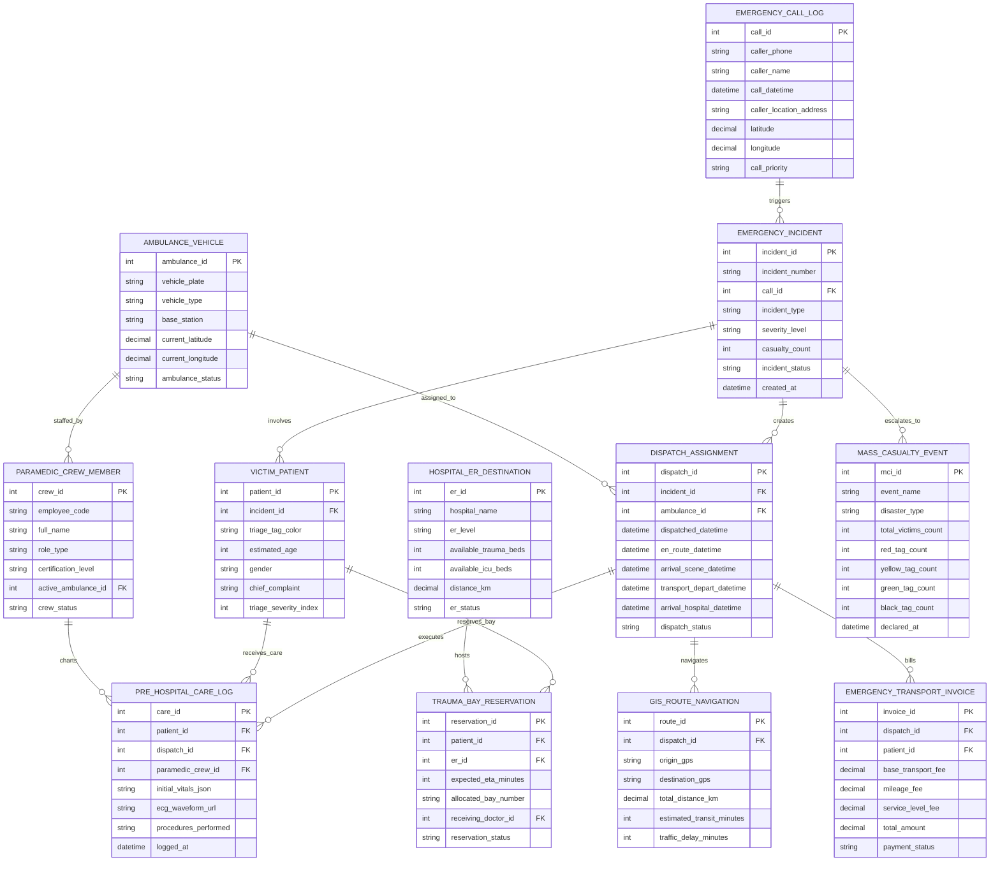

# Conceptual ERD — Emergency Response Management System

## Mermaid Code

## Entity Description Table | Bảng mô tả Entity

| # | Entity Name | Vietnamese Name | Description | Key Attributes | Main Relationships |
|---|-------------|-----------------|-------------|----------------|-------------------|
| 1 | EMERGENCY_CALL_LOG | Nhật ký Cuộc gọi 115 | 115 emergency telephone call log storing caller phone, caller name, call datetime, location address, GPS pin, and priority. | call_id, caller_phone, caller_name, call_datetime, caller_location_address, latitude, longitude, call_priority | Has many EMERGENCY_INCIDENT entities. |
| 2 | EMERGENCY_INCIDENT | Sự cố Cap cứu Master | Core CAD emergency incident record tracking incident number, type (Cardiac, Trauma, Crash), severity level, casualty count, and status. | incident_id, incident_number, call_id, incident_type, severity_level, casualty_count, incident_status | Belongs to EMERGENCY_CALL_LOG; Has many DISPATCH_ASSIGNMENT, VICTIM_PATIENT, and MASS_CASUALTY_EVENT. |
| 3 | AMBULANCE_VEHICLE | Xe Cấp cứu 115 | Ambulance vehicle master record (ALS / BLS) tracking vehicle plate number, type, base station, real-time GPS coordinates, and status. | ambulance_id, vehicle_plate, vehicle_type, base_station, current_latitude, current_longitude, ambulance_status | Has many DISPATCH_ASSIGNMENT and PARAMEDIC_CREW_MEMBER entities. |
| 4 | PARAMEDIC_CREW_MEMBER | Kíp Cấp cứu Paramedic | Paramedic and EMT crew member record tracking employee code, name, role (Lead Paramedic, EMT Driver), and certification level. | crew_id, employee_code, full_name, role_type, certification_level, active_ambulance_id, crew_status | Belongs to AMBULANCE_VEHICLE; Has many PRE_HOSPITAL_CARE_LOG entities. |
| 5 | DISPATCH_ASSIGNMENT | Lệnh Điều xe Cấp cứu | CAD vehicle dispatch log tracking dispatch timestamps (En Route, Arrived Scene, Transport Depart, Arrived Hospital) and status. | dispatch_id, incident_id, ambulance_id, dispatched_datetime, arrival_scene_datetime, arrival_hospital_datetime | Belongs to EMERGENCY_INCIDENT and AMBULANCE_VEHICLE; Has PRE_HOSPITAL_CARE_LOG, GIS_ROUTE_NAVIGATION, etc. |
| 6 | VICTIM_PATIENT | Nạn nhân / Bệnh nhân Cấp cứu | Emergency victim patient record storing START triage tag color (Red, Yellow, Green, Black), estimated age, gender, and complaint. | patient_id, incident_id, triage_tag_color, estimated_age, gender, chief_complaint, triage_severity_index | Belongs to EMERGENCY_INCIDENT; Has many PRE_HOSPITAL_CARE_LOG and TRAUMA_BAY_RESERVATION entities. |
| 7 | PRE_HOSPITAL_CARE_LOG | Phiếu Cấp cứu Ngoại viện | Electronic Patient Care Record (ePCR) charting in-transit vitals JSON, 12-lead ECG waveform URL, procedures performed, and logged at. | care_id, patient_id, dispatch_id, paramedic_crew_id, initial_vitals_json, ecg_waveform_url, procedures_performed | Belongs to DISPATCH_ASSIGNMENT, VICTIM_PATIENT, and PARAMEDIC_CREW_MEMBER. |
| 8 | HOSPITAL_ER_DESTINATION | Bệnh viện Tiệp nhận ER | Receiving hospital emergency department entry tracking ER name, trauma level (Level 1-3), available trauma beds, ICU beds, and status. | er_id, hospital_name, er_level, available_trauma_beds, available_icu_beds, distance_km, er_status | Has many TRAUMA_BAY_RESERVATION entities. |
| 9 | TRAUMA_BAY_RESERVATION | Đặt chỗ Buồng Cấp cứu ER | Hospital ER trauma bay reservation record tracking expected ETA countdown, allocated bay number, receiving doctor ID, and status. | reservation_id, patient_id, er_id, expected_eta_minutes, allocated_bay_number, receiving_doctor_id, reservation_status | Belongs to VICTIM_PATIENT and HOSPITAL_ER_DESTINATION. |
| 10 | MASS_CASUALTY_EVENT | Thảm họa Hàng loạt (MCI) | Mass Casualty Incident (MCI) disaster record tracking event name, disaster type, total victims count, and Red/Yellow/Green/Black tag tallies. | mci_id, event_name, disaster_type, total_victims_count, red_tag_count, yellow_tag_count, declared_at | Belongs to EMERGENCY_INCIDENT. |
| 11 | GIS_ROUTE_NAVIGATION | Nhật ký Định tuyến GIS | GIS navigation log tracking dispatch origin/destination GPS coordinates, total distance km, estimated transit minutes, and traffic delays. | route_id, dispatch_id, origin_gps, destination_gps, total_distance_km, estimated_transit_minutes, traffic_delay_minutes | Belongs to DISPATCH_ASSIGNMENT. |
| 12 | EMERGENCY_TRANSPORT_INVOICE | Hóa đơn Vận chuyển Cấp cứu | Emergency ambulance transport billing record calculating base transport fee, mileage fee, ALS/BLS service level fee, and payment status. | invoice_id, dispatch_id, patient_id, base_transport_fee, mileage_fee, service_level_fee, total_amount | Belongs to DISPATCH_ASSIGNMENT and VICTIM_PATIENT. |

## Relationship Description | Mô tả Quan hệ

| # | From Entity | Cardinality | To Entity | Relationship Label | Business Explanation |
|---|-------------|-------------|-----------|-------------------|----------------------|
| 1 | EMERGENCY_CALL_LOG | one-to-many | EMERGENCY_INCIDENT | triggers | One 115 emergency telephone call triggers an active CAD emergency incident. |
| 2 | EMERGENCY_INCIDENT | one-to-many | DISPATCH_ASSIGNMENT | creates | One emergency incident creates one or more ambulance dispatch assignments. |
| 3 | EMERGENCY_INCIDENT | one-to-many | VICTIM_PATIENT | involves | One emergency incident involves one or more victim patients. |
| 4 | EMERGENCY_INCIDENT | one-to-many | MASS_CASUALTY_EVENT | escalates_to | One major emergency incident escalates to a Mass Casualty Incident (MCI) disaster. |
| 5 | AMBULANCE_VEHICLE | one-to-many | DISPATCH_ASSIGNMENT | assigned_to | One ambulance vehicle is assigned to CAD emergency dispatches. |
| 6 | AMBULANCE_VEHICLE | one-to-many | PARAMEDIC_CREW_MEMBER | staffed_by | One ambulance vehicle is staffed by active paramedic and EMT crew members. |
| 7 | DISPATCH_ASSIGNMENT | one-to-many | PRE_HOSPITAL_CARE_LOG | executes | One ambulance dispatch assignment executes pre-hospital care charting. |
| 8 | DISPATCH_ASSIGNMENT | one-to-many | GIS_ROUTE_NAVIGATION | navigates | One ambulance dispatch assignment navigates optimized GIS travel routes. |
| 9 | DISPATCH_ASSIGNMENT | one-to-many | EMERGENCY_TRANSPORT_INVOICE | bills | One completed ambulance dispatch assignment bills transport fees. |
| 10 | VICTIM_PATIENT | one-to-many | PRE_HOSPITAL_CARE_LOG | receives_care | One victim patient receives pre-hospital emergency care and vitals charting. |
| 11 | VICTIM_PATIENT | one-to-many | TRAUMA_BAY_RESERVATION | reserves_bay | One critical victim patient reserves a receiving hospital ER trauma bay. |
| 12 | HOSPITAL_ER_DESTINATION | one-to-many | TRAUMA_BAY_RESERVATION | hosts | One receiving hospital emergency department hosts trauma bay reservations. |
| 13 | PARAMEDIC_CREW_MEMBER | one-to-many | PRE_HOSPITAL_CARE_LOG | charts | One paramedic crew member charts pre-hospital clinical ePCR records. |
