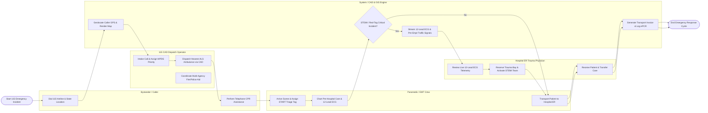

# Swimlane Diagram — Emergency Response Management System

## Mermaid Code

## Flow Description | Mô tả luồng

| Lane | Actor / Subsystem | Role in Flow |
|------|-------------------|--------------|
| 1 | Bystander / Caller | Dials 115 emergency hotline, provides incident location and victim details, and receives telephone-assisted CPR guidance. |
| 2 | 115 CAD Dispatch Operator | Intakes 115 calls, calculates MPDS triage priority codes, dispatches optimal ALS/BLS ambulances via CAD, and coordinates fire/police mutual aid. |
| 3 | Paramedic / EMT Crew | Responds to dispatch, performs START triage tagging on scene, charts pre-hospital ePCR notes, transmits 12-lead ECGs, and transports victims. |
| 4 | Hospital ER Trauma Physician | Reviews real-time 12-lead ECG telemetry, activates STEMI/trauma teams, reserves ER trauma bays, and receives patient hand-off. |
| 5 | System / CAD & GIS Engine | Geolocates caller GPS pins, calculates ambulance proximity routes, streams cardiac telemetry, preempts traffic signals, and bills transport fees. |
