# Action Tree — Emergency Response Management System

## Mermaid Code

```mermaid
graph TD
    Root["Emergency Response Management System"]

    Root --> M1["115 Call Intake & Geolocation"]
    Root --> M2["Computer-Aided Dispatch CAD"]
    Root --> M3["Pre-Hospital START Triage"]
    Root --> M4["12-Lead ECG & Telemetry"]
    Root --> M5["ER Trauma Bay Reservation"]
    Root --> M6["Mass Casualty Incident MCI"]
    Root --> M7["GIS Traffic & Navigation"]
    Root --> M8["Transport Billing & QA Audit"]

    M1 --> A11["Parse Caller Mobile GPS & Cell Pin"]
    M1 --> A12["Execute MPDS Triage Questionnaire"]
    M1 --> A13["Assign Priority 1 to 4 Echo Code"]
    M1 --> A14["Provide Dispatcher Telephone CPR"]

    M2 --> A21["Recommend Nearest ALS BLS Unit"]
    M2 --> A22["Transmit Dispatch CAD Order to MDT"]
    M2 --> A23["Track Chute & Travel Time Timers"]
    M2 --> A24["Reassign Move-Up Fleet Stations"]

    M3 --> A31["Assign START Triage Color Tag"]
    M3 --> A32["Chart Mobile Vitals & Airway Notes"]
    M3 --> A33["Log IV Medication & CPR Shocks"]
    M3 --> A34["Require Dual Signature Narcotics"]

    M4 --> A41["Acquire 12-Lead Cardiac ECG Waveform"]
    M4 --> A42["Stream Real-Time Telemetry to ER"]
    M4 --> A43["Trigger High-Priority STEMI Alert"]
    M4 --> A44["Receive Online Medical Direct Orders"]

    M5 --> A51["Check ER Trauma Bed Availability"]
    M5 --> A52["Reserve Allocated ER Trauma Bay"]
    M5 --> A53["Update Ambulance Arrival Countdown"]
    M5 --> A54["Synchronize ePCR to Hospital EHR"]

    M6 --> A61["Declare Level 3 Disaster MCI Event"]
    M6 --> A62["Dispatch Multi-Agency Fire Police Aid"]
    M6 --> A63["Track Red Yellow Green Tag Counts"]
    M6 --> A64["Optimize Regional Hospital Distribution"]

    M7 --> A71["Calculate Fastest GIS Ambulance Route"]
    M7 --> A72["Trigger Green-Wave Traffic Signals"]
    M7 --> A73["Reroute Around Live Traffic Closures"]
    M7 --> A74["Guide Turn-by-Turn Mobile Navigation"]

    M8 --> A81["Calculate Base & Mileage Transport Fees"]
    M8 --> A82["Submit Emergency Health Insurance Claims"]
    M8 --> A83["Audit Chute Scene & Transport Times"]
    M8 --> A84["Export National EMS Call Analytics"]
```

## Module Description | Mô tả Module

| # | Module | Description | Actions |
|---|--------|-------------|---------|
| 1 | 115 Call Intake & Geolocation | Ingests 115 calls, parses caller mobile GPS coordinates, executes MPDS triage questionnaires, and provides telephone CPR instructions. | Parse Caller Mobile GPS & Cell Pin, Execute MPDS Triage Questionnaire, Assign Priority 1 to 4 Echo Code, Provide Dispatcher Telephone CPR |
| 2 | Computer-Aided Dispatch CAD | Recommends nearest ALS/BLS ambulances by GPS proximity, transmits dispatch orders to vehicle terminals, and monitors response timers. | Recommend Nearest ALS BLS Unit, Transmit Dispatch CAD Order to MDT, Track Chute & Travel Time Timers, Reassign Move-Up Fleet Stations |
| 3 | Pre-Hospital START Triage | Conducts START triage tagging (Red/Yellow/Green/Black), charts pre-hospital vitals and airway notes, and logs controlled narcotics. | Assign START Triage Color Tag, Chart Mobile Vitals & Airway Notes, Log IV Medication & CPR Shocks, Require Dual Signature Narcotics |
| 4 | 12-Lead ECG & Telemetry | Acquires 12-lead ECG waveforms, streams telemetry to receiving hospital ERs, triggers STEMI alerts, and receives online medical orders. | Acquire 12-Lead Cardiac ECG Waveform, Stream Real-Time Telemetry to ER, Trigger High-Priority STEMI Alert, Receive Online Medical Direct Orders |
| 5 | ER Trauma Bay Reservation | Checks hospital ER bed availability, reserves trauma bays, displays incoming ambulance ETA countdowns, and syncs ePCR charts to EHRs. | Check ER Trauma Bed Availability, Reserve Allocated ER Trauma Bay, Update Ambulance Arrival Countdown, Synchronize ePCR to Hospital EHR |
| 6 | Mass Casualty Incident MCI | Declares disaster MCI events, dispatches multi-agency fire/police aid, tracks START victim counts, and optimizes hospital distribution. | Declare Level 3 Disaster MCI Event, Dispatch Multi-Agency Fire Police Aid, Track Red Yellow Green Tag Counts, Optimize Regional Hospital Distribution |
| 7 | GIS Traffic & Navigation | Calculates optimal ambulance routes, triggers green-wave traffic signal preemption, reroutes around traffic jams, and provides navigation. | Calculate Fastest GIS Ambulance Route, Trigger Green-Wave Traffic Signals, Reroute Around Live Traffic Closures, Guide Turn-by-Turn Mobile Navigation |
| 8 | Transport Billing & QA Audit | Calculates transport base and mileage fees, submits health insurance claims, audits EMS response time benchmarks, and exports analytics. | Calculate Base & Mileage Transport Fees, Submit Emergency Health Insurance Claims, Audit Chute Scene & Transport Times, Export National EMS Call Analytics |
