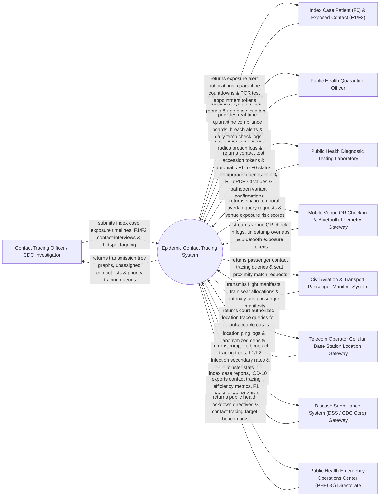

# Context Diagram — Epidemic Contact Tracing System

## Mermaid Code

## Actor & Interaction Table | Bảng Actor & Tương tác

| # | Actor | Actor Type | Data Sent TO System | Data Received FROM System | Notes |
|---|-------|------------|---------------------|---------------------------|-------|
| 1 | Contact Tracing Officer / CDC Investigator | Primary | Index Case (F0) exposure timelines, F1/F2 contact interview notes, hotspot location tags. | Transmission tree graphs, unassigned contact lists, priority tracing queues. | Public health investigator conducting contact interviews and tracing exposure chains. |
| 2 | Index Case Patient (F0) & Exposed Contact (F1/F2) | Primary | Daily temperature check-ins, symptom self-reports, geofence GPS location pings. | Exposure alert notifications, quarantine countdown timers, PCR test appointment tokens. | Individual identified as an Index Case (F0), Direct Close Contact (F1), or Secondary Contact (F2). |
| 3 | Public Health Quarantine Officer | Primary | Quarantine site assignments (Home vs Facility), geofence breach logs, quarantine release sign-offs. | Real-time quarantine compliance boards, geofence breach alerts, daily temperature logs. | Officer monitoring home or facility quarantine adherence and symptom check-ins. |
| 4 | Public Health Diagnostic Testing Laboratory | Primary | PCR test results, RT-qPCR Ct values, pathogen strain variant confirmations. | Contact test accession tokens, automatic F1-to-F0 status upgrade triggers. | Laboratory testing contact samples to confirm or exclude infection status. |
| 5 | Mobile Venue QR Check-in & Bluetooth Telemetry Gateway | Supporting System | Venue QR check-in logs, timestamp overlap data, Bluetooth Exposure Notification (GAEN) tokens. | Spatio-temporal overlap query requests, venue exposure risk scores. | National mobile contact tracing app gateway (Zalo, PC-COVID, VNeID) capturing venue check-ins. |
| 6 | Civil Aviation & Transport Passenger Manifest System | Supporting System | Commercial flight passenger manifests, train seat allocations, intercity bus passenger lists. | Passenger contact tracing queries, seat proximity match requests (same row ± 2 rows). | Transport authority system providing passenger manifests for long-distance travel tracing. |
| 7 | Telecom Operator Cellular Base Station Location Gateway | Supporting System | Cell tower location ping logs, anonymized population density movement pings. | Court-authorized location trace queries for untraceable high-risk index cases. | Telecommunications operator providing cell tower pings under emergency public health authorizations. |
| 8 | Disease Surveillance System (DSS / CDC Core) Gateway | Supporting System | Confirmed F0 Index Case notifications, primary ICD-10 diagnosis, lab confirmation flags. | Completed contact tracing trees, F1/F2 secondary infection rates, cluster stats. | Core national CDC surveillance system feeding confirmed index case reports into ECTS. |
| 9 | Public Health Emergency Operations Center (PHEOC) Directorate | Regulatory | Emergency contact tracing mandates, target tracing SLA hours (e.g., F1 within 12 hours). | Contact tracing efficiency metrics, F1 identification SLA completion %, quarantine counts. | Executive health authority directing epidemic containment and contact tracing policies. |

## System Boundary Description | Mô tả Phạm vi Hệ thống

The **Epidemic Contact Tracing System (ECTS)** is a specialized public health emergency and epidemiological contact management platform engineered for Centers for Disease Control (CDC), public health departments, quarantine facilities, and mobile contact tracing response units. It manages Index Case (F0) exposure timeline mapping, multi-tiered contact categorization (F0 -> F1 Direct Contact -> F2 Secondary Contact), spatio-temporal venue QR check-in overlap matching, passenger transport manifest tracing, automated Zalo/SMS exposure alerts, geofenced quarantine monitoring, and transmission tree visualization.

**Inside System Scope:**
- Index Case (F0) exposure timeline mapping and infectious window calculation (e.g., 48 hours prior to symptom onset).
- Multi-tiered contact identification, classification, and risk scoring (F0 Index, F1 Direct Contact, F2 Secondary Contact).
- Multi-source contact ingestion (Field interviews, venue QR check-ins, transport manifests, Bluetooth tokens).
- Spatio-temporal overlap matching engine (identifying individuals present at the same venue/time as F0).
- Automated exposure notifications, Zalo push alerts, SMS notifications, and PCR test appointment generation.
- Home and facility quarantine monitoring, daily temperature/symptom check-ins, and geofence breach alerts.
- Automatic contact status cascading (upgrading F1 to F0 upon positive PCR result, auto-converting F2 to F1).
- Outbreak transmission tree graph rendering, secondary attack rate calculation, and PHEOC analytics.

**Outside System Scope:**
- Inpatient hospital ward clinical treatment of severe COVID-19/Ebola patients (handled by HIS / Inpatient).
- Physical police enforcement of quarantine checkpoints (handled by municipal law enforcement).
- Physical laboratory execution of PCR thermocycling (handled by laboratory hardware).
- Commercial corporate financial general ledger accounting (handled by enterprise ERP).
