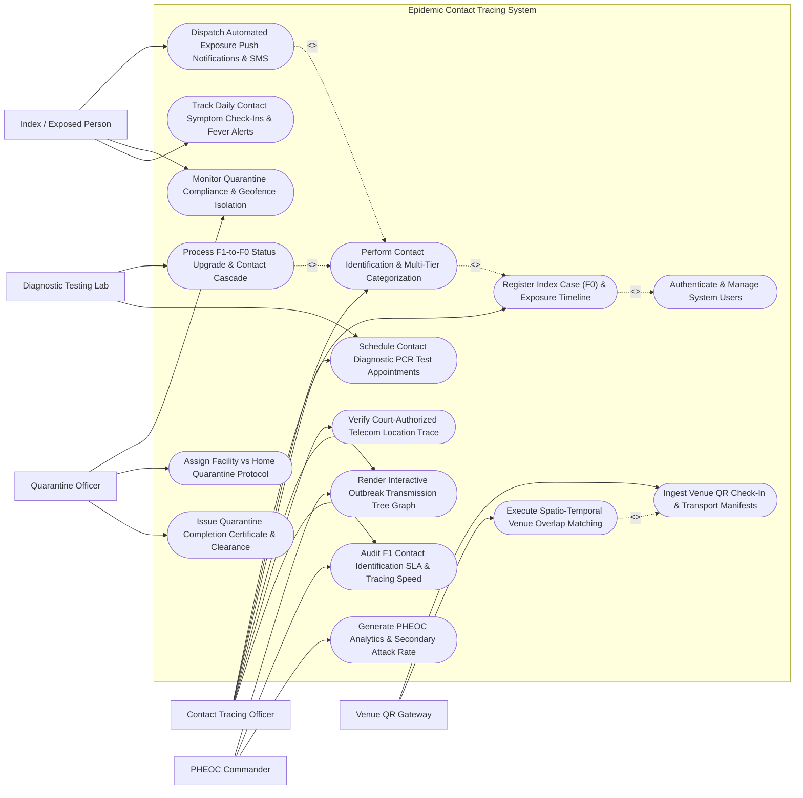

# Use Case Diagram — Epidemic Contact Tracing System

## Mermaid Code

## Actor Table | Bảng Actor

| # | Actor | Actor Type | Role Description | Related Use Cases |
|---|-------|------------|------------------|-------------------|
| 1 | Contact Tracing Officer | Primary | CDC investigator conducting patient interviews, mapping exposure timelines, categorizing F1/F2 contacts, and building transmission trees. | UC01, UC02, UC08, UC09, UC12, UC14 |
| 2 | Index / Exposed Person | Primary | Patient (F0) or exposed contact (F1/F2) receiving exposure alerts, logging daily temperature check-ins, and honoring quarantine rules. | UC04, UC05, UC10 |
| 3 | Quarantine Officer | Primary | Public health officer managing home/facility quarantine sites, enforcing geofence isolation rules, and issuing clearance certificates. | UC05, UC11, UC13 |
| 4 | Diagnostic Testing Lab | Secondary / System | Diagnostic reference lab uploading PCR test results and triggering automatic F1-to-F0 status upgrades. | UC06, UC08 |
| 5 | PHEOC Commander | Secondary / System | Public Health Emergency Operations Center director analyzing transmission trees, secondary attack rates, and tracing SLA metrics. | UC09, UC14, UC15 |
| 6 | Venue QR Gateway | Secondary / System | National mobile check-in app gateway streaming venue QR check-in logs and timestamp overlaps. | UC03, UC07 |

## Use Case Table | Bảng Use Case

| # | UC ID | Use Case Name | Primary Actor | Secondary Actor | Description | Priority |
|---|-------|---------------|---------------|-----------------|-------------|----------|
| 1 | UC01 | Register Index Case (F0) & Exposure Timeline | Contact Tracing Officer | None | Register confirmed F0 Index Case, input symptom onset date, and map infectious period exposure timeline (locations, dates, times). | High |
| 2 | UC02 | Perform Contact Identification & Multi-Tier Categorization | Contact Tracing Officer | None | Identify exposed individuals and categorize into risk tiers: F0 (Index), F1 (Direct Close Contact), F2 (Secondary Contact). | High |
| 3 | UC03 | Ingest Venue QR Check-In & Transport Manifests | Venue QR Gateway | Contact Tracing Officer | Ingest digital venue QR check-in logs, flight manifests, and train seat allocations to identify individuals sharing spatial-temporal space. | High |
| 4 | UC04 | Dispatch Automated Exposure Push Notifications & SMS | Index / Exposed Person | None | Send urgent push alerts (Zalo/SMS/App) to identified F1/F2 contacts, detailing exposure risk, instructions, and quarantine orders. | High |
| 5 | UC05 | Monitor Quarantine Compliance & Geofence Isolation | Quarantine Officer | Index / Exposed Person | Track home or facility quarantine compliance using mobile GPS geofencing, logging radius breaches (> 50m) and alerting officers. | High |
| 6 | UC06 | Process F1-to-F0 Status Upgrade & Contact Cascade | Diagnostic Testing Lab | Contact Tracing Officer | Automatically upgrade an F1 contact to F0 status upon positive PCR test result, triggering automated conversion of linked F2s to F1s. | High |
| 7 | UC07 | Execute Spatio-Temporal Venue Overlap Matching | Venue QR Gateway | None | Run automated spatio-temporal algorithms matching F0 visit timestamps against public venue check-ins to flag exposed populations. | High |
| 8 | UC08 | Schedule Contact Diagnostic PCR Test Appointments | Contact Tracing Officer | Diagnostic Testing Lab | Generate mandatory PCR test appointment tokens (Day 1, Day 7, Day 14) for F1 contacts, dispatching location barcodes. | High |
| 9 | UC09 | Render Interactive Outbreak Transmission Tree Graph | Contact Tracing Officer | PHEOC Commander | Renders dynamic directed transmission graph nodes (F0 -> F1 -> F2) showing generation lines, exposure locations, and cluster roots. | High |
| 10 | UC10 | Track Daily Contact Symptom Check-Ins & Fever Alerts | Index / Exposed Person | None | Ingest daily self-reported temperature readings and symptoms (cough, loss of taste/smell), triggering fever alerts (> 37.5°C). | High |
| 11 | UC11 | Assign Facility vs Home Quarantine Protocol | Quarantine Officer | None | Evaluate contact vulnerability and risk score to assign centralized facility quarantine (high-risk F1) vs home isolation (low-risk F2). | Medium |
| 12 | UC12 | Verify Court-Authorized Telecom Location Trace | Contact Tracing Officer | None | Ingest court-authorized cellular base station pings for untraceable high-risk index cases who refuse interview cooperation. | Medium |
| 13 | UC13 | Issue Quarantine Completion Certificate & Clearance | Quarantine Officer | None | Issue official digital Quarantine Clearance Certificate after 14 days of compliance and 3 negative PCR test results. | High |
| 14 | UC14 | Audit F1 Contact Identification SLA & Tracing Speed | Contact Tracing Officer | PHEOC Commander | Audit contact tracing performance against statutory SLAs: target 100% of F1 contacts identified and isolated within 12 hours. | Medium |
| 15 | UC15 | Generate PHEOC Analytics & Secondary Attack Rate | PHEOC Commander | None | Calculate epidemic metrics: Secondary Attack Rate (SAR %), F1-to-F0 conversion rate, cluster growth velocity, and $R_t$ impact. | Medium |
| 16 | UC16 | Authenticate & Manage System Users | All Users | None | Enforce multi-factor authentication, role-based access control (Tracer, Quarantine Officer, Director), and strict privacy safeguards. | High |

## Use Case Specification | Đặc tả Use Case

---

### UC01 — Register Index Case (F0) & Exposure Timeline

| Field | Detail |
|-------|--------|
| **UC ID** | UC01 |
| **Use Case Name** | Register Index Case (F0) & Exposure Timeline |
| **Actor(s)** | Primary: Contact Tracing Officer |
| **Description** | Registers a laboratory-confirmed Index Case (F0 patient), inputs symptom onset date, calculates the infectious window (e.g., 48 hours prior to symptom onset to isolation date), and logs a detailed chronological exposure timeline of all visited locations, transport trips, and social gatherings. |
| **Precondition** | 1. A confirmed positive PCR test report is received from Disease Surveillance System (DSS).   2. The Contact Tracing Officer is authenticated in ECTS. |
| **Main Flow** | 1. The Tracing Officer opens "New Index Case (F0) Intake" in ECTS.   2. The Officer enters F0 Patient Identity: National ID (CCCD `034088001234`), Full Name (Nguyen Van A), Age (34), Mobile Number (`0912345678`), and Residential Address.   3. The Officer enters Clinical Disease Parameters:   &nbsp;&nbsp;&nbsp;&nbsp;- Disease Code: `COVID-19 Omicron Variant (ICD-10 U07.1)`   &nbsp;&nbsp;&nbsp;&nbsp;- Symptom Onset Date: October 12, 2026 (Fever 38.2°C, Sore Throat)   &nbsp;&nbsp;&nbsp;&nbsp;- PCR Confirmation Date: October 14, 2026 (Ct Value = 18.2 - High Viral Load)   &nbsp;&nbsp;&nbsp;&nbsp;- Isolation Date: October 14, 2026 at 10:00 AM.   4. The System auto-calculates the **Infectious Window**: October 10, 2026 00:00 AM to October 14, 2026 10:00 AM (48 hours prior to onset through isolation).   5. The Officer maps the **Chronological Exposure Timeline** during the infectious window:   &nbsp;&nbsp;&nbsp;&nbsp;- *Oct 10 (08:00 - 17:00)*: Workplace — ABC Tech Office (Floor 5, 120 Le Loi St)   &nbsp;&nbsp;&nbsp;&nbsp;- *Oct 10 (18:30 - 20:30)*: Restaurant — Highland Coffee (24 Nguyen Hue St)   &nbsp;&nbsp;&nbsp;&nbsp;- *Oct 11 (09:00 - 11:30)*: Transport — Flight VN-218 (Hanoi to HCM, Seat 12C)   &nbsp;&nbsp;&nbsp;&nbsp;- *Oct 12 (19:00 - 21:00)*: Fitness Gym — California Fitness (District 1).   6. The System registers Index Case ID `F0-2026-08192`, pins exposure locations on the GIS Spatio-Temporal Map, and queues venue check-in overlap matching (UC03 / UC07). |
| **Alternative Flow** | **AF1** — Asymptomatic Index Case Timeline Calculation: For an asymptomatic F0 patient discovered via random screening, the System auto-calculates the infectious window as 7 days prior to the positive PCR sample collection date.   **AF2** — Automated EMR Travel History Import: The System imports self-reported travel history logs submitted by the patient on their mobile app prior to interview. |
| **Exception Flow** | **EX1** — Uncooperative Patient / Timeline Gaps (> 12 Hours Unaccounted): Patient refuses to account for 14 hours on Oct 11; the System flags "Timeline Gap Warning" and prompts court-authorized telecom location trace (UC12).   **EX2** — Duplicate F0 Index Registration: System detects Citizen ID is already registered under another CDC district, prompting case consolidation. |
| **Postcondition** | Index Case F0-2026-08192 is registered, infectious window (Oct 10-14) is defined, exposure timeline locations are pinned, and contact identification (UC02) is triggered. |
| **Business Rule** | **BR1**: The infectious window for symptomatic index cases MUST be calculated starting at least 48 hours prior to symptom onset date until isolation timestamp.   **BR2**: All visited public venues logged in the index case exposure timeline MUST record precise start and end timestamps. |

---

### UC02 — Perform Contact Identification & Multi-Tier Categorization

| Field | Detail |
|-------|--------|
| **UC ID** | UC02 |
| **Use Case Name** | Perform Contact Identification & Multi-Tier Categorization |
| **Actor(s)** | Primary: Contact Tracing Officer |
| **Description** | Identifies and categorizes exposed individuals into risk tiers based on proximity, duration, and environment of exposure to Index Case F0, assigning **F1 Direct Close Contact** (face-to-face < 2m for > 15 mins, household members, unmasked) and **F2 Secondary Contact** (contacts of F1). |
| **Precondition** | 1. Index Case F0 exposure timeline (UC01) is registered.   2. Field contact interview or venue overlap matching logs are loaded. |
| **Main Flow** | 1. The Tracing Officer opens "Contact Identification & Categorization Workspace" for Index Case `F0-2026-08192`.   2. The Officer reviews exposure locations and interviews F0 to identify contacts.   3. The Officer registers **F1 Direct Close Contacts (Tier 1)**:   &nbsp;&nbsp;&nbsp;&nbsp;- *Contact 1*: Spouse (Household contact, unmasked sleeping in same room) -> Assigned **F1**   &nbsp;&nbsp;&nbsp;&nbsp;- *Contact 2*: Co-worker sitting adjacent at desk (Floor 5 ABC Tech, < 1.5m for 8 hours) -> Assigned **F1**   &nbsp;&nbsp;&nbsp;&nbsp;- *Contact 3*: Flight VN-218 Seat 12B & 12D (Row 12 passengers) -> Assigned **F1**.   4. For each F1 contact, the System generates unique Contact ID (e.g., `F1-2026-99182`) and calculates **Exposure Risk Score**: `High Risk (Score 9.5 / 10)`.   5. The Officer queries F1 contacts to identify **F2 Secondary Contacts (Tier 2)**:   &nbsp;&nbsp;&nbsp;&nbsp;- *F1 Contact 2's Household*: Spouse and 2 Children living with F1 Co-worker -> Assigned **F2** (linked to F1 `F1-2026-99182`).   6. The System constructs the 3-tiered relationship links: `F0-2026-08192` -> `F1-2026-99182` -> `F2-2026-7701`.   7. The Officer saves categorization.   8. The System auto-triggers Exposure Push Notifications (UC04), mandatory PCR test scheduling for F1s (UC08), and Quarantine Protocol Assignment (UC11). |
| **Alternative Flow** | **AF1** — Mass Venue F1 Categorization via Overlap Engine: The System ingests Highland Coffee QR overlap logs (UC07); all 12 patrons present at table cluster #4 during F0's visit are auto-categorized as F1.   **AF2** — High-Risk Vulnerable F1 Tagging: F1 contact is a healthcare worker in an elderly nursing home; System flags "High-Risk Vulnerable Environment" for immediate facility isolation. |
| **Exception Flow** | **EX1** — Unverified Contact Phone Number: Entered phone number for an F1 is invalid; System flags "Untraced F1 Contact — Alert Local Police Tracing Team".   **EX2** — Incorrect Tier Categorization Conflict: Officer attempts to categorize a household member as F2; System flags error "Rule Violation — Household Contacts of F0 MUST be Categorized as F1". |
| **Postcondition** | Exposed contacts are categorized into F1 and F2 tiers, risk scores are assigned, 3-tiered transmission links are logged, and quarantine/testing workflows are initiated. |
| **Business Rule** | **BR1**: Household members and individuals with face-to-face exposure < 2 meters for > 15 minutes with an F0 MUST be categorized as F1 Direct Close Contacts.   **BR2**: Contacts of confirmed F1 individuals MUST be categorized as F2 Secondary Contacts and enrolled in health monitoring until F1 PCR test results are negative. |

---

### UC03 — Ingest Venue QR Check-In & Transport Manifests

| Field | Detail |
|-------|--------|
| **UC ID** | UC03 |
| **Use Case Name** | Ingest Venue QR Check-In & Transport Manifests |
| **Actor(s)** | Primary: Venue QR Gateway   Secondary: Contact Tracing Officer |
| **Description** | Ingests digital venue QR check-in logs (from national mobile tracing apps), commercial flight passenger manifests, train seat allocations, and intercity bus manifests, matching spatio-temporal overlap timestamps against Index Case F0 exposure timelines. |
| **Precondition** | 1. Index Case F0 exposure timeline (UC01) specifies visited public venues or transit trips.   2. National Venue Check-in Gateway API and Transport Manifest APIs are active. |
| **Main Flow** | 1. The **Spatio-Temporal Ingestion Engine** receives a query for Index Case `F0-2026-08192`'s visit to *Highland Coffee (24 Nguyen Hue St)* on *Oct 10, 2026 (18:30 - 20:30)*.   2. The System queries the **National Venue QR Check-In Gateway**:   &nbsp;&nbsp;&nbsp;&nbsp;- Fetches all QR check-in logs at Venue ID `VNU-HCM-09182` between 18:00 PM and 21:00 PM (including 30-min buffer window)   &nbsp;&nbsp;&nbsp;&nbsp;- Total Check-Ins Ingested: 48 Individual Check-In Logs.   3. The System queries the **Civil Aviation Transport Manifest API** for Flight `VN-218 (Oct 11, 2026)`:   &nbsp;&nbsp;&nbsp;&nbsp;- F0 Seat: `Seat 12C`   &nbsp;&nbsp;&nbsp;&nbsp;- Manifest Ingested: 180 Passengers (Identifies Row 10 to Row 14 = 30 Proximity Passengers).   4. The System runs **Spatial-Temporal Overlap Analysis**:   &nbsp;&nbsp;&nbsp;&nbsp;- *High-Risk Overlap (Table Area A)*: 6 Patrons present within 15 minutes of F0 -> Flagged for **F1 Categorization**   &nbsp;&nbsp;&nbsp;&nbsp;- *Medium-Risk Overlap (Same Floor)*: 42 Patrons -> Flagged for **F2 / Health Alert**.   5. The System outputs 48 Matched Person Records (National ID, Phone Number, Check-In Timestamp) to the Tracing Officer's queue (UC02). |
| **Alternative Flow** | **AF1** — Bluetooth Exposure Notification (GAEN) Token Match: The System ingests anonymized Bluetooth proximity tokens exchanged between smartphones within 2 meters for > 15 minutes, identifying 3 close contacts without venue QR check-ins.   **AF2** — Intercity Bus Ticket Scanner Ingestion: Ingests bus passenger ticket scans for a 4-hour highway bus ride, flagging all passengers sharing the enclosed bus as F1 contacts. |
| **Exception Flow** | **EX1** — Venue QR Check-In System API Downtime: If national QR gateway API is offline, System alerts Tracing Officer to request manual paper guestbook logs from venue management.   **EX2** — Transport Manifest Missing Seat Numbers: Flight manifest contains passenger names but no assigned seat numbers; System flags all 180 passengers for preliminary contact inquiry. |
| **Postcondition** | Venue QR check-in logs and transport manifests are ingested, spatio-temporal overlaps are computed, and matched populations are queued for contact categorization. |
| **Business Rule** | **BR1**: Venue QR check-in overlap queries MUST include a minimum 30-minute buffer before F0 arrival and 30-minute buffer after F0 departure.   **BR2**: Commercial flight contact tracing MUST automatically classify passengers seated in the same row, 2 rows ahead, and 2 rows behind the F0 index case as F1 contacts. |

---

### UC04 — Dispatch Automated Exposure Push Notifications & SMS

| Field | Detail |
|-------|--------|
| **UC ID** | UC04 |
| **Use Case Name** | Dispatch Automated Exposure Push Notifications & SMS |
| **Actor(s)** | Primary: Index / Exposed Person |
| **Description** | Dispatches automated, urgent exposure alert notifications via mobile app push (Zalo, PC-COVID, VNeID) and SMS to identified F1 and F2 contacts, providing exposure risk warnings, mandatory home isolation instructions, PCR test appointment barcodes, and emergency hotline numbers. |
| **Precondition** | 1. Exposed contacts (F1 and F2) are categorized and verified in ECTS (UC02).   2. Messaging gateway (Zalo Official Account / Telecommunication SMS Gateway) is connected. |
| **Main Flow** | 1. The **Notification Dispatch Engine** picks up 6 newly categorized F1 Contacts linked to Index Case `F0-2026-08192`.   2. For Contact `F1-2026-99182` (Phone: `0988123456`), the System compiles an **Urgent F1 Exposure Alert Payload**:   &nbsp;&nbsp;&nbsp;&nbsp;- **Alert Header**: `URGENT PUBLIC HEALTH NOTICE — HIGH-RISK EXPOSURE ALERT`   &nbsp;&nbsp;&nbsp;&nbsp;- **Exposure Context**: You were in direct contact with a confirmed COVID-19 case at ABC Tech Office on Oct 10   &nbsp;&nbsp;&nbsp;&nbsp;- **Mandatory Action**: Remain at your current location. Do NOT use public transport.   &nbsp;&nbsp;&nbsp;&nbsp;- **Quarantine Order**: 14-Day Mandatory Isolation Order attached (UC11)   &nbsp;&nbsp;&nbsp;&nbsp;- **Testing Token**: PCR Test Appointment Barcode `BAR-PCR-99182` for Oct 14 at 14:00 PM   &nbsp;&nbsp;&nbsp;&nbsp;- **Emergency Hotline**: Call CDC Hotline 1900-9095 for immediate guidance.   3. The System dispatches the payload via **Zalo Official Account Push Notification**.   4. Zalo Gateway returns **Delivery Receipt**: Delivered & Opened (`Oct 14, 2026 10:15:22 AM`).   5. Simultaneously, the System dispatches an **SMS Backup Notification** to ensure dual-channel reach.   6. The System updates Contact Status to "Notified - Pending Quarantine Acknowledgment". |
| **Alternative Flow** | **AF1** — F2 Secondary Exposure Notification Payload: For an F2 contact, the System dispatches a lower-tier notification: "You are an F2 contact. Please self-isolate at home, monitor temperature daily, and await F1 PCR test results."   **AF2** — Broadcast Public Venue Exposure Alert: For a general public venue (Highland Coffee), the System broadcasts an anonymized public health alert to all app users present at that location: "If you visited Highland Coffee 24 Nguyen Hue on Oct 10 between 18:30-20:30, please report to nearest health station." |
| **Exception Flow** | **EX1** — Zalo Push & SMS Delivery Failure (Phone Disconnected): Both Zalo and SMS fail to deliver; System flags "CRITICAL NOTIFICATION FAILURE — Dispatch Physical Police/CDC Unit to Address".   **EX2** — Recipient Opt-Out / Block Error: If recipient has blocked public health SMS shortcodes, System routes notification via automated IVR voice phone call. |
| **Postcondition** | Multi-channel exposure alerts (Zalo + SMS) are delivered, delivery receipts are logged, PCR test appointment barcodes are issued, and contact acknowledgment is tracked. |
| **Business Rule** | **BR1**: F1 Direct Close Contact exposure notifications MUST be dispatched within 15 minutes of contact categorization sign-off.   **BR2**: Exposure alerts MUST include a mandatory isolation directive, emergency hotline number, and digital PCR test appointment barcode. |

---

### UC05 — Monitor Quarantine Compliance & Geofence Isolation

| Field | Detail |
|-------|--------|
| **UC ID** | UC05 |
| **Use Case Name** | Monitor Quarantine Compliance & Geofence Isolation |
| **Actor(s)** | Primary: Quarantine Officer   Secondary: Index / Exposed Person |
| **Description** | Monitors compliance of isolated contacts under home or facility quarantine, leveraging smartphone GPS geofencing (50-meter radius boundary), monitoring real-time location pings, tracking daily temperature check-ins (UC10), and triggering automated alerts for geofence breaches. |
| **Precondition** | 1. An F1 or F2 contact is enrolled in a Quarantine Order (UC11) with designated home address coordinates.   2. The contact has activated the Health Tracing Mobile App with location services enabled. |
| **Main Flow** | 1. The **Geofence Monitoring Engine** initializes a 50-meter virtual boundary around Contact `F1-2026-99182`'s home address (Lat: 10.7769, Long: 106.6951).   2. The Contact's smartphone app transmits encrypted **GPS Location Pings** every 15 minutes.   3. Current Ping: Lat 10.7769, Long 106.6951 (Distance from home center = 4 meters -> **Within Geofence Boundary**).   4. At 08:00 AM, the System prompts the Contact to complete **Daily Temperature Check-In** (UC10).   5. Contact logs: Temp = 36.6°C, No Symptoms -> **Check-In Verified**.   6. At 14:30 PM, the Contact's smartphone transmits Ping: Lat 10.7812, Long 106.7005 (Distance = 580 meters -> **GEOFENCE BREACH DETECTED**).   7. The System triggers an immediate **Geofence Breach Alert**:   &nbsp;&nbsp;&nbsp;&nbsp;- Sends urgent push alert to Contact: *"GEOFENCE VIOLATION WARNING — You have exceeded your 50m home quarantine radius. Return home immediately."*   &nbsp;&nbsp;&nbsp;&nbsp;- Dispatches an urgent alert to the Quarantine Officer's dashboard (`Breach Distance: 580m`).   8. The Quarantine Officer reviews the breach, contacts the individual by phone, and logs the violation incident. |
| **Alternative Flow** | **AF1** — Centralized Facility Quarantine Monitoring: For an F1 contact in a centralized facility, the System monitors room/zone RFID door access cards instead of GPS geofencing.   **AF2** — Smartphone Power Off / Location Disabled Alarm: If the contact turns off smartphone location services or phone battery dies, the System flags "Location Telemetry Lost Alert" after 30 minutes. |
| **Exception Flow** | **EX1** — Persistent Unlawful Breach (> 2 Hours Outside Geofence): Contact refuses to return home; Quarantine Officer escalates incident to Local Police for administrative fine and forced transfer to centralized facility.   **EX2** — GPS Jitter / Indoor Drift False Alarm: GPS location jumps 60m due to indoor satellite blockage for 1 ping; System requires 2 consecutive breaching pings before triggering officer alert. |
| **Postcondition** | GPS location pings are verified, daily temperature check-ins are logged, geofence breaches are detected, and officer alerts are dispatched. |
| **Business Rule** | **BR1**: Home quarantine geofence boundaries MUST be configured with a maximum radius of 50 meters from the registered home center coordinates.   **BR2**: Geofence breaches exceeding 50 meters sustained for >= 2 consecutive location pings MUST trigger an automated alert to the supervising Quarantine Officer. |
