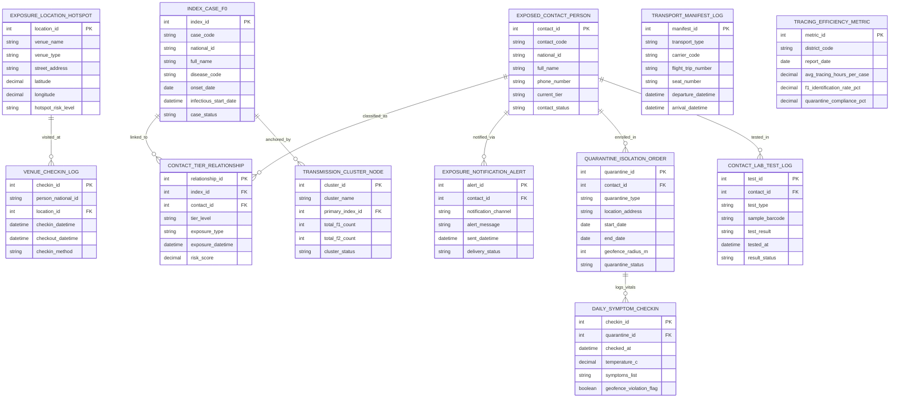

# Conceptual ERD — Epidemic Contact Tracing System

## Mermaid Code

## Entity Description Table | Bảng mô tả Entity

| # | Entity Name | Vietnamese Name | Description | Key Attributes | Main Relationships |
|---|-------------|-----------------|-------------|----------------|-------------------|
| 1 | INDEX_CASE_F0 | Bệnh nhân F0 (Index Case) | Master F0 index case record storing case code, national ID, full name, disease code, symptom onset date, infectious window start timestamp, and status. | index_id, case_code, national_id, full_name, disease_code, onset_date, infectious_start_date, case_status | Has CONTACT_TIER_RELATIONSHIP and TRANSMISSION_CLUSTER_NODE. |
| 2 | EXPOSED_CONTACT_PERSON | Người Tiếp xúc (F1/F2 Contact) | Master record for exposed individuals storing contact code, national ID, full name, phone number, current tier level (F1/F2), and contact status. | contact_id, contact_code, national_id, full_name, phone_number, current_tier, contact_status | Has RELATIONSHIP, NOTIFICATION_ALERT, QUARANTINE_ORDER, LAB_TEST_LOG. |
| 3 | CONTACT_TIER_RELATIONSHIP | Mối quan hệ Phân cấp F0-F1-F2 | Multi-tier relationship record linking an F0 index case to an exposed contact, storing tier level (F1, F2), exposure type, datetime, and risk score. | relationship_id, index_id, contact_id, tier_level, exposure_type, exposure_datetime, risk_score | Belongs to INDEX_CASE_F0 and EXPOSED_CONTACT_PERSON. |
| 4 | EXPOSURE_LOCATION_HOTSPOT | Điểm Dịch tễ / Hotspot | Public venue or exposure hotspot location record tracking venue name, venue type (Restaurant, Gym, Office), street address, GPS coordinates, and risk level. | location_id, venue_name, venue_type, street_address, latitude, longitude, hotspot_risk_level | Has VENUE_CHECKIN_LOG. |
| 5 | VENUE_CHECKIN_LOG | Nhật ký QR Check-in Điểm | Digital venue QR check-in log tracking person national ID, location ID, check-in/out datetimes, and check-in method (Zalo, Mobile App, Paper). | checkin_id, person_national_id, location_id, checkin_datetime, checkout_datetime, checkin_method | Belongs to EXPOSURE_LOCATION_HOTSPOT. |
| 6 | TRANSPORT_MANIFEST_LOG | Danh sách Hành khách Vận tải | Passenger transport manifest log tracking transport type (Flight, Train, Bus), carrier code, trip number, seat number, and departure/arrival times. | manifest_id, transport_type, carrier_code, flight_trip_number, seat_number, departure_datetime, arrival_datetime | Standalone transport manifest record. |
| 7 | EXPOSURE_NOTIFICATION_ALERT | Thông báo Cảnh báo Tiếp xúc | Automated exposure alert notification record tracking contact ID, notification channel (Zalo, SMS, App), alert message, sent timestamp, and delivery status. | alert_id, contact_id, notification_channel, alert_message, sent_datetime, delivery_status | Belongs to EXPOSED_CONTACT_PERSON. |
| 8 | QUARANTINE_ISOLATION_ORDER | Quyết định Cách ly Dịch tễ | Official quarantine order tracking contact ID, quarantine type (Home vs Facility), location address, start/end dates, geofence radius meters, and status. | quarantine_id, contact_id, quarantine_type, location_address, start_date, end_date, geofence_radius_m, quarantine_status | Belongs to EXPOSED_CONTACT_PERSON; Has DAILY_SYMPTOM_CHECKIN. |
| 9 | DAILY_SYMPTOM_CHECKIN | Khai báo Y tế & Nhiệt độ | Daily temperature and symptom check-in record tracking quarantine ID, checked timestamp, temperature °C, symptoms list, and geofence violation flag. | checkin_id, quarantine_id, checked_at, temperature_c, symptoms_list, geofence_violation_flag | Belongs to QUARANTINE_ISOLATION_ORDER. |
| 10 | CONTACT_LAB_TEST_LOG | Nhật ký Xét nghiệm F1/F2 | Diagnostic PCR test log for exposed contacts tracking contact ID, test type (RT-PCR, Antigen), sample barcode, test result, tested timestamp, and status. | test_id, contact_id, test_type, sample_barcode, test_result, tested_at, result_status | Belongs to EXPOSED_CONTACT_PERSON. |
| 11 | TRANSMISSION_CLUSTER_NODE | Cụm / Chuỗi Lây nhiễm | Epidemic transmission cluster node record tracking cluster name, primary index F0 ID, total F1 count, total F2 count, and cluster status. | cluster_id, cluster_name, primary_index_id, total_f1_count, total_f2_count, cluster_status | Belongs to INDEX_CASE_F0. |
| 12 | TRACING_EFFICIENCY_METRIC | Chỉ số Hiệu suất Truy vết | Aggregated contact tracing performance metric store tracking district code, report date, avg tracing hours per case, F1 identification SLA %, and compliance %. | metric_id, district_code, report_date, avg_tracing_hours_per_case, f1_identification_rate_pct, quarantine_compliance_pct | Standalone performance metric store. |

## Relationship Description | Mô tả Quan hệ

| # | From Entity | Cardinality | To Entity | Relationship Label | Business Explanation |
|---|-------------|-------------|-----------|-------------------|----------------------|
| 1 | INDEX_CASE_F0 | one-to-many | CONTACT_TIER_RELATIONSHIP | linked_to | One F0 index case is linked to multiple F1 and F2 contact tier relationships. |
| 2 | INDEX_CASE_F0 | one-to-one | TRANSMISSION_CLUSTER_NODE | anchored_by | One F0 index case anchors an epidemic transmission cluster node. |
| 3 | EXPOSED_CONTACT_PERSON | one-to-many | CONTACT_TIER_RELATIONSHIP | classified_as | One exposed person is classified in contact tier relationships (F1 or F2). |
| 4 | EXPOSED_CONTACT_PERSON | one-to-many | EXPOSURE_NOTIFICATION_ALERT | notified_via | One exposed person receives automated exposure alerts via Zalo, SMS, or app push. |
| 5 | EXPOSED_CONTACT_PERSON | one-to-many | QUARANTINE_ISOLATION_ORDER | enrolled_in | One exposed person is enrolled in statutory home or facility quarantine orders. |
| 6 | EXPOSED_CONTACT_PERSON | one-to-many | CONTACT_LAB_TEST_LOG | tested_in | One exposed person is tested in diagnostic PCR test logs (Day 1, 7, 14). |
| 7 | EXPOSURE_LOCATION_HOTSPOT | one-to-many | VENUE_CHECKIN_LOG | visited_at | One exposure hotspot location records multiple public venue QR check-in logs. |
| 8 | QUARANTINE_ISOLATION_ORDER | one-to-many | DAILY_SYMPTOM_CHECKIN | logs_vitals | One quarantine isolation order logs daily temperature and symptom check-in entries. |
