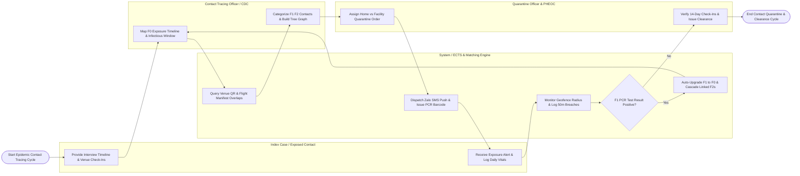

# Swimlane Diagram — Epidemic Contact Tracing System

## Mermaid Code

## Flow Description | Mô tả luồng

| Lane | Actor / Subsystem | Role in Flow |
|------|-------------------|--------------|
| 1 | Index Case / Exposed Contact | Provides exposure timeline details during interviews, receives Zalo/SMS exposure alerts, logs daily temperature check-ins on mobile app, and honors quarantine. |
| 2 | Contact Tracing Officer / CDC | Registers confirmed F0 index cases, calculates infectious window, interviews index cases, categorizes exposed contacts into F1 and F2 risk tiers, and builds transmission trees. |
| 3 | System / ECTS & Matching Engine | Runs spatio-temporal venue QR check-in overlap analysis, dispatches automated exposure push alerts, monitors 50-meter GPS geofences, and auto-upgrades positive F1s to F0 status. |
| 4 | Quarantine Officer & PHEOC | Assigns centralized facility vs home quarantine orders, enforces isolation rules, monitors daily temperature logs, audits tracing speed SLAs, and issues clearance certificates. |
