# Action Tree — Epidemic Contact Tracing System

## Mermaid Code

```mermaid
graph TD
    Root["Epidemic Contact Tracing System"]

    Root --> M1["Index Case F0 & Timeline Registration"]
    Root --> M2["Multi-Tier Contact Categorization"]
    Root --> M3["Venue & Transport Overlap Ingestion"]
    Root --> M4["Automated Exposure Push Alerts"]
    Root --> M5["Geofenced Quarantine Monitoring"]
    Root --> M6["Diagnostic Testing & Status Cascade"]
    Root --> M7["Transmission Tree Visualization"]
    Root --> M8["PHEOC Analytics & SLA Metrics"]

    M1 --> A11["Register Confirmed F0 Index Patient Case"]
    M1 --> A12["Calculate 48-Hour Infectious Window Date"]
    M1 --> A13["Map Chronological Exposure Location Timeline"]
    M1 --> A14["Pin Visited Public Hotspots on GIS Map"]

    M2 --> A21["Identify Direct Close Contacts F1 Tier 1"]
    M2 --> A22["Categorize Secondary Contacts F2 Tier 2"]
    M2 --> A23["Assign Individual Contact Risk Scores"]
    M2 --> A24["Tag High-Risk Vulnerable Environment Contacts"]

    M3 --> A31["Ingest National Venue QR Check-In Logs"]
    M3 --> A32["Import Flight & Train Passenger Manifests"]
    M3 --> A33["Run Spatio-Temporal Overlap Analysis"]
    M3 --> A34["Query Bluetooth Exposure GAEN Proximity Tokens"]

    M4 --> A41["Dispatch Zalo Push Exposure Alerts"]
    M4 --> A42["Send Dual-Channel SMS Warning Messages"]
    M4 --> A43["Issue Digital PCR Test Appointment Barcodes"]
    M4 --> A44["Broadcast Venue Public Health Warnings"]

    M5 --> A51["Assign Home vs Facility Quarantine Orders"]
    M5 --> A52["Configure 50-Meter GPS Geofence Boundaries"]
    M5 --> A53["Log Real-Time Location Pings & Radius Breaches"]
    M5 --> A54["Ingest Daily Temperature & Symptom Check-Ins"]

    M6 --> A61["Schedule Mandatory Day 1 7 14 PCR Tests"]
    M6 --> A62["Ingest Reference Laboratory PCR Test Results"]
    M6 --> A63["Auto-Upgrade Positive F1 Contacts to F0 Status"]
    M6 --> A64["Auto-Convert Linked F2 Contacts to F1 Tier"]

    M7 --> A71["Render Interactive Transmission Tree Graph"]
    M7 --> A72["Display Directed Infection Generation Nodes"]
    M7 --> A73["Trace Outbreak Origin Index Case Roots"]
    M7 --> A74["Export Outbreak Transmission Cluster Maps"]

    M8 --> A81["Measure F1 Identification Speed SLA Hours"]
    M8 --> A82["Calculate Secondary Attack Rate SAR Percent"]
    M8 --> A83["Audit Quarantine Geofence Compliance Rates"]
    M8 --> A84["Export Daily PHEOC Situation Bulletins"]
```

## Module Description | Mô tả Module

| # | Module | Description | Actions |
|---|--------|-------------|---------|
| 1 | Index Case F0 & Timeline Registration | Registers confirmed F0 index cases, calculates infectious windows (48 hours prior to onset), maps exposure timelines, and pins GIS hotspots. | Register Confirmed F0 Index Patient Case, Calculate 48-Hour Infectious Window Date, Map Chronological Exposure Location Timeline, Pin Visited Public Hotspots on GIS Map |
| 2 | Multi-Tier Contact Categorization | Identifies exposed contacts, categorizes them into F1 (Direct Close Contact) and F2 (Secondary Contact) tiers, assigns risk scores, and tags vulnerable contacts. | Identify Direct Close Contacts F1 Tier 1, Categorize Secondary Contacts F2 Tier 2, Assign Individual Contact Risk Scores, Tag High-Risk Vulnerable Environment Contacts |
| 3 | Venue & Transport Overlap Ingestion | Ingests venue QR check-in logs, flight/train passenger manifests, runs spatio-temporal overlap analysis, and queries Bluetooth proximity tokens. | Ingest National Venue QR Check-In Logs, Import Flight & Train Passenger Manifests, Run Spatio-Temporal Overlap Analysis, Query Bluetooth Exposure GAEN Proximity Tokens |
| 4 | Automated Exposure Push Alerts | Dispatches Zalo push notifications, dual-channel SMS warnings, issues PCR test appointment barcodes, and broadcasts venue health alerts. | Dispatch Zalo Push Exposure Alerts, Send Dual-Channel SMS Warning Messages, Issue Digital PCR Test Appointment Barcodes, Broadcast Venue Public Health Warnings |
| 5 | Geofenced Quarantine Monitoring | Assigns home/facility quarantine orders, configures 50m GPS geofences, logs location pings/breaches, and ingests daily temperature check-ins. | Assign Home vs Facility Quarantine Orders, Configure 50-Meter GPS Geofence Boundaries, Log Real-Time Location Pings & Radius Breaches, Ingest Daily Temperature & Symptom Check-Ins |
| 6 | Diagnostic Testing & Status Cascade | Schedules mandatory Day 1/7/14 PCR tests, ingests lab results, auto-upgrades positive F1s to F0 status, and auto-converts linked F2s to F1 tier. | Schedule Mandatory Day 1 7 14 PCR Tests, Ingest Reference Laboratory PCR Test Results, Auto-Upgrade Positive F1 Contacts to F0 Status, Auto-Convert Linked F2 Contacts to F1 Tier |
| 7 | Transmission Tree Visualization | Renders interactive directed transmission tree graphs (F0 -> F1 -> F2), displays infection generation nodes, and traces cluster origins. | Render Interactive Transmission Tree Graph, Display Directed Infection Generation Nodes, Trace Outbreak Origin Index Case Roots, Export Outbreak Transmission Cluster Maps |
| 8 | PHEOC Analytics & SLA Metrics | Audits F1 identification SLA speed (target < 12 hours), calculates Secondary Attack Rates (SAR %), monitors geofence compliance, and exports reports. | Measure F1 Identification Speed SLA Hours, Calculate Secondary Attack Rate SAR Percent, Audit Quarantine Geofence Compliance Rates, Export Daily PHEOC Situation Bulletins |
