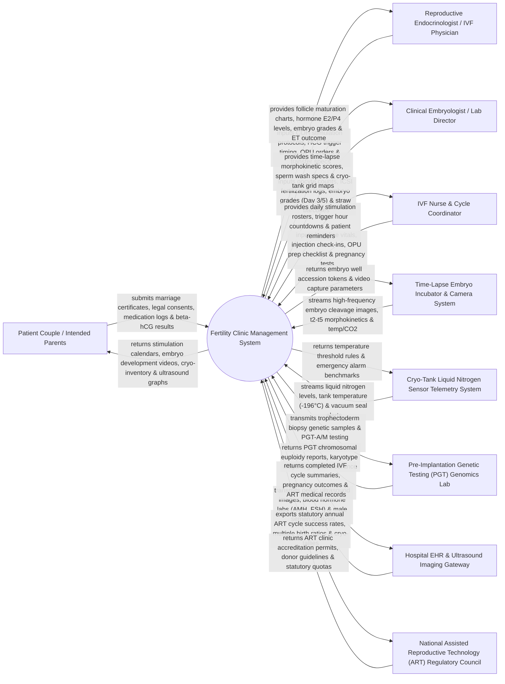

# Context Diagram — Fertility Clinic Management System

## Mermaid Code

## Actor & Interaction Table | Bảng Actor & Tương tác

| # | Actor | Actor Type | Data Sent TO System | Data Received FROM System | Notes |
|---|-------|------------|---------------------|---------------------------|-------|
| 1 | Patient Couple / Intended Parents | Primary | Marriage certificates, legal spouse consent forms, hormone injection logs, home pregnancy test results. | Controlled ovarian stimulation calendar, embryo time-lapse videos, cryo-straw inventory, ultrasound charts. | Married couple or intended parents undergoing IVF, ICSI, IUI, or donor fertility treatment cycles. |
| 2 | Reproductive Endocrinologist / IVF Physician | Primary | Controlled Ovarian Hyperstimulation (COH) protocols, HCG trigger timing, OPU orders, Embryo Transfer specs. | Follicle growth charts, Estradiol (E2)/Progesterone (P4) trends, blastocyst grades, pregnancy outcomes. | Specialist physician directing fertility diagnosis, ovarian stimulation, egg retrieval, and embryo transfer. |
| 3 | Clinical Embryologist / Lab Director | Primary | Oocyte maturation counts (MII), ICSI fertilization logs, Day 3/Day 5 embryo grades, cryo-straw barcodes. | Time-lapse morphokinetic scores (t2, t5, tSB), sperm processing specs, cryo-tank storage grid maps. | Laboratory scientist performing IVF, ICSI micro-injection, embryo culture, biopsy, and vitrification. |
| 4 | IVF Nurse & Cycle Coordinator | Primary | Baseline vital signs, daily hormone injection logs, pre-OPU preparation checklists, Beta-hCG blood test results. | Daily patient stimulation rosters, HCG trigger hour countdown alerts, patient appointment reminders. | Specialized nurse coordinating patient injection schedules, monitoring visits, and procedure logistics. |
| 5 | Time-Lapse Embryo Incubator & Camera System | Supporting System | High-frequency time-lapse embryo imaging frames, morphokinetic cleavage timestamps (t2-t5), CO2/O2/Temp telemetry. | Embryo dish well accession tokens, image capture interval configurations, camera calibration parameters. | Time-lapse incubator system (e.g., EmbryoScope, MIRI TL) imaging developing embryos continuously. |
| 6 | Cryo-Tank Liquid Nitrogen Sensor Telemetry System | Supporting System | Real-time liquid nitrogen (LN2) level %, cryo-tank temperature (-196°C), vacuum insulation pressure. | Temperature safety thresholds, low-LN2 level emergency alarm rules, sensor sampling intervals. | IoT sensor network monitoring cryogenic storage tanks holding frozen embryos, oocytes, and sperm straws. |
| 7 | Pre-Implantation Genetic Testing (PGT) Genomics Lab | Supporting System | PGT-A (Aneuploidy), PGT-M (Monogenic), PGT-SR chromosomal karyotype results, euploidy status. | Trophectoderm biopsy sample requisitions, embryo biopsy barcodes, genetic testing orders. | Genetics laboratory conducting NGS genomic sequencing on embryo trophectoderm biopsy samples. |
| 8 | Hospital EHR & Ultrasound Imaging Gateway | Supporting System | Transvaginal ultrasound (TVUS) DICOM images, baseline hormone panels (AMH, FSH, LH, E2), WHO semen analysis. | Completed IVF cycle summaries, early obstetric pregnancy outcomes, ART clinical charts. | Enterprise hospital information system linking OB/GYN ultrasound clinics and endocrine labs. |
| 9 | National ART Regulatory Council | Regulatory | Statutory ART legal mandates, donor anonymity guidelines, maximum embryo transfer limit rules. | Statutory annual ART cycle success rate reports, multiple pregnancy ratios, cryo-inventory audits. | Government healthcare body regulating Assisted Reproductive Technology (SART / ESHRE / MOH). |

## System Boundary Description | Mô tả Phạm vi Hệ thống

The **Fertility Clinic Management System (FCMS)** is a specialized reproductive medicine, embryology laboratory, and Assisted Reproductive Technology (ART) clinical management platform. It operates across IVF clinics, fertility centers, embryology labs, and cryopreservation banks. It manages couple intake and legal consent, Controlled Ovarian Hyperstimulation (COH) protocol tracking, transvaginal ultrasound follicle monitoring, Oocyte Pick-Up (OPU) retrieval, WHO semen processing, Intracytoplasmic Sperm Injection (ICSI), time-lapse embryo morphokinetics, PGT genetic biopsy tracking, vitrification cryopreservation (-196°C LN2), Embryo Transfer (ET / FET), and Beta-hCG pregnancy outcome tracking.

**Inside System Scope:**
- Couple intake, marriage certificate verification, and legal spouse consent management.
- Controlled Ovarian Hyperstimulation (COH) protocol builder, medication dosing, and E2/P4/LH hormone tracking.
- Transvaginal ultrasound (TVUS) follicle tracking (Right/Left ovary follicle count and size mm).
- Oocyte Pick-Up (OPU) procedure logging, follicle aspiration, and oocyte maturity grading (MII, MI, GV).
- Semen analysis (WHO 6th ed parameters: volume, concentration, motility, morphology) and sperm wash processing.
- Embryology lab workstation: Conventional IVF, ICSI micro-injection, Day 3 cleavage grading, and Day 5 Blastocyst grading (Gardner scale: e.g., 4AA).
- Time-lapse incubator data ingestion (morphokinetic markers: t2, t3, t5, tSB, tB) and AI embryo quality scoring.
- Vitrification cryopreservation inventory (straw barcodes, tank/canister/goblet 4-tier grid mapping) and FET scheduling.
- Embryo Transfer (ET/FET) procedure logging, endometrial thickness monitoring, and Beta-hCG pregnancy outcome tracking.

**Outside System Scope:**
- Routine general obstetric prenatal care past 12 weeks gestation (handled by Maternal & Child Health System).
- Physical manufacturing of incubator gas mixtures or culture media (handled by laboratory vendors).
- General hospital financial general ledger accounting (handled by enterprise ERP).
