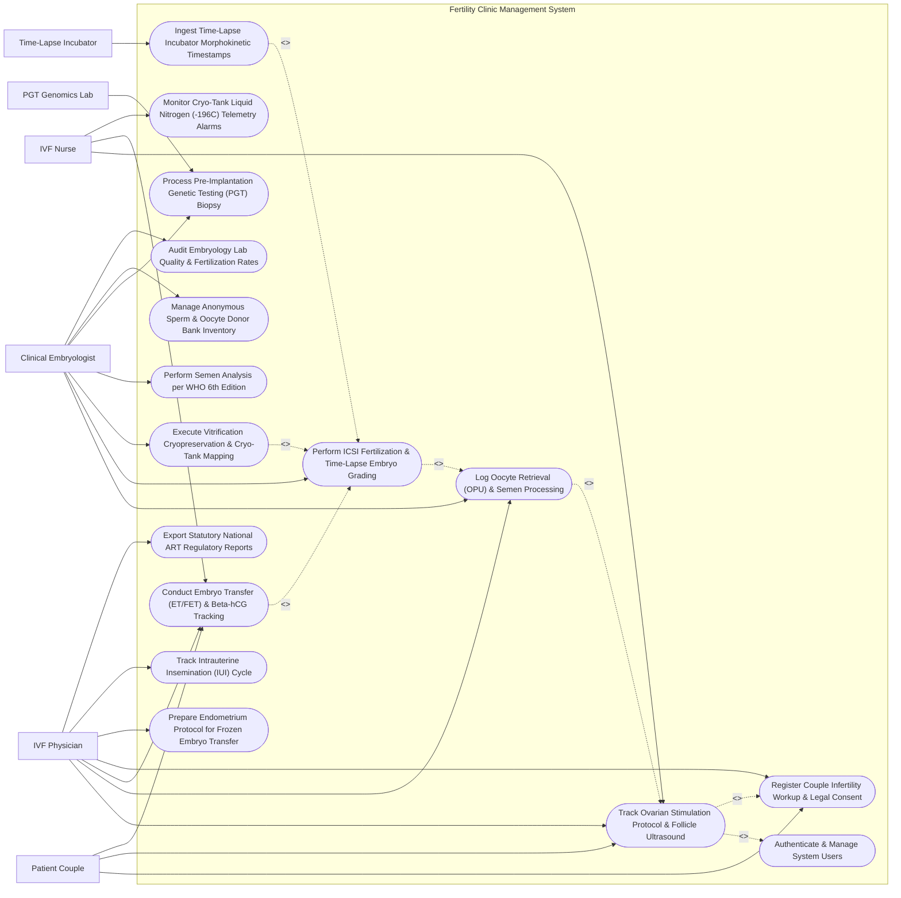

# Use Case Diagram — Fertility Clinic Management System

## Mermaid Code

## Actor Table | Bảng Actor

| # | Actor | Actor Type | Role Description | Related Use Cases |
|---|-------|------------|------------------|-------------------|
| 1 | Patient Couple | Primary | Married couple or intended parents receiving IVF/ICSI treatment, tracking follicle growth, and signing consents. | UC01, UC05, UC06 |
| 2 | IVF Physician | Primary | Reproductive endocrinologist prescribing COH stimulation protocols, evaluating follicle maturation, executing OPU and ET procedures. | UC01, UC02, UC05, UC06, UC12, UC13, UC15 |
| 3 | Clinical Embryologist | Primary | Laboratory scientist processing semen, identifying oocytes, performing ICSI micro-injections, grading embryos, and vitrifying straws. | UC02, UC03, UC04, UC07, UC09, UC10, UC14 |
| 4 | IVF Nurse | Primary | Nurse coordinating daily hormone injection calendars, tracking E2/P4 blood results, and monitoring cryo-tank telemetry. | UC01, UC05, UC11 |
| 5 | Time-Lapse Incubator | Secondary / System | Automated time-lapse incubator system (EmbryoScope) streaming continuous embryo cleavage images and morphokinetic timestamps. | UC08 |
| 6 | PGT Genomics Lab | Secondary / System | Genetics laboratory performing trophectoderm biopsy sequencing and returning PGT-A chromosomal euploidy results. | UC09 |

## Use Case Table | Bảng Use Case

| # | UC ID | Use Case Name | Primary Actor | Secondary Actor | Description | Priority |
|---|-------|---------------|---------------|-----------------|-------------|----------|
| 1 | UC01 | Track Ovarian Stimulation Protocol & Follicle Ultrasound | IVF Physician | IVF Nurse | Prescribe Controlled Ovarian Hyperstimulation (COH) protocols, log daily hormone doses, and record TVUS follicle growth mm. | High |
| 2 | UC02 | Log Oocyte Retrieval (OPU) & Semen Processing | IVF Physician | Clinical Embryologist | Document Oocyte Pick-Up (OPU) retrieval, count aspirated oocytes, assess maturity (MII, MI, GV), and log WHO semen preparation. | High |
| 3 | UC03 | Perform ICSI Fertilization & Time-Lapse Embryo Grading | Clinical Embryologist | Time-Lapse Incubator | Perform Intracytoplasmic Sperm Injection (ICSI), grade fertilization 2PN, track time-lapse morphokinetics, and score Day 5 Blastocysts. | High |
| 4 | UC04 | Execute Vitrification Cryopreservation & Cryo-Tank Mapping | Clinical Embryologist | None | Vitrify high-grade embryos or oocytes, log cryo-straw barcodes, and assign 4-tier storage grid locations inside -196°C LN2 tanks. | High |
| 5 | UC05 | Conduct Embryo Transfer (ET/FET) & Beta-hCG Tracking | IVF Physician | Patient Couple | Perform fresh Embryo Transfer (ET) or Frozen Embryo Transfer (FET), monitor endometrial thickness mm, and log 14-day Beta-hCG pregnancy test. | High |
| 6 | UC06 | Register Couple Infertility Workup & Legal Consent | IVF Physician | Patient Couple | Register couple profile, link husband and wife, verify marriage certificate, record baseline AMH/FSH, and sign legal ART consents. | High |
| 7 | UC07 | Perform Semen Analysis per WHO 6th Edition | Clinical Embryologist | None | Evaluate semen parameters according to WHO 6th edition guidelines: volume, concentration, total motility, progressive motility %, and morphology %. | High |
| 8 | UC08 | Ingest Time-Lapse Incubator Morphokinetic Timestamps | Clinical Embryologist | Time-Lapse Incubator | Ingest automated morphokinetic timestamps (t2, t3, t5, tSB, tB) from time-lapse incubators to calculate AI embryo implantation scores. | Medium |
| 9 | UC09 | Process Pre-Implantation Genetic Testing (PGT) Biopsy | Clinical Embryologist | PGT Genomics Lab | Perform Day 5 trophectoderm biopsy, label biopsy tubes, dispatch to PGT lab, and ingest PGT-A euploid/aneuploid result reports. | High |
| 10 | UC10 | Manage Anonymous Sperm & Oocyte Donor Bank Inventory | Clinical Embryologist | None | Manage donor bank inventory (Donor Sperm Straws, Donor Eggs), tracking genetic screening, 6-month quarantine clearance, and donor matching. | Medium |
| 11 | UC11 | Monitor Cryo-Tank Liquid Nitrogen (-196C) Telemetry Alarms | IVF Nurse | None | Monitor IoT sensor telemetry across cryogenic storage tanks (-196°C LN2 levels), triggering automated high-priority alarms for LN2 drops. | High |
| 12 | UC12 | Prepare Endometrium Protocol for Frozen Embryo Transfer | IVF Physician | None | Prescribe estrogen/progesterone endometrial preparation protocol for FET, tracking trilaminar endometrial thickness (> 8mm target). | High |
| 13 | UC13 | Track Intrauterine Insemination (IUI) Cycle | IVF Physician | None | Track artificial insemination cycles: ovulation monitoring, HCG trigger timing, processed sperm insemination, and 14-day pregnancy outcome. | Medium |
| 14 | UC14 | Audit Embryology Lab Quality & Fertilization Rates | Clinical Embryologist | None | Calculate embryology key performance indicators (KPIs): ICSI fertilization rate (> 75%), Day 5 blastocyst conversion rate, and vitrification survival %. | Medium |
| 15 | UC15 | Export Statutory National ART Regulatory Reports | IVF Physician | None | Generate statutory reports for SART / ESHRE / Ministry of Health: total ART cycles, clinical pregnancy rate per transfer, and multiple birth ratios. | Medium |
| 16 | UC16 | Authenticate & Manage System Users | All Users | None | Enforce secure multi-factor authentication, double-witness identity verification for embryo handling, and HIPAA data compliance. | High |

## Use Case Specification | Đặc tả Use Case

---

### UC01 — Track Ovarian Stimulation Protocol & Follicle Ultrasound

| Field | Detail |
|-------|--------|
| **UC ID** | UC01 |
| **Use Case Name** | Track Ovarian Stimulation Protocol & Follicle Ultrasound |
| **Actor(s)** | Primary: IVF Physician   Secondary: IVF Nurse, Patient Couple |
| **Description** | Prescribes a Controlled Ovarian Hyperstimulation (COH) protocol (Antagonist, Long GnRH Agonist, Mild Stimulation), tracks daily gonadotropin medication dosing (rFSH, hMG), records serum Estradiol (E2) and Progesterone (P4) levels, monitors transvaginal ultrasound (TVUS) follicle growth in millimeters, and calculates HCG trigger timing. |
| **Precondition** | 1. Couple registration and legal IVF consents (UC06) are completed.   2. Baseline Day 2 pelvic ultrasound (antral follicle count AFC) and AMH levels are logged. |
| **Main Flow** | 1. The IVF Physician opens "New Ovarian Stimulation Protocol" for Patient (Female Partner: Le Thi M, Cycle ID: `CYC-2026-08192`).   2. The Physician selects COH Protocol: **Flexible GnRH Antagonist Protocol**.   3. The Physician prescribes initial medication dosage: *rFSH (Gonal-F) 225 IU SC Daily* starting Cycle Day 2.   4. As stimulation progresses, the Physician logs **Serial TVUS Follicle Monitoring** at Cycle Day 8:   &nbsp;&nbsp;&nbsp;&nbsp;- **Right Ovary**: 5 Follicles (16mm, 15mm, 14mm, 12mm, 10mm)   &nbsp;&nbsp;&nbsp;&nbsp;- **Left Ovary**: 4 Follicles (17mm, 16mm, 14mm, 11mm)   &nbsp;&nbsp;&nbsp;&nbsp;- **Endometrial Thickness**: 9.2 mm (Trilaminar Pattern)   &nbsp;&nbsp;&nbsp;&nbsp;- **Hormone Labs**: Serum Estradiol (E2) = 1,850 pg/mL, Progesterone (P4) = 0.6 ng/mL.   5. The Physician adds GnRH Antagonist (*Cetrotide 0.25mg SC*) to prevent premature LH surge.   6. At Cycle Day 10, when 3 lead follicles reach >= 18mm (19mm, 18.5mm, 18mm), the Physician calculates **Trigger Timing**:   &nbsp;&nbsp;&nbsp;&nbsp;- **Trigger Order**: *r-hCG (Ovitrelle 250mcg)* administered at **10:00 PM on Oct 14**   &nbsp;&nbsp;&nbsp;&nbsp;- **Scheduled OPU Time**: **36 Hours Post-Trigger = Oct 16 at 10:00 AM** (UC02).   7. The System publishes the digital Medication Calendar to the Patient's mobile app and dispatches an urgent HCG Trigger Alarm to the IVF Nurse. |
| **Alternative Flow** | **AF1** — Dual Trigger for OHSS Prevention: For a high-responder patient (AMH > 4.5 ng/mL, E2 > 4,000 pg/mL), the Physician orders a Dual Trigger (GnRH Agonist *Decapeptyl 0.2mg* + Low-Dose hCG) and mandates "Freeze-All Embryos" protocol to prevent Ovarian Hyperstimulation Syndrome (OHSS).   **AF2** — Natural Cycle / Mild Stimulation IVF: For a poor responder (AMH < 0.5 ng/mL), the Physician prescribes Letrozole + Low-Dose hMG (75 IU). |
| **Exception Flow** | **EX1** — Ovarian Hyperstimulation Syndrome (OHSS) Risk Alert: E2 exceeds 4,500 pg/mL with > 25 follicles; System triggers "CRITICAL OHSS RISK ALARM — Cancel Fresh Transfer; Freeze-All Mandated".   **EX2** — Premature LH Surge / Ovulation Risk: P4 level spikes to 1.8 ng/mL prior to trigger; System alerts "Premature Luteinization Warning — Consider Early Trigger or Cycle Cancellation". |
| **Postcondition** | COH stimulation protocol, follicle growth measurements, serum E2/P4 levels, and HCG trigger timestamp (36h prior to OPU) are recorded. |
| **Business Rule** | **BR1**: Oocyte Pick-Up (OPU) retrieval MUST be scheduled exactly 34 to 36 hours after HCG / Agonist trigger administration.   **BR2**: Estradiol (E2) levels exceeding 4,000 pg/mL with > 20 lead follicles MUST trigger a mandatory OHSS prevention protocol requiring freeze-all embryos. |

---

### UC02 — Log Oocyte Retrieval (OPU) & Semen Processing

| Field | Detail |
|-------|--------|
| **UC ID** | UC02 |
| **Use Case Name** | Log Oocyte Retrieval (OPU) & Semen Processing |
| **Actor(s)** | Primary: IVF Physician   Secondary: Clinical Embryologist |
| **Description** | Logs transvaginal ultrasound-guided Oocyte Pick-Up (OPU) follicular aspiration, records total aspirated oocytes, assesses oocyte nuclear maturity (Metaphase II MII, Metaphase I MI, Germinal Vesicle GV), and processes husband/partner semen sample using WHO-compliant washing techniques (Density Gradient Centrifugation). |
| **Precondition** | 1. HCG trigger was administered 36 hours prior (UC01).   2. The OPU operating room and embryology pass-through window are active. |
| **Main Flow** | 1. The IVF Physician performs transvaginal ultrasound-guided OPU aspiration in the OR at 10:00 AM.   2. The Physician hands follicular fluid test tubes through the temperature-controlled pass-through window to the Clinical Embryologist.   3. The Embryologist searches follicular fluid under the stereo-microscope heated stage (37°C) and isolates Cumulus-Oocyte Complexes (COCs).   4. The Embryologist enters **OPU Recovery Findings**:   &nbsp;&nbsp;&nbsp;&nbsp;- Total Follicles Aspirated: 12 Follicles   &nbsp;&nbsp;&nbsp;&nbsp;- **Total Oocytes Retrieved**: `10 COCs`   &nbsp;&nbsp;&nbsp;&nbsp;- Oocyte Quality: Good cumulus expansion.   5. After hyaluronidase denuding, the Embryologist records **Oocyte Nuclear Maturity Breakdown**:   &nbsp;&nbsp;&nbsp;&nbsp;- **MII (Metaphase II - Mature)**: `8 Oocytes` (Eligible for ICSI)   &nbsp;&nbsp;&nbsp;&nbsp;- **MI (Metaphase I - Immature)**: 1 Oocyte   &nbsp;&nbsp;&nbsp;&nbsp;- **GV (Germinal Vesicle - Immature)**: 1 Oocyte   &nbsp;&nbsp;&nbsp;&nbsp;- Degenerated: 0.   6. Simultaneously, the Embryologist processes the husband's fresh semen sample (`Volume = 3.2 mL, Conc = 45M/mL, Motility = 55%`):   &nbsp;&nbsp;&nbsp;&nbsp;- Processing Method: **Discontinuous Density Gradient Centrifugation (45%/90% Gradient)**   &nbsp;&nbsp;&nbsp;&nbsp;- **Post-Wash Recovery**: Volume = 0.5 mL, Post-Wash Conc = 22M/mL, Progressive Motility = 92% (High-Motility Sperm Suspension).   7. The System logs OPU & Semen Processing Record `OPU-2026-99182` and queues the 8 MII oocytes for ICSI Micro-Injection (UC03). |
| **Alternative Flow** | **AF1** — Surgical Sperm Retrieval (TESE / Micro-TESE): For an azoospermic male, the Urologist performs Micro-TESE testicular biopsy; Embryologist searches testicular tissue fragments for viable motile spermatozoa.   **AF2** — Frozen Donor Sperm Thawing: Embryologist thaws a 0.5mL donor sperm straw from the Sperm Bank (UC10), verifying donor code and post-thaw motility (> 40%). |
| **Exception Flow** | **EX1** — Empty Follicle Syndrome (0 Oocytes Retrieved): Physician aspirates 10 follicles but 0 oocytes are found; System logs "Empty Follicle Event", prompting cycle review.   **EX2** — Severe Severe Asthenozoospermia / 0% Motility: Post-wash motility is 0%; Embryologist uses Pentoxifylline or HOS test to identify live un-motile sperm for ICSI. |
| **Postcondition** | OPU retrieval count (10 COCs, 8 MII mature) and post-wash high-motility sperm metrics are logged, and oocytes are queued for ICSI fertilization. |
| **Business Rule** | **BR1**: Oocytes and semen samples MUST be double-witnessed (two embryologists verifying patient names and IDs) before micro-injection or culture.   **BR2**: Oocyte nuclear maturity (MII vs MI/GV) MUST be evaluated and logged under high magnification before performing ICSI. |

---

### UC03 — Perform ICSI Fertilization & Time-Lapse Embryo Grading

| Field | Detail |
|-------|--------|
| **UC ID** | UC03 |
| **Use Case Name** | Perform ICSI Fertilization & Time-Lapse Embryo Grading |
| **Actor(s)** | Primary: Clinical Embryologist   Secondary: Time-Lapse Incubator |
| **Description** | Performs Intracytoplasmic Sperm Injection (ICSI) micro-injection of mature MII oocytes, evaluates 16-18 hour fertilization (presence of 2 pronuclei 2PN), places fertilized zygotes into time-lapse incubator wells, ingests morphokinetic cleavage timestamps (t2, t3, t5, tSB, tB), and grades Day 3 cleavage and Day 5 Blastocysts (Gardner Scale: e.g., 4AA). |
| **Precondition** | 1. Mature MII oocytes and processed sperm (UC02) are ready in the embryology lab.   2. Time-Lapse Incubator (EmbryoScope) culture dish is prepared and equilibrated. |
| **Main Flow** | 1. The Clinical Embryologist performs **ICSI Micro-Injection** on 8 mature MII oocytes under the inverted micro-manipulator scope (Injecting 1 morphologically normal sperm into each MII oocyte).   2. The Embryologist loads the 8 injected oocytes into individual wells of Time-Lapse Culture Dish `DISH-2026-0812` and places the dish into **Time-Lapse Incubator #02** (UC08).   3. **Day 1 (16-18 Hours Post-ICSI)**: The Embryologist checks fertilization:   &nbsp;&nbsp;&nbsp;&nbsp;- **2PN Fertilized Normal**: `7 Oocytes` (87.5% Fertilization Rate -> Normal)   &nbsp;&nbsp;&nbsp;&nbsp;- 1PN / 3PN Abnormal: 1 Oocyte.   4. **Day 3 Cleavage Assessment (68 Hours Post-ICSI)**:   &nbsp;&nbsp;&nbsp;&nbsp;- Embryo 1: 8-Cell, Grade 1 (Equal blastomeres, < 5% fragmentation)   &nbsp;&nbsp;&nbsp;&nbsp;- Embryo 2: 8-Cell, Grade 1   &nbsp;&nbsp;&nbsp;&nbsp;- Embryos 3 to 7: 6 to 8-Cell, Grade 1-2.   5. **Day 5 Blastocyst Assessment (116 Hours Post-ICSI)** using Gardner Scale:   &nbsp;&nbsp;&nbsp;&nbsp;- **Embryo #1**: **Grade 4AA** (Expanded Blastocyst, Excellent Inner Cell Mass A, Excellent Trophectoderm A) -> *Top Quality*   &nbsp;&nbsp;&nbsp;&nbsp;- **Embryo #2**: **Grade 4AB** (Expanded Blastocyst, Good Quality)   &nbsp;&nbsp;&nbsp;&nbsp;- **Embryo #3**: **Grade 3BB** (Full Blastocyst)   &nbsp;&nbsp;&nbsp;&nbsp;- Embryos #4-7: Morula / Early Blastocysts.   6. The Embryologist logs embryo grades and marks Embryo #1 (4AA) and Embryo #2 (4AB) for Fresh Embryo Transfer (UC05) or PGT Biopsy (UC09) / Vitrification (UC04). |
| **Alternative Flow** | **AF1** — Conventional IVF Insemination: For normal semen parameters, Embryologist performs conventional insemination (co-incubating 150,000 motile sperm per oocyte in culture drop).   **AF2** — Time-Lapse AI Morphokinetic Score Selection: The System ingests EmbryoScope morphokinetic timestamps (t2=26h, t5=48h, tSB=88h), calculating an AI Implantation Score (Score 9.2/10) to rank embryo #1 for transfer. |
| **Exception Flow** | **EX1** — Total Fertilization Failure (0% 2PN): All 8 oocytes fail to fertilize (0 2PN); System alerts Lab Director, logging "Total Fertilization Failure Event" and triggering emergency consultation.   **EX2** — Complete Embryonic Arrest at Day 3: All cleavage embryos arrest at 4-cell stage with severe fragmentation; System logs "Day 3 Embryonic Arrest". |
| **Postcondition** | Fertilization rate (87.5%), Day 3 cell counts, and Day 5 Blastocyst grades (4AA, 4AB) are recorded, and top-graded blastocysts are queued for transfer or vitrification. |
| **Business Rule** | **BR1**: Normal fertilization MUST be confirmed by observing 2 distinct pronuclei (2PN) and 2 polar bodies 16-18 hours post-insemination.   **BR2**: Blastocyst grading MUST strictly utilize standardized Gardner criteria (Blastocyst Expansion 1-6, Inner Cell Mass A-C, Trophectoderm A-C). |

---

### UC04 — Execute Vitrification Cryopreservation & Cryo-Tank Mapping

| Field | Detail |
|-------|--------|
| **UC ID** | UC04 |
| **Use Case Name** | Execute Vitrification Cryopreservation & Cryo-Tank Mapping |
| **Actor(s)** | Primary: Clinical Embryologist |
| **Description** | Executes ultra-rapid vitrification cryopreservation of surplus high-grade blastocysts or oocytes, logs high-security cryo-straw barcodes, assigns 4-tier storage grid locations (Liquid Nitrogen Tank Number -> Canister -> Cane Color -> Goblet Position) in -196°C LN2 tanks, and updates couple cryo-inventory. |
| **Precondition** | 1. Surplus high-quality blastocysts (e.g., Day 5 4AB, 3BB from UC03) or oocytes are ready for freezing.   2. Liquid Nitrogen cryo-tank inventory topology is active in FCMS. |
| **Main Flow** | 1. The Clinical Embryologist selects 2 surplus blastocysts (Embryo #2: 4AB, Embryo #3: 3BB) for vitrification.   2. The Embryologist prepares high-security cryo-straws and scans **Cryo-Straw 2D Barcodes**:   &nbsp;&nbsp;&nbsp;&nbsp;- **Straw 1**: Barcode `STR-EMB-2026-99181` (Loaded with Embryo #2: 4AB)   &nbsp;&nbsp;&nbsp;&nbsp;- **Straw 2**: Barcode `STR-EMB-2026-99182` (Loaded with Embryo #3: 3BB).   3. The Embryologist performs **Vitrification Protocol**: Equilibrates blastocysts in vitrification solutions (VS1 -> VS2 with DMSO/Ethylene Glycol) and plunges straws directly into liquid nitrogen (-196°C).   4. The System assigns precise **4-Tier Cryo-Tank Grid Coordinates**:   &nbsp;&nbsp;&nbsp;&nbsp;- **LN2 Tank Number**: `TANK-IVF-03` (-196°C Vapor Phase)   &nbsp;&nbsp;&nbsp;&nbsp;- **Canister Number**: `Canister #02`   &nbsp;&nbsp;&nbsp;&nbsp;- **Cane Color / ID**: `Blue Cane #05`   &nbsp;&nbsp;&nbsp;&nbsp;- **Goblet Position**: `Top Goblet (Position A & B)`.   5. The Embryologist places the straws into Blue Cane #05 inside Tank 03, Canister 02, and confirms grid placement.   6. The System locks grid coordinates, updates Cryo-Straw status to "Vitrified - Active Storage", and attaches the inventory record to Couple Profile `CPL-2026-0812`.   7. The System prints a physical Cryo-Storage Summary Certificate for the couple. |
| **Alternative Flow** | **AF1** — Oocyte Vitrification (Egg Freezing Cycle): For an elective fertility preservation patient, Embryologist vitrifies 12 mature MII oocytes across 4 cryo-straws (3 eggs per straw), mapping locations in Tank 01.   **AF2** — Testicular Tissue / Sperm Cryopreservation: Embryologist freezes 5 straws of processed sperm in liquid nitrogen vapor, logging straw color and tank location. |
| **Exception Flow** | **EX1** — Cryo-Straw Barcode Scan Error / Duplicate: System detects barcode `STR-EMB-99181` is already in use; System blocks saving and prompts loading a fresh unique barcode straw.   **EX2** — Target Canister Capacity Exceeded: Canister 02 is 100% full; System auto-suggests available space in Canister 03. |
| **Postcondition** | Cryo-straw barcodes are registered, vitrification parameters logged, 4-tier LN2 tank grid locations locked, and couple cryo-inventory updated. |
| **Business Rule** | **BR1**: Every vitrified cryo-straw (embryo, oocyte, sperm) MUST be tagged with a unique 2D barcode and mapped to an exact 4-tier grid coordinate (Tank, Canister, Cane, Goblet).   **BR2**: Vitrification records MUST detail exact embryo stage, morphological grade, cryo-protectant exposure time, and double-witness sign-offs. |

---

### UC05 — Conduct Embryo Transfer (ET/FET) & Beta-hCG Tracking

| Field | Detail |
|-------|--------|
| **UC ID** | UC05 |
| **Use Case Name** | Conduct Embryo Transfer (ET/FET) & Beta-hCG Tracking |
| **Actor(s)** | Primary: IVF Physician   Secondary: Patient Couple, Clinical Embryologist |
| **Description** | Conducts transabdominal ultrasound-guided Embryo Transfer (Fresh ET or Frozen Embryo Transfer FET), verifies embryo identity and catheter placement, logs transferred embryo count (1 or 2 blastocysts per guidelines), prescribes luteal phase support (Progesterone), and tracks 14-day serum Beta-hCG pregnancy outcome. |
| **Precondition** | 1. Selected high-grade blastocyst (Fresh 4AA from UC03 or Thawed FET 4AB from UC04) is loaded in transfer catheter.   2. Patient endometrial thickness (> 8.0 mm) and bladder filling are confirmed. |
| **Main Flow** | 1. The IVF Physician and Embryologist execute **Double-Witness Verification**: Confirming Patient Identity (Female: Le Thi M, Male: Tran Van N, Cycle `CYC-2026-08192`) and Selected Embryo (#1: Day 5 Grade 4AA Blastocyst).   2. The Embryologist loads Embryo #1 into the soft transfer catheter (Wallace Catheter) under stereomicroscope.   3. The IVF Physician performs **Transabdominal Ultrasound-Guided Embryo Transfer**:   &nbsp;&nbsp;&nbsp;&nbsp;- Catheter Insertion: Smooth passage through internal cervical os   &nbsp;&nbsp;&nbsp;&nbsp;- Transfer Site: 1.5 cm from uterine fundus   &nbsp;&nbsp;&nbsp;&nbsp;- Flash Visualization: Air bubble flash visualized on ultrasound.   4. The Embryologist inspects the returned catheter under microscope -> **No Retained Embryo (Transfer Complete)**.   5. The Physician logs Transfer Record:   &nbsp;&nbsp;&nbsp;&nbsp;- Transfer Type: Single Embryo Transfer (SET)   &nbsp;&nbsp;&nbsp;&nbsp;- Transferred Count: 1 Blastocyst (Grade 4AA)   &nbsp;&nbsp;&nbsp;&nbsp;- Catheter Ease: Easy / No Blood.   6. The Physician prescribes **Luteal Phase Support**: *Micronized Progesterone (Utrogestan 200mg) 1 cap PV 3x/daily + Duphaston 10mg PO 2x/daily*.   7. The System schedules **14-Day Serum Beta-hCG Blood Test Date** (Oct 28, 2026).   8. On Day 14, the System ingests Beta-hCG Blood Result: **`Beta-hCG = 485 mIU/mL` (POSITIVE PREGNANCY)**.   9. The System logs Pregnancy Outcome: **Clinical Pregnancy Confirmed**, scheduling 6-Week Obstetric Ultrasound for Fetal Heartbeat (UC11). |
| **Alternative Flow** | **AF1** — Frozen Embryo Transfer (FET) Thaw Cycle: For FET, Embryologist thaws Straw `STR-EMB-99181` from Tank 03, verifying 100% post-thaw blastocyst re-expansion before loading catheter.   **AF2** — Double Embryo Transfer (DET) for Advanced Maternal Age: For a 41-year-old patient, Physiatrist transfers 2 Day 3 cleavage embryos in accordance with age-based ESHRE/SART guidelines. |
| **Exception Flow** | **EX1** — Retained Embryo in Catheter Warning: Embryologist checks returned catheter and finds embryo still inside; Physician re-inserts fresh catheter and repeats transfer immediately.   **EX2** — Negative Beta-hCG Result (< 5 mIU/mL): Day 14 Beta-hCG is 1.2 mIU/mL; System logs "Biochemical Non-Pregnancy", notifies Physician, and schedules post-cycle review consultation. |
| **Postcondition** | Single Embryo Transfer (SET) procedure is completed, luteal support is prescribed, 14-day Beta-hCG (485 mIU/mL Positive) is recorded, and 6-week OB scan is scheduled. |
| **Business Rule** | **BR1**: Double-witness identity verification MUST be performed verbally and electronically by two clinical staff members immediately prior to loading embryos into the transfer catheter.   **BR2**: Elective Single Embryo Transfer (eSET) MUST be recommended for young patients (< 35 yrs) with top-quality blastocysts to minimize multiple pregnancy risks. |
