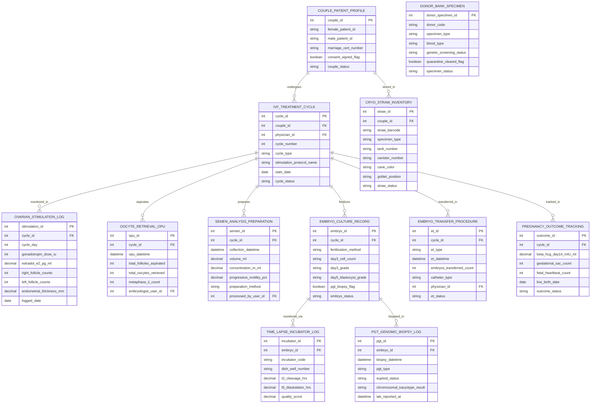

# Conceptual ERD — Fertility Clinic Management System

## Mermaid Code

## Entity Description Table | Bảng mô tả Entity

| # | Entity Name | Vietnamese Name | Description | Key Attributes | Main Relationships |
|---|-------------|-----------------|-------------|----------------|-------------------|
| 1 | COUPLE_PATIENT_PROFILE | Hồ sơ Cặp Vợ chồng | Master couple record linking female and male partner IDs, storing marriage cert number, legal consent signed flag, and status. | couple_id, female_patient_id, male_patient_id, marriage_cert_number, consent_signed_flag, couple_status | Has IVF_TREATMENT_CYCLE and CRYO_STRAW_INVENTORY. |
| 2 | IVF_TREATMENT_CYCLE | Chu kỳ Điều trị IVF/ICSI | Master treatment cycle record tracking couple ID, physician ID, cycle number, cycle type (Fresh, FET, IUI), stimulation protocol name, start date, and status. | cycle_id, couple_id, physician_id, cycle_number, cycle_type, stimulation_protocol_name, start_date, cycle_status | Belongs to COUPLE_PATIENT_PROFILE; Has STIMULATION_LOG, OPU, SEMEN, EMBRYO, ET, OUTCOME. |
| 3 | OVARIAN_STIMULATION_LOG | Nhật ký Kích thích Buồng trứng | Controlled Ovarian Hyperstimulation (COH) daily log tracking cycle day, gonadotropin IU dose, Estradiol (E2), follicle counts (R/L), endometrial thickness mm, and date. | stimulation_id, cycle_id, cycle_day, gonadotropin_dose_iu, estradol_e2_pg_ml, right_follicle_counts, left_follicle_counts, endometrial_thickness_mm | Belongs to IVF_TREATMENT_CYCLE. |
| 4 | OOCYTE_RETRIEVAL_OPU | Hồ sơ Chọc hút Trứng (OPU) | Oocyte Pick-Up (OPU) procedure record tracking OPU datetime, total aspirated follicles, total retrieved oocytes, Metaphase II (MII) count, and embryologist user ID. | opu_id, cycle_id, opu_datetime, total_follicles_aspirated, total_oocytes_retrieved, metaphase_ii_count, embryologist_user_id | Belongs to IVF_TREATMENT_CYCLE. |
| 5 | SEMEN_ANALYSIS_PREPARATION | Processing Tinh trùng | Semen analysis and wash preparation record tracking collection datetime, volume mL, concentration M/mL, progressive motility %, method, and user ID. | semen_id, cycle_id, collection_datetime, volume_ml, concentration_m_ml, progressive_motility_pct, preparation_method, processed_by_user_id | Belongs to IVF_TREATMENT_CYCLE. |
| 6 | EMBRYO_CULTURE_RECORD | Hồ sơ Nuôi cấy Phôi | Individual embryo record tracking fertilization method (ICSI vs IVF), Day 3 cell count/grade, Day 5 Blastocyst grade (Gardner scale), PGT flag, and status. | embryo_id, cycle_id, fertilization_method, day3_cell_count, day3_grade, day5_blastocyst_grade, pgt_biopsy_flag, embryo_status | Belongs to IVF_TREATMENT_CYCLE; Has TIME_LAPSE_LOG and PGT_BIOPSY_LOG. |
| 7 | TIME_LAPSE_INCUBATOR_LOG | Nhật ký Tủ Time-Lapse | Time-lapse incubator morphokinetic tracking record storing incubator code, dish well number, cleavage timestamps (t2, t5), and quality score. | incubator_id, embryo_id, incubator_code, dish_well_number, t2_cleavage_hrs, t5_blastulation_hrs, quality_score | Belongs to EMBRYO_CULTURE_RECORD. |
| 8 | PGT_GENOMIC_BIOPSY_LOG | Nhật ký Sinh thiết PGT | Pre-Implantation Genetic Testing (PGT) biopsy record tracking biopsy datetime, PGT type (PGT-A/M/SR), euploid status, karyotype result, and report timestamp. | pgt_id, embryo_id, biopsy_datetime, pgt_type, euploid_status, chromosomal_karyotype_result, lab_reported_at | Belongs to EMBRYO_CULTURE_RECORD. |
| 9 | CRYO_STRAW_INVENTORY | Kho Trữ Đông Cryo (Cọng Rơm) | Cryopreservation straw inventory record tracking straw 2D barcode, specimen type (Embryo, Oocyte, Sperm), 4-tier grid location (Tank/Canister/Cane/Goblet), and status. | straw_id, couple_id, straw_barcode, specimen_type, tank_number, canister_number, cane_color, goblet_position, straw_status | Belongs to COUPLE_PATIENT_PROFILE. |
| 10 | EMBRYO_TRANSFER_PROCEDURE | Hồ sơ Chuyển Phôi (ET/FET) | Embryo Transfer procedure record tracking transfer type (Fresh ET vs FET), transfer datetime, transferred embryo count (SET vs DET), catheter type, physician ID, and status. | et_id, cycle_id, et_type, et_datetime, embryos_transferred_count, catheter_type, physician_id, et_status | Belongs to IVF_TREATMENT_CYCLE. |
| 11 | PREGNANCY_OUTCOME_TRACKING | Theo dõi Kết quả Thai | Post-transfer pregnancy outcome record tracking Day 14 Beta-hCG mIU/mL level, gestational sac count, fetal heartbeat count, live birth date, and status. | outcome_id, cycle_id, beta_hcg_day14_mIU_ml, gestational_sac_count, fetal_heartbeat_count, live_birth_date, outcome_status | Belongs to IVF_TREATMENT_CYCLE. |
| 12 | DONOR_BANK_SPECIMEN | Ngân hàng Mẫu Hiến | Donor bank specimen inventory record tracking donor code, specimen type (Sperm/Oocyte), blood type, genetic screening status, quarantine clearance, and status. | donor_specimen_id, donor_code, specimen_type, blood_type, genetic_screening_status, quarantine_cleared_flag, specimen_status | Standalone donor bank inventory record. |

## Relationship Description | Mô tả Quan hệ

| # | From Entity | Cardinality | To Entity | Relationship Label | Business Explanation |
|---|-------------|-------------|-----------|-------------------|----------------------|
| 1 | COUPLE_PATIENT_PROFILE | one-to-many | IVF_TREATMENT_CYCLE | undergoes | One registered couple undergoes multiple IVF/ICSI treatment cycles over time. |
| 2 | COUPLE_PATIENT_PROFILE | one-to-many | CRYO_STRAW_INVENTORY | stored_in | One registered couple owns vitrified embryo/oocyte cryo-straws stored in tanks. |
| 3 | IVF_TREATMENT_CYCLE | one-to-many | OVARIAN_STIMULATION_LOG | monitored_in | One IVF treatment cycle logs daily ovarian stimulation hormone and TVUS follicle data. |
| 4 | IVF_TREATMENT_CYCLE | one-to-one | OOCYTE_RETRIEVAL_OPU | aspirates | One IVF treatment cycle culminates in one Oocyte Pick-Up (OPU) retrieval procedure. |
| 5 | IVF_TREATMENT_CYCLE | one-to-one | SEMEN_ANALYSIS_PREPARATION | prepares | One IVF treatment cycle prepares one male partner semen wash sample for fertilizing oocytes. |
| 6 | IVF_TREATMENT_CYCLE | one-to-many | EMBRYO_CULTURE_RECORD | fertilizes | One IVF treatment cycle fertilizes and cultures multiple individual embryos (Day 1-5). |
| 7 | IVF_TREATMENT_CYCLE | one-to-many | EMBRYO_TRANSFER_PROCEDURE | transferred_in | One IVF treatment cycle performs embryo transfer procedures (Fresh ET or FET). |
| 8 | IVF_TREATMENT_CYCLE | one-to-one | PREGNANCY_OUTCOME_TRACKING | tracked_in | One IVF treatment cycle tracks 14-day Beta-hCG pregnancy test and obstetric outcomes. |
| 9 | EMBRYO_CULTURE_RECORD | one-to-one | TIME_LAPSE_INCUBATOR_LOG | monitored_via | One cultured embryo is monitored via continuous time-lapse incubator image sequences. |
| 10 | EMBRYO_CULTURE_RECORD | one-to-one | PGT_GENOMIC_BIOPSY_LOG | biopsied_in | One Day 5 blastocyst embryo is biopsied for PGT genetic screening. |
