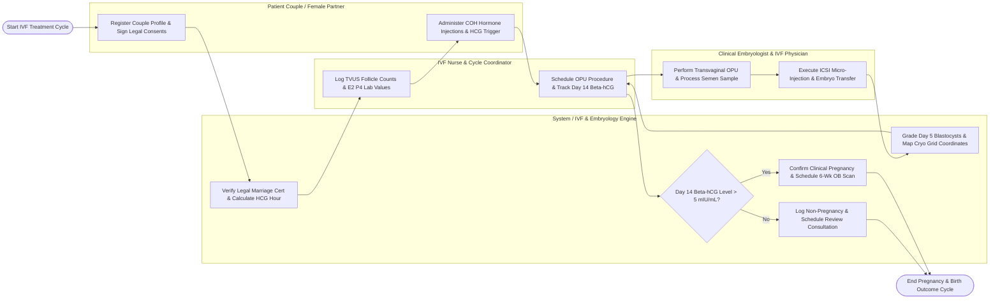

# Swimlane Diagram — Fertility Clinic Management System

## Mermaid Code

## Flow Description | Mô tả luồng

| Lane | Actor / Subsystem | Role in Flow |
|------|-------------------|--------------|
| 1 | Patient Couple / Female Partner | Registers couple profiles, signs legal ART spouse consent forms, receives controlled ovarian stimulation hormone injections, and attends TVUS monitoring. |
| 2 | IVF Nurse & Cycle Coordinator | Tracks daily hormone injection calendars, logs TVUS follicle growth counts (R/L ovaries), schedules OPU retrieval times, and monitors Day 14 Beta-hCG blood tests. |
| 3 | System / IVF & Embryology Engine | Validates legal marriage certs, calculates HCG trigger hour (36h prior to OPU), ingests time-lapse morphokinetics, grades Day 5 blastocysts, and maps cryo-tank grid locations. |
| 4 | Clinical Embryologist & IVF Physician | Conducts transvaginal ultrasound-guided OPU retrieval, processes WHO semen samples, performs ICSI micro-injections, executes Embryo Transfer (SET), and prescribes luteal support. |
