# Action Tree — Fertility Clinic Management System

## Mermaid Code

```mermaid
graph TD
    Root["Fertility Clinic Management System"]

    Root --> M1["Couple Intake & Legal Consents"]
    Root --> M2["Ovarian Stimulation & Follicle TVUS"]
    Root --> M3["OPU Retrieval & Semen Processing"]
    Root --> M4["Embryology Lab & ICSI Culture"]
    Root --> M5["Time-Lapse & PGT Genetics Biopsy"]
    Root --> M6["Vitrification & Cryo-Tank Inventory"]
    Root --> M7["Embryo Transfer & Luteal Support"]
    Root --> M8["Pregnancy Outcomes & ART Reporting"]

    M1 --> A11["Register Husband Wife Couple Profile"]
    M1 --> A12["Verify Marriage Certificate Authenticity"]
    M1 --> A13["Record Baseline AMH FSH LH Hormone Panel"]
    M1 --> A14["Execute Statutory Legal ART Consent Forms"]

    M2 --> A21["Prescribe Controlled Ovarian Stimulation Protocol"]
    M2 --> A22["Log Daily Gonadotropin Medication Dosages"]
    M2 --> A23["Record Serial TVUS Follicle Growth Sizes"]
    M2 --> A24["Calculate HCG Trigger Hour 36h Prior to OPU"]

    M3 --> A31["Log Ultrasound-Guided OPU Aspirated Follicles"]
    M3 --> A32["Assess Oocyte Nuclear Maturity MII MI GV"]
    M3 --> A33["Perform WHO 6th Ed Semen Analysis Evaluation"]
    M3 --> A34["Process Density Gradient Sperm Wash Preparation"]

    M4 --> A41["Execute ICSI Sperm Micro-Injection Protocol"]
    M4 --> A42["Evaluate Day 1 2PN Normal Fertilization Rate"]
    M4 --> A43["Grade Day 3 Cleavage Embryo Blastomere Quality"]
    M4 --> A44["Score Day 5 Blastocysts via Gardner Scale"]

    M5 --> A51["Ingest Time-Lapse Morphokinetic Timestamps"]
    M5 --> A52["Calculate AI Embryo Implantation Quality Score"]
    M5 --> A53["Execute Day 5 Trophectoderm Biopsy Protocol"]
    M5 --> A54["Ingest PGT-A Chromosomal Euploidy Results"]

    M6 --> A61["Execute Embryo Oocyte Vitrification Freezing"]
    M6 --> A62["Register High-Security 2D Cryo-Straw Barcodes"]
    M6 --> A63["Map 4-Tier Grid Coordinates Tank Canister Cane"]
    M6 --> A64["Monitor -196C Liquid Nitrogen Telemetry Alarms"]

    M7 --> A71["Execute Double-Witness Embryo ID Verification"]
    M7 --> A72["Perform Ultrasound-Guided Embryo Transfer SET"]
    M7 --> A73["Monitor Endometrial Thickness & Trilaminar Pattern"]
    M7 --> A74["Prescribe Progesterone Luteal Phase Support"]

    M8 --> A81["Ingest Day 14 Serum Beta-hCG Blood Test"]
    M8 --> A82["Schedule 6-Week Obstetric Fetal Heartbeat Scan"]
    M8 --> A83["Calculate Embryology Lab Fertilization KPIs"]
    M8 --> A84["Export Statutory SART ESHRE Regulatory Reports"]
```

## Module Description | Mô tả Module

| # | Module | Description | Actions |
|---|--------|-------------|---------|
| 1 | Couple Intake & Legal Consents | Registers couple profiles, verifies marriage certificates, records baseline AMH/FSH hormone panels, and executes legal ART consent agreements. | Register Husband Wife Couple Profile, Verify Marriage Certificate Authenticity, Record Baseline AMH FSH LH Hormone Panel, Execute Statutory Legal ART Consent Forms |
| 2 | Ovarian Stimulation & Follicle TVUS | Prescribes COH stimulation protocols, logs daily gonadotropin dosing, records TVUS follicle growth, and calculates HCG trigger timing (36h pre-OPU). | Prescribe Controlled Ovarian Stimulation Protocol, Log Daily Gonadotropin Medication Dosages, Record Serial TVUS Follicle Growth Sizes, Calculate HCG Trigger Hour 36h Prior to OPU |
| 3 | OPU Retrieval & Semen Processing | Logs transvaginal OPU follicle aspiration, assesses oocyte nuclear maturity (MII), evaluates WHO 6th ed semen, and performs density gradient sperm washing. | Log Ultrasound-Guided OPU Aspirated Follicles, Assess Oocyte Nuclear Maturity MII MI GV, Perform WHO 6th Ed Semen Analysis Evaluation, Process Density Gradient Sperm Wash Preparation |
| 4 | Embryology Lab & ICSI Culture | Performs ICSI micro-injections, evaluates 2PN fertilization, grades Day 3 cleavage embryos, and scores Day 5 Blastocysts using Gardner criteria (e.g. 4AA). | Execute ICSI Sperm Micro-Injection Protocol, Evaluate Day 1 2PN Normal Fertilization Rate, Grade Day 3 Cleavage Embryo Blastomere Quality, Score Day 5 Blastocysts via Gardner Scale |
| 5 | Time-Lapse & PGT Genetics Biopsy | Ingests time-lapse morphokinetic timestamps (t2-t5), computes AI implantation scores, performs trophectoderm biopsies, and ingests PGT-A euploidy reports. | Ingest Time-Lapse Morphokinetic Timestamps, Calculate AI Embryo Implantation Quality Score, Execute Day 5 Trophectoderm Biopsy Protocol, Ingest PGT-A Chromosomal Euploidy Results |
| 6 | Vitrification & Cryo-Tank Inventory | Vitrifies blastocysts/oocytes, registers 2D cryo-straw barcodes, maps 4-tier grid locations in -196°C LN2 tanks, and monitors IoT temperature telemetry. | Execute Embryo Oocyte Vitrification Freezing, Register High-Security 2D Cryo-Straw Barcodes, Map 4-Tier Grid Coordinates Tank Canister Cane, Monitor -196C Liquid Nitrogen Telemetry Alarms |
| 7 | Embryo Transfer & Luteal Support | Enforces double-witness ID verification, performs ultrasound-guided Embryo Transfer (eSET), monitors endometrial thickness, and prescribes luteal support. | Execute Double-Witness Embryo ID Verification, Perform Ultrasound-Guided Embryo Transfer SET, Monitor Endometrial Thickness & Trilaminar Pattern, Prescribe Progesterone Luteal Phase Support |
| 8 | Pregnancy Outcomes & ART Reporting | Ingests Day 14 Beta-hCG blood test results, schedules 6-week obstetric fetal heartbeat scans, calculates lab KPIs, and exports statutory ART reports. | Ingest Day 14 Serum Beta-hCG Blood Test, Schedule 6-Week Obstetric Fetal Heartbeat Scan, Calculate Embryology Lab Fertilization KPIs, Export Statutory SART ESHRE Regulatory Reports |
