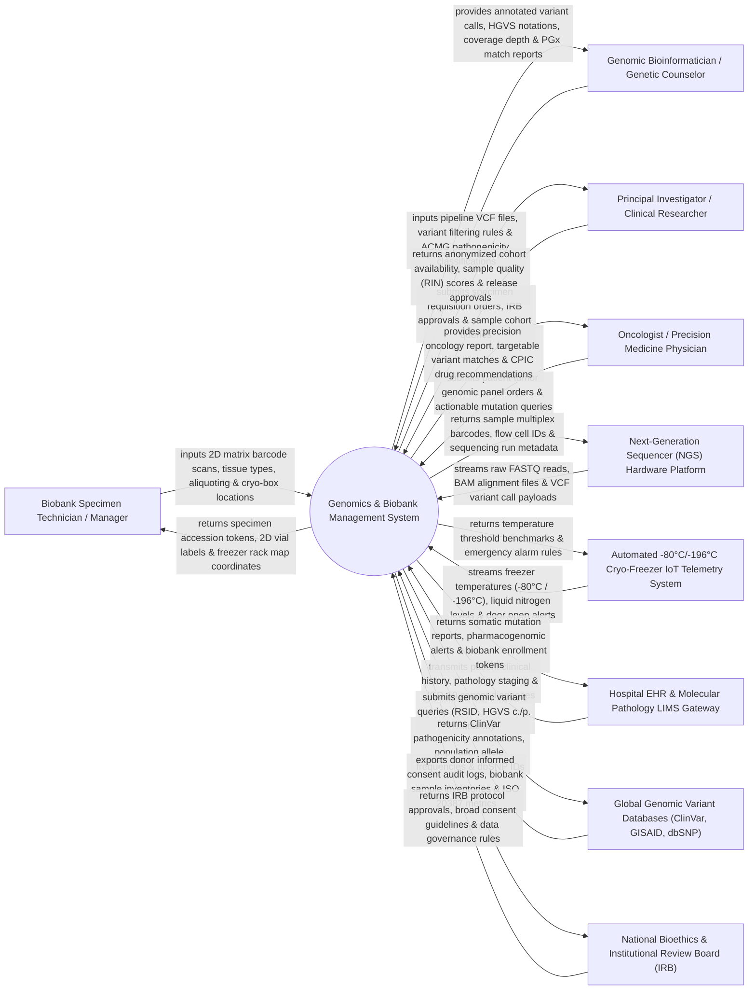

# Context Diagram — Genomics & Biobank Management System

## Mermaid Code

## Actor & Interaction Table | Bảng Actor & Tương tác

| # | Actor | Actor Type | Data Sent TO System | Data Received FROM System | Notes |
|---|-------|------------|---------------------|---------------------------|-------|
| 1 | Biobank Specimen Technician / Manager | Primary | 2D matrix barcode scans, tissue specimen type (Blood, FFPE, DNA, RNA), aliquoting volumes, freezer grid coordinates. | Specimen accession IDs, 2D vial barcode label specs, freezer rack map coordinates (Box/Well A1-H12). | Biobank technician managing physical biospecimen receiving, aliquoting, and cryo-preservation. |
| 2 | Genomic Bioinformatician / Genetic Counselor | Primary | Secondary analysis VCF files, variant filtering thresholds, ACMG 5-tier pathogenicity classifications. | Annotated variant call lists, HGVS c./p. notations, BAM read depth coverage, PGx diplotype reports. | Geneticist or bioinformatician analyzing NGS variant data and clinical variant interpretation. |
| 3 | Principal Investigator / Clinical Researcher | Primary | Biospecimen requisition orders, IRB approval documents, research cohort search filters. | Anonymized sample cohort availability, RNA Integrity Number (RIN) quality scores, sample release tokens. | Biomedical researcher requesting biobank specimens for clinical trials or genomic discovery studies. |
| 4 | Oncologist / Precision Medicine Physician | Primary | Tumor genomic profiling orders, targeted therapy inquiries, patient clinical history. | Precision oncology report, actionable mutation matches (EGFR, BRAF, BRCA1/2), CPIC PGx guidance. | Medical oncologist ordering genomic panels to select targeted therapies or immunotherapy. |
| 5 | Next-Generation Sequencer (NGS) Hardware Platform | Supporting System | Raw FASTQ sequence reads, aligned BAM files, VCF variant call payloads, Q30 quality scores. | Sample multiplex index barcodes, flow cell run IDs, sequencing library run metadata. | NGS sequencing platform (Illumina NovaSeq, Thermo Fisher Ion Torrent, PacBio, Oxford Nanopore). |
| 6 | Automated -80°C/-196°C Cryo-Freezer Telemetry System | Supporting System | Real-time ultra-low freezer temperatures (-80°C / -196°C LN2), liquid nitrogen tank levels, door open alerts. | Temperature threshold benchmarks, automated alarm rules, sensor sampling intervals. | Industrial IoT sensors monitoring ultra-low temperature freezers and liquid nitrogen tanks. |
| 7 | Hospital EHR & Molecular Pathology LIMS Gateway | Supporting System | Patient clinical histories, tumor pathology staging, immunohistochemistry (IHC) results, ICD-10 codes. | Somatic mutation reports, pharmacogenomic drug-gene interaction alerts, biobank enrollment tokens. | Enterprise hospital information system linking molecular pathology labs with genomic records. |
| 8 | Global Genomic Variant Databases | Supporting System | ClinVar pathogenicity classifications, gnomAD population allele frequencies, dbSNP RSIDs, Ensembl transcripts. | Genomic variant annotation query requests (Chromosome, Position, Ref/Alt alleles, HGVS notation). | Public genomic variant databases providing clinical annotations and allele frequency data. |
| 9 | National Bioethics & Institutional Review Board (IRB) | Regulatory | IRB protocol approvals, broad consent guidelines, material transfer agreement (MTA) rules. | Donor informed consent audit logs, biobank inventory summaries, ISO 20387 biobank quality metrics. | Regulatory board governing human biospecimen ethics, donor consent compliance, and biobank quality. |

## System Boundary Description | Mô tả Phạm vi Hệ thống

The **Genomics & Biobank Management System (GBMS)** is an enterprise biomedical informatics and biobanking platform operating across genomics research institutes, precision oncology centers, academic biobanks, and molecular pathology laboratories. It manages human biospecimen accessioning, 2D matrix barcode cryo-vial inventory, ultra-low freezer location mapping (-80°C / -196°C LN2), donor informed consent governance, Next-Generation Sequencing (NGS) data ingestion (FASTQ/BAM/VCF), genomic variant annotation (ACMG 5-tier classification), pharmacogenomic (PGx) drug-gene matching, and ISO 20387 biobank quality auditing.

**Inside System Scope:**
- Biospecimen sample accessioning and 2D matrix barcode cryo-vial inventory management.
- Multi-tier ultra-low freezer location mapping (Freezer Unit -> Tower/Rack -> Box -> Well Grid A1 to H12).
- Continuous IoT monitoring of -80°C mechanical freezers and -196°C liquid nitrogen (LN2) tanks with temperature alerts.
- Donor informed consent tracking, broad consent governance, and consent revocation processing.
- Ingestion of NGS sequencing runs (FASTQ, BAM, VCF), Q30 quality metrics, and coverage depth analysis.
- Clinical variant annotation, HGVS nomenclature formatting, and ACMG 5-tier pathogenicity scoring.
- Pharmacogenomic (PGx) CPIC drug-gene interaction matching (CYP2D6, CYP2C19, TPMT, HLA-B*5701).
- Specimen requisition workflows, IRB approval validation, Material Transfer Agreements (MTA), and ISO 20387 quality auditing.

**Outside System Scope:**
- Physical operation of NGS sequencing flow cells or chemistry reagents (handled by NGS hardware).
- Physical manual picking of cryo-vials inside freezers by technicians (guided by system grid coordinates).
- Direct inpatient administration of targeted chemotherapy drugs in hospital wards (handled by EHR / Inpatient).
- Commercial corporate financial general ledger accounting (handled by enterprise ERP).
