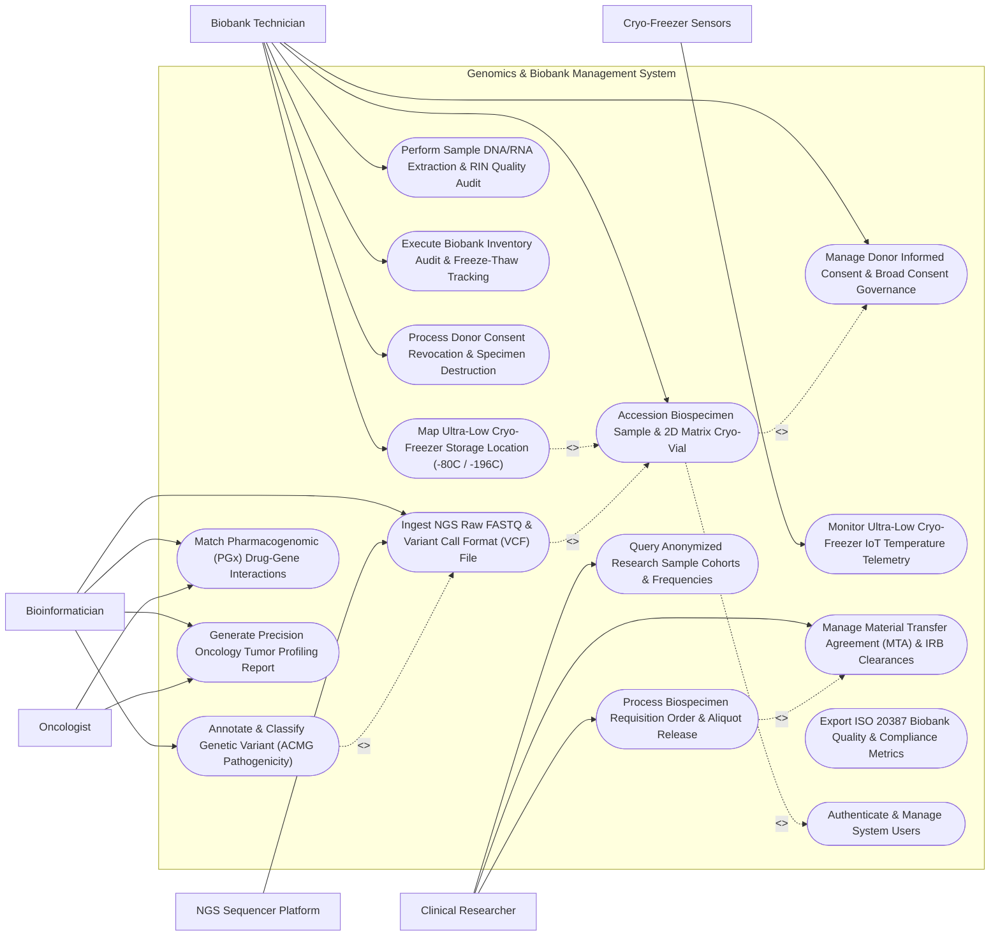

# Use Case Diagram — Genomics & Biobank Management System

## Mermaid Code

## Actor Table | Bảng Actor

| # | Actor | Actor Type | Role Description | Related Use Cases |
|---|-------|------------|------------------|-------------------|
| 1 | Biobank Technician | Primary | Specimen manager receiving biospecimens, scanning 2D barcodes, aliquoting DNA/RNA, and mapping cryo-freezer locations. | UC01, UC02, UC06, UC10, UC11, UC14 |
| 2 | Bioinformatician | Primary | Computational biologist processing NGS sequencing runs (FASTQ/VCF), annotating variants, scoring ACMG pathogenicity, and matching PGx. | UC03, UC04, UC08, UC09 |
| 3 | Clinical Researcher | Primary | Principal Investigator querying research sample cohorts, submitting biospecimen requisition orders, and attaching IRB/MTA clearances. | UC05, UC12, UC13 |
| 4 | Oncologist | Primary | Precision medicine physician ordering somatic tumor panels and reviewing actionable genomic mutation reports for targeted therapy. | UC08, UC09 |
| 5 | NGS Sequencer Platform | Secondary / System | Automated Next-Generation Sequencer streaming raw FASTQ reads, BAM alignments, VCF files, and Q30 quality metrics. | UC03 |
| 6 | Cryo-Freezer Sensors | Secondary / System | Industrial IoT sensors monitoring ultra-low mechanical freezers (-80°C) and liquid nitrogen tanks (-196°C). | UC07 |

## Use Case Table | Bảng Use Case

| # | UC ID | Use Case Name | Primary Actor | Secondary Actor | Description | Priority |
|---|-------|---------------|---------------|-----------------|-------------|----------|
| 1 | UC01 | Accession Biospecimen Sample & 2D Matrix Cryo-Vial | Biobank Technician | None | Register incoming human biospecimens (Whole Blood, Fresh Frozen Tissue, FFPE, Plasma), scan 2D matrix vial barcodes, and link donor consent. | High |
| 2 | UC02 | Map Ultra-Low Cryo-Freezer Storage Location (-80C / -196C) | Biobank Technician | None | Assign precise 4-tier grid coordinates (Freezer Unit -> Rack -> Box -> Well Grid A1-H12) inside -80°C freezers or -196°C LN2 tanks. | High |
| 3 | UC03 | Ingest NGS Raw FASTQ & Variant Call Format (VCF) File | Bioinformatician | NGS Sequencer Platform | Ingest raw FASTQ reads, aligned BAM files, and VCF variant calls from NGS sequencers, evaluating Q30 quality and mean coverage depth. | High |
| 4 | UC04 | Annotate & Classify Genetic Variant (ACMG Pathogenicity) | Bioinformatician | None | Annotate genomic variants against ClinVar/gnomAD and score pathogenicity according to ACMG 5-tier guidelines (Pathogenic -> Benign). | High |
| 5 | UC05 | Process Biospecimen Requisition Order & Aliquot Release | Clinical Researcher | None | Submit sample requisition orders, verify IRB approvals and Material Transfer Agreements (MTA), approve aliquot release, and update inventory. | High |
| 6 | UC06 | Manage Donor Informed Consent & Broad Consent Governance | Biobank Technician | None | Record donor informed consent agreements, track broad consent scope (Cancer Research, Commercial Use, Genetic Sequencing), and manage restrictions. | High |
| 7 | UC07 | Monitor Ultra-Low Cryo-Freezer IoT Temperature Telemetry | Biobank Technician | Cryo-Freezer Sensors | Ingest real-time IoT temperature telemetry from -80°C freezers and -196°C LN2 tanks, triggering automated emergency alerts for temp spikes. | High |
| 8 | UC08 | Match Pharmacogenomic (PGx) Drug-Gene Interactions | Bioinformatician | Oncologist | Cross-reference donor germline variants against CPIC guidelines (CYP2D6, CYP2C19, DPYD, TPMT), predicting drug metabolism and toxicity. | Medium |
| 9 | UC09 | Generate Precision Oncology Tumor Profiling Report | Bioinformatician | Oncologist | Produce clinical precision oncology reports detailing somatic driver mutations (EGFR, BRAF, KRAS), Tumor Mutational Burden (TMB), and MSI status. | High |
| 10 | UC10 | Perform Sample DNA/RNA Extraction & RIN Quality Audit | Biobank Technician | None | Record automated DNA/RNA extraction protocols, measure concentration (ng/μL) via fluorometry, and audit RNA Integrity Number (RIN 1-10). | Medium |
| 11 | UC11 | Execute Biobank Inventory Audit & Freeze-Thaw Tracking | Biobank Technician | None | Audit physical biobank inventory, track cumulative freeze-thaw cycles per aliquot, and alert when freeze-thaw threshold (> 3 cycles) is reached. | Medium |
| 12 | UC12 | Query Anonymized Research Sample Cohorts & Frequencies | Clinical Researcher | None | Query de-identified sample cohorts filtering by disease diagnosis, age, gender, tissue type, RIN score, and specific variant presence. | Medium |
| 13 | UC13 | Manage Material Transfer Agreement (MTA) & IRB Clearances | Clinical Researcher | None | Upload and validate Institutional Review Board (IRB) ethics approvals and legal Material Transfer Agreements (MTA) prior to sample dispatch. | High |
| 14 | UC14 | Process Donor Consent Revocation & Specimen Destruction | Biobank Technician | None | Execute formal donor consent revocation, flagging all linked biospecimens and genomic data files for mandatory destruction and audit logging. | High |
| 15 | UC15 | Export ISO 20387 Biobank Quality & Compliance Metrics | Biobank Technician | None | Render biobank quality analytics conforming to ISO 20387 standards: sample retrieval success rate, storage compliance %, and RIN distributions. | Medium |
| 16 | UC16 | Authenticate & Manage System Users | All Users | None | Enforce secure multi-factor authentication, role-based access control (Technician, Bioinformatician, Researcher), and genomic data encryption. | High |

## Use Case Specification | Đặc tả Use Case

---

### UC01 — Accession Biospecimen Sample & 2D Matrix Cryo-Vial

| Field | Detail |
|-------|--------|
| **UC ID** | UC01 |
| **Use Case Name** | Accession Biospecimen Sample & 2D Matrix Cryo-Vial |
| **Actor(s)** | Primary: Biobank Technician |
| **Description** | Accessions incoming human biospecimens (Fresh Frozen Tumor Tissue, Whole Blood EDTA, Blood Plasma, FFPE Tissue Blocks, Buffy Coat), scans 2D matrix barcode cryo-vials, verifies donor informed consent status, logs collection timestamps, and creates sample master records. |
| **Precondition** | 1. The biospecimen arrives at the biobank intake receiving station with a valid collection manifest.   2. Donor Informed Consent (UC06) is verified. |
| **Main Flow** | 1. The Biobank Technician opens "New Biospecimen Accession" in GBMS.   2. The Technician scans the collection manifest barcode, linking Donor ID `DNR-2026-08192` (Diagnosis: `ICD-10 C34.9 Non-Small Cell Lung Carcinoma`).   3. The System verifies **Donor Informed Consent**: Active Broad Consent for Cancer Genomic Research (Signed Oct 10, 2026) -> **Consent Verified**.   4. The Technician selects **Biospecimen Type & Attributes**:   &nbsp;&nbsp;&nbsp;&nbsp;- Primary Specimen Type: *Fresh Frozen Lung Tumor Tissue*   &nbsp;&nbsp;&nbsp;&nbsp;- Preservation Method: Snap-Frozen in Liquid Nitrogen   &nbsp;&nbsp;&nbsp;&nbsp;- Ischemia Time: Cold Ischemia Time = 18 Minutes (< 30 Mins Target)   &nbsp;&nbsp;&nbsp;&nbsp;- Initial Weight / Volume: 250 mg.   5. The Technician aliquots the specimen into 4 cryo-vials and scans the **2D Data Matrix Barcode** on the bottom of each vial:   &nbsp;&nbsp;&nbsp;&nbsp;- Vial 1: `2D-CRY-9918201`   &nbsp;&nbsp;&nbsp;&nbsp;- Vial 2: `2D-CRY-9918202`   &nbsp;&nbsp;&nbsp;&nbsp;- Vial 3: `2D-CRY-9918203`   &nbsp;&nbsp;&nbsp;&nbsp;- Vial 4: `2D-CRY-9918204`.   6. The System registers 4 Aliquot Master Records, links them to Sample ID `SMP-2026-4412`, and queues vials for Freezer Storage Location Assignment (UC02). |
| **Alternative Flow** | **AF1** — Formalin-Fixed Paraffin-Embedded (FFPE) Block Accession: Technician accessions an FFPE pathology block, scanning 1D cassette barcode, logging tissue block thickness (4 μm), and attaching H&E histology slide image link.   **AF2** — Whole Blood Liquid Biopsy Accession: Technician accessions Streck Cell-Free DNA blood tubes, logging centrifuging protocol (1,600g x 10 mins) to isolate plasma for circulating tumor DNA (ctDNA). |
| **Exception Flow** | **EX1** — Missing / Revoked Donor Consent Block: If Donor ID has no signed informed consent on file, the System blocks accessioning and flags "BIOBANK LOCK — Consent Missing; Hold Sample in Temporary Storage".   **EX2** — Excessive Cold Ischemia Time (> 60 Mins): If cold ischemia time exceeds 60 minutes, the System flags a yellow quality warning "High Ischemia Time — RNA Integrity May Be Compromised". |
| **Postcondition** | Biospecimen sample and 4 2D matrix cryo-vial aliquots are accessioned, consent is verified, cold ischemia time is logged, and vials are ready for freezer storage. |
| **Business Rule** | **BR1**: Biospecimens MUST NOT be permanently accessioned into biobank inventory without an active, verified Donor Informed Consent agreement.   **BR2**: Cold ischemia time (time from surgical excision to cryo-fixation) MUST be logged in minutes for all fresh tissue specimens. |

---

### UC02 — Map Ultra-Low Cryo-Freezer Storage Location (-80C / -196C)

| Field | Detail |
|-------|--------|
| **UC ID** | UC02 |
| **Use Case Name** | Map Ultra-Low Cryo-Freezer Storage Location (-80C / -196C) |
| **Actor(s)** | Primary: Biobank Technician |
| **Description** | Maps and assigns precise 4-tier storage grid coordinates (Freezer Unit Code -> Tower/Rack Number -> Cryo-Box Number -> Well Grid Position A1 to H12) inside -80°C mechanical freezers or -196°C liquid nitrogen (LN2) tanks for accessioned cryo-vials. |
| **Precondition** | 1. Accessioned 2D matrix cryo-vials (UC01) are queued for storage.   2. Storage freezer topology and available grid wells are indexed in GBMS. |
| **Main Flow** | 1. The Technician selects Accessioned Aliquot Batch `SMP-2026-4412` (4 Cryo-Vials).   2. The System queries **Biobank Storage Topology** for optimal temperature storage:   &nbsp;&nbsp;&nbsp;&nbsp;- Target Storage Temp: **-196°C Liquid Nitrogen Vapor Phase Tank**   &nbsp;&nbsp;&nbsp;&nbsp;- Tank Assignment: `LN2-TANK-02` (Oncology Biobank Unit).   3. The System auto-calculates available 4-tier grid coordinates:   &nbsp;&nbsp;&nbsp;&nbsp;- **Freezer Unit**: `LN2-TANK-02`   &nbsp;&nbsp;&nbsp;&nbsp;- **Rack Number**: `RACK-04`   &nbsp;&nbsp;&nbsp;&nbsp;- **Cryo-Box ID**: `BOX-ONC-881` (9x9 81-Well Polycarbonate Cryo-Box)   &nbsp;&nbsp;&nbsp;&nbsp;- **Well Positions**: `Well C03`, `Well C04`, `Well C05`, `Well C06`.   4. The Technician scans Cryo-Box Barcode `BOX-ONC-881` on the 2D Box Camera Reader; the camera scans all 81 vials simultaneously, confirming vial `2D-CRY-9918201` is placed in Well C03.   5. The Technician transfers Cryo-Box `BOX-ONC-881` into Rack 04 inside `LN2-TANK-02`.   6. The System locks grid coordinates, updates Aliquot Status to "Stored - Active", and displays a 2D Graphical Grid Map highlighting newly occupied wells in green. |
| **Alternative Flow** | **AF1** — Mechanical -80°C Ultra-Low Freezer Storage: For DNA extracts, the System assigns `FRZ-80C-05` -> `Rack 02` -> `Box 10` -> `Well A01`, verifying mechanical freezer temperature is -81.4°C.   **AF2** — Bulk Re-Location / Rack Migration: Technician moves an entire Rack (10 Cryo-Boxes) from Tank 01 to Tank 02; the System updates all 810 vial grid locations in a single batch operation. |
| **Exception Flow** | **EX1** — Target Well Grid Occupied Conflict: If a technician attempts to assign a vial to Well C03 which already contains an existing sample, the System blocks assignment and flashes "Well Occupied Error".   **EX2** — Storage Temperature Mismatch Warning: Attempting to store RNA extracts at -20°C instead of -80°C triggers a quality warning "Sub-Optimal Storage Temperature for RNA". |
| **Postcondition** | 4-tier freezer grid coordinates (Tank/Rack/Box/Well) are assigned, 2D box camera verification passes, and aliquot status is updated to Stored. |
| **Business Rule** | **BR1**: Every biobank cryo-vial MUST be mapped to an exact 4-tier grid coordinate (Freezer Unit, Rack, Box, Well A1-H12) to enable 100% rapid specimen retrieval.   **BR2**: Cryo-box storage assignments MUST be verified using 2D matrix camera scanners before locking storage locations. |

---

### UC03 — Ingest NGS Raw FASTQ & Variant Call Format (VCF) File

| Field | Detail |
|-------|--------|
| **UC ID** | UC03 |
| **Use Case Name** | Ingest NGS Raw FASTQ & Variant Call Format (VCF) File |
| **Actor(s)** | Primary: Bioinformatician   Secondary: NGS Sequencer Platform |
| **Description** | Ingests raw sequencing FASTQ files, aligned BAM/CRAM alignment files, and secondary analysis Variant Call Format (VCF / gVCF) files from Next-Generation Sequencers, calculating Q30 quality scores, mean target coverage depth (e.g., 100x), and indexing variant calls for annotation. |
| **Precondition** | 1. An NGS sequencing run (Illumina NovaSeq / Ion Torrent) for Aliquot `2D-CRY-9918201` is completed.   2. Sequencing run output directory contains FASTQ, BAM, and VCF files. |
| **Main Flow** | 1. The Bioinformatician opens "NGS Run Ingestion & QC" in GBMS.   2. The System detects automated secondary analysis output folder: `RUN-20261014-NOVASEQ-991`.   3. The System parses **Sequencing Run QC Metrics**:   &nbsp;&nbsp;&nbsp;&nbsp;- Flow Cell ID: `FC-HG2026-9812`   &nbsp;&nbsp;&nbsp;&nbsp;- Total Reads Generated: 420 Million Reads   &nbsp;&nbsp;&nbsp;&nbsp;- **Q30 Quality Score**: 92.4% (Target > 85% -> **Passed**)   &nbsp;&nbsp;&nbsp;&nbsp;- **Mean Target Coverage Depth**: 142x (Target > 100x -> **Passed**)   &nbsp;&nbsp;&nbsp;&nbsp;- Uniformity of Coverage: 96.8%.   4. The System links Run `RUN-20261014` to Aliquot ID `2D-CRY-9918201` and Donor ID `DNR-2026-08192`.   5. The System ingests the multi-sample VCF file (`sample_9918201.vcf.gz`), parsing 14,820 total variant rows (SNVs and Indels).   6. The System filters low-quality variant calls (Filter: `PASS`, Min Read Depth `DP >= 20`, Variant Allele Frequency `VAF >= 5%`).   7. The System indexes 1,240 candidate variants into the Genomic Variant Database, queuing them for ACMG Annotation & Pathogenicity Classification (UC04). |
| **Alternative Flow** | **AF1** — Whole Genome Sequencing (WGS) Large VCF Ingestion: For a 30x WGS run (3.2 million variants), the System executes distributed parallel tabix indexing and stores VCF records in a high-performance genomic database.   **AF2** — Somatic vs Germline Subtraction Ingestion: For paired Tumor-Normal sequencing, the System ingests both Tumor VCF and Normal VCF, automatically subtracting germline variants to isolate somatic tumor driver mutations. |
| **Exception Flow** | **EX1** — Low Coverage QC Failure Alert (< 50x Depth): If mean coverage depth is 32x (below 100x target), the System flags "NGS QC FAILURE — Low Coverage Depth", flagging sample for re-sequencing.   **EX2** — Sample Index Demultiplexing Mismatch: If barcode demultiplexing mismatch exceeds 5%, the System halts VCF ingestion and alerts bioinformatician. |
| **Postcondition** | NGS sequencing run QC metrics (Q30 %, 142x coverage) are verified, VCF variant calls are ingested, and candidate variants are indexed for annotation. |
| **Business Rule** | **BR1**: NGS sequencing runs MUST meet minimum quality control criteria (Q30 > 85%, Mean Depth >= 100x for somatic panels) before VCF variant ingestion is authorized.   **BR2**: Raw FASTQ files, aligned BAM files, and VCF files MUST be cryptographically hashed (MD5 checksum) and linked to the originating biobank aliquot ID. |

---

### UC04 — Annotate & Classify Genetic Variant (ACMG Pathogenicity)

| Field | Detail |
|-------|--------|
| **UC ID** | UC04 |
| **Use Case Name** | Annotate & Classify Genetic Variant (ACMG Pathogenicity) |
| **Actor(s)** | Primary: Bioinformatician |
| **Description** | Annotates candidate genomic variants against global databases (ClinVar, gnomAD, dbSNP, Ensembl), formats HGVS c./p. nomenclature, evaluates population allele frequencies, and scores variant pathogenicity according to ACMG/AMP 5-tier guidelines (Pathogenic, Likely Pathogenic, VUS, Likely Benign, Benign). |
| **Precondition** | 1. Indexed VCF variant calls from an NGS run (UC03) are loaded.   2. Annotation pipeline connections to ClinVar and gnomAD are active. |
| **Main Flow** | 1. The Bioinformatician opens "Variant Annotation & ACMG Classifier" for Sample `2D-CRY-9918201`.   2. The System queries Global Annotation Databases for variant `chr7:55249071 C>T`:   &nbsp;&nbsp;&nbsp;&nbsp;- **Gene Symbol**: `EGFR` (Epidermal Growth Factor Receptor)   &nbsp;&nbsp;&nbsp;&nbsp;- **HGVS Transcript**: `c.2573T>G`   &nbsp;&nbsp;&nbsp;&nbsp;- **HGVS Protein**: `p.L858R` (Leu858Arg)   &nbsp;&nbsp;&nbsp;&nbsp;- **dbSNP RSID**: `rs121434568`   &nbsp;&nbsp;&nbsp;&nbsp;- **gnomAD Allele Frequency**: 0.000008 (Extremely Rare)   &nbsp;&nbsp;&nbsp;&nbsp;- **ClinVar ID**: `16609` (ClinVar Status: Pathogenic).   3. The System evaluates **ACMG 28 Evidence Criteria**:   &nbsp;&nbsp;&nbsp;&nbsp;- **PVS1**: Null variant in gene where LOF is mechanism -> N/A   &nbsp;&nbsp;&nbsp;&nbsp;- **PS1**: Same amino acid change as established pathogenic variant -> Met   &nbsp;&nbsp;&nbsp;&nbsp;- **PM2**: Absent/rare in population databases (gnomAD) -> Met   &nbsp;&nbsp;&nbsp;&nbsp;- **PP3**: In silico computational algorithms (SIFT/PolyPhen2) predict damaging -> Met.   4. The System calculates ACMG Classification Score -> **Tier 1: PATHOGENIC**.   5. The Bioinformatician reviews evidence criteria, confirms classification as **PATHOGENIC**, and tags variant as an **Actionable Somatic Driver Mutation**.   6. The System attaches clinical drug sensitivity annotations: Sensitive to 3rd Generation EGFR TKIs (*Osimertinib*).   7. The Bioinformatician signs the variant annotation, feeding the Precision Oncology Report (UC09). |
| **Alternative Flow** | **AF1** — Variant of Uncertain Significance (VUS) Re-Classification: A variant previously classified as VUS (`chr17:41244000 BRCA1`) receives updated ClinVar data; System auto-flags for re-classification review.   **AF2** — Germline Hereditary Cancer Variant Scoring: For a germline *BRCA2 p.Glu1593Ter* mutation, the Bioinformatician applies ACMG germline guidelines, generating a Hereditary Cancer Risk Alert for genetic counseling. |
| **Exception Flow** | **EX1** — Discrepant ClinVar Assertion Warning: ClinVar contains conflicting assertions (2 labs say Pathogenic, 1 lab says VUS); System displays "Conflicting ClinVar Assertions — Manual Literature Review Required".   **EX2** — Invalid HGVS Nomenclature Syntax: Variant notation fails HGVS checker rules; System flags "HGVS Syntax Error" and prompts transcript selection. |
| **Postcondition** | Variant is annotated with HGVS nomenclature, ClinVar/gnomAD data, and ACMG 5-tier pathogenicity score (Pathogenic), ready for precision reporting. |
| **Business Rule** | **BR1**: Clinical genetic variant classifications MUST follow standardized ACMG/AMP 5-tier terminology: Pathogenic, Likely Pathogenic, Variant of Uncertain Significance (VUS), Likely Benign, Benign.   **BR2**: Clinical reports MUST explicitly list transcript accession numbers (e.g., NM_005228.5) alongside HGVS c. and p. notations for all reported variants. |

---

### UC05 — Process Biospecimen Requisition Order & Aliquot Release

| Field | Detail |
|-------|--------|
| **UC ID** | UC05 |
| **Use Case Name** | Process Biospecimen Requisition Order & Aliquot Release |
| **Actor(s)** | Primary: Clinical Researcher |
| **Description** | Submits and processes a research biospecimen requisition order requesting specific biobank aliquots, verifying Institutional Review Board (IRB) ethics approvals and Material Transfer Agreements (MTA), approving aliquot release, generating physical pick lists, and updating biobank inventory. |
| **Precondition** | 1. Anonymized research sample cohorts are identified via cohort query (UC12).   2. The Clinical Researcher (Principal Investigator) is registered in GBMS. |
| **Main Flow** | 1. The Researcher submits "New Biospecimen Requisition Order" for Project: *Targeted Lung Cancer Biomarker Discovery Study*.   2. The Researcher attaches **Required Statutory Approvals**:   &nbsp;&nbsp;&nbsp;&nbsp;- **IRB Approval Number**: `IRB-2026-ETH-9918` (Valid thru Dec 2027)   &nbsp;&nbsp;&nbsp;&nbsp;- **Material Transfer Agreement (MTA)**: `MTA-ONC-2026-04` (Signed by both institutions).   3. The Researcher selects requested sample cohort: 10 Aliquots of Fresh Frozen Lung Tumor DNA (Concentration > 50 ng/μL, RIN > 7.0).   4. The System verifies **Donor Consent Scope**: Checks all 10 linked donor consent records -> All 10 donors have active **Broad Consent for Commercial & Genomic Research** (UC06) -> **Consent Verification Passed**.   5. The Biobank Committee approves the requisition order in GBMS.   6. The System generates an electronic **Cryo-Freezer Pick List**:   &nbsp;&nbsp;&nbsp;&nbsp;- Pick Item 1: `LN2-TANK-02` -> `Rack 04` -> `Box ONC-881` -> `Well C03` (`Vial 2D-CRY-9918201`)   &nbsp;&nbsp;&nbsp;&nbsp;- Pick Items 2 to 10: Grid coordinates listed.   7. The Biobank Technician retrieves the 10 vials, scans 2D matrix barcodes at the outbound station, and places them in dry-ice dispatch shippers.   8. The System updates Aliquot Status to "Released - Dispensed for Research" and decrements biobank active inventory. |
| **Alternative Flow** | **AF1** — Automated Specimen Aliquoting Before Release: If researcher requests only 20 μL DNA and original vial contains 100 μL, Technician executes automated liquid handler aliquoting, creating a sub-aliquot while preserving 80 μL in biobank.   **AF2** — International Material Transfer Processing: For an overseas research partner, System generates export customs permits and CITES/biosecurity declaration forms. |
| **Exception Flow** | **EX1** — IRB Approval Expired Block: If the attached IRB ethics approval expired 2 weeks ago, the System blocks order submission with error "IRB Ethics Approval Expired — Renewal Required".   **EX2** — Donor Consent Restriction Violation: Donor consent explicitly opted OUT of commercial research; System removes Donor #04 from requested pick list and prompts selection of an alternate sample. |
| **Postcondition** | IRB and MTA approvals are verified, 10 cryo-vials are picked from freezer grid locations, 2D matrix barcodes are verified, and biobank inventory is updated to Released. |
| **Business Rule** | **BR1**: Biospecimen release for external research MUST strictly verify active IRB ethics approval, Material Transfer Agreement (MTA), and donor consent scope before physical retrieval.   **BR2**: Physical retrieval of cryo-vials from -80°C/-196°C storage MUST be completed within 90 seconds per rack access to prevent thermal degradation of adjacent samples. |
