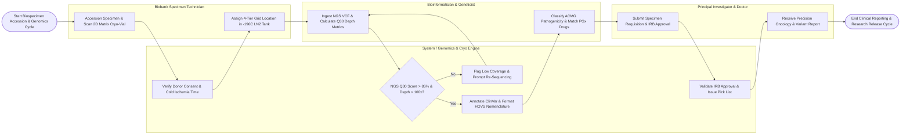

# Swimlane Diagram — Genomics & Biobank Management System

## Mermaid Code

## Flow Description | Mô tả luồng

| Lane | Actor / Subsystem | Role in Flow |
|------|-------------------|--------------|
| 1 | Biobank Specimen Technician | Accessions incoming biospecimens, verifies tissue types, scans 2D matrix barcode cryo-vials, aliquots DNA/RNA, and assigns precise 4-tier grid locations in -80°C/-196°C freezers. |
| 2 | Bioinformatician & Geneticist | Ingests NGS sequencing VCF files, evaluates coverage depth metrics, annotates variants against ClinVar/gnomAD, scores ACMG pathogenicity, and matches PGx drug-gene recommendations. |
| 3 | System / Genomics & Cryo Engine | Validates donor informed consent scope, tracks cold ischemia time, monitors IoT freezer telemetry, formats HGVS nomenclature, verifies IRB approvals, and generates cryo-box pick lists. |
| 4 | Principal Investigator & Doctor | Submits research sample requisitions, attaches IRB approvals and MTAs, orders precision oncology tumor panels, and receives actionable genomic mutation reports. |
