# Action Tree — Genomics & Biobank Management System

## Mermaid Code

```mermaid
graph TD
    Root["Genomics & Biobank Management System"]

    Root --> M1["Biospecimen Accessioning & 2D Barcoding"]
    Root --> M2["Cryo-Freezer Storage & IoT Telemetry"]
    Root --> M3["Donor Consent & Broad Governance"]
    Root --> M4["NGS Run Ingestion & Quality Control"]
    Root --> M5["Genomic Variant Annotation & ACMG"]
    Root --> M6["Pharmacogenomics & Precision Oncology"]
    Root --> M7["Research Requisition & IRB Release"]
    Root --> M8["ISO 20387 Biobank Quality Metrics"]

    M1 --> A11["Register Tissue Blood Plasma FFPE Samples"]
    M1 --> A12["Scan 2D Data Matrix Barcode Cryo-Vials"]
    M1 --> A13["Log Cold Ischemia Time & Fixation Protocol"]
    M1 --> A14["Extract DNA RNA & Measure RIN Quality Score"]

    M2 --> A21["Map 4-Tier Grid Locations Tank Rack Box Well"]
    M2 --> A22["Monitor -80C Mechanical & -196C LN2 Sensors"]
    M2 --> A23["Trigger Automated Storage Temperature Alarms"]
    M2 --> A24["Execute Cryo-Box 2D Camera Batch Scans"]

    M3 --> A31["Record Donor Informed Consent Agreements"]
    M3 --> A32["Configure Broad Consent Scope & Restrictions"]
    M3 --> A33["Process Donor Consent Withdrawal & Revocation"]
    M3 --> A34["Enforce Mandatory Specimen Destruction Orders"]

    M4 --> A41["Ingest NGS Raw FASTQ BAM & VCF File Runs"]
    M4 --> A42["Evaluate Q30 Quality Score & Mean Coverage Depth"]
    M4 --> A43["Filter Variant Allele Frequency & Read Depth"]
    M4 --> A44["Perform Somatic vs Germline Variant Subtraction"]

    M5 --> A51["Query ClinVar gnomAD & dbSNP Annotations"]
    M5 --> A52["Format HGVS Standard c and p Nomenclatures"]
    M5 --> A53["Score ACMG 5-Tier Pathogenicity Classification"]
    M5 --> A54["Flag Actionable Somatic Driver Mutations"]

    M6 --> A61["Match CPIC Drug-Gene Interaction Diplotypes"]
    M6 --> A62["Predict CYP2D6 & CYP2C19 Drug Metabolism"]
    M6 --> A63["Generate Precision Oncology Panel Reports"]
    M6 --> A64["Calculate Tumor Mutational Burden TMB & MSI"]

    M7 --> A71["Submit Research Specimen Requisition Orders"]
    M7 --> A72["Verify IRB Ethics Approval & MTA Agreements"]
    M7 --> A73["Generate Automated Cryo-Freezer Pick Lists"]
    M7 --> A74["Track Dry-Ice Dispatch & Aliquot Release"]

    M8 --> A81["Audit Sample Retrieval Success & Processing Time"]
    M8 --> A82["Track Cumulative Aliquot Freeze-Thaw Cycles"]
    M8 --> A83["Render ISO 20387 Biobank Quality Dashboards"]
    M8 --> A84["Export Anonymized Cohort Frequency Reports"]
```

## Module Description | Mô tả Module

| # | Module | Description | Actions |
|---|--------|-------------|---------|
| 1 | Biospecimen Accessioning & 2D Barcoding | Accessions tissue/blood/FFPE samples, scans 2D matrix cryo-vials, logs cold ischemia time, and measures RNA Integrity Number (RIN) quality. | Register Tissue Blood Plasma FFPE Samples, Scan 2D Data Matrix Barcode Cryo-Vials, Log Cold Ischemia Time & Fixation Protocol, Extract DNA RNA & Measure RIN Quality Score |
| 2 | Cryo-Freezer Storage & IoT Telemetry | Maps 4-tier grid locations (Tank/Rack/Box/Well A1-H12), monitors IoT sensors (-80°C / -196°C LN2), triggers alarms, and performs 2D camera box scans. | Map 4-Tier Grid Locations Tank Rack Box Well, Monitor -80C Mechanical & -196C LN2 Sensors, Trigger Automated Storage Temperature Alarms, Execute Cryo-Box 2D Camera Batch Scans |
| 3 | Donor Consent & Broad Governance | Records donor informed consent, configures broad consent scope, processes consent revocations, and enforces mandatory sample destruction. | Record Donor Informed Consent Agreements, Configure Broad Consent Scope & Restrictions, Process Donor Consent Withdrawal & Revocation, Enforce Mandatory Specimen Destruction Orders |
| 4 | NGS Run Ingestion & Quality Control | Ingests NGS sequencing runs (FASTQ, BAM, VCF), evaluates Q30 quality and mean coverage depth, filters variant frequency, and subtracts germline variants. | Ingest NGS Raw FASTQ BAM & VCF File Runs, Evaluate Q30 Quality Score & Mean Coverage Depth, Filter Variant Allele Frequency & Read Depth, Perform Somatic vs Germline Variant Subtraction |
| 5 | Genomic Variant Annotation & ACMG | Annotates variants against ClinVar/gnomAD, formats HGVS c./p. nomenclature, scores ACMG 5-tier pathogenicity, and flags actionable somatic drivers. | Query ClinVar gnomAD & dbSNP Annotations, Format HGVS Standard c and p Nomenclatures, Score ACMG 5-Tier Pathogenicity Classification, Flag Actionable Somatic Driver Mutations |
| 6 | Pharmacogenomics & Precision Oncology | Matches CPIC drug-gene interactions (CYP2D6, CYP2C19), predicts drug metabolism, generates precision oncology reports, and calculates TMB/MSI scores. | Match CPIC Drug-Gene Interaction Diplotypes, Predict CYP2D6 & CYP2C19 Drug Metabolism, Generate Precision Oncology Panel Reports, Calculate Tumor Mutational Burden TMB & MSI |
| 7 | Research Requisition & IRB Release | Submits biospecimen requisition orders, verifies IRB ethics approvals and Material Transfer Agreements (MTA), generates pick lists, and dispatches. | Submit Research Specimen Requisition Orders, Verify IRB Ethics Approval & MTA Agreements, Generate Automated Cryo-Freezer Pick Lists, Track Dry-Ice Dispatch & Aliquot Release |
| 8 | ISO 20387 Biobank Quality Metrics | Audits sample retrieval success, tracks cumulative freeze-thaw cycles, renders ISO 20387 quality dashboards, and exports anonymized cohort statistics. | Audit Sample Retrieval Success & Processing Time, Track Cumulative Aliquot Freeze-Thaw Cycles, Render ISO 20387 Biobank Quality Dashboards, Export Anonymized Cohort Frequency Reports |
