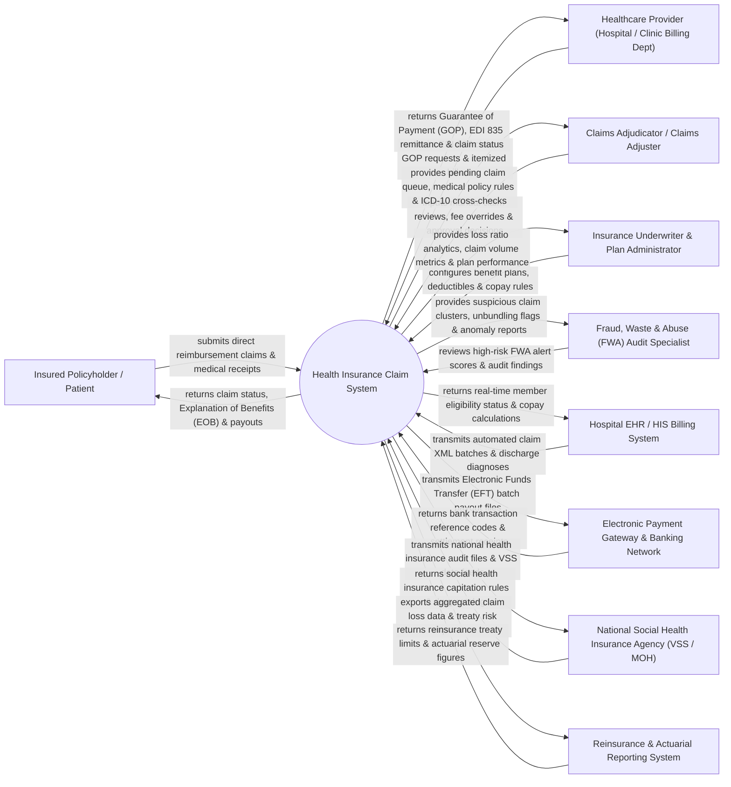

# Context Diagram — Health Insurance Claim System

## Mermaid Code

## Actor & Interaction Table | Bảng Actor & Tương tác

| # | Actor | Actor Type | Data Sent TO System | Data Received FROM System | Notes |
|---|-------|------------|---------------------|---------------------------|-------|
| 1 | Insured Policyholder / Patient | Primary | Direct reimbursement claim forms, medical receipts, hospital discharge letters, bank account details. | Claim processing status, Explanation of Benefits (EOB) statements, claim payout notifications. | Individual covered under a commercial or social health insurance policy. |
| 2 | Healthcare Provider (Hospital / Clinic Billing Dept) | Primary | EDI 837 electronic claims, Guarantee of Payment (GOP) pre-auth requests, itemized medical bills, diagnostic codes. | Guarantee of Payment (GOP) certificates, EDI 835 Electronic Remittance Advice (ERA), claim rejection codes. | Contracted hospital or clinic billing department submitting direct claims for medical services. |
| 3 | Claims Adjudicator / Claims Adjuster | Primary | Manual claim review decisions, medical necessity approvals, fee schedule overrides, claim denial rationale. | Adjudication queue worklist, policy coverage rules, ICD-10 to CPT compatibility matrices. | Insurance company claims professional evaluating complex or flagged medical claims. |
| 4 | Insurance Underwriter & Plan Administrator | Primary | Policy master definitions, benefit coverage limits, deductible tiers, co-insurance percentages, exclusion lists. | Claim loss ratios, plan profitability analytics, claim frequency metrics, premium vs payout curves. | Insurance executive configuring benefit plan structures and monitoring underwriting performance. |
| 5 | Fraud, Waste & Abuse (FWA) Audit Specialist | Primary | FWA investigation notes, fraud case confirmations, provider blacklist updates, audit recovery actions. | Suspicious claim anomaly alerts, high risk-score clusters, uncoding/upcoding detection reports. | Anti-fraud investigator auditing suspicious billing practices, phantom claims, and over-utilization. |
| 6 | Hospital EHR / HIS Billing System | Supporting System | Automated claim XML batch feeds, ICD-10 diagnosis codes, CPT/CDT procedure items, inpatient length of stay. | Real-time member eligibility verification (EDI 270/271), pre-calculated copay & deductible amounts. | Enterprise hospital information system transmitting electronic medical bills directly to insurers. |
| 7 | Electronic Payment Gateway & Banking Network | Supporting System | Electronic Funds Transfer (EFT) confirmation receipts, bank transaction reference codes, return status logs. | ACH / EFT batch payout files, bank disbursement instructions, provider direct deposit files. | Financial banking network executing automated claim reimbursement disbursements to providers and members. |
| 8 | National Social Health Insurance Agency (VSS / MOH) | Regulatory | National health insurance policy directives, Social Security drug fee catalogs, DRG reimbursement caps. | National health claim audit logs, statutory insurance data feeds, public health claim statistics. | Governmental body (e.g., Vietnam Social Security - VSS, MOH) regulating social health insurance. |
| 9 | Reinsurance & Actuarial Reporting System | Supporting System | Reinsurance treaty coverage limits, catastrophic risk thresholds, actuarial reserve requirements. | Aggregated claim loss datasets, high-cost claim exposure logs, treaty reinsurance recovery claims. | External reinsurance entity absorbing catastrophic claim losses exceeding primary insurer retentions. |

## System Boundary Description | Mô tả Phạm vi Hệ thống

The **Health Insurance Claim System (HICS)** is an enterprise financial and clinical software platform engineered for health insurance companies, Third Party Administrators (TPA), and social health insurance organizations. It manages member eligibility verification, Guarantee of Payment (GOP) pre-authorization, electronic claim intake (EDI 837 / XML), automated adjudication rule evaluation, Fraud, Waste & Abuse (FWA) AI anomaly screening, Explanation of Benefits (EOB) generation, Electronic Funds Transfer (EFT) payment processing, and claim appeals.

**Inside System Scope:**
- Real-time member eligibility verification (EDI 270/271) and active benefit check.
- Inpatient and high-cost outpatient Guarantee of Payment (GOP) pre-authorization workflows.
- Electronic claim intake (EDI 837, XML batches, paper receipt scan OCR) from hospitals and policyholders.
- Automated adjudication engine evaluating deductibles, copays, out-of-pocket maximums, and ICD-10 vs CPT rules.
- AI-driven Fraud, Waste & Abuse (FWA) detection for upcoding, unbundling, and duplicate billing.
- Generation of Explanation of Benefits (EOB) statements and EDI 835 Remittance Advice.
- Automated Electronic Funds Transfer (EFT) payment batching for provider direct settlement and member reimbursement.
- Claim appeal, dispute handling, and reinsurance loss reporting.

**Outside System Scope:**
- Physical medical treatment of patients inside hospital wards (handled by HIS / Hospitals).
- Physical printing and mailing of paper checks (handled by bank mail fulfillment services).
- General corporate HR payroll processing (handled by enterprise HR software).
- Core banking ledger maintenance for commercial banks (handled by core banking systems).
