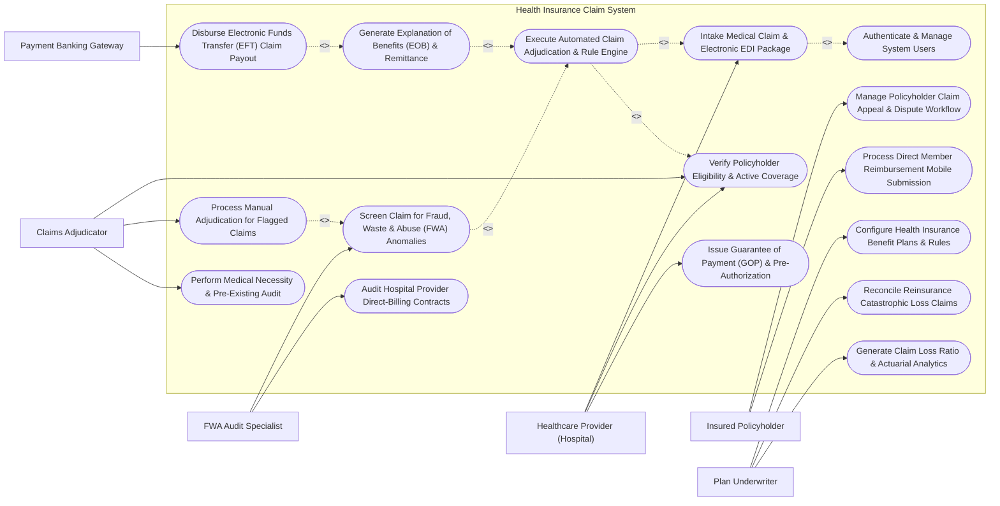

# Use Case Diagram — Health Insurance Claim System

## Mermaid Code

## Actor Table | Bảng Actor

| # | Actor | Actor Type | Role Description | Related Use Cases |
|---|-------|------------|------------------|-------------------|
| 1 | Insured Policyholder | Primary | Policyholder submitting direct reimbursement claims via mobile app and filing claim appeals. | UC09, UC14 |
| 2 | Healthcare Provider (Hospital) | Primary | Contracted hospital billing department verifying eligibility, requesting GOP pre-auth, and submitting EDI 837 claims. | UC01, UC02, UC04 |
| 3 | Claims Adjudicator | Primary | Claims professional verifying eligibility, performing manual reviews on complex/flagged claims, and auditing medical necessity. | UC02, UC06, UC13 |
| 4 | FWA Audit Specialist | Primary | Fraud investigator monitoring suspicious claim patterns, unbundling/upcoding, and auditing hospital contracts. | UC05, UC11 |
| 5 | Plan Underwriter | Primary | Insurance executive configuring benefit plan rules, managing reinsurance claims, and analyzing loss ratio analytics. | UC10, UC12, UC15 |
| 6 | Payment Banking Gateway | Secondary / System | Financial banking network executing automated EFT direct deposits to hospitals and policyholder accounts. | UC08 |

## Use Case Table | Bảng Use Case

| # | UC ID | Use Case Name | Primary Actor | Secondary Actor | Description | Priority |
|---|-------|---------------|---------------|-----------------|-------------|----------|
| 1 | UC01 | Intake Medical Claim & Electronic EDI Package | Healthcare Provider (Hospital) | None | Intake electronic medical claims via EDI 837 / XML batches or OCR optical scan, capturing diagnosis and itemized fees. | High |
| 2 | UC02 | Verify Policyholder Eligibility & Active Coverage | Healthcare Provider (Hospital) | Claims Adjudicator | Verify real-time member policy status (EDI 270/271), active coverage dates, benefit caps, and remaining deductibles. | High |
| 3 | UC03 | Execute Automated Claim Adjudication & Rule Engine | Claims Adjudicator | None | Run automated adjudication engine to calculate deductibles, co-insurance, out-of-pocket maximums, and payable amounts. | High |
| 4 | UC04 | Issue Guarantee of Payment (GOP) & Pre-Authorization | Healthcare Provider (Hospital) | None | Process pre-authorization for planned hospital admissions, evaluating medical necessity and issuing GOP certificates. | High |
| 5 | UC05 | Screen Claim for Fraud, Waste & Abuse (FWA) Anomalies | FWA Audit Specialist | None | Execute AI anomaly detection algorithms to flag suspicious claims (unbundling, upcoding, duplicate billing, phantom services). | High |
| 6 | UC06 | Process Manual Adjudication for Flagged Claims | Claims Adjudicator | None | Review claims flagged by FWA or rule exceptions, override fee items with documented rationale, and issue final approvals. | High |
| 7 | UC07 | Generate Explanation of Benefits (EOB) & Remittance | Claims Adjudicator | None | Generate Explanation of Benefits (EOB) for policyholders and Electronic Remittance Advice (EDI 835 ERA) for hospitals. | High |
| 8 | UC08 | Disburse Electronic Funds Transfer (EFT) Claim Payout | Payment Banking Gateway | None | Batch approved claim payments and execute Electronic Funds Transfer (EFT / ACH) direct deposits to bank accounts. | High |
| 9 | UC09 | Manage Policyholder Claim Appeal & Dispute Workflow | Insured Policyholder | Claims Adjudicator | Handle formal policyholder or provider claim rejection appeals, review supplementary medical notes, and re-adjudicate. | Medium |
| 10 | UC10 | Configure Health Insurance Benefit Plans & Rules | Plan Underwriter | None | Define master insurance benefit structures, annual policy limits, copay percentages, deductibles, and exclusion catalogs. | High |
| 11 | UC11 | Audit Hospital Provider Direct-Billing Contracts | FWA Audit Specialist | None | Cross-check provider billing rates against contracted fee schedules, auditing unauthorized price markups or unapproved drugs. | Medium |
| 12 | UC12 | Reconcile Reinsurance Catastrophic Loss Claims | Plan Underwriter | None | Identify high-cost claims exceeding reinsurance retention limits (e.g., > $100,000) and compile treaty recovery claims. | Medium |
| 13 | UC13 | Perform Medical Necessity & Pre-Existing Audit | Claims Adjudicator | None | Audit medical records for pre-existing condition exclusions, cosmetic procedure exclusions, or non-covered experimental treatments. | High |
| 14 | UC14 | Process Direct Member Reimbursement Mobile Submission | Insured Policyholder | None | Ingest member-submitted mobile claim photos (hospital bills, pharmacy receipts), running OCR to auto-populate claims. | High |
| 15 | UC15 | Generate Claim Loss Ratio & Actuarial Analytics | Plan Underwriter | None | Produce loss ratio analytics (Loss Ratio = Claims Paid / Earned Premiums), provider cost rankings, and claim turnaround times. | Medium |
| 16 | UC16 | Authenticate & Manage System Users | All Users | None | Enforce secure multi-factor authentication, role-based claims access control, and immutable financial audit logging. | High |

## Use Case Specification | Đặc tả Use Case

---

### UC01 — Intake Medical Claim & Electronic EDI Package

| Field | Detail |
|-------|--------|
| **UC ID** | UC01 |
| **Use Case Name** | Intake Medical Claim & Electronic EDI Package |
| **Actor(s)** | Primary: Healthcare Provider (Hospital) |
| **Description** | Ingests electronic medical claims submitted by hospitals (via EDI 837 Health Care Claim format or XML B2B gateway) or OCR-scanned paper receipt packages, validating mandatory claim header fields, ICD-10 diagnosis codes, CPT/CDT procedure line items, and attaching supporting medical records. |
| **Precondition** | 1. The healthcare provider is an accredited hospital or clinic registered in HICS.   2. The claim package (EDI 837I / EDI 837P or XML) is formatted per HIPAA EDI standards. |
| **Main Flow** | 1. The Hospital Billing System transmits an electronic EDI 837 claim batch to the HICS intake gateway.   2. The System ingests the payload and validates mandatory EDI Claim Header fields: Provider Code, Member ID Number, Claim Type (Inpatient, Outpatient, Dental), Admission/Discharge Dates, Primary ICD-10 Diagnosis, and Total Claimed Amount.   3. The System validates individual **Claim Line Items**: CPT/CDT Procedure Code, Quantity, Unit Price, Service Date, and Line Item Billed Amount.   4. The System assigns a unique **Claim Master Number** (e.g., CLM-2026-88192) and links supporting digital attachments (Hospital Discharge Summary, Operation Notes, Itemized Pharmacy Bill).   5. The System checks for duplicate submissions: Verifies if a claim with matching Member ID, Provider Code, Service Date, and Total Amount already exists.   6. If duplicate check passes, the System updates claim status to "Intake Complete - Queued for Eligibility Verification" and routes the claim to the Adjudication Engine (UC03). |
| **Alternative Flow** | **AF1** — Direct Member Mobile OCR Intake: For out-of-network claims, the Policyholder snaps photos of medical receipts on the mobile app (UC14); the System executes Optical Character Recognition (OCR) to extract total amount, clinic name, and receipt date.   **AF2** — Batch Paper Claim Scan Import: High-volume paper claims are scanned in batch; the System performs intelligent character recognition (ICR) to index paper CMS-1500 / UB-04 forms. |
| **Exception Flow** | **EX1** — Malformed EDI Format Error: If the EDI 837 file has syntax errors or missing mandatory segments (e.g., missing Loop 2300 Diagnosis), the System rejects the batch and returns an EDI 999 Implementation Acknowledgment Error to the hospital.   **EX2** — Duplicate Claim Hard Block: If an identical claim is already in "Approved" or "Paid" status, the System rejects the new claim with Rejection Code `DUP-01 (Duplicate Claim Submission)`. |
| **Postcondition** | Electronic medical claim is validated, unique Claim Master Number is assigned, itemized procedure lines are indexed, and claim is queued for eligibility verification. |
| **Business Rule** | **BR1**: Medical claims must contain at least one valid primary ICD-10 diagnosis code and corresponding CPT/CDT procedure code.   **BR2**: Claims submitted after the Timely Filing Limit (e.g., 90 calendar days from service discharge date) must be automatically flagged as `LATE-01 (Timely Filing Exceeded)`. |

---

### UC02 — Verify Policyholder Eligibility & Active Coverage

| Field | Detail |
|-------|--------|
| **UC ID** | UC02 |
| **Use Case Name** | Verify Policyholder Eligibility & Active Coverage |
| **Actor(s)** | Primary: Healthcare Provider (Hospital)   Secondary: Claims Adjudicator |
| **Description** | Verifies the real-time insurance policy status of an insured member (via EDI 270/271 Benefit Inquiry/Response), confirming active coverage on the service date, enrolled benefit plan rules, remaining annual benefit limits, accrued deductible balances, and pre-existing condition waiting period status. |
| **Precondition** | 1. A claim or pre-authorization request with Member ID number is ingested.   2. Member policy database is active and up to date. |
| **Main Flow** | 1. The Hospital or System initiates an Eligibility Verification Inquiry (EDI 270) using Member ID (e.g., MEM-991823) and Date of Service.   2. The System queries the Master Policy Database and retrieves member coverage status.   3. The System verifies **Policy Active Status**: Checks if the policy is active on the date of service (Effective Date <= Service Date <= Expiration Date) and premium payments are up to date.   4. The System retrieves **Benefit Plan Master Rules** (UC10): Plan Type (Gold Comprehensive), Annual Benefit Limit (e.g., $50,000), Annual Deductible (e.g., $500), Inpatient Copay % (10%), and Out-of-Pocket Maximum (e.g., $3,000).   5. The System calculates current financial balances:   &nbsp;&nbsp;&nbsp;&nbsp;- **Accumulated Billed YTD**: $12,400 / $50,000   &nbsp;&nbsp;&nbsp;&nbsp;- **Remaining Annual Cap**: $37,600   &nbsp;&nbsp;&nbsp;&nbsp;- **Met Deductible YTD**: $500 / $500 (Deductible Met)   &nbsp;&nbsp;&nbsp;&nbsp;- **Pre-Existing Condition Status**: 12-Month Waiting Period Passed.   6. The System generates an EDI 271 Eligibility Response confirming "Active Coverage - Verified", linking financial balances to the active claim payload. |
| **Alternative Flow** | **AF1** — Dependent Coverage Verification: For claims involving a spouse or child, the System verifies dependent enrollment status and primary vs secondary insurance coordination of benefits (COB).   **AF2** — Pre-Existing Condition Exclusion Period: If the policy was issued 3 months ago and diagnosis is Chronic Kidney Disease (subject to 12-month pre-existing exclusion), the System flags "Pre-Existing Exclusion Applies". |
| **Exception Flow** | **EX1** — Terminated / Inactive Policy Alert: If the member's policy was terminated due to non-payment of premium 30 days prior to service date, the System returns "Eligibility Failed: Policy Terminated" and rejects the claim.   **EX2** — Annual Benefit Cap Exceeded: If the remaining annual limit is $0 (annual $50,000 cap reached), the System flags "Annual Limit Reached - 100% Patient Responsibility". |
| **Postcondition** | Member eligibility is verified, active plan benefit rules (limits, deductibles, copays) are attached, and eligibility verification token (EDI 271) is recorded. |
| **Business Rule** | **BR1**: Services rendered on dates outside active policy effective dates (before inception or after termination) MUST be denied with Rejection Code `ELIG-01`.   **BR2**: Annual benefit limits and deductible accumulators must be updated in real-time upon claim adjudication approval. |

---

### UC03 — Execute Automated Claim Adjudication & Rule Engine

| Field | Detail |
|-------|--------|
| **UC ID** | UC03 |
| **Use Case Name** | Execute Automated Claim Adjudication & Rule Engine |
| **Actor(s)** | Primary: Claims Adjudicator |
| **Description** | Runs the automated deterministic adjudication rule engine on verified medical claims, evaluating medical necessity, ICD-10 vs CPT procedure compatibility, contracted fee schedules, applying deductibles, copays, and co-insurance to calculate Net Insurer Payable Amount and Patient Responsibility. |
| **Precondition** | 1. Claim intake (UC01) and Member eligibility verification (UC02) are complete.   2. Fee schedules and plan benefit rules are active. |
| **Main Flow** | 1. The Adjudication Engine fetches the queued claim (CLM-2026-88192) with total claimed amount of $4,500 for Inpatient Appendectomy.   2. The Engine evaluates **Contracted Provider Fee Schedule**: Compares hospital billed line items against contracted negotiated rates (e.g., Billed: $4,500; Contracted Negotiated Rate: $3,600; Non-Covered Price Markup: $900 Disallowed).   3. The Engine evaluates **ICD-10 vs CPT Compatibility Rules**: Verifies that Diagnosis `ICD-10 K35.80 (Acute Appendicitis)` is medically compatible with Procedure `CPT 44950 (Appendectomy)`.   4. The Engine applies **Financial Benefit Rules**:   &nbsp;&nbsp;&nbsp;&nbsp;- **Gross Allowed Amount**: $3,600   &nbsp;&nbsp;&nbsp;&nbsp;- **Deductible Applied**: $0 (Annual deductible already met)   &nbsp;&nbsp;&nbsp;&nbsp;- **Co-Insurance (90% Insurer / 10% Patient)**: Insurer Portion = $3,240; Patient Copay = $360   &nbsp;&nbsp;&nbsp;&nbsp;- **Net Insurer Payable Amount**: $3,240   &nbsp;&nbsp;&nbsp;&nbsp;- **Total Patient Responsibility**: $360 Copay + $900 Disallowed = $1,260.   5. The Engine checks for FWA Anomaly Triggers (UC05). If no FWA risk flags exist, the Engine sets status to "Auto-Adjudicated - Approved for Payment".   6. The System updates policy accumulators (YTD Paid Claims + $3,240) and queues the claim for EOB generation (UC07) and EFT payout (UC08). |
| **Alternative Flow** | **AF1** — Partial Line Item Denial: For a claim containing 5 line items, Item #1-4 are approved ($3,000), but Item #5 (Cosmetic Scar Gel) is denied as non-covered, issuing a partial approval status.   **AF2** — Out-of-Network Penalty Adjustment: For non-contracted providers, the Engine applies Out-of-Network benefit rules (60% Insurer / 40% Patient co-insurance + higher deductible). |
| **Exception Flow** | **EX1** — Incompatible Diagnosis/Procedure Rule Violation: If a claim bills `CPT 93000 (ECG Tracing)` under Diagnosis `ICD-10 L70.0 (Acne)`, the Engine flags "Medical Necessity Failed" and routes to Manual Adjudication (UC06).   **EX2** — FWA High-Risk Score Trigger: If the FWA engine assigns a risk score > 75 (e.g., suspicious unbundling), the Engine pauses auto-approval and routes the claim to the FWA Auditor. |
| **Postcondition** | Claim is adjudicated, contracted allowed amounts, deductibles, copays, and net insurer payable amounts are calculated, and status is set to Approved or Flagged. |
| **Business Rule** | **BR1**: Claims meeting 100% of automated rule criteria without FWA risk flags must be auto-adjudicated within 5 seconds without manual human intervention (Straight-Through Processing - STP).   **BR2**: Total insurer payable amount plus patient responsibility shall never exceed the contracted allowed fee schedule rate. |

---

### UC04 — Issue Guarantee of Payment (GOP) & Pre-Authorization

| Field | Detail |
|-------|--------|
| **UC ID** | UC04 |
| **Use Case Name** | Issue Guarantee of Payment (GOP) & Pre-Authorization |
| **Actor(s)** | Primary: Healthcare Provider (Hospital) |
| **Description** | Processes pre-authorization requests for planned inpatient hospital admissions or high-cost outpatient surgeries, evaluating medical necessity, proposed length of stay (LOS), and issuing a legally binding Guarantee of Payment (GOP) certificate to the hospital. |
| **Precondition** | 1. The hospital or attending physician submits a Pre-Authorization / GOP Request with treatment plan and estimated costs.   2. The patient has an active policy with inpatient coverage. |
| **Main Flow** | 1. The Hospital Admission Department submits a "Pre-Authorization / GOP Request" for planned surgery (e.g., Total Knee Replacement).   2. The System validates member eligibility (UC02) and verifies that planned surgery is a covered benefit under the member's plan.   3. The System evaluates clinical documentation: Primary Diagnosis `ICD-10 M17.11 (Osteoarthritis Right Knee)`, Proposed Surgery `CPT 27447`, Medical History (Failed 6 months conservative physical therapy), Estimated Inpatient Length of Stay (3 days), and Estimated Cost ($12,000).   4. The Medical Pre-Auth Medical Officer reviews clinical criteria and approves 3 Days Length of Stay and Maximum Approved GOP Guarantee Limit of $10,000.   5. The System generates an official **Guarantee of Payment (GOP) Certificate** (e.g., GOP-2026-00412) specifying: GOP Certificate Number, Approved Inpatient Length of Stay (3 Days), Max Approved Amount ($10,000), Expiration Date (30 days), and Excluded Personal Expenses (Telephone, Extra Meals).   6. The System dispatches the GOP Certificate via secure electronic portal and SMS to the hospital and policyholder.   7. Upon hospital discharge, the final claim (UC01) is automatically linked to GOP-2026-00412 for expedited settlement. |
| **Alternative Flow** | **AF1** — Emergency Inpatient GOP Issuance: For emergency ICU admissions, the hospital requests GOP within 24 hours of emergency admission; the System retroactively issues Emergency GOP.   **AF2** — Length of Stay Extension Request: During hospital stay, the physician requests 2 additional inpatient days due to post-op fever; the Medical Officer reviews progress notes and issues a "GOP Extension Amendment". |
| **Exception Flow** | **EX1** — Non-Covered Cosmetic / Elective Procedure: If the pre-auth request is for elective cosmetic rhinoplasty, the System issues a "GOP Denied - Non-Covered Benefit" letter.   **EX2** — Pre-Existing Condition Investigation Required: If the policy was purchased 1 month ago and pre-auth is for chronic spinal fusion, the System flags "Hold GOP - Request 3-Year Prior Medical Records". |
| **Postcondition** | Medical necessity is approved, GOP Certificate with approved limit and length of stay is issued to hospital, and pre-authorization is linked to member record. |
| **Business Rule** | **BR1**: Planned inpatient admissions exceeding $2,000 require mandatory Pre-Authorization / GOP certification prior to hospital admission.   **BR2**: GOP certificates are valid for 30 calendar days from date of issuance and cover only medically necessary treatments specified in the approval letter. |

---

### UC05 — Screen Claim for Fraud, Waste & Abuse (FWA) Anomalies

| Field | Detail |
|-------|--------|
| **UC ID** | UC05 |
| **Use Case Name** | Screen Claim for Fraud, Waste & Abuse (FWA) Anomalies |
| **Actor(s)** | Primary: FWA Audit Specialist |
| **Description** | Executes AI machine learning models and deterministic rule engines across incoming claims to detect Fraud, Waste & Abuse (FWA) patterns, including Upcoding (billing higher severity CPTs), Unbundling (fragmenting single procedure codes), Phantom Billing (billing for unperformed services), and Over-Utilization. |
| **Precondition** | 1. The claim has passed initial intake (UC01) and is undergoing adjudication (UC03).   2. Historical claim database and FWA detection models are active. |
| **Main Flow** | 1. As claims pass through adjudication, the **FWA Screening Engine** analyzes claim line items against multi-dimensional fraud detection algorithms.   2. The Engine executes **Unbundling Rules**: Checks if separate CPT codes billed together (e.g., CPT 47562 Laparoscopic Cholecystectomy + CPT 49320 Diagnostic Laparoscopy) should be bundled into a single primary code per CCI (Correct Coding Initiative) edits.   3. The Engine executes **Upcoding Detection**: Compares provider evaluation & management (E&M) coding distribution against national specialty peer averages (e.g., Provider bills 95% Level 5 E&M `CPT 99215`, while peer average is 15%).   4. The Engine checks **Frequency & Phantom Billing Rules**: Verifies if 2 appendectomies or 3 brain CT scans were billed for the same patient within 7 days.   5. The Engine computes an overall **FWA Risk Score** (Scale 0 to 100):   &nbsp;&nbsp;&nbsp;&nbsp;- Risk Score < 30: Low Risk -> Pass to Auto-Adjudication   &nbsp;&nbsp;&nbsp;&nbsp;- Risk Score 30-70: Medium Risk -> Flag for Post-Payment Audit   &nbsp;&nbsp;&nbsp;&nbsp;- Risk Score > 70: High Risk -> Immediate Payment Hold & Manual Review.   6. For a claim scoring Risk Score 82 (Suspected Unbundling + High Provider Anomaly), the System places a "Pre-Payment Audit Hold" on Claim CLM-2026-88192 and generates an FWA Audit Alert (fwa_id).   7. The FWA Audit Specialist opens the alert, inspects suspicious line items, requests medical records from the hospital, and confirms or dismisses the fraud flag. |
| **Alternative Flow** | **AF1** — Provider Blacklist / Watchlist Matching: If a claim is submitted by a provider or physician currently on the "Regulatory Blacklist / Watchlist", the System automatically blocks payment and alerts compliance officers.   **AF2** — Post-Payment Machine Learning Data Mining: The System runs quarterly unsupervised clustering (K-means / Isolation Forest) on historical claims to identify emerging systemic billing fraud rings across providers. |
| **Exception Flow** | **EX1** — False Positive FWA Flag Override: The FWA Specialist reviews medical records for a flagged high-cost claim and confirms legitimate complex trauma care; the Specialist marks "False Positive - Cleared", releasing the claim for payment.   **EX2** — Confirmed Fraud Investigation Escalation: The Specialist confirms intentional phantom billing (fake receipts); the System locks all pending provider payments, issues a Payment Recovery Order, and exports evidence to Legal. |
| **Postcondition** | FWA Risk Score (0-100) is calculated, unbundling/upcoding anomalies are detected, high-risk claims are placed on payment hold, and audit alerts are queued for FWA specialists. |
| **Business Rule** | **BR1**: Claims triggering an FWA Risk Score > 70 MUST be placed on immediate pre-payment hold and assigned to an FWA Audit Specialist within 24 hours.   **BR2**: Unbundled procedure codes identified by NCCI edits must be automatically re-bundled to the primary procedure code allowed rate. |
