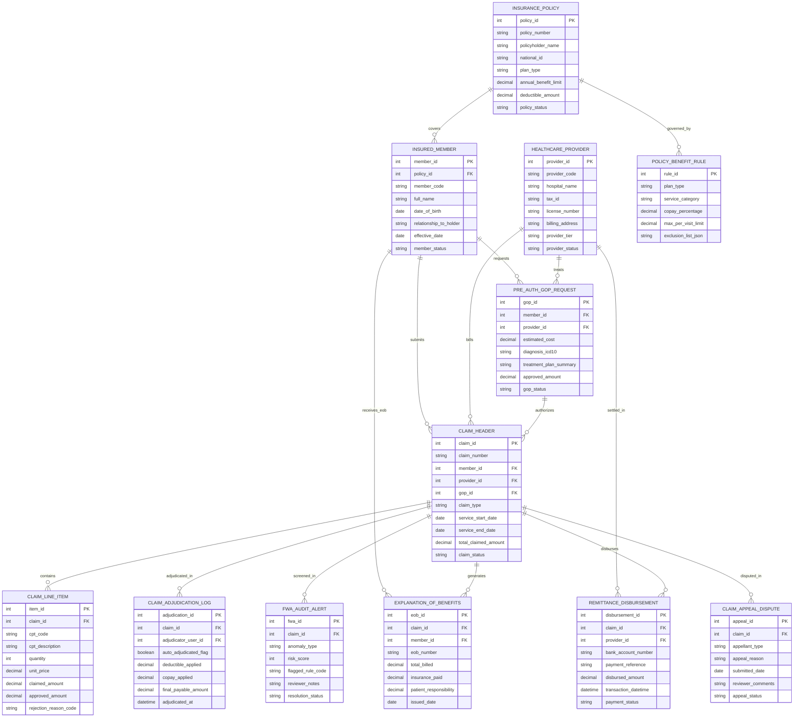

# Conceptual ERD — Health Insurance Claim System

## Mermaid Code

## Entity Description Table | Bảng mô tả Entity

| # | Entity Name | Vietnamese Name | Description | Key Attributes | Main Relationships |
|---|-------------|-----------------|-------------|----------------|-------------------|
| 1 | INSURANCE_POLICY | Hợp đồng Bảo hiểm Master | Master insurance policy record storing policy number, policyholder name, plan type, annual benefit cap, deductible, and status. | policy_id, policy_number, policyholder_name, plan_type, annual_benefit_limit, deductible_amount | Has many INSURED_MEMBER and POLICY_BENEFIT_RULE entities. |
| 2 | INSURED_MEMBER | Thành viên được Bảo hiểm | Insured individual member record (primary holder or dependent) tracking member code, DOB, relationship, and effective dates. | member_id, policy_id, member_code, full_name, dob, relationship_to_holder, member_status | Belongs to INSURANCE_POLICY; Has many PRE_AUTH_GOP_REQUEST, CLAIM_HEADER, EXPLANATION_OF_BENEFITS, etc. |
| 3 | HEALTHCARE_PROVIDER | Cơ sở Y tế (Bệnh viện) | Contracted hospital or clinic provider record storing provider code, hospital name, tax ID, billing address, tier, and status. | provider_id, provider_code, hospital_name, tax_id, license_number, provider_tier, provider_status | Has many PRE_AUTH_GOP_REQUEST, CLAIM_HEADER, and REMITTANCE_DISBURSEMENT entities. |
| 4 | PRE_AUTH_GOP_REQUEST | Bảo lãnh Viện phí (GOP) | Pre-authorization and Guarantee of Payment (GOP) request record tracking estimated cost, ICD-10 diagnosis, and approved GOP limit. | gop_id, member_id, provider_id, estimated_cost, diagnosis_icd10, approved_amount, gop_status | Belongs to INSURED_MEMBER and HEALTHCARE_PROVIDER; Has many CLAIM_HEADER entities. |
| 5 | CLAIM_HEADER | Hồ sơ Bồi thường Master | Core medical claim header record storing claim number, member ID, provider ID, claim type, service dates, total claimed, and status. | claim_id, claim_number, member_id, provider_id, gop_id, service_start_date, total_claimed_amount, claim_status | Belongs to INSURED_MEMBER, HEALTHCARE_PROVIDER, and PRE_AUTH_GOP_REQUEST; Has CLAIM_LINE_ITEM, ADJUDICATION_LOG, FWA_ALERT, etc. |
| 6 | CLAIM_LINE_ITEM | Chi tiết Dịch vụ Bồi thường | Individual CPT/CDT procedure line item detail storing CPT code, quantity, unit price, claimed amount, approved amount, and rejection code. | item_id, claim_id, cpt_code, quantity, unit_price, claimed_amount, approved_amount, rejection_reason_code | Belongs to CLAIM_HEADER. |
| 7 | CLAIM_ADJUDICATION_LOG | Nhật ký Giám định Bồi thường | Adjudication calculation log recording adjudicator ID, auto-adjudicated flag, applied deductible, applied copay, and net payable amount. | adjudication_id, claim_id, adjudicator_user_id, auto_adjudicated_flag, deductible_applied, copay_applied, final_payable_amount | Belongs to CLAIM_HEADER. |
| 8 | FWA_AUDIT_ALERT | Cảnh báo Gian lận FWA | Fraud, Waste & Abuse (FWA) audit alert record tracking anomaly type (unbundling, upcoding), FWA risk score (0-100), rule code, and status. | fwa_id, claim_id, anomaly_type, risk_score, flagged_rule_code, reviewer_notes, resolution_status | Belongs to CLAIM_HEADER. |
| 9 | EXPLANATION_OF_BENEFITS | Thông báo Bồi thường EOB | Explanation of Benefits (EOB) statement sent to policyholders detailing total billed, insurer paid, and patient responsibility amount. | eob_id, claim_id, member_id, eob_number, total_billed, insurance_paid, patient_responsibility | Belongs to CLAIM_HEADER and INSURED_MEMBER. |
| 10 | REMITTANCE_DISBURSEMENT | Nhật ký Thanh toán Payout | Financial payout disbursement record tracking provider bank account, EFT transaction reference, disbursed amount, and payment status. | disbursement_id, claim_id, provider_id, bank_account_number, payment_reference, disbursed_amount, payment_status | Belongs to CLAIM_HEADER and HEALTHCARE_PROVIDER. |
| 11 | CLAIM_APPEAL_DISPUTE | Khiếu nại Bồi thường | Claim appeal and dispute record documenting appellant type (member/provider), appeal reason, submitted date, and reviewer comments. | appeal_id, claim_id, appellant_type, appeal_reason, submitted_date, reviewer_comments, appeal_status | Belongs to CLAIM_HEADER. |
| 12 | POLICY_BENEFIT_RULE | Quy tắc Quyền lợi Bảo hiểm | Master benefit plan configuration rule setting copay percentages, max per-visit caps, service category rules, and exclusion lists. | rule_id, plan_type, service_category, copay_percentage, max_per_visit_limit, exclusion_list_json | Belongs to INSURANCE_POLICY. |

## Relationship Description | Mô tả Quan hệ

| # | From Entity | Cardinality | To Entity | Relationship Label | Business Explanation |
|---|-------------|-------------|-----------|-------------------|----------------------|
| 1 | INSURANCE_POLICY | one-to-many | INSURED_MEMBER | covers | One insurance policy covers one primary policyholder and optional dependents. |
| 2 | INSURANCE_POLICY | one-to-many | POLICY_BENEFIT_RULE | governed_by | One insurance policy is governed by master plan benefit rules (copays, caps, exclusions). |
| 3 | INSURED_MEMBER | one-to-many | PRE_AUTH_GOP_REQUEST | requests | One insured member requests pre-authorization or Guarantee of Payment (GOP) certificates. |
| 4 | INSURED_MEMBER | one-to-many | CLAIM_HEADER | submits | One insured member submits medical claims for reimbursement. |
| 5 | INSURED_MEMBER | one-to-many | EXPLANATION_OF_BENEFITS | receives_eob | One insured member receives Explanation of Benefits (EOB) statements for processed claims. |
| 6 | HEALTHCARE_PROVIDER | one-to-many | PRE_AUTH_GOP_REQUEST | treats | One healthcare provider treats members under GOP pre-authorizations. |
| 7 | HEALTHCARE_PROVIDER | one-to-many | CLAIM_HEADER | bills | One healthcare provider bills direct electronic medical claims (EDI 837). |
| 8 | HEALTHCARE_PROVIDER | one-to-many | REMITTANCE_DISBURSEMENT | settled_in | One healthcare provider is settled in Electronic Funds Transfer (EFT) payout batches. |
| 9 | PRE_AUTH_GOP_REQUEST | one-to-many | CLAIM_HEADER | authorizes | One approved GOP pre-authorization authorizes subsequent medical claim headers. |
| 10 | CLAIM_HEADER | one-to-many | CLAIM_LINE_ITEM | contains | One claim header contains multiple individual procedure line items (CPT/CDT). |
| 11 | CLAIM_HEADER | one-to-many | CLAIM_ADJUDICATION_LOG | adjudicated_in | One claim header undergoes automated or manual adjudication logging. |
| 12 | CLAIM_HEADER | one-to-many | FWA_AUDIT_ALERT | screened_in | One claim header is screened in Fraud, Waste & Abuse (FWA) audit alerts. |
| 13 | CLAIM_HEADER | one-to-one | EXPLANATION_OF_BENEFITS | generates | One approved claim header generates exactly one Explanation of Benefits (EOB) statement. |
| 14 | CLAIM_HEADER | one-to-many | REMITTANCE_DISBURSEMENT | disburses | One approved claim header disburses payments via banking network transfers. |
| 15 | CLAIM_HEADER | one-to-many | CLAIM_APPEAL_DISPUTE | disputed_in | One denied or partially paid claim header can be disputed in formal appeals. |
