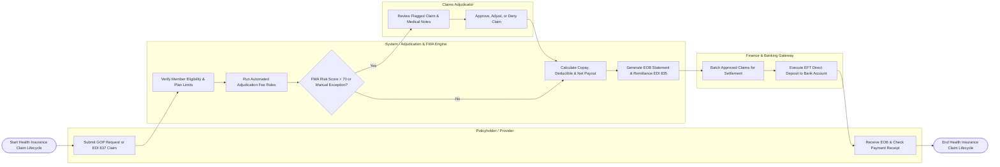

# Swimlane Diagram — Health Insurance Claim System

## Mermaid Code

## Flow Description | Mô tả luồng

| Lane | Actor / Subsystem | Role in Flow |
|------|-------------------|--------------|
| 1 | Policyholder / Provider | Submits pre-authorization GOP requests or electronic EDI 837 claim packages, receives Explanation of Benefits (EOB) statements, and checks bank deposit receipts. |
| 2 | System / Adjudication & FWA Engine | Verifies member policy eligibility, runs automated adjudication rules against contracted fee schedules, calculates deductibles and copays, screens FWA fraud scores, and generates EOBs. |
| 3 | Claims Adjudicator | Reviews complex claims or high-risk FWA alerts flagged by the system, inspects hospital medical necessity notes, and issues manual approvals or denial decisions. |
| 4 | Finance & Banking Gateway | Batches approved claims for payment, generates Electronic Funds Transfer (EFT / ACH) instructions, and executes direct deposit payouts to hospital or member bank accounts. |
