# Action Tree — Health Insurance Claim System

## Mermaid Code

```mermaid
graph TD
    Root["Health Insurance Claim System"]

    Root --> M1["Member Eligibility Verification"]
    Root --> M2["Pre-Authorization & GOP"]
    Root --> M3["Claim Intake & EDI Gateway"]
    Root --> M4["Automated Adjudication Engine"]
    Root --> M5["FWA Fraud Detection"]
    Root --> M6["EOB & Remittance Advice"]
    Root --> M7["EFT Settlement & Banking"]
    Root --> M8["Appeals & Loss Analytics"]

    M1 --> A11["Verify EDI 270 271 Policy Coverage"]
    M1 --> A12["Check Annual Benefit Limit Cap"]
    M1 --> A13["Track Accumulated Deductible Balance"]
    M1 --> A14["Audit Pre-Existing Condition Period"]

    M2 --> A21["Review Inpatient Admission Pre-Auth"]
    M2 --> A22["Evaluate Medical Necessity & LOS"]
    M2 --> A23["Issue Guarantee of Payment GOP Certificate"]
    M2 --> A24["Process Emergency GOP Retro-Approval"]

    M3 --> A31["Ingest EDI 837 Electronic Claims"]
    M3 --> A32["OCR Scan Paper Medical Receipts"]
    M3 --> A33["Validate Mandatory Claim Header Fields"]
    M3 --> A34["Block Duplicate Claim Submissions"]

    M4 --> A41["Apply Contracted Fee Schedule Rates"]
    M4 --> A42["Cross-Check ICD-10 Diagnosis vs CPT"]
    M4 --> A43["Calculate Copay & Insurer Net Payout"]
    M4 --> A44["Execute Straight-Through Auto-Approval"]

    M5 --> A51["Detect CPT Code Unbundling Anomalies"]
    M5 --> A52["Screen High-Volume E&M Upcoding"]
    M5 --> A53["Compute Overall FWA Risk Score"]
    M5 --> A54["Place Pre-Payment Audit Hold Flag"]

    M6 --> A61["Generate Explanation of Benefits EOB"]
    M6 --> A62["Publish EDI 835 Remittance Advice"]
    M6 --> A63["Notify Patient Responsibility Amounts"]
    M6 --> A64["Export Claim Rejection Error Codes"]

    M7 --> A71["Batch Approved Claims for Settlement"]
    M7 --> A72["Execute Electronic Funds Transfer EFT"]
    M7 --> A73["Process Bank Transaction ACH Receipts"]
    M7 --> A74["Reconcile Provider Direct Deposit Accounts"]

    M8 --> A81["Manage Policyholder Claim Rejection Appeal"]
    M8 --> A82["Reconcile Reinsurance Catastrophic Loss"]
    M8 --> A83["Calculate Plan Claim Loss Ratios"]
    M8 --> A84["Export Actuarial Performance Analytics"]
```

## Module Description | Mô tả Module

| # | Module | Description | Actions |
|---|--------|-------------|---------|
| 1 | Member Eligibility Verification | Verifies real-time policy active status (EDI 270/271), tracks annual benefit caps, accumulated deductibles, and pre-existing condition periods. | Verify EDI 270 271 Policy Coverage, Check Annual Benefit Limit Cap, Track Accumulated Deductible Balance, Audit Pre-Existing Condition Period |
| 2 | Pre-Authorization & GOP | Evaluates medical necessity for planned inpatient admissions, checks proposed length of stay, and issues Guarantee of Payment (GOP) certificates. | Review Inpatient Admission Pre-Auth, Evaluate Medical Necessity & LOS, Issue Guarantee of Payment GOP Certificate, Process Emergency GOP Retro-Approval |
| 3 | Claim Intake & EDI Gateway | Ingests electronic EDI 837 / XML claims, parses mobile receipt OCR scans, validates mandatory claim header fields, and blocks duplicate submissions. | Ingest EDI 837 Electronic Claims, OCR Scan Paper Medical Receipts, Validate Mandatory Claim Header Fields, Block Duplicate Claim Submissions |
| 4 | Automated Adjudication Engine | Applies contracted fee schedules, cross-checks ICD-10 vs CPT code compatibility, calculates copays and deductibles, and executes auto-approvals. | Apply Contracted Fee Schedule Rates, Cross-Check ICD-10 Diagnosis vs CPT, Calculate Copay & Insurer Net Payout, Execute Straight-Through Auto-Approval |
| 5 | FWA Fraud Detection | Runs AI anomaly detection for CPT unbundling and E&M upcoding, computes FWA Risk Scores (0-100), and places pre-payment audit holds. | Detect CPT Code Unbundling Anomalies, Screen High-Volume E&M Upcoding, Compute Overall FWA Risk Score, Place Pre-Payment Audit Hold Flag |
| 6 | EOB & Remittance Advice | Generates Explanation of Benefits (EOB) for policyholders, publishes EDI 835 ERA remittance advice for hospitals, and exports rejection codes. | Generate Explanation of Benefits EOB, Publish EDI 835 Remittance Advice, Notify Patient Responsibility Amounts, Export Claim Rejection Error Codes |
| 7 | EFT Settlement & Banking | Batches approved claims for settlement, executes Electronic Funds Transfers (EFT / ACH), parses bank receipts, and reconciles provider accounts. | Batch Approved Claims for Settlement, Execute Electronic Funds Transfer EFT, Process Bank Transaction ACH Receipts, Reconcile Provider Direct Deposit Accounts |
| 8 | Appeals & Loss Analytics | Manages policyholder claim rejection appeals, reconciles catastrophic reinsurance claims, calculates claim loss ratios, and exports actuarial analytics. | Manage Policyholder Claim Rejection Appeal, Reconcile Reinsurance Catastrophic Loss, Calculate Plan Claim Loss Ratios, Export Actuarial Performance Analytics |
