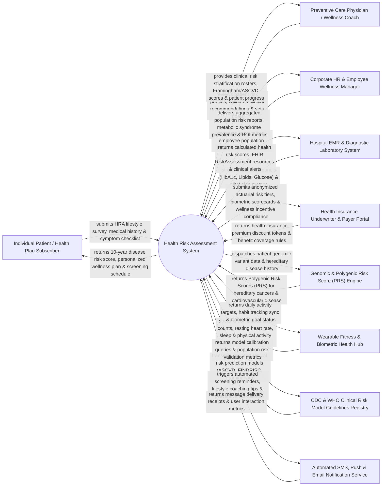

# Context Diagram — Health Risk Assessment System

## Mermaid Code

## Actor & Interaction Table | Bảng Actor & Tương tác

| # | Actor | Actor Type | Data Sent TO System | Data Received FROM System | Notes |
|---|-------|------------|---------------------|---------------------------|-------|
| 1 | Individual Patient / Subscriber | Primary | HRA questionnaire answers (diet, smoking, alcohol, exercise, family history), self-reported symptoms, consent forms. | Overall health risk score, 10-year cardiovascular/diabetes risk %, personalized wellness action plan, screening reminders. | Individual users or insured employees completing digital health risk assessments and tracking preventive wellness goals. |
| 2 | Preventive Care Physician / Coach | Primary | Clinical risk profile validations, physician sign-offs, customized lifestyle goal adjustments, diagnostic screening orders. | High-risk patient triage rosters, ASCVD/Framingham score breakdowns, longitudinal risk score trends, SOAP consultation notes. | Medical doctors, preventive health specialists, or certified wellness coaches reviewing patient risk evaluations. |
| 3 | Corporate HR & Wellness Manager | Primary | Population health benchmarking requests, employee wellness incentive program parameters, corporate department filters. | Anonymized corporate population health risk reports, aggregate metabolic syndrome statistics, wellness ROI analytics. | HR leaders managing corporate wellness programs and evaluating aggregate health risks of employee populations. |
| 4 | Hospital EMR & Diagnostic Lab | Supporting System | Laboratory blood panel data (Fasting Glucose, HbA1c, Lipid Profile, Liver Function), vital signs (BP, BMI, waist circumference). | Calculated health risk scores, FHIR `RiskAssessment` resources, high-risk lab alert triggers, clinical summary sync. | Enterprise hospital EMR (Epic, Cerner) and commercial diagnostic laboratories (Quest, LabCorp) supplying clinical lab inputs. |
| 5 | Health Insurance Underwriter | Supporting System | Health plan coverage rules, premium discount eligibility criteria, underwriting risk tier definitions. | Anonymized actuarial risk distribution data, employee wellness program engagement metrics, premium discount tokens. | Health insurance payers using risk assessment data to calculate group premium discounts and wellness incentives. |
| 6 | Genomic Risk Assessment Engine | Supporting System | Polygenic Risk Scores (PRS) for hereditary cancers (breast, colorectal) and early-onset cardiovascular disease. | Anonymized patient genetic variant data, family cancer history, target disease phenotype queries. | Advanced genomic microservice calculating polygenic risk scores based on single nucleotide polymorphisms (SNPs). |
| 7 | Wearable Fitness & Health Hub | Supporting System | Daily step counts, resting heart rate, active calorie burn, sleep duration, continuous blood pressure/SpO2 trends. | Daily physical activity targets, lifestyle goal progress sync, wearable biometric compliance badges. | Consumer and medical wearable platforms (Apple Health, Fitbit, Garmin, Google Fit) streaming physical activity data. |
| 8 | CDC & WHO Risk Model Registry | Regulatory | Validated clinical risk algorithms (Framingham 10-Yr CVD, AHA/ACC ASCVD Risk Estimator, FINDRISC Diabetes Score). | Model validation queries, population risk score distribution metrics, algorithmic calibration data. | Standard medical research registries providing clinical risk prediction models and evidence-based screening guidelines. |
| 9 | Automated Notification Service | Supporting System | Message delivery status receipts, SMS link clicks, push notification open events, email engagement analytics. | Automated preventive screening reminders, HRA completion prompts, weekly lifestyle tips, urgent risk alert SMS. | Communication gateway (Twilio, SendGrid, Firebase) delivering multi-channel preventive health reminders. |

## System Boundary Description | Mô tả Phạm vi Hệ thống

The **Health Risk Assessment System (HRAS)** is an enterprise clinical risk stratification, disease prevention, lifestyle analytics, and population health management platform. Operating across individual patient portals, clinical preventive care centers, corporate wellness programs, and health insurance payer networks, it ingests multi-source data (digital HRA questionnaires, laboratory blood panels, wearable biometrics, and genomic variants), executes clinical risk algorithms (ASCVD, Framingham, FINDRISC, Polygenic Risk Scores), stratifies individuals into risk categories, generates personalized preventive action plans, and delivers aggregate population risk analytics.

**Inside System Scope:**
- Digital Health Risk Assessment (HRA) questionnaire engine covering diet, exercise, smoking, stress, family history, and symptoms.
- Integration of clinical laboratory blood panels (HbA1c, Lipid Profile, Fasting Glucose) and physical biometrics (BP, BMI).
- Multi-model clinical risk calculation engine: ASCVD 10-year CVD risk, Framingham Risk Score, FINDRISC Diabetes Score, and Polygenic Risk Scores (PRS).
- Automated risk category stratification (Low, Moderate, High, Very High) with color-coded risk dashboards.
- Generation of personalized preventive wellness action plans, lifestyle modification targets, and age/gender-specific screening schedules.
- Physician clinical validation workflow, risk profile sign-offs, and virtual preventive care consultation tools.
- Anonymized corporate employee population health risk reporting, metabolic syndrome prevalence benchmarking, and wellness ROI tracking.
- Integration with health insurance underwriter portals for wellness incentive tracking and premium discount calculation.

**Outside System Scope:**
- Acute emergency inpatient treatment and surgical operations (handled by Hospital Information Systems).
- Physical laboratory processing of blood specimens (handled by LIS / Diagnostic Labs).
- Direct underwriting of individual health insurance policy contracts (handled by Insurance Core Underwriting Systems).
