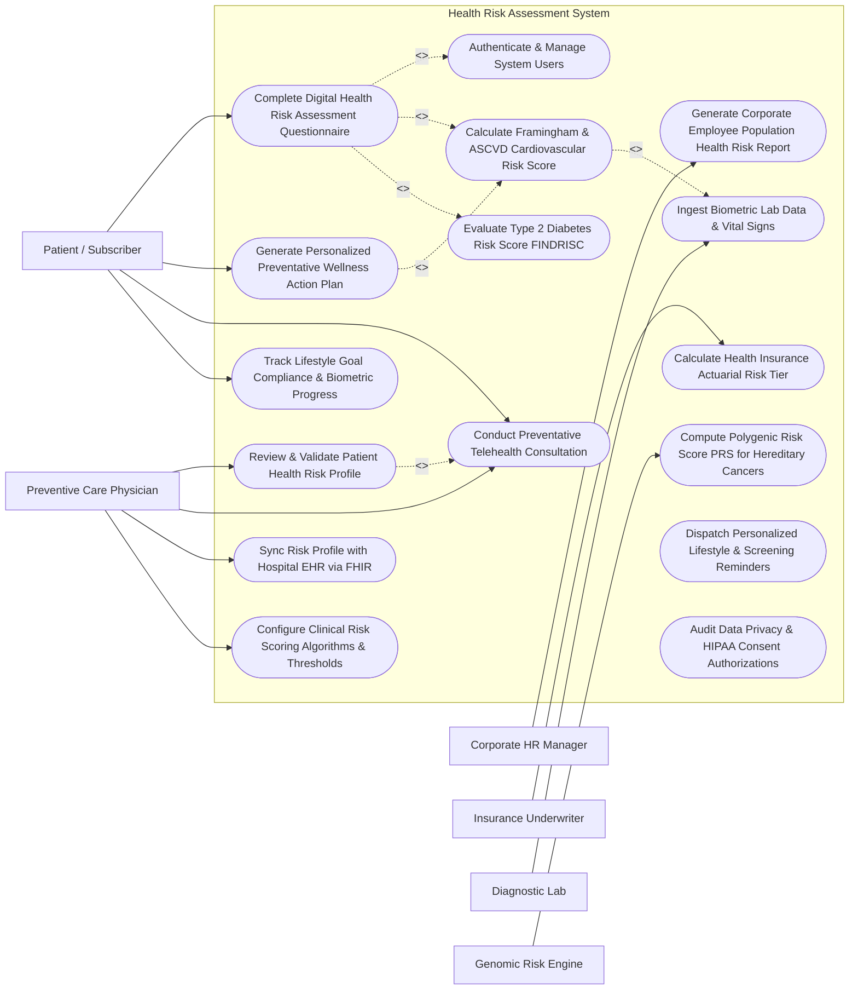

# Use Case Diagram — Health Risk Assessment System

## Mermaid Code

## Actor Table | Bảng Actor

| # | Actor | Actor Type | Role Description | Related Use Cases |
|---|-------|------------|------------------|-------------------|
| 1 | Patient / Subscriber | Primary | Individual health plan member or employee completing HRA questionnaires, tracking wellness progress, and attending preventive check-ups. | UC01, UC06, UC08, UC11 |
| 2 | Preventive Care Physician | Primary | Licensed physician or wellness coach reviewing patient risk scores, validating clinical assessments, and conducting preventive consultations. | UC07, UC08, UC12, UC13 |
| 3 | Corporate HR Manager | Primary | Enterprise human resources manager reviewing aggregated, anonymized employee population health risk reports and wellness ROI metrics. | UC09 |
| 4 | Insurance Underwriter | Primary | Health insurance payer representative reviewing anonymized actuarial risk distributions and authorizing wellness premium discounts. | UC10 |
| 5 | Diagnostic Lab | Secondary / System | External clinical laboratory or hospital EMR system transmitting validated patient blood chemistry panels (Lipids, HbA1c, Glucose). | UC02 |
| 6 | Genomic Risk Engine | Secondary / System | External bioinformatics service calculating Polygenic Risk Scores (PRS) based on genomic variant analysis. | UC05 |

## Use Case Table | Bảng Use Case

| # | UC ID | Use Case Name | Primary Actor | Secondary Actor | Description | Priority |
|---|-------|---------------|---------------|-----------------|-------------|----------|
| 1 | UC01 | Complete Digital Health Risk Assessment Questionnaire | Patient / Subscriber | None | Complete comprehensive digital HRA questionnaire covering nutrition, physical activity, tobacco/alcohol use, family history, and mental stress. | High |
| 2 | UC02 | Ingest Biometric Lab Data & Vital Signs | Diagnostic Lab | None | Automatically ingest and validate clinical lab panels (HbA1c, Lipid profile, Fasting glucose) and physical vitals (BP, BMI, waist-hip ratio). | High |
| 3 | UC03 | Calculate Framingham & ASCVD Cardiovascular Risk Score | Patient / Subscriber | Diagnostic Lab | Compute 10-year atherosclerotic cardiovascular disease (ASCVD) and Framingham risk percentage based on age, BP, cholesterol, and smoking status. | High |
| 4 | UC04 | Evaluate Type 2 Diabetes Risk Score FINDRISC | Patient / Subscriber | Diagnostic Lab | Calculate Finnish Diabetes Risk Score (FINDRISC) estimating 10-year probability of developing Type 2 Diabetes based on BMI, waist, and lab inputs. | High |
| 5 | UC05 | Compute Polygenic Risk Score PRS for Hereditary Cancers | Genomic Risk Engine | Preventive Care Physician | Integrate polygenic genomic variant data to calculate multi-locus risk scores for hereditary breast, prostate, and colorectal cancers. | Medium |
| 6 | UC06 | Generate Personalized Preventative Wellness Action Plan | Patient / Subscriber | None | Produce tailored multi-pillar wellness action plans detailing target nutrition changes, exercise prescriptions, and screening schedules. | High |
| 7 | UC07 | Review & Validate Patient Health Risk Profile | Preventive Care Physician | None | Review automated risk score outputs, validate high-risk patient flags, adjust recommendations, and sign off on clinical risk assessments. | High |
| 8 | UC08 | Conduct Preventative Telehealth Consultation | Patient / Subscriber | Preventive Care Physician | Conduct WebRTC virtual video consultation to discuss risk assessment findings, address high-risk factors, and establish lifestyle modification goals. | High |
| 9 | UC09 | Generate Corporate Employee Population Health Risk Report | Corporate HR Manager | None | Generate anonymized, HIPAA-compliant aggregate risk reports for corporate employee cohorts, highlighting metabolic syndrome prevalence and ROI. | High |
| 10 | UC10 | Calculate Health Insurance Actuarial Risk Tier | Insurance Underwriter | None | Evaluate subscriber cohort risk distribution to determine actuarial risk tiers and calculate corporate health insurance premium discounts. | Medium |
| 11 | UC11 | Track Lifestyle Goal Compliance & Biometric Progress | Patient / Subscriber | None | Monitor patient ongoing compliance with assigned wellness goals, logging weight changes, step counts, and repeat lab test improvements. | Medium |
| 12 | UC12 | Sync Risk Profile with Hospital EHR via FHIR | Preventive Care Physician | None | Export validated health risk assessments and preventive plans to hospital EMRs as HL7 FHIR `RiskAssessment` and `CarePlan` resources. | High |
| 13 | UC13 | Configure Clinical Risk Scoring Algorithms & Thresholds | Preventive Care Physician | None | Update clinical risk calculation formulas, score weights, and alert cut-offs based on updated CDC, AHA, or WHO medical guidelines. | Medium |
| 14 | UC14 | Dispatch Personalized Lifestyle & Screening Reminders | Patient / Subscriber | None | Send automated SMS, push notifications, and email alerts for upcoming cancer screenings, annual check-ups, and daily habit tracking. | Low |
| 15 | UC15 | Audit Data Privacy & HIPAA Consent Authorizations | All Users | None | Manage patient HIPAA data sharing consents, track employer data anonymization filters, and maintain immutable privacy audit logs. | High |
| 16 | UC16 | Authenticate & Manage System Users | All Users | None | Authenticate users via multi-factor authentication (MFA), manage role-based access control (Patient, Physician, HR, Underwriter), and audit logs. | High |

## Use Case Specification | Đặc tả Use Case

---

### UC01 — Complete Digital Health Risk Assessment Questionnaire

| Field | Detail |
|-------|--------|
| **UC ID** | UC01 |
| **Use Case Name** | Complete Digital Health Risk Assessment Questionnaire |
| **Actor(s)** | Primary: Patient / Subscriber |
| **Description** | Completes an interactive, dynamic digital Health Risk Assessment (HRA) questionnaire evaluating lifestyle habits (diet, physical activity, tobacco use, alcohol consumption), medical and surgical history, family history of chronic disease, and mental stress indicators, establishing the baseline inputs for clinical risk score calculation. |
| **Precondition** | 1. Patient is authenticated in HRAS portal with active subscriber account.   2. The HRA questionnaire template v4.2 conforming to CDC/AHA standards is active. |
| **Main Flow** | 1. The Patient opens "Start Annual Health Risk Assessment" in HRAS.   2. The System renders **Section 1: Demographics & Biometrics**:   &nbsp;&nbsp;&nbsp;&nbsp;- Age: 52, Gender: Male, Height: 175 cm, Weight: 88 kg (Calculated BMI: $28.7\text{ kg/m}^2$ - Overweight).   3. The Patient completes **Section 2: Lifestyle & Habits**:   &nbsp;&nbsp;&nbsp;&nbsp;- Tobacco: Active Smoker (10 cigarettes/day for 15 years -> 7.5 Pack-Years)   &nbsp;&nbsp;&nbsp;&nbsp;- Alcohol: 4 units/week   &nbsp;&nbsp;&nbsp;&nbsp;- Physical Activity: Moderate (60 minutes/week -> Sub-optimal)   &nbsp;&nbsp;&nbsp;&nbsp;- Diet: Low fruit/vegetable intake (< 2 servings/day).   4. The Patient completes **Section 3: Family & Personal Medical History**:   &nbsp;&nbsp;&nbsp;&nbsp;- Family History: Father had Myocardial Infarction at age 54 (Early CVD)   &nbsp;&nbsp;&nbsp;&nbsp;- Diagnosed Conditions: Treated Hypertension (Systolic BP $142\text{ mmHg}$).   5. The System cross-references patient's recent lab results from UC02 (Total Cholesterol: $235\text{ mg/dL}$, HDL: $38\text{ mg/dL}$, Fasting Glucose: $112\text{ mg/dL}$).   6. The System executes clinical risk algorithms:   &nbsp;&nbsp;&nbsp;&nbsp;- **ASCVD 10-Year CVD Risk Score**: $\mathbf{16.8\%}$ (**HIGH RISK**)   &nbsp;&nbsp;&nbsp;&nbsp;- **FINDRISC Diabetes Risk Score**: $\mathbf{15\text{ Points}}$ (**HIGH RISK** — 33% 10-Yr Diabetes Probability).   7. The System saves questionnaire record `HRA-2026-99182` and routes high-risk profile for Physician validation (UC07). |
| **Alternative Flow** | **AF1** — Conversational AI Guided Questionnaire: Patient chooses interactive voice/chat AI assistant mode to complete survey via mobile app.   **AF2** — Pre-Populated Historical HRA Carryover: Patient completed HRA last year; System pre-populates static fields (family history, birth date), requiring confirmation and updating only changed lifestyle habits. |
| **Exception Flow** | **EX1** — Incomplete Critical Data Input Error: Patient leaves mandatory smoking history field blank; System blocks submission with alert "Mandatory Field Required — Tobacco History Required for Cardiovascular Risk Calculation".   **EX2** — Biometric Outlier Warning: Patient inputs weight as 880 kg; System flags "Biometric Value Out of Range — Verify Input". |
| **Postcondition** | Questionnaire record HRA-2026-99182 is saved, ASCVD (16.8%) and FINDRISC (15 pts) risk scores are computed, and profile is flagged as High Risk for physician review. |
| **Business Rule** | **BR1**: Health Risk Assessment questionnaires MUST incorporate validated clinical risk scoring models (AHA/ACC ASCVD, FINDRISC) and require 100% completion of mandatory risk factor fields.   **BR2**: Clinical risk calculations MUST combine self-reported survey data with objective laboratory diagnostic blood panels whenever lab data is available within the last 12 months. |

---

### UC02 — Ingest Biometric Lab Data & Vital Signs

| Field | Detail |
|-------|--------|
| **UC ID** | UC02 |
| **Use Case Name** | Ingest Biometric Lab Data & Vital Signs |
| **Actor(s)** | Primary: Diagnostic Lab |
| **Description** | Automatically ingests, parses, validates, and normalizes clinical laboratory blood panel results (Fasting Glucose, HbA1c, Total Cholesterol, HDL, LDL, Triglycerides) and physical vital sign measurements (Systolic/Diastolic BP, BMI, Waist Circumference) received from diagnostic labs or hospital EMR systems via HL7 v2 / FHIR APIs. |
| **Precondition** | 1. Patient `PAT-2026-99182` has a matching National ID / EMR MRN in HRAS.   2. Secure HL7 FHIR R4 interface endpoint with Diagnostic Lab is active. |
| **Main Flow** | 1. The Diagnostic Lab API dispatches an HL7 FHIR `DiagnosticReport` payload to HRAS.   2. The System validates payload header and matches Patient MRN `MRN-VN-88192`.   3. The System parses and normalizes laboratory observation fields:   &nbsp;&nbsp;&nbsp;&nbsp;- **Fasting Blood Glucose**: $112\text{ mg/dL}$ (LOINC `1558-6` -> Impaired Fasting Glucose / Prediabetes)   &nbsp;&nbsp;&nbsp;&nbsp;- **HbA1c**: $6.1\%$ (LOINC `4548-4` -> Prediabetes Range)   &nbsp;&nbsp;&nbsp;&nbsp;- **Total Cholesterol**: $235\text{ mg/dL}$ (LOINC `2093-3` -> Elevated)   &nbsp;&nbsp;&nbsp;&nbsp;- **HDL Cholesterol**: $38\text{ mg/dL}$ (LOINC `2085-9` -> Low / High Risk)   &nbsp;&nbsp;&nbsp;&nbsp;- **LDL Cholesterol**: $158\text{ mg/dL}$ (LOINC `13457-7` -> Borderline High)   &nbsp;&nbsp;&nbsp;&nbsp;- **Systolic / Diastolic BP**: $142/91\text{ mmHg}$ (LOINC `85354-9` -> Stage 1 Hypertension).   4. The System verifies lab test date (`2026-07-20`) is within acceptable 90-day window.   5. The System stores normalized lab record `LAB-2026-77812` in the Patient Biometric Database.   6. The System triggers automated re-calculation of ASCVD and FINDRISC risk scores (UC03, UC04). |
| **Alternative Flow** | **AF1** — Manual OCR Lab Report Scanning: Patient uploads PDF blood test report; System applies Optical Character Recognition (OCR) to extract values, requiring patient confirmation before saving.   **AF2** — Wearable Continuous Biometric Sync: System ingests continuous blood pressure and resting heart rate data from consumer smartwatches (Apple Health / Fitbit API). |
| **Exception Flow** | **EX1** — Unmatched Patient MRN Error: Lab payload contains unknown MRN; System routes payload to "Unmatched Lab Results Queue" for manual HIM reconciliation.   **EX2** — Critical Lab Value Alert: Fasting Glucose is $> 300\text{ mg/dL}$ (Critical High); System immediately dispatches Urgent Clinical Alert notification to Physician (UC07). |
| **Postcondition** | Biometric lab record LAB-2026-77812 is normalized, stored, linked to patient profile PAT-2026-99182, and clinical risk recalculation is triggered. |
| **Business Rule** | **BR1**: Laboratory biometric data MUST be mapped to LOINC standard codes and normalized into standardized units (mg/dL or mmol/L) prior to risk score processing.   **BR2**: Biometric lab values older than 12 months MUST be flagged as expired, prompting a recommendation for repeat annual blood testing. |

---

### UC03 — Calculate Framingham & ASCVD Cardiovascular Risk Score

| Field | Detail |
|-------|--------|
| **UC ID** | UC03 |
| **Use Case Name** | Calculate Framingham & ASCVD Cardiovascular Risk Score |
| **Actor(s)** | Primary: Patient / Subscriber   Secondary: Diagnostic Lab |
| **Description** | Calculates the 10-year Atherosclerotic Cardiovascular Disease (ASCVD) risk percentage and Framingham Risk Score using multi-variable Cox proportional hazards regression models combining age, gender, race, blood pressure, total/HDL cholesterol, diabetes status, and smoking history. |
| **Precondition** | 1. Patient HRA questionnaire (UC01) and Biometric Lab Data (UC02) are loaded.   2. AHA/ACC ASCVD Risk Estimator engine v2.0 is initialized. |
| **Main Flow** | 1. The Risk Calculation Engine retrieves input parameters for Patient *John Doe* (Age: 52, Male):   &nbsp;&nbsp;&nbsp;&nbsp;- Systolic BP: $142\text{ mmHg}$ (Treated Hypertension: Yes)   &nbsp;&nbsp;&nbsp;&nbsp;- Total Cholesterol: $235\text{ mg/dL}$, HDL: $38\text{ mg/dL}$   &nbsp;&nbsp;&nbsp;&nbsp;- Smoker: Yes, Diabetes: No (Fasting Glucose $112\text{ mg/dL}$).   2. The Engine executes the **AHA/ACC ASCVD 10-Year Risk Formula**:   &nbsp;&nbsp;&nbsp;&nbsp;$$\text{ASCVD Risk Score} = 1 - S_{10}^{\exp(\text{Individual Index} - \text{Mean Index})}$$   &nbsp;&nbsp;&nbsp;&nbsp;- Calculated 10-Year Risk: $\mathbf{16.8\%}$ (High Risk Threshold: $\ge 7.5\%$).   3. The Engine executes the **Framingham Heart Study 10-Year CVD Model**:   &nbsp;&nbsp;&nbsp;&nbsp;- Calculated Framingham Score: $\mathbf{18.4\%}$ (High Risk Threshold: $\ge 20\%$).   4. The Engine computes **Optimal Risk Comparison**:   &nbsp;&nbsp;&nbsp;&nbsp;- Patient's 10-Yr Risk: $16.8\%$ vs Optimal Risk for same age/gender: $2.1\%$   &nbsp;&nbsp;&nbsp;&nbsp;- **Vascular Heart Age**: Calculated Heart Age is **68 Years** (16 years older than chronological age).   5. The System classifies Risk Category as **HIGH CARDIOVASCULAR RISK** (Red Flag).   6. The System generates **Modifiable Risk Impact Simulation**:   &nbsp;&nbsp;&nbsp;&nbsp;- *Quitting Smoking*: Reduces 10-Yr Risk from $16.8\%$ to $9.2\%$ (-7.6%).   &nbsp;&nbsp;&nbsp;&nbsp;- *Lowering BP to 120 mmHg*: Reduces 10-Yr Risk to $6.8\%$ (Moderate Risk category).   7. The System attaches ASCVD calculation record `SCORE-CVD-88912` to Patient Profile. |
| **Alternative Flow** | **AF1** — Lifetime CVD Risk Calculation: For young patients (Age 20-39), System calculates Lifetime Cardiovascular Risk Percentage (e.g., 39% Lifetime Risk) since 10-year risk may underestimate long-term burden.   **AF2** — High-Density Lipoprotein Ratio Fallback: If direct LDL is missing, System computes Non-HDL Cholesterol ($235 - 38 = 197\text{ mg/dL}$) as surrogate marker. |
| **Exception Flow** | **EX1** — Out-of-Age-Range Algorithm Limit: Patient age is 85 (> 79 max limit for ACC/AHA formula); System switches to Senior Cardiovascular Assessment protocol with clinical disclaimer.   **EX2** — Missing Essential Input Parameter: HDL cholesterol value is missing; System flags calculation as "Incomplete — HDL Laboratory Value Required for ASCVD Scoring". |
| **Postcondition** | 10-Year ASCVD Risk Score (16.8%), Framingham Score (18.4%), and Vascular Heart Age (68 yrs) are computed, categorized as High Risk, and attached to profile. |
| **Business Rule** | **BR1**: ASCVD 10-year risk calculations MUST strictly utilize ACC/AHA Pooled Cohort Equations and categorize patients into Low (< 5%), Borderline (5-7.4%), Intermediate (7.5-19.9%), and High (>= 20%) risk tiers.   **BR2**: Risk scoring outputs MUST display modifiable risk factor simulations showing estimated risk reduction if lifestyle targets are achieved. |

---

### UC04 — Evaluate Type 2 Diabetes Risk Score FINDRISC

| Field | Detail |
|-------|--------|
| **UC ID** | UC04 |
| **Use Case Name** | Evaluate Type 2 Diabetes Risk Score FINDRISC |
| **Actor(s)** | Primary: Patient / Subscriber   Secondary: Diagnostic Lab |
| **Description** | Calculates the Finnish Diabetes Risk Score (FINDRISC) evaluating 10-year probability of developing Type 2 Diabetes Mellitus based on age, BMI, waist circumference, physical activity, daily vegetable intake, history of antihypertensive medication, history of high blood glucose, and family history of diabetes. |
| **Precondition** | 1. Patient HRA questionnaire (UC01) and biometric data (UC02) are loaded.   2. FINDRISC scoring matrix v2.0 is active. |
| **Main Flow** | 1. The Risk Calculation Engine retrieves FINDRISC parameters for Patient *John Doe*:   &nbsp;&nbsp;&nbsp;&nbsp;- Age: 52 years -> **2 Points** (Range 45-54 yrs)   &nbsp;&nbsp;&nbsp;&nbsp;- BMI: $28.7\text{ kg/m}^2$ -> **1 Point** (Range 25-30 kg/m²)   &nbsp;&nbsp;&nbsp;&nbsp;- Waist Circumference: $98\text{ cm}$ -> **3 Points** (Men > 94 cm)   &nbsp;&nbsp;&nbsp;&nbsp;- Physical Activity < 30 mins/day -> **2 Points**   &nbsp;&nbsp;&nbsp;&nbsp;- Eat Vegetables/Fruit Daily: No -> **1 Point**   &nbsp;&nbsp;&nbsp;&nbsp;- Taken Anti-hypertensive Meds: Yes -> **2 Points**   &nbsp;&nbsp;&nbsp;&nbsp;- History of High Blood Glucose (Fasting $112\text{ mg/dL}$) -> **5 Points**   &nbsp;&nbsp;&nbsp;&nbsp;- Family History of Diabetes (Parent/Sibling): No -> **0 Points**.   2. The Engine sums total FINDRISC score: **16 Points** (Out of 26 max).   3. The Engine evaluates **10-Year Diabetes Risk Category**:   &nbsp;&nbsp;&nbsp;&nbsp;- Score 15-20 Points = **HIGH RISK** (1 in 3, or **$33\%$ Probability** of developing Type 2 Diabetes within 10 years).   4. The Engine cross-references recent HbA1c ($6.1\%$) and Fasting Glucose ($112\text{ mg/dL}$) from UC02, confirming **PREDIABETES CLINICAL STATE**.   5. The System triggers automated **Diabetes Prevention Program (DPP) Referral** recommendation.   6. The System attaches FINDRISC evaluation record `SCORE-DIA-99182` to Patient Profile. |
| **Alternative Flow** | **AF1** — Ethnicity-Adjusted FINDRISC Variant: Patient is of Asian ethnicity; System adjusts waist circumference cutoff points (Men > 90 cm = 3 points) according to WHO Asian BMI/waist criteria.   **AF2** — ADA Diabetes Risk Test Comparison: System simultaneously computes American Diabetes Association (ADA) 7-point Risk Test for comparative validation. |
| **Exception Flow** | **EX1** — Existing Diagnosed Diabetes Exclusion: Patient profile indicates established Type 2 Diabetes (ICD-10 E11); System suppresses FINDRISC calculation and displays "Patient Has Established T2D Diagnosis — Active Diabetes Management Protocol Assigned".   **EX2** — Missing Waist Circumference Measurement: Waist measurement missing; System prompts patient to measure waist at home or uses BMI surrogate calculation. |
| **Postcondition** | FINDRISC Score (16 Pts), 10-Yr Diabetes Probability (33%), and Prediabetes clinical state are documented, triggering Diabetes Prevention Program referral. |
| **Business Rule** | **BR1**: FINDRISC scores >= 15 MUST automatically flag the patient for Prediabetes screening and generate an evidence-based Diabetes Prevention Program (DPP) lifestyle intervention referral.   **BR2**: Waist circumference parameters in diabetes risk models MUST adjust for Asian ethnic origin threshold criteria in accordance with WHO guidelines. |

---

### UC05 — Compute Polygenic Risk Score PRS for Hereditary Cancers

| Field | Detail |
|-------|--------|
| **UC ID** | UC05 |
| **Use Case Name** | Compute Polygenic Risk Score PRS for Hereditary Cancers |
| **Actor(s)** | Primary: Genomic Risk Engine   Secondary: Preventive Care Physician |
| **Description** | Integrates whole-genome or targeted SNP microarray sequencing data to calculate multi-locus Polygenic Risk Scores (PRS) for hereditary cancers (Colorectal, Breast, Prostate) and cardiovascular conditions, combining genetic susceptibility with environmental HRA risk factors. |
| **Precondition** | 1. Patient has consented to genomic risk profiling (UC15).   2. Genomic variant VCF (Variant Call Format) file or SNP microarray data is uploaded from accredited genetic laboratory. |
| **Main Flow** | 1. The Genomic Risk Engine ingests Patient Genomic VCF File `GEN-2026-88192.vcf.gz`.   2. The Engine analyzes Single Nucleotide Polymorphism (SNP) variants against validated GWAS risk allele databases:   &nbsp;&nbsp;&nbsp;&nbsp;- **Colorectal Cancer PRS**: Analyzes 140 validated susceptibility loci.   &nbsp;&nbsp;&nbsp;&nbsp;- **Prostate Cancer PRS**: Analyzes 269 validated susceptibility loci.   3. The Engine computes **Polygenic Risk Score Percentiles**:   &nbsp;&nbsp;&nbsp;&nbsp;- *Colorectal Cancer PRS*: **88th Percentile** (2.8x Relative Risk compared to general population)   &nbsp;&nbsp;&nbsp;&nbsp;- *Prostate Cancer PRS*: **45th Percentile** (Average Population Risk).   4. The Engine combines Genetic PRS with HRA Lifestyle Factors (UC01):   &nbsp;&nbsp;&nbsp;&nbsp;- Combined High Genetic PRS (88th percentile) + Low Fiber Diet + Smoker -> **ABSOLUTE 10-YEAR COLORECTAL CANCER RISK: 8.4%** (Population Average: 2.1%).   5. The System generates **Enhanced Screening Recommendation**:   &nbsp;&nbsp;&nbsp;&nbsp;- Recommends advancing initial Screening Colonoscopy from standard age 45 to **Age 38**   &nbsp;&nbsp;&nbsp;&nbsp;- Recommends annual Fecal Immunochemical Test (FIT).   6. The System routes Genomic PRS Report `PRS-CAN-2026-9918` for Physician validation and genetic counseling referral (UC07). |
| **Alternative Flow** | **AF1** — Monogenic High-Penetrance Mutation Detection: VCF file reveals pathogenic BRCA1 or Lynch Syndrome (MLH1/MSH2) monogenic mutation; System immediately overrides polygenic score, flagging "HIGH-PENETRANCE MONOGENIC MUTATION DETECTED" and triggering urgent Genetic Counselor consult.   **AF2** — Pharmacogenomic Drug Response Profile: Genomic engine simultaneously extracts pharmacogenomic (PGx) variants (e.g., CYP2C19 for Clopidogrel, SLCO1B1 for Statin-induced myopathy). |
| **Exception Flow** | **EX1** — Low Quality Genomic Sequencing File Error: VCF file has low call rate (< 95% SNP coverage); System rejects file with error "Genomic Quality Control Failed — Low SNP Call Rate", requesting re-sequencing.   **EX2** — Missing Patient Genetic Informed Consent: Patient has not signed explicit Genomic Privacy Consent; System blocks genomic PRS calculation until digital consent is signed (UC15). |
| **Postcondition** | Colorectal Cancer PRS (88th Percentile, 2.8x Risk) is computed, combined absolute risk (8.4%) calculated, colonoscopy advanced to age 38, and report routed for physician review. |
| **Business Rule** | **BR1**: Polygenic Risk Score (PRS) calculations MUST be combined with lifestyle risk factors to provide a holistic absolute risk calculation rather than genetic risk alone.   **BR2**: High-risk genomic PRS results (> 80th percentile) or monogenic pathogenic variant detections MUST require physician validation and genetic counseling referral before patient disclosure. |
