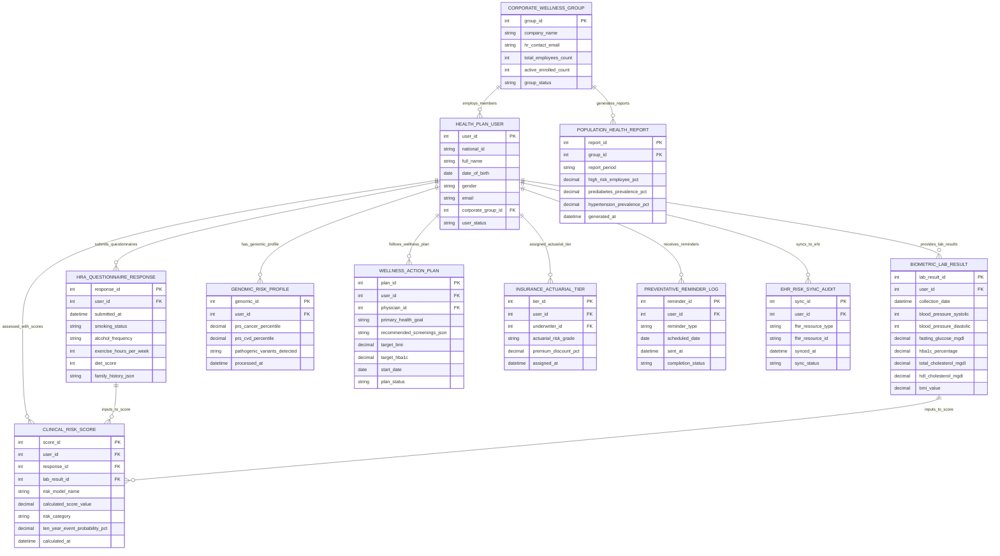

# Conceptual ERD — Health Risk Assessment System

## Mermaid Code

## Entity Description Table | Bảng mô tả Entity

| # | Entity Name | Vietnamese Name | Description | Key Attributes | Main Relationships |
|---|-------------|-----------------|-------------|----------------|-------------------|
| 1 | HEALTH_PLAN_USER | Người dùng Đăng ký Sức khỏe | Individual patient or employee enrolled in the Health Risk Assessment System storing National ID, name, DOB, email, and corporate group ID. | user_id, national_id, full_name, date_of_birth, gender, email, corporate_group_id, user_status | Belongs to CORPORATE_WELLNESS_GROUP; Has QUESTIONNAIRE, LAB_RESULT, RISK_SCORE, GENOMIC, PLAN, TIER, REMINDER. |
| 2 | HRA_QUESTIONNAIRE_RESPONSE | Câu trả lời Khảo sát HRA | Digital Health Risk Assessment survey response record storing lifestyle habits (smoking, alcohol, exercise, diet) and family disease history. | response_id, user_id, submitted_at, smoking_status, alcohol_frequency, exercise_hours_per_week, diet_score, family_history_json | Belongs to HEALTH_PLAN_USER; Inputs to CLINICAL_RISK_SCORE. |
| 3 | BIOMETRIC_LAB_RESULT | Kết quả Xét nghiệm Sinh hiệu | Clinical laboratory blood test panel (Glucose, HbA1c, Lipids) and physical vitals (BP, BMI) ingested from labs or hospital EMRs. | lab_result_id, user_id, collection_date, blood_pressure_systolic, blood_pressure_diastolic, fasting_glucose_mgdl, hba1c_percentage, total_cholesterol_mgdl | Belongs to HEALTH_PLAN_USER; Inputs to CLINICAL_RISK_SCORE. |
| 4 | CLINICAL_RISK_SCORE | Điểm số Rủi ro Lâm sàng | Computed clinical risk evaluation record storing risk model name (ASCVD, Framingham, FINDRISC), score value, risk category, and 10-yr event probability %. | score_id, user_id, response_id, lab_result_id, risk_model_name, calculated_score_value, risk_category, ten_year_event_probability_pct | Belongs to HEALTH_PLAN_USER, HRA_QUESTIONNAIRE_RESPONSE, and BIOMETRIC_LAB_RESULT. |
| 5 | GENOMIC_RISK_PROFILE | Hồ sơ Rủi ro Gen PRS | Polygenic Risk Score (PRS) record calculating hereditary disease susceptibility percentiles for cancers and cardiovascular conditions. | genomic_id, user_id, prs_cancer_percentile, prs_cvd_percentile, pathogenic_variants_detected, processed_at | Belongs to HEALTH_PLAN_USER. |
| 6 | WELLNESS_ACTION_PLAN | Kế hoạch Hành động Dự phòng | Customized preventive wellness action plan detailing health goals, target BMI/HbA1c, recommended screening schedules, and physician sign-off. | plan_id, user_id, physician_id, primary_health_goal, recommended_screenings_json, target_bmi, target_hba1c, start_date, plan_status | Belongs to HEALTH_PLAN_USER. |
| 7 | CORPORATE_WELLNESS_GROUP | Nhóm Sức khỏe Doanh nghiệp | Corporate employer organization record managing employee wellness cohorts, total headcount, active enrollment, and contact information. | group_id, company_name, hr_contact_email, total_employees_count, active_enrolled_count, group_status | Has HEALTH_PLAN_USER and POPULATION_HEALTH_REPORT. |
| 8 | POPULATION_HEALTH_REPORT | Báo cáo Rủi ro Dân số Doanh nghiệp | Aggregated, anonymized corporate population health risk report storing high-risk employee %, prediabetes prevalence %, and hypertension rates. | report_id, group_id, report_period, high_risk_employee_pct, prediabetes_prevalence_pct, hypertension_prevalence_pct, generated_at | Belongs to CORPORATE_WELLNESS_GROUP. |
| 9 | INSURANCE_ACTUARIAL_TIER | Hạng Rủi ro Định phí Bảo hiểm | Health insurance underwriting risk tier record linking member risk scores to insurance premium discount percentages and incentive status. | tier_id, user_id, underwriter_id, actuarial_risk_grade, premium_discount_pct, assigned_at | Belongs to HEALTH_PLAN_USER. |
| 10 | PREVENTATIVE_REMINDER_LOG | Nhật ký Nhắc nhở Dự phòng | Multi-channel communication log tracking scheduled preventive screening reminders, annual check-up alerts, and habit tracking prompts. | reminder_id, user_id, reminder_type, scheduled_date, sent_at, completion_status | Belongs to HEALTH_PLAN_USER. |
| 11 | EHR_RISK_SYNC_AUDIT | Nhật ký Đồng bộ Risk EHR | FHIR integration audit log tracking the sync of `RiskAssessment` and `CarePlan` resources between HRAS and enterprise hospital EHRs. | sync_id, user_id, fhir_resource_type, fhir_resource_id, synced_at, sync_status | Belongs to HEALTH_PLAN_USER. |

## Relationship Description | Mô tả Quan hệ

| # | From Entity | Cardinality | To Entity | Relationship Label | Business Explanation |
|---|-------------|-------------|-----------|-------------------|----------------------|
| 1 | CORPORATE_WELLNESS_GROUP | one-to-many | HEALTH_PLAN_USER | employs_members | One corporate wellness group employs multiple enrolled health plan users. |
| 2 | CORPORATE_WELLNESS_GROUP | one-to-many | POPULATION_HEALTH_REPORT | generates_reports | One corporate group generates periodic aggregated population health risk reports. |
| 3 | HEALTH_PLAN_USER | one-to-many | HRA_QUESTIONNAIRE_RESPONSE | submits_questionnaires | One user submits digital HRA questionnaire responses over time. |
| 4 | HEALTH_PLAN_USER | one-to-many | BIOMETRIC_LAB_RESULT | provides_lab_results | One user provides clinical laboratory blood chemistry and vital sign test results. |
| 5 | HEALTH_PLAN_USER | one-to-many | CLINICAL_RISK_SCORE | assessed_with_scores | One user is assessed with clinical risk scores (ASCVD, Framingham, FINDRISC). |
| 6 | HEALTH_PLAN_USER | one-to-many | GENOMIC_RISK_PROFILE | has_genomic_profile | One user has polygenic risk scores calculated from genomic variant data. |
| 7 | HEALTH_PLAN_USER | one-to-many | WELLNESS_ACTION_PLAN | follows_wellness_plan | One user is assigned personalized preventive wellness action plans. |
| 8 | HEALTH_PLAN_USER | one-to-many | INSURANCE_ACTUARIAL_TIER | assigned_actuarial_tier | One user is assigned health insurance actuarial risk tiers for premium discounts. |
| 9 | HEALTH_PLAN_USER | one-to-many | PREVENTATIVE_REMINDER_LOG | receives_reminders | One user receives automated screening and lifestyle habit reminders. |
| 10 | HEALTH_PLAN_USER | one-to-many | EHR_RISK_SYNC_AUDIT | syncs_to_ehr | One user syncs clinical risk assessments and care plans to hospital EHRs. |
| 11 | HRA_QUESTIONNAIRE_RESPONSE | one-to-many | CLINICAL_RISK_SCORE | inputs_to_score | Questionnaire responses serve as inputs for calculating clinical risk scores. |
| 12 | BIOMETRIC_LAB_RESULT | one-to-many | CLINICAL_RISK_SCORE | inputs_to_score | Laboratory blood panel results serve as inputs for calculating clinical risk scores. |
