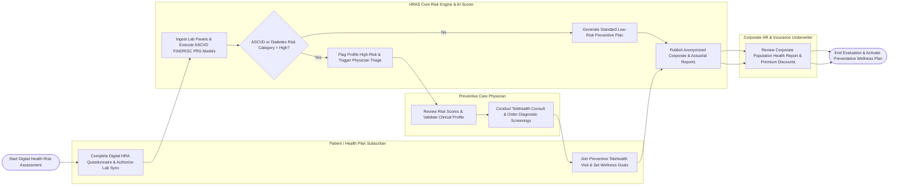

# Swimlane Diagram — Health Risk Assessment System

## Mermaid Code

## Flow Description | Mô tả luồng

| Lane | Actor / Subsystem | Role in Flow |
|------|-------------------|--------------|
| 1 | Patient / Health Plan Subscriber | Completes dynamic digital HRA lifestyle survey, authorizes diagnostic lab blood panel ingestion, joins virtual preventive consultations, and tracks daily wellness targets. |
| 2 | HRAS Core Risk Engine & AI Scorer | Ingests lab chemistry data, calculates 10-year ASCVD, Framingham, FINDRISC, and Polygenic Risk Scores (PRS), stratifies risk categories, and generates corporate/actuarial reports. |
| 3 | Preventive Care Physician | Reviews automated high-risk flags, validates clinical risk calculations, conducts WebRTC preventive telehealth visits, orders diagnostic screenings, and signs off on care plans. |
| 4 | Corporate HR & Insurance Underwriter | Evaluates anonymized corporate employee population health risk reports, tracks aggregate metabolic syndrome prevalence, and calculates wellness premium discount incentives. |
