# Action Tree — Health Risk Assessment System

## Mermaid Code

```mermaid
graph TD
    Root["Health Risk Assessment System"]

    Root --> M1["HRA Questionnaire & Survey Engine"]
    Root --> M2["Biometric Lab & Vitals Ingestion"]
    Root --> M3["Cardiovascular & Metabolic Risk Calculation"]
    Root --> M4["Genomic PRS & Hereditary Cancer Engine"]
    Root --> M5["Preventative Wellness Plan & Telehealth"]
    Root --> M6["Physician Validation & Clinical Triage"]
    Root --> M7["Corporate Population Health Reporting"]
    Root --> M8["Actuarial Underwriting & EHR Integration"]

    M1 --> A11["Render Dynamic HRA Lifestyle Questionnaire"]
    M1 --> A12["Capture Tobacco Alcohol Diet Exercise Data"]
    M1 --> A13["Log Family History of Chronic Diseases"]
    M1 --> A14["Pre-Populate Historical Annual HRA Surveys"]

    M2 --> A21["Ingest HL7 FHIR Diagnostic Blood Lab Panels"]
    M2 --> A22["Normalize Fasting Glucose HbA1c Lipid Values"]
    M2 --> A23["Capture Physical Vitals BP BMI Waist Ratio"]
    M2 --> A24["OCR Scan PDF Blood Test Report Uploads"]

    M3 --> A31["Calculate AHA ACC ASCVD 10-Yr CVD Risk Score"]
    M3 --> A32["Compute Framingham 10-Yr Cardiovascular Risk"]
    M3 --> A33["Evaluate FINDRISC Type 2 Diabetes Score"]
    M3 --> A34["Simulate Modifiable Risk Factor Impact"]

    M4 --> A41["Ingest Patient VCF Genomic Microarray Data"]
    M4 --> A42["Compute Polygenic Risk Scores PRS for Cancers"]
    M4 --> A43["Combine Genetic PRS with Lifestyle Risk Factors"]
    M4 --> A44["Detect High-Penetrance Monogenic BRCA Variants"]

    M5 --> A51["Generate Tailored Wellness Action Plans"]
    M5 --> A52["Set Target BMI HbA1c & Exercise Prescriptions"]
    M5 --> A53["Launch WebRTC Preventive Telehealth Consults"]
    M5 --> A54["Dispatch Automated Screening & Habit Reminders"]

    M6 --> A61["Triage High-Risk Patient Score Roster"]
    M6 --> A62["Validate Automated Clinical Risk Calculations"]
    M6 --> A63["Sign Off on Physician Risk Assessment Profile"]
    M6 --> A64["Order Advanced Screening Diagnostic Tests"]

    M7 --> A71["Generate Anonymized Corporate Risk Reports"]
    M7 --> A72["Benchmark Metabolic Syndrome Prevalence"]
    M7 --> A73["Calculate Corporate Employee Wellness ROI"]
    M7 --> A74["Enforce HIPAA Anonymization Threshold Filters"]

    M8 --> A81["Assign Health Insurance Actuarial Risk Tiers"]
    M8 --> A82["Calculate Wellness Premium Discount Incentives"]
    M8 --> A83["Sync FHIR RiskAssessment Resources to EHR"]
    M8 --> A84["Audit User Privacy Consents & Data Access"]
```

## Module Description | Mô tả Module

| # | Module | Description | Actions |
|---|--------|-------------|---------|
| 1 | HRA Questionnaire & Survey Engine | Renders dynamic health risk questionnaires, captures lifestyle habits (smoking, alcohol, diet, exercise), logs family history, and pre-populates survey data. | Render Dynamic HRA Lifestyle Questionnaire, Capture Tobacco Alcohol Diet Exercise Data, Log Family History of Chronic Diseases, Pre-Populate Historical Annual HRA Surveys |
| 2 | Biometric Lab & Vitals Ingestion | Ingests HL7 FHIR diagnostic blood lab panels, normalizes blood chemistry values (Glucose, HbA1c, Lipids), captures vitals, and applies OCR for PDF lab uploads. | Ingest HL7 FHIR Diagnostic Blood Lab Panels, Normalize Fasting Glucose HbA1c Lipid Values, Capture Physical Vitals BP BMI Waist Ratio, OCR Scan PDF Blood Test Report Uploads |
| 3 | Cardiovascular & Metabolic Risk Calculation | Computes AHA/ACC ASCVD 10-yr CVD risk, Framingham risk score, FINDRISC diabetes score, and simulates modifiable risk factor impacts. | Calculate AHA ACC ASCVD 10-Yr CVD Risk Score, Compute Framingham 10-Yr Cardiovascular Risk, Evaluate FINDRISC Type 2 Diabetes Score, Simulate Modifiable Risk Factor Impact |
| 4 | Genomic PRS & Hereditary Cancer Engine | Ingests VCF genomic data, computes Polygenic Risk Scores (PRS) for hereditary cancers, combines genetic/lifestyle risk, and flags monogenic BRCA variants. | Ingest Patient VCF Genomic Microarray Data, Compute Polygenic Risk Scores PRS for Cancers, Combine Genetic PRS with Lifestyle Risk Factors, Detect High-Penetrance Monogenic BRCA Variants |
| 5 | Preventative Wellness Plan & Telehealth | Generates tailored wellness action plans, sets target BMI/HbA1c goals, launches WebRTC preventive telehealth consults, and dispatches screening reminders. | Generate Tailored Wellness Action Plans, Set Target BMI HbA1c & Exercise Prescriptions, Launch WebRTC Preventive Telehealth Consults, Dispatch Automated Screening & Habit Reminders |
| 6 | Physician Validation & Clinical Triage | Triages high-risk patient rosters, validates automated risk calculations, signs off on clinical profiles, and orders diagnostic screening tests. | Triage High-Risk Patient Score Roster, Validate Automated Clinical Risk Calculations, Sign Off on Physician Risk Assessment Profile, Order Advanced Screening Diagnostic Tests |
| 7 | Corporate Population Health Reporting | Generates anonymized corporate employee risk reports, benchmarks metabolic syndrome prevalence, calculates wellness ROI, and enforces HIPAA threshold filters. | Generate Anonymized Corporate Risk Reports, Benchmark Metabolic Syndrome Prevalence, Calculate Corporate Employee Wellness ROI, Enforce HIPAA Anonymization Threshold Filters |
| 8 | Actuarial Underwriting & EHR Integration | Assigns health insurance actuarial risk tiers, calculates wellness premium discount incentives, syncs FHIR `RiskAssessment` to EMRs, and audits privacy consents. | Assign Health Insurance Actuarial Risk Tiers, Calculate Wellness Premium Discount Incentives, Sync FHIR RiskAssessment Resources to EHR, Audit User Privacy Consents & Data Access |
