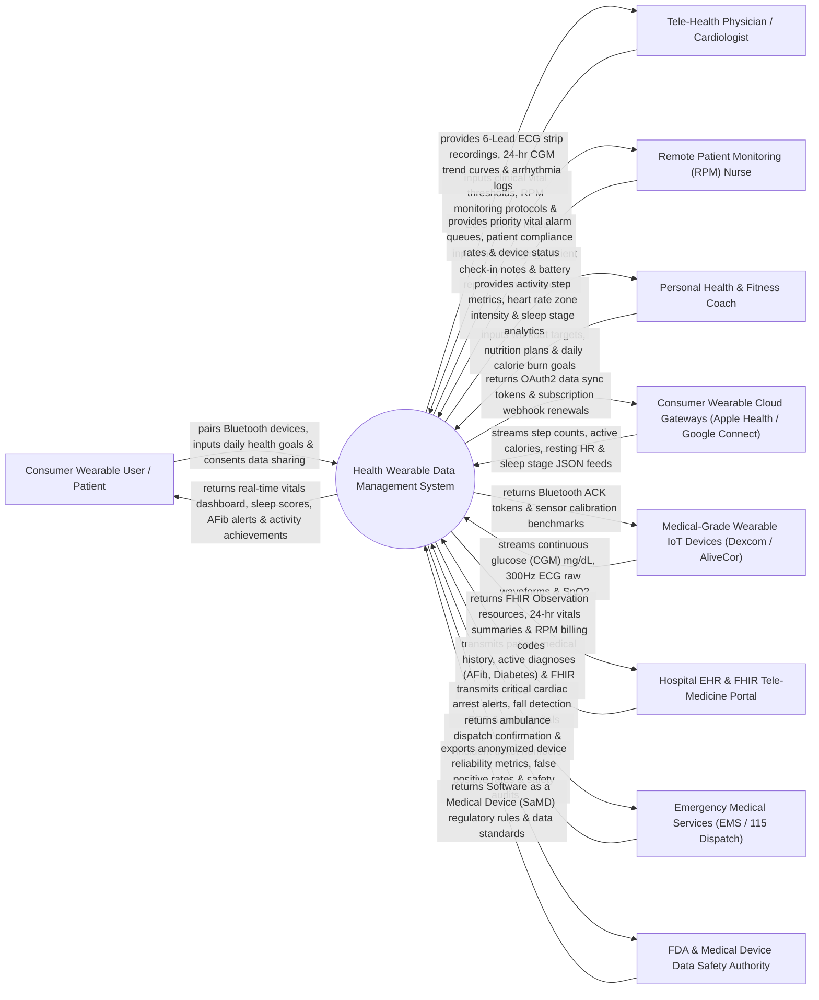

# Context Diagram — Health Wearable Data Management System

## Mermaid Code

## Actor & Interaction Table | Bảng Actor & Tương tác

| # | Actor | Actor Type | Data Sent TO System | Data Received FROM System | Notes |
|---|-------|------------|---------------------|---------------------------|-------|
| 1 | Consumer Wearable User / Patient | Primary | Bluetooth device pairing requests, personal health goals, data sharing consent preferences. | Real-time vital signs dashboard, sleep stage breakdown, arrhythmia warnings, fitness badges. | Individual wearing smartwatches, fitness bands, or medical sensors for personal health tracking. |
| 2 | Tele-Health Physician / Cardiologist | Primary | Customized vital alert thresholds (Tachycardia HR > 130 bpm), RPM protocols, ECG review notes. | 6-Lead ECG strip recordings, 24-hour Continuous Glucose (CGM) curves, arrhythmia logs. | Specialist physician remotely reviewing patient cardiac ECGs, glucose trends, and vital anomalies. |
| 3 | Remote Patient Monitoring (RPM) Nurse | Primary | Vital alarm triaging actions, patient wellness check-in notes, device low-battery alerts. | Priority vital alarm queue, patient device compliance %, active notification logs. | Nurse monitoring outpatient telemetry queues and triaging real-time vital sign alarms. |
| 4 | Personal Health & Fitness Coach | Primary | Workout target plans, target heart rate zones (Zone 1-5), active calorie burn goals. | Daily step counts, active calorie burn, exertion heart rate zones, sleep recovery metrics. | Health coach or personal trainer providing lifestyle and exercise guidance. |
| 5 | Consumer Wearable Cloud Gateways | Supporting System | Automated REST/GraphQL feeds: step counts, active calories, resting HR, sleep stage JSON data. | OAuth2 authentication tokens, webhook subscription renewals, sync acknowledgments. | Cloud platforms aggregating consumer wearable data (Apple HealthKit, Google Health Connect, Fitbit). |
| 6 | Medical-Grade Wearable IoT Devices | Supporting System | Raw 300Hz ECG single-lead/6-lead waveforms, continuous glucose (CGM mg/dL), pulse oximeter SpO2. | Bluetooth LE handshake tokens, sensor calibration parameters, sampling rate configurations. | Clinical-grade wearables (Dexcom G7 CGM, AliveCor KardiaMobile, BioIntelliSense Patch). |
| 7 | Hospital EHR & FHIR Tele-Medicine Portal | Supporting System | Patient medical record numbers (MRN), active disease diagnoses (AFib, Type 1 Diabetes), FHIR resources. | FHIR Observation resources, 24-hour vital sign summaries, CPT Remote Patient Monitoring billing codes. | Enterprise hospital EMR platform receiving remote patient telemetry observations. |
| 8 | Emergency Medical Services (EMS / 115 Dispatch) | Supporting System | Ambulance dispatch confirmation tokens, paramedic response arrival status, incident ticket numbers. | Critical cardiac arrest alert payloads, automated fall detection GPS coordinates, live vitals stream. | Municipal emergency dispatch center receiving automated emergency health alerts. |
| 9 | FDA & Medical Device Data Safety Authority | Regulatory | Software as a Medical Device (SaMD) regulatory guidelines, ECG algorithm clearance rules. | Anonymized device reliability logs, AI arrhythmia false positive rates, cybersecurity audit feeds. | Medical device regulatory authority governing SaMD diagnostic algorithms and data privacy. |

## System Boundary Description | Mô tả Phạm vi Hệ thống

The **Health Wearable Data Management System (HWDMS)** is an enterprise IoT health telemetry, remote patient monitoring (RPM), and physiological analytics platform. It ingests continuous vital signs data from consumer smartwatches (Apple Watch, Garmin, Fitbit) and medical-grade IoT wearables (Dexcom CGM, AliveCor ECG patches), executes AI-driven arrhythmia and glycemic anomaly detection algorithms (Atrial Fibrillation, Nocturnal Hypoglycemia, Fall Detection), renders patient and clinician dashboards, broadcasts emergency EMS alerts, and exports FHIR-compliant vital observation resources to hospital EHRs.

**Inside System Scope:**
- Multi-protocol IoT wearable telemetry ingestion (Bluetooth LE, Apple HealthKit API, Google Health Connect, REST webhooks).
- High-frequency vital signs processing: Continuous Heart Rate (HR), Heart Rate Variability (HRV), Single/6-Lead ECG waveforms, SpO2, Continuous Glucose Monitoring (CGM), Respiratory Rate, and Skin Temp.
- AI arrhythmia detection (Atrial Fibrillation AFib, Bradycardia < 40 bpm, Tachycardia > 140 bpm) and fall detection.
- Continuous Glucose Monitoring (CGM) trend arrow calculation and nocturnal hypoglycemia alarms (< 54 mg/dL).
- Patient mobile health dashboard (Daily step counts, Active calorie burn, Sleep stage analysis, Stress index).
- Clinician Remote Patient Monitoring (RPM) portal, ECG strip PDF generation, and alert triaging.
- Automated emergency EMS dispatch integration and emergency contact SMS notifications.
- FHIR R4 Observation resource mapping and CPT Remote Patient Monitoring (RPM) billing logs.

**Outside System Scope:**
- Physical manufacturing of wearable smartwatch hardware or sensor chips (handled by Apple, Dexcom, etc.).
- Physical dispatch and driving of municipal emergency ambulances (handled by EMS 115).
- Prescription and dispensing of insulin or cardiac medications (handled by Pharmacy System).
- Commercial corporate financial general ledger accounting (handled by enterprise ERP).
