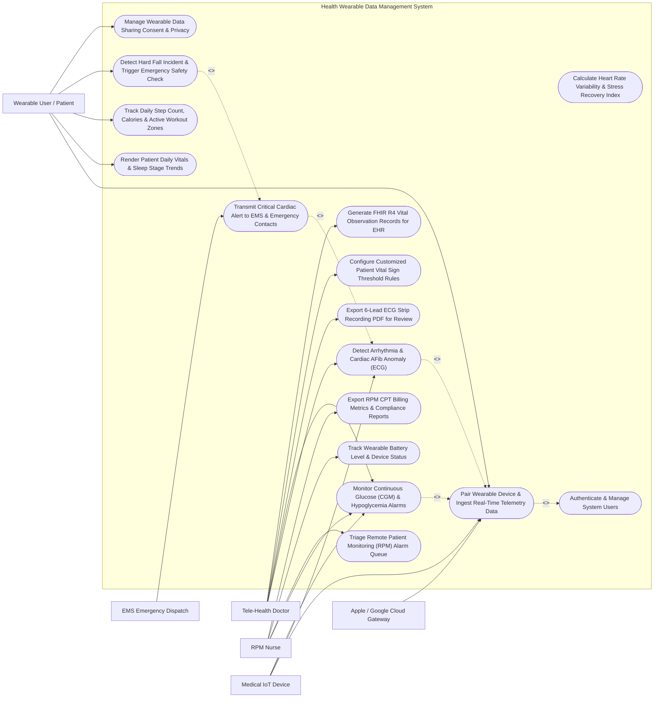

# Use Case Diagram — Health Wearable Data Management System

## Mermaid Code

## Actor Table | Bảng Actor

| # | Actor | Actor Type | Role Description | Related Use Cases |
|---|-------|------------|------------------|-------------------|
| 1 | Wearable User / Patient | Primary | Individual wearing smartwatches or glucose/ECG sensors, viewing personal health trends, and managing consent. | UC01, UC04, UC08, UC09, UC12 |
| 2 | Tele-Health Doctor | Primary | Cardiologist or endocrinologist configuring vital thresholds, evaluating ECG strips, and analyzing CGM curves. | UC02, UC03, UC07, UC10, UC11 |
| 3 | RPM Nurse | Primary | Remote patient monitoring nurse triaging vital sign alarm queues, verifying device connectivity, and reporting billing metrics. | UC03, UC06, UC14, UC15 |
| 4 | Apple / Google Cloud Gateway | Secondary / System | Cloud platform APIs (Apple HealthKit, Google Health Connect) streaming aggregated wearable activity and sleep data. | UC01 |
| 5 | Medical IoT Device | Secondary / System | Medical-grade wearable hardware (Dexcom CGM, AliveCor KardiaMobile) streaming real-time ECG and glucose telemetry. | UC01, UC02, UC03 |
| 6 | EMS Emergency Dispatch | Secondary / System | Emergency medical services dispatch center receiving automated critical cardiac and fall emergency alert payloads. | UC05 |

## Use Case Table | Bảng Use Case

| # | UC ID | Use Case Name | Primary Actor | Secondary Actor | Description | Priority |
|---|-------|---------------|---------------|-----------------|-------------|----------|
| 1 | UC01 | Pair Wearable Device & Ingest Real-Time Telemetry Data | Wearable User / Patient | Medical IoT Device | Pair Bluetooth LE health devices or connect cloud gateways, ingesting continuous HR, SpO2, ECG, and glucose data streams. | High |
| 2 | UC02 | Detect Arrhythmia & Cardiac AFib Anomaly (ECG) | Tele-Health Doctor | Medical IoT Device | Execute AI PPG/ECG waveform analysis algorithms to detect Atrial Fibrillation (AFib), Bradycardia, Tachycardia, and PVCs. | High |
| 3 | UC03 | Monitor Continuous Glucose (CGM) & Hypoglycemia Alarms | Tele-Health Doctor | Medical IoT Device | Ingest 5-minute CGM glucose readings, calculate glucose trend arrows, and trigger urgent alarms for Nocturnal Hypoglycemia (< 54 mg/dL). | High |
| 4 | UC04 | Render Patient Daily Vitals & Sleep Stage Trends | Wearable User / Patient | None | Display interactive mobile dashboard showing 24-hr heart rate, SpO2, sleep stage architecture (Deep, REM, Light), and stress recovery index. | High |
| 5 | UC05 | Transmit Critical Cardiac Alert to EMS & Emergency Contacts | Tele-Health Doctor | EMS Emergency Dispatch | Dispatch automated emergency alert payloads (GPS coordinates, live vitals, ECG strip) to EMS 115 and family contacts during cardiac arrest. | High |
| 6 | UC06 | Triage Remote Patient Monitoring (RPM) Alarm Queue | RPM Nurse | None | Review and triage color-coded RPM vital sign alarm queues (Red Urgent, Orange Warning, Yellow Notice) and log clinical actions. | High |
| 7 | UC07 | Export 6-Lead ECG Strip Recording PDF for Review | Tele-Health Doctor | None | Generate high-resolution 300Hz 6-Lead ECG strip PDF reports featuring grid scaling (25mm/s, 10mm/mV), QRS intervals, and doctor sign-off. | High |
| 8 | UC08 | Track Daily Step Count, Calories & Active Workout Zones | Wearable User / Patient | None | Track daily step counts, active calorie burn, exertion heart rate zones (Zone 1 Warmup to Zone 5 Anaerobic), and workout logs. | Medium |
| 9 | UC09 | Detect Hard Fall Incident & Trigger Emergency Safety Check | Wearable User / Patient | EMS Emergency Dispatch | Detect sudden impact accelerometry patterns consistent with a hard fall, starting a 45-second safety countdown before alerting emergency services. | High |
| 10 | UC10 | Configure Customized Patient Vital Sign Threshold Rules | Tele-Health Doctor | None | Customize patient-specific vital sign alarm rules (e.g., Target Glucose 70-180 mg/dL, High HR > 130 bpm) based on clinical baseline. | High |
| 11 | UC11 | Generate FHIR R4 Vital Observation Records for EHR | Tele-Health Doctor | None | Transform processed wearable telemetry into HL7 FHIR R4 `Observation` resources (LOINC codes for HR, SpO2, Glucose) and sync to hospital EHR. | High |
| 12 | UC12 | Manage Wearable Data Sharing Consent & Privacy | Wearable User / Patient | None | Manage fine-grained data sharing permissions, granting or revoking third-party app access to ECG, glucose, or location telemetry. | High |
| 13 | UC13 | Calculate Heart Rate Variability & Stress Recovery Index | Wearable User / Patient | None | Compute time-domain HRV metrics (rMSSD, SDNN) to calculate daily physical stress index and sleep recovery scores. | Medium |
| 14 | UC14 | Track Wearable Battery Level & Device Status | RPM Nurse | None | Monitor device battery percentages, Bluetooth connection stability, and dispatch low-battery (< 15%) reminders to patients. | Medium |
| 15 | UC15 | Export RPM CPT Billing Metrics & Compliance Reports | RPM Nurse | None | Track patient monthly RPM compliance (minimum 16 days of transmission per month) and export CPT 99453 / 99454 billing reports. | High |
| 16 | UC16 | Authenticate & Manage System Users | All Users | None | Enforce OAuth2 / OpenID Connect authentication, end-to-end telemetry encryption (AES-256), and HIPAA data privacy controls. | High |

## Use Case Specification | Đặc tả Use Case

---

### UC01 — Pair Wearable Device & Ingest Real-Time Telemetry Data

| Field | Detail |
|-------|--------|
| **UC ID** | UC01 |
| **Use Case Name** | Pair Wearable Device & Ingest Real-Time Telemetry Data |
| **Actor(s)** | Primary: Wearable User / Patient   Secondary: Medical IoT Device, Apple / Google Cloud Gateway |
| **Description** | Establishes secure Bluetooth Low Energy (BLE) pairing with a consumer smartwatch or medical-grade IoT wearable device (Dexcom CGM, AliveCor ECG), or authorizes cloud gateway OAuth2 sync (Apple HealthKit, Google Health Connect), continuously ingesting physiological vital signs data streams. |
| **Precondition** | 1. The HWDMS mobile application is installed on the patient's smartphone.   2. Bluetooth is enabled and the wearable device is turned on. |
| **Main Flow** | 1. The Patient opens "Add New Device" in the HWDMS mobile app.   2. The Patient selects Device Category: **Medical-Grade Wearable** -> Brand: *AliveCor KardiaMobile 6L*.   3. The System initiates BLE scanning and discovers Device `Kardia-6L-9918` (`MAC: 00:1A:7D:DA:71:12`).   4. The System executes **BLE Passkey Pairing & AES-128 Encryption Handshake**:   &nbsp;&nbsp;&nbsp;&nbsp;- Verifies device firmware version (`v3.4.2` -> Up to Date)   &nbsp;&nbsp;&nbsp;&nbsp;- Reads Battery Level (`92%`).   5. The Patient grants telemetry permissions: Heart Rate, Single-Lead ECG, 6-Lead ECG, SpO2.   6. The System establishes continuous **IoT Telemetry Data Stream**:   &nbsp;&nbsp;&nbsp;&nbsp;- Ingests 300Hz raw ECG sample streams   &nbsp;&nbsp;&nbsp;&nbsp;- Ingests 1-Hz Heart Rate (BPM)   &nbsp;&nbsp;&nbsp;&nbsp;- Ingests SpO2 (%) every 10 seconds.   7. The System stores incoming telemetry packets in the local encrypted cache, compresses packets, and streams them via WebSocket to the HWDMS Ingestion Gateway. |
| **Alternative Flow** | **AF1** — OAuth2 Cloud Gateway Sync (Apple HealthKit): Patient selects "Sync Apple Watch"; the System opens HealthKit authorization prompt, requesting read permissions for Active Energy, Heart Rate, and Sleep Analysis.   **AF2** — Dexcom Continuous Glucose Monitor (CGM) Direct API Sync: Patient inputs Dexcom Clarity credentials; the System establishes REST webhook subscription, ingesting glucose readings (mg/dL) every 5 minutes. |
| **Exception Flow** | **EX1** — BLE Connection Drop / Timeout: Bluetooth connection drops during pairing; System retries pairing 3 times, displaying "Device Out of Range — Move Wearable Closer to Phone".   **EX2** — Unsupported Firmware Version Error: Device firmware `v1.0.1` is obsolete; System blocks pairing and prompts "Firmware Update Required Before Connection". |
| **Postcondition** | Wearable device is paired, encrypted BLE telemetry stream is established, device battery status is registered, and real-time vital ingestion is active. |
| **Business Rule** | **BR1**: Wearable health telemetry data transmitted over BLE or cellular networks MUST be encrypted using AES-128 or AES-256 end-to-end encryption.   **BR2**: Ingested medical-grade telemetry packets (ECG, CGM) MUST be timestamped with UTC precision millisecond accuracy. |

---

### UC02 — Detect Arrhythmia & Cardiac AFib Anomaly (ECG)

| Field | Detail |
|-------|--------|
| **UC ID** | UC02 |
| **Use Case Name** | Detect Arrhythmia & Cardiac AFib Anomaly (ECG) |
| **Actor(s)** | Primary: Tele-Health Doctor   Secondary: Medical IoT Device |
| **Description** | Executes real-time AI Photoplethysmography (PPG) and Electrocardiogram (ECG) signal processing algorithms on ingested telemetry, analyzing R-R interval variability, P-wave absence, and QRS morphology to detect cardiac arrhythmias (Atrial Fibrillation - AFib, Bradycardia, Tachycardia, Premature Ventricular Contractions - PVCs). |
| **Precondition** | 1. Ingested ECG waveform data (300Hz sampling rate) or PPG heart rate stream is active.   2. The AI Arrhythmia Detection Engine is initialized. |
| **Main Flow** | 1. The **AI Arrhythmia Detection Engine** analyzes a 30-second single-lead ECG recording from Patient `USR-2026-08192`.   2. The Engine executes **ECG Signal Processing**:   &nbsp;&nbsp;&nbsp;&nbsp;- Applies bandpass filtering (0.5 Hz - 40 Hz) to eliminate baseline wander and muscle noise   &nbsp;&nbsp;&nbsp;&nbsp;- Executes Pan-Tompkins algorithm to detect R-peak timestamps   &nbsp;&nbsp;&nbsp;&nbsp;- Measures R-R Interval Variability (Irregularly Irregular rhythm).   3. The Engine evaluates **Morphological Criteria**:   &nbsp;&nbsp;&nbsp;&nbsp;- P-Wave Analysis: Absence of distinct P-waves   &nbsp;&nbsp;&nbsp;&nbsp;- Fibrillation Waves: Present in baseline   &nbsp;&nbsp;&nbsp;&nbsp;- Average Heart Rate: 138 BPM (Tachycardic AFib).   4. The Engine calculates **AFib Confidence Score**: `94.8%` (Exceeds 85% threshold).   5. The System classifies event: **ATRIAL FIBRILLATION WITH RAPID VENTRICULAR RESPONSE (RVR)**.   6. The System generates an **Urgent Cardiac Alarm**:   &nbsp;&nbsp;&nbsp;&nbsp;- Sends instant push notification to Patient: *"Irregular Heart Rhythm Detected — Please sit down and rest."*   &nbsp;&nbsp;&nbsp;&nbsp;- Queues Red Urgent Alarm on the RPM Nurse Monitoring Dashboard (UC06)   &nbsp;&nbsp;&nbsp;&nbsp;- Auto-generates 6-Lead ECG PDF Strip (UC07) for Cardiologist review. |
| **Alternative Flow** | **AF1** — Severe Sustained Bradycardia Detection (HR < 40 BPM): Patient's resting heart rate drops to 34 BPM for 3 consecutive minutes; System flags "SEVERE BRADYCARDIA ALARM", alerting Tele-Health Doctor.   **AF2** — High Exertion Normal Sinus Tachycardia (Exercise Context): Heart rate reaches 155 BPM during a logged workout session; System suppresses alarm, classifying event as "Normal Exercise Exertion Tachycardia". |
| **Exception Flow** | **EX1** — Excessive Motion Artifact Noise (Uninterpretable ECG): Heavy arm movement creates noisy baseline; AI Engine flags "Poor Signal Quality — Motion Artifact; Please Retake 30-Sec Stationary ECG".   **EX2** — Lead Disconnection Alert: Electrode pads lose contact; System alerts "Lead Disconnected". |
| **Postcondition** | Arrhythmia event (AFib RVR @ 138 BPM) is detected, ECG waveform is annotated, urgent cardiac alarm is queued on RPM dashboard, and PDF strip is generated. |
| **Business Rule** | **BR1**: AI Arrhythmia algorithms detecting Atrial Fibrillation or Severe Bradycardia (< 40 BPM) MUST queue an urgent notification on the RPM nurse dashboard within 30 seconds.   **BR2**: ECG arrhythmia detections MUST save 10 seconds of pre-trigger and 20 seconds of post-trigger raw ECG waveform for clinical validation. |

---

### UC03 — Monitor Continuous Glucose (CGM) & Hypoglycemia Alarms

| Field | Detail |
|-------|--------|
| **UC ID** | UC03 |
| **Use Case Name** | Monitor Continuous Glucose (CGM) & Hypoglycemia Alarms |
| **Actor(s)** | Primary: Tele-Health Doctor   Secondary: RPM Nurse, Medical IoT Device |
| **Description** | Continuously monitors 5-minute interstitial glucose readings from Continuous Glucose Monitor (CGM) sensors, calculating glucose rate-of-change trend arrows, computing Time-in-Range (TIR 70-180 mg/dL), and triggering urgent audible alarms for Nocturnal Hypoglycemia (< 54 mg/dL) or Severe Hyperglycemia (> 250 mg/dL). |
| **Precondition** | 1. Dexcom or FreeStyle Libre CGM sensor is paired and transmitting 5-minute readings.   2. Customized glycemic target thresholds (UC10) are configured. |
| **Main Flow** | 1. The **CGM Telemetry Engine** receives a new 5-minute glucose reading for Patient `USR-2026-0412` (Type 1 Diabetes): `Glucose = 52 mg/dL`.   2. The Engine calculates **Glucose Trend Arrow**:   &nbsp;&nbsp;&nbsp;&nbsp;- Previous Reading (5 mins ago): 68 mg/dL   &nbsp;&nbsp;&nbsp;&nbsp;- Rate of Change: -3.2 mg/dL/min   &nbsp;&nbsp;&nbsp;&nbsp;- Trend Arrow: `Double Arrow Down ↓↓` (Rapid Fall).   3. The Engine evaluates **Glycemic Threshold Rules**:   &nbsp;&nbsp;&nbsp;&nbsp;- Level 1 Hypoglycemia Threshold: < 70 mg/dL   &nbsp;&nbsp;&nbsp;&nbsp;- **Level 2 Severe Hypoglycemia Threshold**: < 54 mg/dL -> **TRIGGERED (52 mg/dL)**.   4. The System executes **Emergency Nocturnal Hypoglycemia Protocol**:   &nbsp;&nbsp;&nbsp;&nbsp;- Overrides smartphone silent mode to sound a **High-Volume Critical Alarm** on Patient's phone   &nbsp;&nbsp;&nbsp;&nbsp;- Displays action directive: *"URGENT LOW GLUCOSE: Consume 15g fast-acting carbs (juice/tabs) immediately!"*   &nbsp;&nbsp;&nbsp;&nbsp;- Dispatches SMS alert to designated Family Emergency Contact   &nbsp;&nbsp;&nbsp;&nbsp;- Queues Red Alert on RPM Nurse Dashboard (UC06).   5. The System logs current 24-hour **Time-in-Range (TIR)**: `TIR (70-180 mg/dL) = 68%`, `Time Below Range (< 70 mg/dL) = 6%`. |
| **Alternative Flow** | **AF1** — Severe Hyperglycemia with Sustained High Arrow: Glucose reaches 285 mg/dL with single arrow up ↑; System prompts "Check Urine Ketones & Consider Insulin Correction Bolus".   **AF2** — Predictive Low Glucose Early Warning: System algorithm predicts glucose will hit 62 mg/dL in 20 minutes based on trajectory; System issues a gentle "Predictive Low Warning" before hypoglycemia occurs. |
| **Exception Flow** | **EX1** — CGM Sensor Error / "Re-Calibrate" Code: Sensor transmits error code `ERR-SENSOR-FAIL`; System prompts "CGM Sensor Error — Perform Fingerstick Blood Glucose Check".   **EX2** — CGM Sensor Warm-Up Period Active: New sensor is in 2-hour warm-up phase; System temporarily pauses alerts and displays "Sensor Warming Up". |
| **Postcondition** | Level 2 Hypoglycemia (< 54 mg/dL) event is logged, smartphone critical alarm is sounded, family SMS is dispatched, and 24-hour TIR metrics are updated. |
| **Business Rule** | **BR1**: Severe Hypoglycemia alerts (< 54 mg/dL) MUST override smartphone silent/do-not-disturb modes to sound an audible alarm.   **BR2**: Clinical CGM monitoring MUST track standardized consensus metrics: Time-in-Range (TIR 70-180 mg/dL target > 70%), Time-Below-Range (< 70 mg/dL target < 4%), and Glucose Variability (%CV target <= 36%). |

---

### UC04 — Render Patient Daily Vitals & Sleep Stage Trends

| Field | Detail |
|-------|--------|
| **UC ID** | UC04 |
| **Use Case Name** | Render Patient Daily Vitals & Sleep Stage Trends |
| **Actor(s)** | Primary: Wearable User / Patient |
| **Description** | Renders an interactive, visually rich mobile app health dashboard displaying 24-hour continuous physiological vitals (Heart Rate graph, SpO2, Blood Pressure), sleep architecture breakdown (Deep, Light, REM sleep stages, Sleep Score 0-100), activity metrics, and daily wellness recovery scores. |
| **Precondition** | 1. Telemetry data from wearable devices or cloud gateways (UC01) is ingested and aggregated.   2. The Patient opens the HWDMS mobile app. |
| **Main Flow** | 1. The Patient opens the "Daily Wellness & Vitals Dashboard" on their mobile app.   2. The System renders the **24-Hour Heart Rate Timeline Graph**:   &nbsp;&nbsp;&nbsp;&nbsp;- Displays continuous HR curve with color-coded workout zones   &nbsp;&nbsp;&nbsp;&nbsp;- Highlights Resting Heart Rate: `62 BPM` (Baseline Average)   &nbsp;&nbsp;&nbsp;&nbsp;- Highlights Peak Exertion HR: `152 BPM` during morning run.   3. The System renders **Sleep Architecture Analysis**:   &nbsp;&nbsp;&nbsp;&nbsp;- **Overall Sleep Score**: `84 / 100 (Optimal Recovery)`   &nbsp;&nbsp;&nbsp;&nbsp;- Total Duration: 7 Hours 42 Minutes (11:15 PM - 06:57 AM)   &nbsp;&nbsp;&nbsp;&nbsp;- **Deep Slow-Wave Sleep**: 1 Hour 35 Mins (20%)   &nbsp;&nbsp;&nbsp;&nbsp;- **REM Sleep**: 1 Hour 50 Mins (24%)   &nbsp;&nbsp;&nbsp;&nbsp;- **Light Sleep**: 4 Hours 17 Mins (56%)   &nbsp;&nbsp;&nbsp;&nbsp;- Nocturnal SpO2 Average: 97.2% (No sleep apnea dip detected).   4. The System renders **Body Recovery & Stress Index**:   &nbsp;&nbsp;&nbsp;&nbsp;- Overnight HRV (rMSSD): `48 ms` (High Recovery)   &nbsp;&nbsp;&nbsp;&nbsp;- Stress Score: `22 / 100 (Relaxed)`.   5. The Patient taps "Share Dashboard", generating a 7-day vitals summary PDF for their upcoming doctor visit. |
| **Alternative Flow** | **AF1** — Nocturnal Hypoxemia Sleep Apnea Detection: SpO2 graph reveals 14 oxygen desaturation dips below 88% during sleep; System highlights "Potential Nocturnal Breathing Disturbance — Consult Sleep Specialist".   **AF2** — Weekly Multi-Metric Comparative View: Patient switches to "Weekly View", comparing current week's average resting HR and sleep duration against 30-day historical averages. |
| **Exception Flow** | **EX1** — Incomplete Telemetry Gaps (> 4 Hours Missing): Wearable was off during sleep; Dashboard displays dashed line gap with note "No Sleep Data Recorded — Device Disconnected".   **EX2** — Synchronization Pending Indicator: Offline data queued on phone; Dashboard displays "Syncing Latest Vitals...". |
| **Postcondition** | Interactive 24-hour vital graphs, sleep stage breakdowns, HRV stress scores, and activity summaries are rendered on the patient's mobile app. |
| **Business Rule** | **BR1**: Mobile health dashboards MUST render 24-hour continuous vital sign graphs with zoomable time axes and baseline normal range overlays.   **BR2**: Sleep stage classifications (Deep, REM, Light) MUST be derived from validated multi-sensor algorithms combining HRV, accelerometry, and skin temperature. |

---

### UC05 — Transmit Critical Cardiac Alert to EMS & Emergency Contacts

| Field | Detail |
|-------|--------|
| **UC ID** | UC05 |
| **Use Case Name** | Transmit Critical Cardiac Alert to EMS & Emergency Contacts |
| **Actor(s)** | Primary: Tele-Health Doctor   Secondary: EMS Emergency Dispatch, Wearable User / Patient |
| **Description** | Automatically transmits an emergency medical dispatch payload (containing patient identity, live GPS location coordinates, real-time vitals, and 30-second ECG strip) to municipal Emergency Medical Services (EMS 115) and family emergency contacts upon detection of a critical life-threatening event (Sustained Ventricular Fibrillation, Cardiac Arrest, Unresponsive Hard Fall). |
| **Precondition** | 1. A critical life-threatening arrhythmia (Sustained VFib/VTach) or Hard Fall with Unresponsiveness (UC09) is detected.   2. The Patient has enabled Emergency Response Integration in app settings. |
| **Main Flow** | 1. The **Emergency Event Engine** detects a critical life-threatening event for Patient `USR-2026-08192`: **Unresponsive Hard Fall followed by Ventricular Fibrillation (VFib) @ 210 BPM**.   2. The System initiates a **30-Second Patient Safety Cancel Window**:   &nbsp;&nbsp;&nbsp;&nbsp;- Sounds emergency alarm and vibrates phone   &nbsp;&nbsp;&nbsp;&nbsp;- Screen displays: *"CRITICAL EMERGENCY DETECTED — Press CANCEL within 30s if you are safe"*   &nbsp;&nbsp;&nbsp;&nbsp;- Patient does NOT press cancel (Unresponsive).   3. Upon 30-second timer expiration, the System compiles the **EMS Emergency Dispatch Payload**:   &nbsp;&nbsp;&nbsp;&nbsp;- **Patient Identity**: Le Van H***, Age 72, Male   &nbsp;&nbsp;&nbsp;&nbsp;- **Live GPS Location**: Latitude 10.7769, Longitude 106.6951 (142 Le Loi St, Dist 1, HCM City)   &nbsp;&nbsp;&nbsp;&nbsp;- **Trigger Condition**: Unresponsive Hard Fall + Ventricular Fibrillation @ 210 BPM   &nbsp;&nbsp;&nbsp;&nbsp;- **Live Vitals**: HR 210 BPM, SpO2 84%, Skin Temp 35.8°C   &nbsp;&nbsp;&nbsp;&nbsp;- **ECG Waveform Attachment**: 30-Sec Live Single-Lead ECG Waveform URL.   4. The System transmits the payload via API to **Municipal EMS 115 Dispatch Center**.   5. EMS 115 System returns **Dispatch Confirmation**: `Ambulance Unit #04 Dispatched (ETA 8 Mins), Ticket #EMS-2026-99182`.   6. The System dispatches automated SMS & Zalo Emergency Alerts to 2 pre-registered **Family Emergency Contacts**: *"EMERGENCY ALERT: Le Van H*** had a critical cardiac event. EMS 115 ambulance dispatched to 142 Le Loi St."*   7. The System opens a live audio speakerphone channel on the patient's phone for EMS dispatchers. |
| **Alternative Flow** | **AF1** — Patient Manual Emergency SOS Button Trigger: Patient experiences severe crushing chest pain, presses app "SOS EMERGENCY BUTTON", immediately triggering EMS dispatch payload transmission.   **AF2** — Tele-Health Doctor Manual EMS Escalation: Cardiologist reviewing live ECG strip on RPM portal detects Sustained VTach, clicking "EMERGENCY ESCALATE TO EMS". |
| **Exception Flow** | **EX1** — Patient Cancels Alarm (False Fall Alarm): Patient accidentally drops phone; Patient taps "I AM SAFE — CANCEL ALARM" at second 12; System aborts EMS dispatch and logs false alarm.   **EX2** — GPS Location Unavailable Fallback: GPS signal is blocked indoors; System uses last-known home address and Wi-Fi SSID location triangulation. |
| **Postcondition** | EMS 115 ambulance dispatch payload (GPS, live vitals, ECG strip) is transmitted, dispatch ticket is received, family SMS alerts are delivered, and live speakerphone channel is opened. |
| **Business Rule** | **BR1**: Automated EMS emergency dispatches MUST enforce a 30-second patient cancellation window to prevent accidental false alarm dispatches.   **BR2**: Emergency dispatch payloads MUST include precise real-time GPS coordinates (Latitude/Longitude), street address, trigger vital condition, and live ECG link. |
