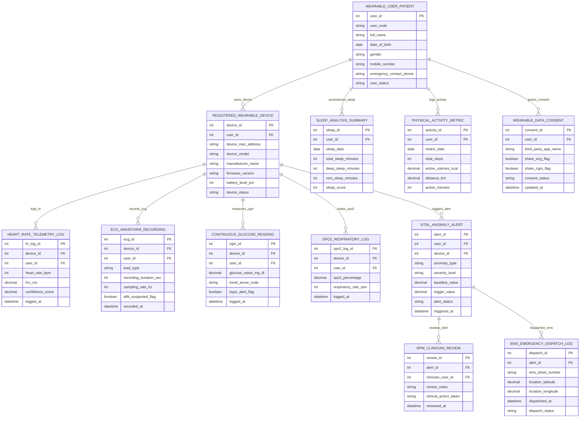

# Conceptual ERD — Health Wearable Data Management System

## Mermaid Code

## Entity Description Table | Bảng mô tả Entity

| # | Entity Name | Vietnamese Name | Description | Key Attributes | Main Relationships |
|---|-------------|-----------------|-------------|----------------|-------------------|
| 1 | WEARABLE_USER_PATIENT | Người dùng / Bệnh nhân Master | Master wearable user patient profile storing user code, full name, DOB, gender, mobile number, emergency contact phone, and status. | user_id, user_code, full_name, dob, gender, mobile_number, emergency_contact_phone, user_status | Has DEVICE, SLEEP_SUMMARY, ACTIVITY_METRIC, DATA_CONSENT. |
| 2 | REGISTERED_WEARABLE_DEVICE | Thiết bị Deo Đăng ký (Device) | Registered wearable device hardware profile storing device MAC address, model, manufacturer, firmware version, battery level %, and status. | device_id, user_id, device_mac_address, device_model, manufacturer_name, firmware_version, battery_level_pct, device_status | Belongs to WEARABLE_USER_PATIENT; Has HR_LOG, ECG_RECORDING, CGM_READING, SPO2_LOG, ANOMALY_ALERT. |
| 3 | HEART_RATE_TELEMETRY_LOG | Nhật ký Nhịp tim Continuous | Continuous heart rate telemetry log tracking device ID, user ID, heart rate BPM, heart rate variability (HRV ms), confidence score, and timestamp. | hr_log_id, device_id, user_id, heart_rate_bpm, hrv_ms, confidence_score, logged_at | Belongs to REGISTERED_WEARABLE_DEVICE and WEARABLE_USER_PATIENT. |
| 4 | ECG_WAVEFORM_RECORDING | Ghi Điện tâm đồ (ECG Waveform) | High-frequency ECG waveform recording tracking lead type (Single/6-Lead), duration sec, sampling rate Hz (300Hz), AFib suspected flag, and timestamp. | ecg_id, device_id, user_id, lead_type, recording_duration_sec, sampling_rate_hz, afib_suspected_flag, recorded_at | Belongs to REGISTERED_WEARABLE_DEVICE and WEARABLE_USER_PATIENT. |
| 5 | CONTINUOUS_GLUCOSE_READING | Đọc Đường huyết Liên tục (CGM) | Continuous Glucose Monitor (CGM) 5-minute reading tracking glucose value mg/dL, trend arrow code, hypoglycemia alert flag, and timestamp. | cgm_id, device_id, user_id, glucose_value_mg_dl, trend_arrow_code, hypo_alert_flag, logged_at | Belongs to REGISTERED_WEARABLE_DEVICE and WEARABLE_USER_PATIENT. |
| 6 | SPO2_RESPIRATORY_LOG | Nhật ký Oxy Máu & Nhịp thở | Pulse oximetry and respiratory telemetry log tracking SpO2 percentage, respiratory rate RPM, and logged timestamp. | spo2_log_id, device_id, user_id, spo2_percentage, respiratory_rate_rpm, logged_at | Belongs to REGISTERED_WEARABLE_DEVICE and WEARABLE_USER_PATIENT. |
| 7 | SLEEP_ANALYSIS_SUMMARY | Tóm tắt Phân tích Giấc ngủ | Daily sleep architecture analysis record tracking sleep date, total sleep minutes, deep sleep minutes, REM sleep minutes, and sleep score (0-100). | sleep_id, user_id, sleep_date, total_sleep_minutes, deep_sleep_minutes, rem_sleep_minutes, sleep_score | Belongs to WEARABLE_USER_PATIENT. |
| 8 | PHYSICAL_ACTIVITY_METRIC | Chỉ số Vận động Hàng ngày | Daily physical activity metric store tracking metric date, total steps, active calories kcal, distance km, and active minutes. | activity_id, user_id, metric_date, total_steps, active_calories_kcal, distance_km, active_minutes | Belongs to WEARABLE_USER_PATIENT. |
| 9 | VITAL_ANOMALY_ALERT | Cảnh báo Bất thường Sinh hiệu | Automated physiological vital sign anomaly alert record tracking anomaly type (AFib, Hypoglycemia, Fall), severity level, trigger value, and status. | alert_id, user_id, device_id, anomaly_type, severity_level, baseline_value, trigger_value, alert_status, triggered_at | Belongs to REGISTERED_WEARABLE_DEVICE; Has RPM_CLINICIAN_REVIEW and EMS_DISPATCH_LOG. |
| 10 | RPM_CLINICIAN_REVIEW | Đánh giá Lâm sàng RPM | Remote Patient Monitoring (RPM) clinician review record tracking alert ID, clinician user ID, review notes, clinical action taken, and timestamp. | review_id, alert_id, clinician_user_id, review_notes, clinical_action_taken, reviewed_at | Belongs to VITAL_ANOMALY_ALERT. |
| 11 | EMS_EMERGENCY_DISPATCH_LOG | Nhật ký Điều phôi Xe 115 | Emergency Medical Services (EMS 115) dispatch log tracking alert ID, EMS ticket number, GPS latitude/longitude, dispatched timestamp, and status. | dispatch_id, alert_id, ems_ticket_number, location_latitude, location_longitude, dispatched_at, dispatch_status | Belongs to VITAL_ANOMALY_ALERT. |
| 12 | WEARABLE_DATA_CONSENT | Quyền Đồng ý Chia sẻ Dữ liệu | User data privacy and sharing consent record tracking third-party app name, share ECG flag, share CGM flag, consent status, and updated timestamp. | consent_id, user_id, third_party_app_name, share_ecg_flag, share_cgm_flag, consent_status, updated_at | Belongs to WEARABLE_USER_PATIENT. |

## Relationship Description | Mô tả Quan hệ

| # | From Entity | Cardinality | To Entity | Relationship Label | Business Explanation |
|---|-------------|-------------|-----------|-------------------|----------------------|
| 1 | WEARABLE_USER_PATIENT | one-to-many | REGISTERED_WEARABLE_DEVICE | owns_device | One wearable user patient owns multiple paired wearable health devices. |
| 2 | WEARABLE_USER_PATIENT | one-to-many | SLEEP_ANALYSIS_SUMMARY | summarizes_sleep | One wearable user has daily sleep architecture analysis summaries. |
| 3 | WEARABLE_USER_PATIENT | one-to-many | PHYSICAL_ACTIVITY_METRIC | logs_activity | One wearable user logs daily physical activity and step metrics. |
| 4 | WEARABLE_USER_PATIENT | one-to-many | WEARABLE_DATA_CONSENT | grants_consent | One wearable user grants privacy data sharing consent settings. |
| 5 | REGISTERED_WEARABLE_DEVICE | one-to-many | HEART_RATE_TELEMETRY_LOG | logs_hr | One registered wearable device logs continuous heart rate telemetry data. |
| 6 | REGISTERED_WEARABLE_DEVICE | one-to-many | ECG_WAVEFORM_RECORDING | records_ecg | One registered wearable device records single-lead or 6-lead ECG waveforms. |
| 7 | REGISTERED_WEARABLE_DEVICE | one-to-many | CONTINUOUS_GLUCOSE_READING | measures_cgm | One registered CGM device measures 5-minute continuous glucose readings. |
| 8 | REGISTERED_WEARABLE_DEVICE | one-to-many | SPO2_RESPIRATORY_LOG | tracks_spo2 | One registered wearable device tracks SpO2 oxygen and respiratory rate logs. |
| 9 | REGISTERED_WEARABLE_DEVICE | one-to-many | VITAL_ANOMALY_ALERT | triggers_alert | One registered wearable device triggers automated vital anomaly alerts (AFib, Hypo). |
| 10 | VITAL_ANOMALY_ALERT | one-to-many | RPM_CLINICIAN_REVIEW | reviews_alert | One vital anomaly alert is reviewed by RPM nurses and tele-health doctors. |
| 11 | VITAL_ANOMALY_ALERT | one-to-one | EMS_EMERGENCY_DISPATCH_LOG | dispatches_ems | One critical life-threatening anomaly alert dispatches EMS 115 emergency payloads. |
