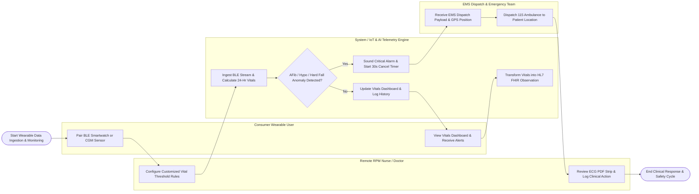

# Swimlane Diagram — Health Wearable Data Management System

## Mermaid Code

## Flow Description | Mô tả luồng

| Lane | Actor / Subsystem | Role in Flow |
|------|-------------------|--------------|
| 1 | Consumer Wearable User | Pairs Bluetooth smartwatches or medical CGM sensors, sets health goals, views real-time vital sign dashboards, receives wellness insights, and manages data consent. |
| 2 | Remote RPM Nurse / Doctor | Configures patient-specific vital alarm thresholds, triages RPM alarm queues, reviews 6-Lead ECG PDF strips, logs clinical actions, and exports CPT billing reports. |
| 3 | System / IoT & AI Telemetry Engine | Ingests real-time BLE/cloud telemetry, executes AI arrhythmia (AFib) and hypoglycemia detection algorithms, sounds 30-second emergency cancel timers, and maps FHIR resources. |
| 4 | EMS Dispatch & Emergency Team | Receives automated emergency dispatch payloads (GPS coordinates, live vitals, ECG strip), dispatches 115 ambulances, and confirms incident ticket numbers. |
