# Action Tree — Health Wearable Data Management System

## Mermaid Code

```mermaid
graph TD
    Root["Health Wearable Data Management System"]

    Root --> M1["IoT Wearable Pairing & Telemetry"]
    Root --> M2["AI Cardiac Arrhythmia & AFib"]
    Root --> M3["CGM Glucose & Hypoglycemia Alarms"]
    Root --> M4["Patient Dashboard & Sleep Stages"]
    Root --> M5["RPM Clinician Triage Portal"]
    Root --> M6["Emergency EMS Dispatch & SOS"]
    Root --> M7["EHR FHIR Integration & RPM Billing"]
    Root --> M8["Data Privacy Consent & SaMD Rules"]

    M1 --> A11["Pair BLE Smartwatch & Medical Sensors"]
    M1 --> A12["Authorize OAuth2 Apple Health & Google Sync"]
    M1 --> A13["Ingest 300Hz Raw ECG Waveform Stream"]
    M1 --> A14["Track Wearable Battery Level & Status"]

    M2 --> A21["Execute AI PPG & ECG Waveform Analysis"]
    M2 --> A22["Detect Atrial Fibrillation AFib & RVR"]
    M2 --> A23["Flag Severe Tachycardia & Bradycardia"]
    M2 --> A24["Generate 6-Lead ECG Strip Recording PDF"]

    M3 --> A31["Ingest 5-Minute Continuous Glucose Readings"]
    M3 --> A32["Calculate Glucose Rate-of-Change Trend Arrows"]
    M3 --> A33["Trigger Nocturnal Hypoglycemia Critical Alarms"]
    M3 --> A34["Compute Time-in-Range TIR 70 to 180 mg/dL"]

    M4 --> A41["Render 24-Hour Heart Rate & SpO2 Graphs"]
    M4 --> A42["Analyze Deep REM Light Sleep Architecture"]
    M4 --> A43["Calculate Heart Rate Variability HRV Stress"]
    M4 --> A44["Track Daily Steps Active Calories & Workouts"]

    M5 --> A51["Display Color-Coded RPM Vital Alarm Queue"]
    M5 --> A52["Configure Patient Vital Threshold Rules"]
    M5 --> A53["Log Clinician Tele-Health Review Notes"]
    M5 --> A54["Dispatch Patient Wellness Check Reminders"]

    M6 --> A61["Detect Hard Fall Accelerometry Patterns"]
    M6 --> A62["Start 30-Second Patient Emergency Cancel Timer"]
    M6 --> A63["Transmit EMS 115 GPS Location & Vitals Payload"]
    M6 --> A64["Send Automated Family Emergency Contact SMS"]

    M7 --> A71["Transform Wearable Telemetry to FHIR R4"]
    M7 --> A72["Sync EHR Vital Observation LOINC Resources"]
    M7 --> A73["Audit Monthly 16-Day RPM Patient Compliance"]
    M7 --> A74["Export CPT 99453 & 99454 Billing Logs"]

    M8 --> A81["Manage Fine-Grained Third-Party Data Consent"]
    M8 --> A82["Enforce AES-256 Telemetry Encryption"]
    M8 --> A83["Audit SaMD Algorithm False Positive Rates"]
    M8 --> A84["Export HIPAA Privacy & Security Audit Logs"]
```

## Module Description | Mô tả Module

| # | Module | Description | Actions |
|---|--------|-------------|---------|
| 1 | IoT Wearable Pairing & Telemetry | Pairs BLE smartwatches/sensors, authorizes Apple/Google Cloud sync, ingests 300Hz ECG streams, and tracks device battery status. | Pair BLE Smartwatch & Medical Sensors, Authorize OAuth2 Apple Health & Google Sync, Ingest 300Hz Raw ECG Waveform Stream, Track Wearable Battery Level & Status |
| 2 | AI Cardiac Arrhythmia & AFib | Executes AI PPG/ECG analysis, detects Atrial Fibrillation (AFib RVR), flags tachycardia/bradycardia, and exports 6-Lead ECG PDF strips. | Execute AI PPG & ECG Waveform Analysis, Detect Atrial Fibrillation AFib & RVR, Flag Severe Tachycardia & Bradycardia, Generate 6-Lead ECG Strip Recording PDF |
| 3 | CGM Glucose & Hypoglycemia Alarms | Ingests 5-minute CGM glucose readings, calculates trend arrows, triggers nocturnal hypoglycemia alarms (< 54 mg/dL), and tracks Time-in-Range (TIR). | Ingest 5-Minute Continuous Glucose Readings, Calculate Glucose Rate-of-Change Trend Arrows, Trigger Nocturnal Hypoglycemia Critical Alarms, Compute Time-in-Range TIR 70 to 180 mg/dL |
| 4 | Patient Dashboard & Sleep Stages | Renders 24-hour vital graphs, analyzes sleep architecture (Deep, REM, Light), computes HRV stress scores, and tracks daily steps/calories. | Render 24-Hour Heart Rate & SpO2 Graphs, Analyze Deep REM Light Sleep Architecture, Calculate Heart Rate Variability HRV Stress, Track Daily Steps Active Calories & Workouts |
| 5 | RPM Clinician Triage Portal | Displays color-coded RPM vital alarm queues, configures vital threshold rules, logs clinician review notes, and dispatches patient reminders. | Display Color-Coded RPM Vital Alarm Queue, Configure Patient Vital Threshold Rules, Log Clinician Tele-Health Review Notes, Dispatch Patient Wellness Check Reminders |
| 6 | Emergency EMS Dispatch & SOS | Detects hard fall patterns, starts 30-second emergency cancel timers, transmits EMS 115 GPS location payloads, and sends family SMS alerts. | Detect Hard Fall Accelerometry Patterns, Start 30-Second Patient Emergency Cancel Timer, Transmit EMS 115 GPS Location & Vitals Payload, Send Automated Family Emergency Contact SMS |
| 7 | EHR FHIR Integration & RPM Billing | Transforms telemetry into HL7 FHIR R4 Observation resources, syncs hospital EHRs, audits monthly 16-day RPM compliance, and exports CPT billing logs. | Transform Wearable Telemetry to FHIR R4, Sync EHR Vital Observation LOINC Resources, Audit Monthly 16-Day RPM Patient Compliance, Export CPT 99453 & 99454 Billing Logs |
| 8 | Data Privacy Consent & SaMD Rules | Manages third-party data sharing consent, enforces AES-256 telemetry encryption, audits SaMD algorithm accuracy, and exports HIPAA privacy logs. | Manage Fine-Grained Third-Party Data Consent, Enforce AES-256 Telemetry Encryption, Audit SaMD Algorithm False Positive Rates, Export HIPAA Privacy & Security Audit Logs |
