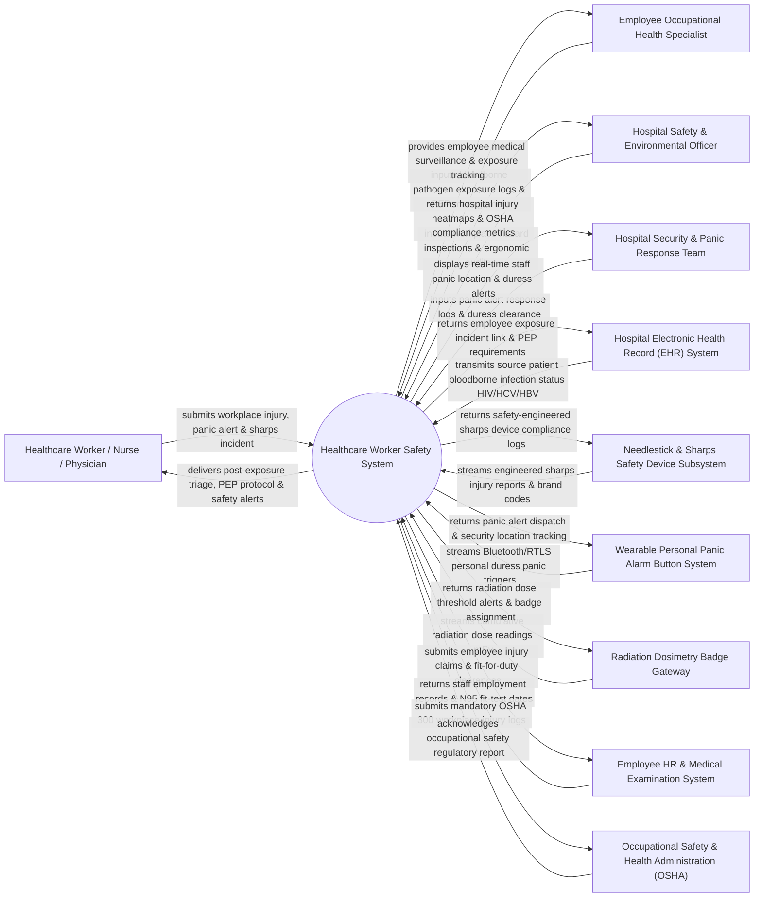

# Context Diagram — Healthcare Worker Safety System

## Mermaid Code

## Actor & Interaction Table | Bảng Actor & Tương tác

| # | Actor | Actor Type | Data Sent TO System | Data Received FROM System | Notes |
|---|-------|------------|---------------------|---------------------------|-------|
| 1 | Healthcare Worker / Nurse / Physician | Primary | Needlestick/sharps injury reports, workplace violence incidents, chemical splash alerts, personal panic duress triggers, N95 fit-test records. | Immediate post-exposure triage instructions, HIV/HBV/HCV PEP protocols, panic alert dispatch confirmations, safety alerts. | Front-line healthcare staff reporting workplace safety incidents, violence, or chemical exposures. |
| 2 | Employee Occupational Health Specialist | Primary | Bloodborne pathogen exposure investigation notes, PEP drug dispensation tracking, staff immunization logs, return-to-work clearances. | Employee medical surveillance roster, bloodborne exposure follow-up calendars, N95 fit-test expiration lists. | Occupational health nurse or physician managing employee medical surveillance, PEP, and injury clearance. |
| 3 | Hospital Safety & Environmental Officer | Primary | Hazardous chemical (OSHA HazCom) safety data sheets (SDS), ergonomic assessment logs, hospital safety inspection audits. | Hospital injury/illness heatmaps, OSHA 300 incident logs, ergonomics risk scores, chemical hazard alerts. | Safety director overseeing hospital environmental health, hazardous materials, and ergonomic safety compliance. |
| 4 | Hospital Security & Panic Response Team | Primary | Security response timestamps, duress incident resolution notes, de-escalation report files. | Real-time staff panic duress location tracking (RTLS room coordinates), active violence alert beacons, security dispatch orders. | Hospital security team responding to real-time staff panic alarms and workplace violence threats. |
| 5 | Hospital Electronic Health Record (EHR) System | Supporting | Source patient bloodborne infection status (HIV, Hepatitis B, Hepatitis C), viral load, source patient MRN. | Employee exposure incident linkage, mandatory source patient testing requisitions. | Hospital EHR providing source patient infection status for rapid bloodborne exposure risk stratification. |
| 6 | Needlestick & Sharps Safety Device Subsystem | Supporting | Engineered sharps safety device brand codes, needle gauge sizes, passive safety feature deployment logs. | Safety-engineered sharps device compliance metrics, high-injury needle model alerts. | Medical device subsystem tracking safety-engineered needles, scalpels, and blood collection devices. |
| 7 | Wearable Personal Panic Alarm Button System | Supporting | Real-time location system (RTLS) Bluetooth/Wi-Fi duress panic signals, staff badge ID, room location coordinates. | Panic signal receipt acknowledgments, silent alarm activation confirmations. | Wearable IoT panic badges worn by nurses and ED staff to trigger immediate security intervention. |
| 8 | Radiation Dosimetry Badge Gateway | Supporting | Thermoluminescent dosimeter (TLD) / optically stimulated luminescence (OSL) radiation dose readings (mSv). | Radiation dose threshold breach alerts, quarterly staff dose summaries, pregnant worker dose limits. | Dosimetry vendor portal streaming cumulative radiation exposure data for radiology and cath lab staff. |
| 9 | Employee HR & Medical Examination System | Supporting | Employee job titles, department assignments, baseline health records, N95 respirator fit-test completion dates. | Employee workers' compensation claims, work restriction notices, fit-for-duty clearances. | Enterprise HR system managing employee job classifications, workers' comp claims, and annual health exams. |
| 10 | Occupational Safety & Health Administration (OSHA) | Supporting / Regulatory | Mandated occupational safety standards (Bloodborne Pathogens Standard 1910.1030, OSHA 300 Log rules), audit guidelines. | Annual OSHA 300 / 300A Summary Log electronic submissions, severe injury report notifications. | Government regulatory agency enforcing workplace safety standards and collecting injury statistics. |

## System Boundary Description | Mô tả Phạm vi Hệ thống

The **Healthcare Worker Safety System (HWSS)** is an enterprise occupational health, personal safety, and environmental hazard management platform designed to protect healthcare workers from bloodborne pathogen exposures, workplace violence, radiation hazards, and chemical risks.

**Inside System Scope:**
- Instant reporting and triage workflows for needlestick/sharps injuries and bloodborne pathogen exposures (HIV, HBV, HCV).
- Management of Post-Exposure Prophylaxis (PEP) protocols, source patient testing, and employee medical surveillance calendars.
- Real-time staff personal panic alarm button integration with Real-Time Location Systems (RTLS) for instant workplace violence security dispatch.
- Radiation dose tracking from digital dosimetry badges and N95 respirator fit-test compliance management.
- Automated generation of mandatory OSHA 300/300A Log electronic reports and workers' compensation injury documentation.

**Outside System Scope:**
- Physical security intervention or physical restraint of violent individuals (performed by Hospital Security Officers).
- Physical manufacturing of safety-engineered needles or N95 masks (handled by medical device manufacturers).
- Direct financial disbursement of workers' compensation disability funds (managed by Workers' Compensation Insurers).
