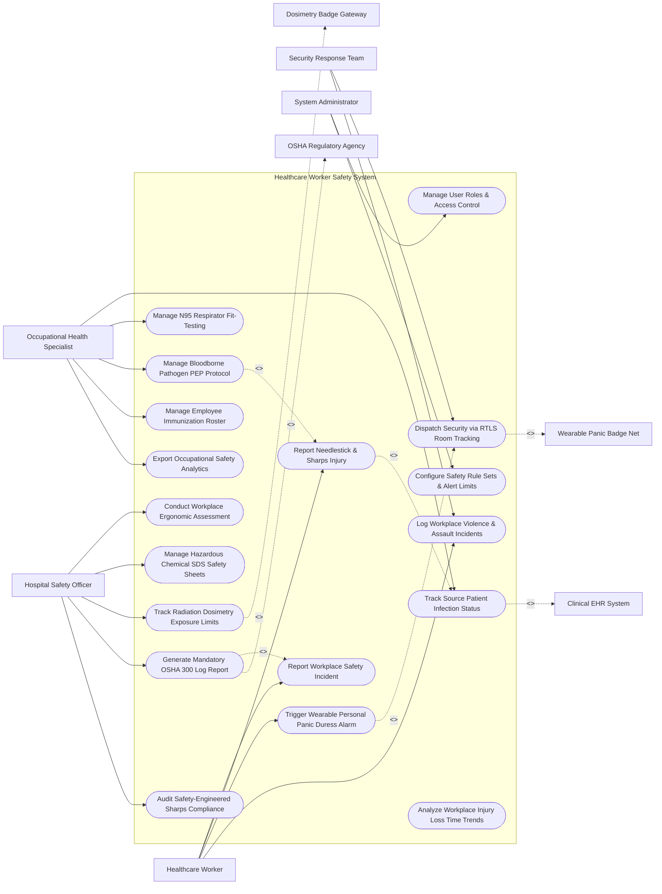

# Use Case Diagram — Healthcare Worker Safety System

## Mermaid Code

## Actor Table | Bảng Actor

| # | Actor | Actor Type | Role Description | Related Use Cases |
|---|-------|------------|------------------|-------------------|
| 1 | Healthcare Worker | Primary | Nurse, physician, or hospital staff member reporting needlestick injuries, violence, or triggering panic badges. | UC01, UC02, UC05, UC14 |
| 2 | Occupational Health Specialist | Primary | Specialist managing bloodborne exposure protocols (PEP), N95 fit-testing, employee immunizations, and medical surveillance. | UC03, UC04, UC07, UC12, UC15 |
| 3 | Hospital Safety Officer | Primary | Environmental safety director auditing sharps safety devices, chemical SDS, radiation dosimetry, and OSHA logs. | UC08, UC09, UC10, UC11, UC13 |
| 4 | Security Response Team | Primary | Hospital security personnel receiving RTLS panic room alerts and investigating workplace violence incidents. | UC06, UC14 |
| 5 | System Administrator | Primary | IT administrative user managing security roles, duress alert thresholds, and system integration. | UC16, UC17 |
| 6 | Clinical EHR System | System (Secondary) | Hospital EHR supplying source patient HIV, HBV, and HCV infection status. | UC03 |
| 7 | Wearable Panic Badge Net | System (Secondary) | Real-Time Location System (RTLS) wireless network streaming duress panic signals and room coordinates. | UC06 |
| 8 | Dosimetry Badge Gateway | System (Secondary) | Radiation monitoring vendor portal streaming cumulative millisievert (mSv) exposure readings. | UC10 |
| 9 | OSHA Regulatory Agency | System (Secondary) | Government safety body receiving mandatory electronic OSHA 300 / 300A injury summary reports. | UC11 |

## Use Case Table | Bảng Use Case

| # | UC ID | Use Case Name | Primary Actor | Secondary Actor | Description | Priority |
|---|-------|---------------|---------------|-----------------|-------------|----------|
| 1 | UC01 | Report Workplace Safety Incident | HC Worker | None | Captures general workplace safety incident reports (slips, trips, falls, physical strains, chemical splashes). | High |
| 2 | UC02 | Report Needlestick & Sharps Injury | HC Worker | EHR System | Captures urgent needlestick, scalpel cut, or bloodborne exposure details and initiates emergency triage. | Critical |
| 3 | UC03 | Track Source Patient Infection Status | OccHealth | Clinical EHR | Queries EHR for source patient bloodborne pathogen status (HIV, Hepatitis B, Hepatitis C) to stratify risk. | Critical |
| 4 | UC04 | Manage N95 Respirator Fit-Testing | OccHealth | None | Tracks annual OSHA N95 respirator fit-testing compliance, mask brand/size assignments, and expiry dates. | High |
| 5 | UC05 | Trigger Wearable Personal Panic Duress Alarm | HC Worker | Panic Net | Transmits instant wireless duress signal from wearable panic badge when threatened by workplace violence. | Critical |
| 6 | UC06 | Dispatch Security via RTLS Room Tracking | Security | Panic Net | Maps panic duress alert to exact hospital room coordinates via RTLS and dispatches security officers. | Critical |
| 7 | UC07 | Manage Bloodborne Pathogen PEP Protocol | OccHealth | None | Manages Post-Exposure Prophylaxis (PEP) drug dispensation, baseline lab tests, and 6-week/6-month follow-up. | Critical |
| 8 | UC08 | Conduct Workplace Ergonomic Assessment | Safety Officer | None | Conducts ergonomic risk assessments (REBA/RULA scores) for patient handling and repetitive lift tasks. | Medium |
| 9 | UC09 | Manage Hazardous Chemical SDS Safety Sheets | Safety Officer | None | Maintains searchable database of Safety Data Sheets (SDS) for all hospital hazardous chemicals and GHS pictograms. | High |
| 10 | UC10 | Track Radiation Dosimetry Exposure Limits | Safety Officer | Dosimetry Gateway | Ingests quarterly dosimeter badge readings (mSv) and alerts when staff approach annual dose limits. | High |
| 11 | UC11 | Generate Mandatory OSHA 300 Log Report | Safety Officer | OSHA Agency | Compiles and exports mandatory OSHA 300 / 300A Log electronic reports detailing recordable workplace injuries. | High |
| 12 | UC12 | Manage Employee Immunization Roster | OccHealth | None | Tracks employee mandatory vaccinations (Hepatitis B, Influenza, MMR, Varicella) and antibody titer immunity. | High |
| 13 | UC13 | Audit Safety-Engineered Sharps Compliance | Safety Officer | None | Audits hospital compliance with OSHA Needlestick Safety Act, tracking safety needle vs non-safety device use. | Medium |
| 14 | UC14 | Log Workplace Violence & Assault Incidents | HC Worker | Security | Logs verbal threats, physical assaults, or patient aggression incidents, recording room location and injury. | High |
| 15 | UC15 | Export Occupational Safety Analytics | OccHealth | None | Renders hospital injury heatmaps, lost-workday incidence rates, and department safety compliance scores. | Medium |
| 16 | UC16 | Manage User Roles & Access Control | Admin | None | Configures user roles, security credentials, and HIPAA-compliant employee health record privacy protections. | High |
| 17 | UC17 | Configure Safety Rule Sets & Alert Limits | Admin | Safety Officer | Configures panic alarm dispatch rules, radiation dose alert limits, and bloodborne PEP triage workflows. | High |
| 18 | UC18 | Analyze Workplace Injury Loss Time Trends | System | None | Computes Days Away, Restricted, or Transferred (DART) rate metrics to measure lost productivity impact. | Medium |

## Use Case Specification | Đặc tả Use Case

---

### UC02 — Report Needlestick & Sharps Injury

| Field | Detail |
|-------|--------|
| **UC ID** | UC02 |
| **Use Case Name** | Report Needlestick & Sharps Injury |
| **Actor(s)** | Primary: Healthcare Worker / Nurse / Physician   Secondary: Clinical EHR System |
| **Description** | Captures urgent details of a needlestick, scalpel cut, or mucosal bloodborne pathogen exposure, links source patient information, and immediately initializes emergency post-exposure triage. |
| **Precondition** | 1. Healthcare worker experiences a percutaneous needlestick or blood splash incident. |
| **Main Flow** | 1. Healthcare Worker opens "Urgent Needlestick / Exposure Report" on mobile app or workstation.   2. Worker inputs Incident Details: Date/Time, Department, Exact Body Site (e.g., Right Index Finger), Sharps Device Type (e.g., 22G Hollow-Bore Syringe Needle), Safety Feature Status (Deployed vs Not Deployed).   3. Worker inputs Source Patient Identification (MRN or Encounter ID).   4. System queries EHR System (UC03) to check Source Patient infection status for HIV, Hepatitis B (HBsAg), and Hepatitis C (Anti-HCV).   5. System displays Immediate First-Aid Triage Guide: "Wash area thoroughly with soap and water for 5 minutes. Do not squeeze wound."   6. System generates an emergency `BLOODBORNE_EXPOSURE_INCIDENT` record.   7. System sends immediate SMS alert to Employee Occupational Health Specialist (UC07) and dispatches electronic lab requisition for worker baseline blood draw. |
| **Alternative Flow** | **AF1** — Unknown Source Patient: Needlestick occurred in biohazard waste bin with unidentified source patient; System flags source as `UNKNOWN_HIGH_RISK` and defaults to conservative high-risk PEP protocol. |
| **Exception Flow** | **EX1** — Source Patient Known HIV Positive: EHR confirms source patient has active HIV with high viral load; System triggers red modal alert "HIGH-RISK HIV EXPOSURE", prompting worker to report to Emergency Department for PEP drug initiation within 2 hours. |
| **Postcondition** | Needlestick injury is registered, source patient status is checked, emergency triage guide is displayed, and PEP workflow is queued. |
| **Business Rule** | **BR1**: Needlestick exposure reporting MUST initiate source patient testing and worker PEP evaluation within 2 hours of exposure. |

---

### UC05 — Trigger Wearable Personal Panic Duress Alarm

| Field | Detail |
|-------|--------|
| **UC ID** | UC05 |
| **Use Case Name** | Trigger Wearable Personal Panic Duress Alarm |
| **Actor(s)** | Primary: Healthcare Worker / Nurse   Secondary: Wearable Panic Badge Net, Security Response Team |
| **Description** | Transmits an instant wireless duress panic signal from a wearable RTLS badge when a healthcare worker is threatened by patient violence, pin-pointing exact room coordinates for security dispatch. |
| **Precondition** | 1. Healthcare worker is wearing an active RTLS personal panic badge.   2. Hospital RTLS wireless beacon network is online. |
| **Main Flow** | 1. Healthcare worker experiences a workplace violence threat (e.g., aggressive patient brandishing weapon in ED Exam Room 4).   2. Worker double-presses red panic button on wearable RTLS badge.   3. Badge transmits encrypted RF/Bluetooth signal to ceiling RTLS beacons.   4. System ingests panic signal, decodes Badge ID to Worker Name, and calculates room location: `ED Room 4 (Floor 1, West Wing)`.   5. System triggers UC06 (Dispatch Security via RTLS Room Tracking):   &nbsp;&nbsp;&nbsp;&nbsp; a. Triggers audible/visual alarm on Security Command Center monitor.   &nbsp;&nbsp;&nbsp;&nbsp; b. Flashes red alert beacon on Ward Nurse Station display panel.   &nbsp;&nbsp;&nbsp;&nbsp; c. Sends instant push notification and walkie-talkie alert to on-duty Security Officers.   6. System sends silent vibration feedback to worker badge confirming "Panic Signal Sent - Security En Route".   7. Security officers arrive at ED Room 4 and de-escalate incident. |
| **Alternative Flow** | **AF1** — Staff Escort Assist Request: Worker feels uneasy with aggressive visitor; Worker single-presses badge for "Staff Escort Request" (non-emergency), alerting charge nurse instead of armed security. |
| **Exception Flow** | **EX1** — Accidental Panic Button Press: Worker accidentally bumps panic button; Worker enters 4-digit PIN on badge or phone app within 15 seconds to cancel "False Alarm", preventing security dispatch. |
| **Postcondition** | Panic duress signal is transmitted, RTLS room coordinates are pin-pointed, security is dispatched, and incident is logged. |
| **Business Rule** | **BR1**: Panic duress alerts MUST dispatch security officers to the exact RTLS room location within <= 60 seconds of signal activation. |

---

### UC07 — Manage Bloodborne Pathogen PEP Protocol

| Field | Detail |
|-------|--------|
| **UC ID** | UC07 |
| **Use Case Name** | Manage Bloodborne Pathogen PEP Protocol |
| **Actor(s)** | Primary: Employee Occupational Health Specialist   Secondary: Healthcare Worker |
| **Description** | Manages Post-Exposure Prophylaxis (PEP) anti-retroviral drug dispensation, baseline blood draws, Hepatitis B vaccine/HBIG administration, and schedules 6-week, 12-week, and 6-month laboratory follow-up. |
| **Precondition** | 1. Needlestick or bloodborne exposure incident is reported (UC02).   2. Source patient risk evaluation is completed (UC03). |
| **Main Flow** | 1. Occupational Health Specialist opens "Bloodborne Exposure Protocol" file for exposed worker.   2. Specialist evaluates exposure risk tier (High-Risk HIV / HBV / HCV vs Low-Risk).   3. If HIV risk is confirmed: Specialist orders 28-day HIV Post-Exposure Prophylaxis (PEP) anti-retroviral starter kit (e.g., Tenofovir / Emtricitabine + Raltegravir) to be dispensed within 2 hours.   4. If HBV non-immune: Specialist orders Hepatitis B Immune Globulin (HBIG) injection + Hep B vaccine series booster.   5. Specialist orders baseline blood tests for worker: HIV Ab/Ag, HBsAb, Anti-HCV, Liver Function (ALT/AST).   6. System establishes automated follow-up calendar:   &nbsp;&nbsp;&nbsp;&nbsp; a. 2-Week: PEP Drug Tolerance & Renal Function Check.   &nbsp;&nbsp;&nbsp;&nbsp; b. 6-Week: HIV & HCV RNA PCR Test.   &nbsp;&nbsp;&nbsp;&nbsp; c. 12-Week: HIV Ab/Ag Test.   &nbsp;&nbsp;&nbsp;&nbsp; d. 6-Month: Final Serology Clearance.   7. System dispatches automated SMS/Email reminders to worker prior to each follow-up lab milestone. |
| **Alternative Flow** | **AF1** — Source Patient HIV Negative: Source patient rapid HIV test returns Negative; Specialist discontinues HIV PEP drugs, saving worker from unnecessary 28-day medication side effects. |
| **Exception Flow** | **EX1** — Worker Misses 6-Week Follow-Up Lab: Worker fails to report for 6-week blood draw; System alerts Specialist, places automated phone call to worker, and notifies department supervisor. |
| **Postcondition** | PEP protocol is initiated, baseline lab tests are ordered, and follow-up medical surveillance calendar is scheduled. |
| **Business Rule** | **BR1**: HIV PEP anti-retroviral medications MUST be initiated as soon as possible, ideally within 2 hours and no later than 72 hours post-exposure. |

---

### UC10 — Track Radiation Dosimetry Exposure Limits

| Field | Detail |
|-------|--------|
| **UC ID** | UC10 |
| **Use Case Name** | Track Radiation Dosimetry Exposure Limits |
| **Actor(s)** | Primary: Hospital Safety Officer   Secondary: Dosimetry Badge Gateway |
| **Description** | Ingests quarterly thermoluminescent dosimeter (TLD) badge readings from radiation exposure vendor, monitors cumulative millisievert (mSv) doses, and alerts when staff approach annual regulatory dose limits. |
| **Precondition** | 1. Radiology, Fluoroscopy, and Cath Lab staff are assigned wear-period dosimetry badges.   2. Radiation Dosimetry Badge Gateway streams quarterly reading payloads. |
| **Main Flow** | 1. System ingests quarterly radiation dose reading files from Dosimetry Badge Gateway.   2. System updates cumulative effective dose for each radiation worker in `RADIATION_DOSE_RECORD`:   &nbsp;&nbsp;&nbsp;&nbsp; a. Deep Dose Equivalent (DDE mSv).   &nbsp;&nbsp;&nbsp;&nbsp; b. Eye Lens Dose Equivalent (LDE mSv).   &nbsp;&nbsp;&nbsp;&nbsp; c. Shallow Dose Equivalent (SDE mSv).   3. System calculates 12-month cumulative total dose (e.g., Worker cumulative DDE = 12.4 mSv).   4. System compares dose against regulatory exposure limits:   &nbsp;&nbsp;&nbsp;&nbsp; a. OSHA/NRC Annual Limit: 50 mSv/year.   &nbsp;&nbsp;&nbsp;&nbsp; b. Hospital ALARA Level 1 Trigger: 1.25 mSv/quarter (5 mSv/year).   &nbsp;&nbsp;&nbsp;&nbsp; c. Hospital ALARA Level 2 Trigger: 3.75 mSv/quarter (15 mSv/year).   5. System flags ALARA Level 2 breach icon for Cath Lab Technologist (cumulative dose 16.2 mSv).   6. Safety Officer receives alert, initiates workplace radiation safety audit (checking lead apron integrity and shielding practices), and logs investigation notes. |
| **Alternative Flow** | **AF1** — Declared Pregnant Worker Protection: Worker declares pregnancy; System applies strict embryonic/fetal dose limit ($0.5 \text{ mSv/month}$ or $5 \text{ mSv}$ total gestation period) and assigns fetal dosimeter badge. |
| **Exception Flow** | **EX1** — Sudden High Dose Spikes ($> 5 \text{ mSv}$ single quarter): Single quarterly badge reads $8.5 \text{ mSv}$; System flags "Acute Radiation Dose Anomaly", prompts investigation whether badge was left inside X-ray room accidentally, and orders badge re-calibration. |
| **Postcondition** | Cumulative radiation doses are recorded, ALARA threshold alerts are generated, and safety investigation workflows are initiated. |
| **Business Rule** | **BR1**: Declared pregnant radiation workers MUST NOT exceed an embryonic/fetal radiation dose limit of $0.5 \text{ mSv}$ in any single month. |

---

### UC11 — Generate Mandatory OSHA 300 Log Report

| Field | Detail |
|-------|--------|
| **UC ID** | UC11 |
| **Use Case Name** | Generate Mandatory OSHA 300 Log Report |
| **Actor(s)** | Primary: Hospital Safety Officer   Secondary: OSHA Regulatory Agency |
| **Description** | Compiles and exports mandatory OSHA Form 300 (Log of Work-Related Injuries and Illnesses), Form 300A (Summary), and Form 301 (Incident Report) electronic files for regulatory submission. |
| **Precondition** | 1. Workplace safety incidents are reported and classified as OSHA Recordable (UC01/UC02/UC14). |
| **Main Flow** | 1. Safety Officer opens "OSHA Regulatory Reporting" module.   2. System fetches all OSHA Recordable injury/illness cases for target calendar year:   &nbsp;&nbsp;&nbsp;&nbsp; a. Cases involving Days Away from Work (Lost Time).   &nbsp;&nbsp;&nbsp;&nbsp; b. Cases involving Job Transfer or Restriction.   &nbsp;&nbsp;&nbsp;&nbsp; c. Cases requiring Medical Treatment beyond First Aid.   &nbsp;&nbsp;&nbsp;&nbsp; d. Needlestick and Sharps Injury cases involving bloodborne pathogens.   3. System auto-populates OSHA Form 300 Log entries: Employee Name, Job Title, Date of Injury, Location, Description of Injury/Illness, and Injury Classification check-boxes.   4. System computes OSHA Form 300A Annual Summary totals: Total Deaths, Total Lost-Time Cases, Total Job Restriction Cases, Total Days Away from Work, and Total Lost Workday Incidence Rate.   5. Safety Officer reviews entries, verifies accuracy, and applies digital approval signature.   6. System packages electronic data into OSHA ITA (Injury Tracking Application) CSV/XML schema.   7. System transmits payload via secure HTTPS API to OSHA ITA Portal and archives local copy. |
| **Alternative Flow** | **AF1** — Severe Injury Immediate 8-Hour OSHA Report: Incident involves employee fatality or amputation; System triggers urgent "OSHA Severe Injury Alert", generating immediate 8-hour electronic notification packet. |
| **Exception Flow** | **EX1** — Missing Injury Classification Code: Case #142 lacks OSHA Illness Category code (e.g., Skin Disease vs Hearing Loss); System highlights incomplete row in red and blocks submission until code is selected. |
| **Postcondition** | OSHA Form 300/300A/301 logs are generated, annual summary statistics are computed, and electronic filing is transmitted to OSHA. |
| **Business Rule** | **BR1**: Annual OSHA 300A Summary Logs MUST be posted in hospital employee areas from February 1 to April 30 and electronically filed by March 2. |
