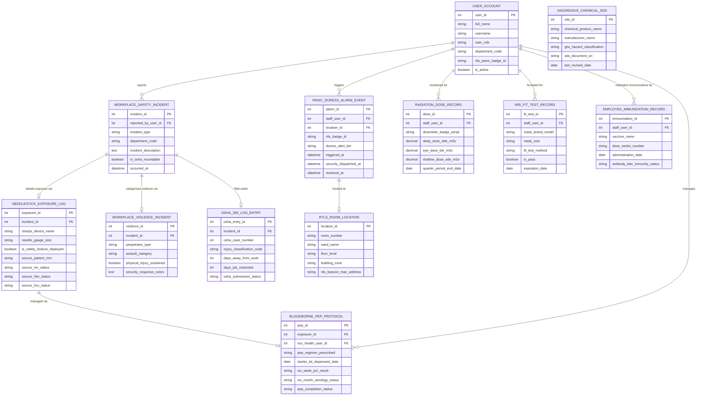

# Conceptual ERD — Healthcare Worker Safety System

## Mermaid Code

## Entity Description Table | Bảng mô tả Entity

| # | Entity Name | Vietnamese Name | Description | Key Attributes | Main Relationships |
|---|-------------|-----------------|-------------|----------------|-------------------|
| 1 | USER_ACCOUNT | Tài khoản Nguời dùng | System credentials, RTLS panic badge ID, department, and safety authorization roles. | `user_id`, `username`, `user_role`, `department_code`, `rtls_panic_badge_id` | Reports `WORKPLACE_SAFETY_INCIDENT`, triggers `PANIC_DURESS_ALARM_EVENT`, monitored for `RADIATION_DOSE_RECORD`. |
| 2 | WORKPLACE_SAFETY_INCIDENT | Sự cố An toàn Lao động | Master incident log capturing workplace injuries, slips/falls, needle sticks, and violence reports. | `incident_id`, `reported_by_user_id`, `incident_type`, `department_code`, `is_osha_recordable` | Details exposure via `NEEDLESTICK_EXPOSURE_LOG`, categorized via `WORKPLACE_VIOLENCE_INCIDENT`, filed under `OSHA_300_LOG_ENTRY`. |
| 3 | NEEDLESTICK_EXPOSURE_LOG | Nhật ký Bị Kim Tiêm Đâm | Urgent needlestick, scalpel cut, or bloodborne exposure incident details and source patient status. | `exposure_id`, `incident_id`, `sharps_device_name`, `source_patient_mrn`, `source_hiv_status` | Belongs to `WORKPLACE_SAFETY_INCIDENT`, managed via `BLOODBORNE_PEP_PROTOCOL`. |
| 4 | BLOODBORNE_PEP_PROTOCOL | Giao thức PEP Mầm bệnh Máu | Post-Exposure Prophylaxis (PEP) drug dispensation, lab testing schedule, and 6-month serology clearance. | `pep_id`, `exposure_id`, `occ_health_user_id`, `pep_regimen_prescribed`, `six_month_serology_status` | Belongs to `NEEDLESTICK_EXPOSURE_LOG`, managed by `USER_ACCOUNT`. |
| 5 | PANIC_DURESS_ALARM_EVENT | Sự kiện Cảnh báo Hoảng loạn | Real-time wireless duress panic alarm triggers transmitted from wearable RTLS staff badges. | `alarm_id`, `staff_user_id`, `location_id`, `rtls_badge_id`, `triggered_at`, `resolved_at` | Triggered by `USER_ACCOUNT`, located at `RTLS_ROOM_LOCATION`. |
| 6 | RTLS_ROOM_LOCATION | Vị trí Phòng RTLS | Real-Time Location System (RTLS) room coordinates, building zones, and beacon MAC addresses. | `location_id`, `room_number`, `ward_name`, `floor_level`, `rtls_beacon_mac_address` | Houses `PANIC_DURESS_ALARM_EVENT`. |
| 7 | RADIATION_DOSE_RECORD | Nhật ký Liều Lượng Bức xạ | Quarterly thermoluminescent dosimeter (TLD) badge exposure readings (DDE, LDE, SDE mSv). | `dose_id`, `staff_user_id`, `dosimeter_badge_serial`, `deep_dose_dde_mSv`, `quarter_period_end_date` | Belongs to `USER_ACCOUNT`. |
| 8 | N95_FIT_TEST_RECORD | Hồ sơ Fit-Test Khẩu trang N95 | OSHA N95 respirator fit-testing records, assigned mask model/size, and annual expiration dates. | `fit_test_id`, `staff_user_id`, `mask_brand_model`, `mask_size`, `expiration_date` | Belongs to `USER_ACCOUNT`. |
| 9 | WORKPLACE_VIOLENCE_INCIDENT | Báo cáo Bạo lực Nơi Làm việc | Incident details logging patient aggression, physical assault, verbal threats, and security dispatch notes. | `violence_id`, `incident_id`, `perpetrator_type`, `assault_category`, `physical_injury_sustained` | Belongs to `WORKPLACE_SAFETY_INCIDENT`. |
| 10 | HAZARDOUS_CHEMICAL_SDS | Trang An toàn Hóa chất (SDS) | Searchable OSHA HazCom Safety Data Sheets (SDS) for hospital hazardous chemical products. | `sds_id`, `chemical_product_name`, `manufacturer_name`, `ghs_hazard_classification`, `sds_document_uri` | Standalone environmental safety entity. |
| 11 | OSHA_300_LOG_ENTRY | Mục Sổ OSHA Form 300 | Official OSHA Form 300 / 300A recordable workplace injury log entries and lost-time day counts. | `osha_entry_id`, `incident_id`, `osha_case_number`, `days_away_from_work`, `osha_submission_status` | Belongs to `WORKPLACE_SAFETY_INCIDENT`. |
| 12 | EMPLOYEE_IMMUNIZATION_RECORD | Hồ sơ Tiêm chủng Nhân viên | Mandatory employee vaccination history (Hepatitis B, MMR, Varicella, Influenza) and antibody titers. | `immunization_id`, `staff_user_id`, `vaccine_name`, `administration_date`, `antibody_titer_immunity_status` | Belongs to `USER_ACCOUNT`. |

## Relationship Description | Mô tả Quan hệ

| # | From Entity | Cardinality | To Entity | Label | Business Explanation |
|---|-------------|-------------|-----------|-------|----------------------|
| 1 | WORKPLACE_SAFETY_INCIDENT | 1 to 0..1 | NEEDLESTICK_EXPOSURE_LOG | details exposure via | A workplace safety incident details bloodborne exposure via a needlestick log. |
| 2 | NEEDLESTICK_EXPOSURE_LOG | 1 to 0..1 | BLOODBORNE_PEP_PROTOCOL | managed via | A needlestick exposure log is managed via a PEP anti-retroviral protocol. |
| 3 | PANIC_DURESS_ALARM_EVENT | 1 to 1 | RTLS_ROOM_LOCATION | located at | A panic duress alarm event is located at a specific RTLS room location. |
| 4 | WORKPLACE_SAFETY_INCIDENT | 1 to 0..1 | WORKPLACE_VIOLENCE_INCIDENT | categorizes violence via | A workplace safety incident categorizes violence details via an assault report. |
| 5 | WORKPLACE_SAFETY_INCIDENT | 1 to 0..1 | OSHA_300_LOG_ENTRY | filed under | A recordable workplace safety incident is filed under an OSHA 300 log entry. |
| 6 | USER_ACCOUNT | 1 to 0..N | WORKPLACE_SAFETY_INCIDENT | reports | A staff user account reports workplace safety incidents. |
| 7 | USER_ACCOUNT | 1 to 0..N | PANIC_DURESS_ALARM_EVENT | triggers | A staff user account triggers wearable panic duress alarm events. |
| 8 | USER_ACCOUNT | 1 to 0..N | RADIATION_DOSE_RECORD | monitored for | A staff user account is monitored for quarterly radiation dose records. |
| 9 | USER_ACCOUNT | 1 to 0..N | N95_FIT_TEST_RECORD | fit-tested for | A staff user account is fit-tested for N95 respirators. |
| 10 | USER_ACCOUNT | 1 to 0..N | EMPLOYEE_IMMUNIZATION_RECORD | maintains immunizations for | A staff user account maintains employee immunization records. |
| 11 | USER_ACCOUNT | 1 to 0..N | BLOODBORNE_PEP_PROTOCOL | manages | An occupational health user account manages bloodborne PEP protocols. |
