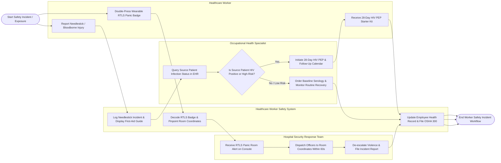

# Swimlane Diagram — Healthcare Worker Safety System

## Mermaid Code

## Flow Description | Mô tả luồng

| Lane | Actor | Role in Flow |
|------|-------|-------------|
| 1 | Healthcare Worker | Reports needlestick injuries, triggers wearable RTLS panic badges during violence threats, performs immediate first aid, and receives PEP starter kits. |
| 2 | Occupational Health Specialist | Queries source patient HIV/HBV/HCV infection status in EHR, evaluates exposure risk tiers, initiates 28-day HIV PEP protocols, and manages follow-up surveillance. |
| 3 | Healthcare Worker Safety System | Logs safety incidents, displays immediate first-aid instructions, decodes RTLS badge room coordinates, updates employee health records, and generates mandatory OSHA 300 log entries. |
| 4 | Hospital Security Response Team | Receives instant RTLS panic room alerts on command center consoles, dispatches security officers within 60 seconds, de-escalates violent threats, and submits security incident logs. |
