# Action Tree — Healthcare Worker Safety System

## Mermaid Code

```mermaid
graph TD
    Root["Healthcare Worker Safety System"]

    Root --> M1["Incident Reporting & Triage Workflow"]
    Root --> M2["Bloodborne Pathogen & PEP Protocol"]
    Root --> M3["RTLS Personal Panic & Violence Response"]
    Root --> M4["Radiation Dosimetry & Environmental Safety"]
    Root --> M5["N95 Fit-Testing & Employee Immunizations"]
    Root --> M6["OSHA Compliance & Occupational Analytics"]

    M1 --> A11["Report Percutaneous Needlestick & Sharps Injuries"]
    M1 --> A12["Log Slips, Trips, Falls & Ergonomic Strains"]
    M1 --> A13["Display Immediate First-Aid & Flush Instructions"]
    M1 --> A14["Check Source Patient HIV/HBV/HCV EHR Status"]

    M2 --> A21["Initiate 28-Day HIV Post-Exposure Prophylaxis (PEP)"]
    M2 --> A22["Order Hepatitis B Immune Globulin (HBIG) & Vaccines"]
    M2 --> A23["Schedule 6-Week, 12-Week & 6-Month Serology Follow-Up"]
    M2 --> A24["Track Safety-Engineered Sharps Device Compliance"]

    M3 --> A31["Trigger Wearable RTLS Personal Panic Badge Alarms"]
    M3 --> A32["Pinpoint Real-Time Staff Panic Room Coordinates"]
    M3 --> A33["Dispatch Security Officers to Panic Site within 60s"]
    M3 --> A34["Log Workplace Violence & Physical Assault Incidents"]

    M4 --> A41["Ingest Quarterly Radiation Dosimeter Badge (mSv) Data"]
    M4 --> A42["Alert on ALARA Radiation Exposure Limit Breaches"]
    M4 --> A43["Enforce Declared Pregnant Worker Fetal Dose Caps"]
    M4 --> A44["Maintain Hazardous Chemical Safety Data Sheets (SDS)"]

    M5 --> A51["Schedule Annual OSHA N95 Respirator Fit-Testing"]
    M5 --> A52["Record Assigned N95 Mask Brand, Model & Size"]
    M5 --> A53["Track Employee Mandatory Immunization Rosters"]
    M5 --> A54["Verify Hepatitis B Antibody Titer Immunity Status"]

    M6 --> A61["Generate Mandatory OSHA 300 / 300A Injury Logs"]
    M6 --> A62["Export Electronic OSHA Injury Tracking Data (ITA)"]
    M6 --> A63["Calculate Lost-Time DART Injury Rates"]
    M6 --> A64["Render Hospital Workplace Injury Heatmap Analytics"]
```

## Module Description | Mô tả Module

| # | Module | Description | Actions |
|---|--------|-------------|---------|
| 1 | Incident Reporting & Triage Workflow | Captures needlestick injuries, slips/falls, displays immediate first-aid instructions, and queries EHR source patient infection status. | Report Needlestick Injuries, Log Slips/Falls/Strains, Display First-Aid Guides, Check Source Patient EHR Status. |
| 2 | Bloodborne Pathogen & PEP Protocol | Manages 28-day HIV PEP anti-retroviral dispensation, HBIG/vaccine boosters, 6-month serology follow-up, and safety sharps audits. | Initiate HIV PEP Protocols, Order HBIG & Hep B Boosters, Schedule Serology Follow-Up, Track Safety Sharps Compliance. |
| 3 | RTLS Personal Panic & Violence Response | Triggers wearable RTLS panic badge alarms, decodes room coordinates, dispatches security within 60s, and logs workplace violence. | Trigger Wearable Panic Badges, Pinpoint RTLS Room Coordinates, Dispatch Security Officers, Log Workplace Violence. |
| 4 | Radiation Dosimetry & Environmental Safety | Ingests quarterly dosimeter badge data (mSv), alerts on ALARA breaches, enforces pregnant worker caps, and maintains chemical SDS sheets. | Ingest Radiation Dosimeter Data, Alert on ALARA Breaches, Enforce Pregnant Worker Caps, Maintain Chemical SDS Sheets. |
| 5 | N95 Fit-Testing & Employee Immunizations | Schedules annual N95 fit-testing, records assigned mask brands/sizes, tracks employee immunizations, and verifies Hep B antibody titers. | Schedule N95 Fit-Testing, Record N95 Mask Models, Track Immunization Rosters, Verify Hep B Antibody Titers. |
| 6 | OSHA Compliance & Occupational Analytics | Auto-generates OSHA 300/300A Logs, exports electronic ITA filing packages, calculates lost-time DART rates, and renders injury heatmaps. | Generate OSHA 300 Logs, Export Electronic ITA Data, Calculate DART Lost-Time Rates, Render Injury Heatmaps. |
