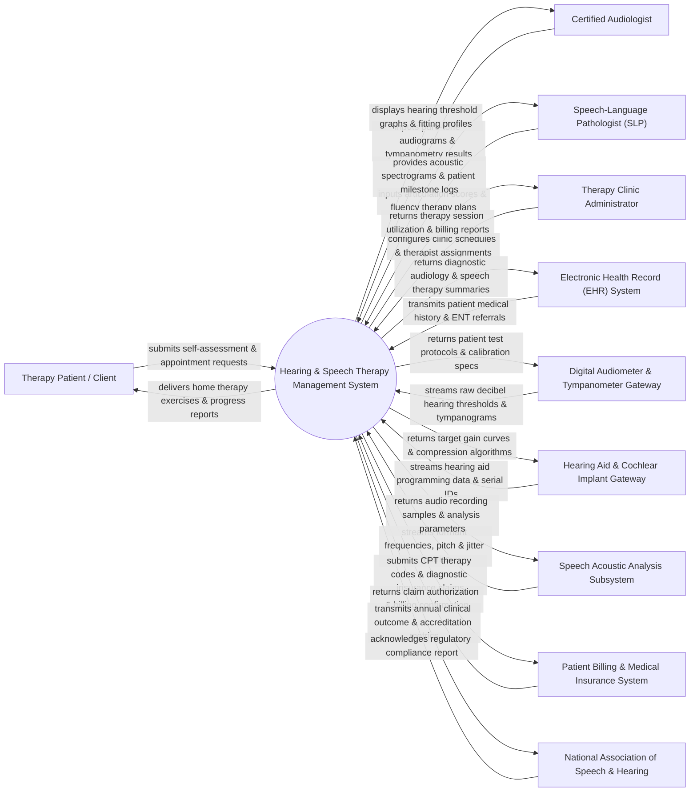

# Context Diagram — Hearing & Speech Therapy Management System

## Mermaid Code

## Actor & Interaction Table | Bảng Actor & Tương tác

| # | Actor | Actor Type | Data Sent TO System | Data Received FROM System | Notes |
|---|-------|------------|---------------------|---------------------------|-------|
| 1 | Therapy Patient / Client | Primary | Home practice logs, auditory self-assessments, speech exercise recordings, appointment bookings. | Personalized home therapy exercises, progress tracking charts, auditory training games, appointment reminders. | Patient of any age receiving audiology evaluations or speech-language rehabilitation. |
| 2 | Certified Audiologist | Primary | Pure-tone audiometry data, speech recognition thresholds (SRT), tympanometry findings, hearing aid fitting profiles. | Interactive audiogram visualizer, ear canal acoustic resonance models, historical hearing loss progression graphs. | Healthcare professional specializing in hearing loss evaluation, tinnitus management, and hearing aid fitting. |
| 3 | Speech-Language Pathologist (SLP) | Primary | Articulation assessments, phonological error logs, fluency counts, dysarthria ratings, therapy intervention goals. | Speech acoustic spectrograms, formant frequency plots, pitch contours, patient goal achievement trends. | Clinical specialist treating speech disorders, language delays, stuttering, and swallowing (dysphagia) conditions. |
| 4 | Therapy Clinic Administrator | Primary | Clinic room bookings, therapist shift schedules, service fee tariffs, insurance provider contracts. | Clinic capacity utilization reports, therapist billable hour summaries, patient attendance statistics. | Administrative manager managing clinic operations, scheduling, and staff allocations. |
| 5 | Electronic Health Record (EHR) System | Supporting | Patient demographics, ENT physician referrals, neurological history, pediatric growth milestones. | Final diagnostic audiology reports, speech therapy evaluation summaries, CPT procedure codes. | Hospital EHR integrated via HL7 interfaces for referral ingestion and report sharing. |
| 6 | Digital Audiometer & Tympanometer Gateway | Supporting | Pure-tone air/bone conduction decibel thresholds (dB HL), acoustic reflex test values, tympanogram compliance curves. | Test protocol templates, transducer calibration data, patient baseline audiograms. | Diagnostic hardware instruments executing hearing tests and tympanometric middle ear screening. |
| 7 | Hearing Aid & Cochlear Implant Gateway | Supporting | Hearing device serial numbers, firmware versions, active memory program settings, real-ear measurement (REM) curves. | Target gain prescription formulas (NAL-NL2, DSL v5), acoustic compression ratios, directionality settings. | Manufacturer software gateways for programming digital hearing aids and cochlear implant speech processors. |
| 8 | Speech Acoustic Analysis Subsystem | Supporting | Formant frequencies (F1/F2), fundamental pitch (F0), voice jitter/shimmer percentages, maximum phonation time (MPT). | Audio voice recordings, acoustic filter configurations, target speech model baselines. | Signal processing engine analyzing voice recordings for speech pathology diagnostics. |
| 9 | Patient Billing & Medical Insurance System | Supporting | Fee tariffs, insurance pre-authorization codes, co-pay rate rules. | Itemized CPT therapy codes (e.g., 92507, 92557), ICD-10 diagnostic codes, claim invoice payloads. | Financial software handling insurance reimbursement for hearing tests and speech therapy sessions. |
| 10 | National Association of Speech & Hearing | Supporting / Regulatory | Clinical practice standards, diagnostic code guidelines, accreditation reporting schemas. | Aggregated clinical treatment outcomes, diagnostic prevalence data, clinic quality compliance metrics. | Professional regulatory body governing audiology and speech-language pathology standards. |

## System Boundary Description | Mô tả Phạm vi Hệ thống

The **Hearing & Speech Therapy Management System (HSTMS)** is an integrated clinical software platform designed to manage audiology evaluations, speech-language therapy plans, digital hearing device fittings, and acoustic voice analysis.

**Inside System Scope:**
- Pure-tone air and bone conduction audiogram generation, speech recognition threshold (SRT) testing, and tympanometry curve visualization.
- Hearing aid fitting prescription calculation (NAL-NL2/DSL v5), Real-Ear Measurement (REM) integration, and device programming history.
- Speech-language pathology (SLP) diagnostic assessments, articulation error classification, fluency tracking, and voice acoustic spectrogram analysis.
- Personalized home therapy exercise assignment, interactive speech practice modules, and patient progress reporting.
- Clinical session notes, CPT coding for audiology/speech therapy, insurance claims integration, and regulatory reporting.

**Outside System Scope:**
- Direct physical repair or soldering of electronic hearing aid hardware (handled by device manufacturers).
- Physical acoustic soundproof booth construction and calibration (managed by environmental sound engineers).
- Financial ledger posting and bank check printing (delegated to Patient Billing Systems).
