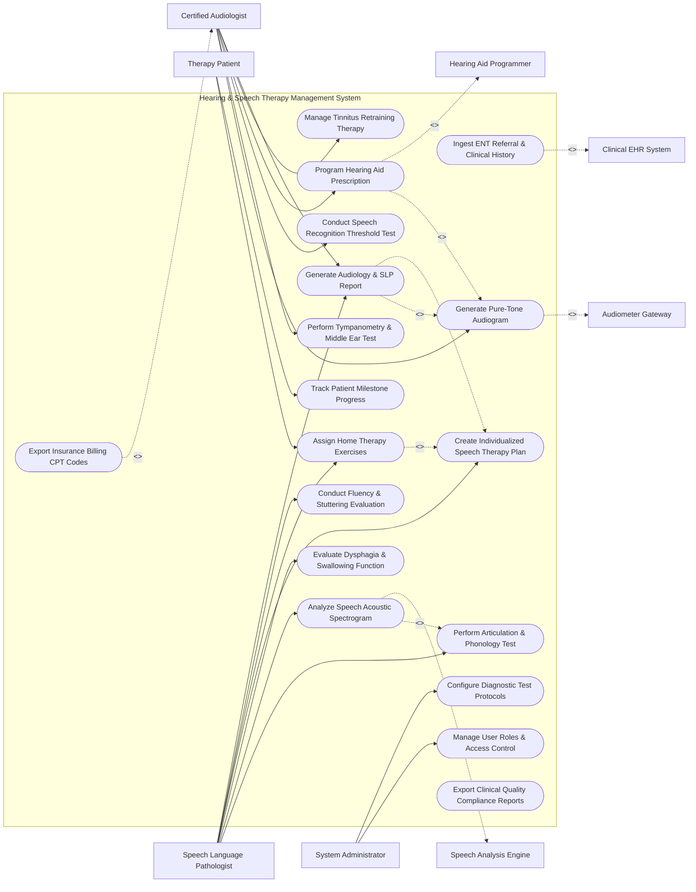

# Use Case Diagram — Hearing & Speech Therapy Management System

## Mermaid Code

## Actor Table | Bảng Actor

| # | Actor | Actor Type | Role Description | Related Use Cases |
|---|-------|------------|------------------|-------------------|
| 1 | Therapy Patient | Primary | Patient completing auditory/speech assessments and practicing home therapy exercises. | UC10, UC11 |
| 2 | Certified Audiologist | Primary | Specialist performing pure-tone audiometry, tympanometry, speech discrimination, and hearing aid fittings. | UC02, UC03, UC04, UC05, UC13, UC14 |
| 3 | Speech Language Pathologist | Primary | Specialist diagnosing articulation errors, voice acoustics, fluency/stuttering, and dysphagia. | UC06, UC07, UC08, UC09, UC10, UC12, UC14 |
| 4 | System Administrator | Primary | IT administrator managing user security roles, system configuration, and diagnostic test templates. | UC16, UC17 |
| 5 | Clinical EHR System | System (Secondary) | Hospital EHR transferring ENT physician referrals and receiving audiology/SLP diagnostic reports. | UC01 |
| 6 | Audiometer Gateway | System (Secondary) | Diagnostic hardware instrument streaming pure-tone decibel thresholds and tympanometry curves. | UC02 |
| 7 | Hearing Aid Programmer | System (Secondary) | Manufacturer programming software calculating acoustic gain curves and fitting digital hearing aids. | UC05 |
| 8 | Speech Analysis Engine | System (Secondary) | Acoustic signal processing engine analyzing voice recordings for pitch, formants, and jitter. | UC07 |

## Use Case Table | Bảng Use Case

| # | UC ID | Use Case Name | Primary Actor | Secondary Actor | Description | Priority |
|---|-------|---------------|---------------|-----------------|-------------|----------|
| 1 | UC01 | Ingest ENT Referral & Clinical History | Audiologist | Clinical EHR | Loads physician referral, medical history, prior hearing loss records, and surgical history. | High |
| 2 | UC02 | Generate Pure-Tone Audiogram | Audiologist | Audiometer Gateway | Records air and bone conduction decibel thresholds (125 Hz - 8000 Hz) to generate standard audiograms. | High |
| 3 | UC03 | Perform Tympanometry & Middle Ear Test | Audiologist | Audiometer Gateway | Evaluates eardrum mobility, ear canal volume, and middle ear pressure to generate tympanograms. | High |
| 4 | UC04 | Conduct Speech Recognition Threshold Test | Audiologist | None | Determines minimum decibel level at which patient can correctly repeat 50% of spondee words. | High |
| 5 | UC05 | Program Hearing Aid Prescription | Audiologist | Hearing Aid Programmer | Applies prescription formulas (NAL-NL2, DSL v5) to program gain curves and compression in hearing aids. | High |
| 6 | UC06 | Perform Articulation & Phonology Test | SLP | None | Evaluates phoneme production, speech sound substitutions, omissions, and distortion errors. | High |
| 7 | UC07 | Analyze Speech Acoustic Spectrogram | SLP | Speech Analysis Engine | Processes voice audio recordings to plot acoustic spectrograms, pitch contours (F0), and formant frequencies. | High |
| 8 | UC08 | Evaluate Dysphagia & Swallowing Function | SLP | None | Evaluates oral and pharyngeal swallowing mechanics to recommend safe diet textures and aspiration precautions. | High |
| 9 | UC09 | Create Individualized Speech Therapy Plan | SLP | None | Establishes measurable short-term and long-term speech goals, session frequencies, and therapeutic techniques. | High |
| 10 | UC10 | Assign Home Therapy Exercises | SLP | Patient | Assigns interactive auditory discrimination games, articulation drills, and vocal exercises for home practice. | Medium |
| 11 | UC11 | Track Patient Milestone Progress | Patient | SLP | Visualizes goal achievement percentages, practice compliance, and speech clarity improvements over time. | Medium |
| 12 | UC12 | Conduct Fluency & Stuttering Evaluation | SLP | None | Measures percentage of dysfluent syllables (%SS), stuttering duration, secondary behaviors, and speech rate. | High |
| 13 | UC13 | Manage Tinnitus Retraining Therapy | Audiologist | None | Assesses tinnitus pitch/loudness matching, masking noise thresholds, and designs sound therapy protocols. | Medium |
| 14 | UC14 | Generate Audiology & SLP Report | Audiologist | SLP | Compiles formal diagnostic evaluation reports, audiograms, treatment summaries, and clinical recommendations. | High |
| 15 | UC15 | Export Insurance Billing CPT Codes | Audiologist | None | Transmits itemized CPT procedure codes (e.g., 92557, 92507) and ICD-10 codes for billing processing. | High |
| 16 | UC16 | Manage User Roles & Access Control | Admin | None | Controls user accounts, security roles (Audiologist, SLP, Admin), and clinical sign-off permissions. | High |
| 17 | UC17 | Configure Diagnostic Test Protocols | Admin | None | Configures test frequency ranges, normative audiogram templates, and SLP evaluation lexicons. | Medium |
| 18 | UC18 | Export Clinical Quality Compliance Reports | Admin | None | Generates clinic-wide treatment outcome analytics and regulatory compliance reporting summaries. | Medium |

## Use Case Specification | Đặc tả Use Case

---

### UC02 — Generate Pure-Tone Audiogram

| Field | Detail |
|-------|--------|
| **UC ID** | UC02 |
| **Use Case Name** | Generate Pure-Tone Audiogram |
| **Actor(s)** | Primary: Certified Audiologist   Secondary: Audiometer Gateway |
| **Description** | Conducts air and bone conduction hearing threshold testing across standard frequencies (125 Hz to 8000 Hz) to generate an interactive audiogram chart and calculate Speech Frequency Pure Tone Average (PTA). |
| **Precondition** | 1. Patient is seated in soundproof acoustic booth with headphones/bone oscillator.   2. Digital audiometer is calibrated and connected via gateway. |
| **Main Flow** | 1. Audiologist selects "New Audiometry Test" for patient.   2. Audiologist presents pure-tone test signals at specified frequencies (250, 500, 1000, 2000, 4000, 8000 Hz) to right ear via air conduction.   3. Audiometer Gateway streams decibel response thresholds (dB HL) to system in real time.   4. System plots right ear air conduction symbols (red 'O') on interactive audiogram grid.   5. Audiologist repeats test for left ear air conduction (blue 'X').   6. Audiologist conducts bone conduction testing using bone oscillator behind ear (right ear '<', left ear '>').   7. System automatically calculates Pure Tone Average (PTA) for 500, 1000, and 2000 Hz for both ears.   8. System classifies degree of hearing loss (Normal, Mild, Moderate, Severe, Profound) and saves audiogram. |
| **Alternative Flow** | **AF1** — Masking Applied: Unilateral hearing loss causes cross-hearing; Audiologist applies masking noise to non-test ear, system updates symbol display to masked air ('Square' / 'Triangle') and masked bone ('[' / ']'). |
| **Exception Flow** | **EX1** — Audiometer Connection Failure: Bluetooth/USB connection drops during test; System prompts "Audiometer Offline", buffers recorded points locally, and allows manual numerical decibel entry. |
| **Postcondition** | Complete pure-tone audiogram is saved, PTA is calculated, and hearing loss classification is updated. |
| **Business Rule** | **BR1**: Pure Tone Average (PTA) must be computed automatically as the mean threshold of 500 Hz, 1000 Hz, and 2000 Hz.   **BR2**: Audiometer calibration date must be within 12 months per ANSI/ASA standards. |

---

### UC05 — Program Hearing Aid Prescription

| Field | Detail |
|-------|--------|
| **UC ID** | UC05 |
| **Use Case Name** | Program Hearing Aid Prescription |
| **Actor(s)** | Primary: Certified Audiologist   Secondary: Hearing Aid Programmer |
| **Description** | Uses baseline audiogram data to calculate targeted acoustic gain curves using validated prescription formulas (NAL-NL2, DSL v5) and programs digital hearing aid parameters via programming interface. |
| **Precondition** | 1. Active pure-tone audiogram exists for patient (UC02).   2. Hearing aid device is connected to programming interface via wireless NoahLink or cable. |
| **Main Flow** | 1. Audiologist opens "Hearing Aid Fitting" module and selects active audiogram.   2. Audiologist selects target prescription fitting formula (e.g., NAL-NL2 for adults or DSL v5 for pediatric patients).   3. System calculates target acoustic gain curves across frequency bands for soft (50 dB), medium (65 dB), and loud (80 dB) input speech.   4. Audiologist connects patient hearing aids and fetches device serial numbers and firmware details via Hearing Aid Programmer.   5. System uploads target gain curves, compression ratios, maximum power output (MPO), and directional microphone profiles into hearing aids.   6. Audiologist conducts Real-Ear Measurement (REM) probe microphone check in patient ear canal to verify actual vs. target gain.   7. Audiologist fine-tunes frequency response curves based on REM feedback and saves final fitting profile. |
| **Alternative Flow** | **AF1** — Tinnitus Masker Configuration: Audiologist enables built-in tinnitus sound generator (pink noise or ocean waves) in hearing aid memory program #2 for tinnitus therapy patients. |
| **Exception Flow** | **EX1** — Excessive MPO Warning: Selected MPO exceeds 125 dB SPL, risking acoustic trauma; System displays red warning alert "MPO Exceeds Safe Output" and caps maximum output to safe levels. |
| **Postcondition** | Hearing aids are programmed, target gain match is verified via REM, and fitting prescription record is saved. |
| **Business Rule** | **BR1**: Pediatric fittings must default to DSL v5 prescription formula to prioritize speech audibility and language development. |

---

### UC07 — Analyze Speech Acoustic Spectrogram

| Field | Detail |
|-------|--------|
| **UC ID** | UC07 |
| **Use Case Name** | Analyze Speech Acoustic Spectrogram |
| **Actor(s)** | Primary: Speech Language Pathologist   Secondary: Speech Analysis Engine |
| **Description** | Ingests audio voice recordings of patient speech, performs acoustic Fast Fourier Transform (FFT) signal analysis, and renders pitch contours (F0), formant frequencies (F1/F2), and voice quality metrics. |
| **Precondition** | 1. Calibrated microphone is connected to workstation.   2. Patient completes standardized vocalization (e.g., sustained vowel /a/ or rainbow passage). |
| **Main Flow** | 1. SLP opens "Speech Acoustic Analysis" module and clicks "Record Audio".   2. Patient speaks into microphone while SLP records sample.   3. SLP stops recording; System streams audio file to Speech Analysis Engine.   4. Speech Analysis Engine processes audio waveform using signal processing algorithms.   5. System renders interactive 3D Speech Spectrogram displaying time vs. frequency vs. intensity.   6. System automatically extracts fundamental frequency (F0 pitch in Hz), formant frequencies (F1, F2 vowel acoustic space), jitter (pitch instability %), shimmer (amplitude variation %), and Maximum Phonation Time (MPT in seconds).   7. SLP reviews acoustic plots to identify voice disorders (dysphonia, vocal cord nodules, hypernasality).   8. System saves acoustic spectrogram analysis report linked to patient evaluation record. |
| **Alternative Flow** | **AF1** — Real-Time Visual Pitch Feedback: Patient views live visual pitch contour line on screen during vocal exercises, adjusting voice pitch up or down to match target therapist template. |
| **Exception Flow** | **EX1** — Excessive Background Noise: Ambient room noise exceeds 50 dB, distorting acoustic analysis; System displays warning "High Background Noise - Re-record in Quiet Environment" and invalidates jitter/shimmer calculations. |
| **Postcondition** | Acoustic spectrogram is rendered, voice quality parameters are logged, and baseline acoustic data is saved for progress comparison. |
| **Business Rule** | **BR1**: Voice acoustic recordings must be sampled at a minimum of 44.1 kHz, 16-bit uncompressed WAV format for diagnostic accuracy. |

---

### UC10 — Assign Home Therapy Exercises

| Field | Detail |
|-------|--------|
| **UC ID** | UC10 |
| **Use Case Name** | Assign Home Therapy Exercises |
| **Actor(s)** | Primary: Speech Language Pathologist   Secondary: Therapy Patient |
| **Description** | Selects and assigns personalized digital home speech drills, auditory discrimination games, articulation practice modules, and voice exercises to the patient's mobile app portal. |
| **Precondition** | 1. Speech therapy plan is established (UC09).   2. Patient or parent has active login credentials for the patient portal mobile app. |
| **Main Flow** | 1. SLP opens "Home Therapy Plan" section for patient.   2. SLP selects target exercise modules matching therapy goals (e.g., /s/ sound initial position articulation drills, auditory memory games, pitch glide exercises).   3. SLP configures daily practice frequency (e.g., 15 minutes twice daily) and target repetition goals (e.g., 20 correct repetitions per sound).   4. SLP adds customized video/audio instruction demos.   5. SLP clicks "Assign to Patient Portal".   6. System dispatches home assignment payload to Patient's mobile app portal and sends a push notification.   7. Patient completes assigned practice on mobile app; app records practice time and audio responses for SLP review. |
| **Alternative Flow** | **AF1** — Gamified Pediatric Mode: Exercises are assigned as interactive animated video games (e.g., blowing bubbles with voice pitch) to motivate pediatric patients. |
| **Exception Flow** | **EX1** — Low Home Practice Compliance: Patient completes < 20% of assigned exercises over 2 weeks; System flags "Low Adherence Warning" on SLP dashboard to prompt therapist follow-up. |
| **Postcondition** | Home exercises are assigned, mobile app notifications are scheduled, and home practice compliance tracking is active. |
| **Business Rule** | **BR1**: Home exercise assignments must explicitly align with active short-term goals defined in the individualized therapy plan. |

---

### UC12 — Conduct Fluency & Stuttering Evaluation

| Field | Detail |
|-------|--------|
| **UC ID** | UC12 |
| **Use Case Name** | Conduct Fluency & Stuttering Evaluation |
| **Actor(s)** | Primary: Speech Language Pathologist   Secondary: None |
| **Description** | Evaluates speech fluency, counts disfluent speech behaviors (repetitions, prolongations, silent blocks), calculates Percentage of Stutter-Like Disfluencies (%SS), and assesses secondary physical behaviors. |
| **Precondition** | 1. Patient is participating in a fluency diagnostic session. |
| **Main Flow** | 1. SLP opens "Fluency & Stuttering Assessment" module.   2. Patient reads a standardized passage or engages in 500-syllable conversational speech sample.   3. SLP taps interactive fluency counter buttons on screen during real-time speech observation:   &nbsp;&nbsp;&nbsp;&nbsp; a. Sound/Syllable Repetitions (e.g., "b-b-ball").   &nbsp;&nbsp;&nbsp;&nbsp; b. Whole-Word Repetitions.   &nbsp;&nbsp;&nbsp;&nbsp; c. Sound Prolongations (e.g., "Sssss-sun").   &nbsp;&nbsp;&nbsp;&nbsp; d. Silent Blocks / Tense Pauses.   4. System tallies total fluent vs. disfluent syllables in real time.   5. System calculates Percentage of Stutter-Like Disfluencies (%SS = Disfluent Syllables / Total Syllables * 100).   6. SLP records average duration of 3 longest stuttering blocks (in seconds).   7. SLP rates secondary physical behaviors (facial grimacing, eye blinking, head nods) on 0-5 severity scale.   8. System computes overall Stuttering Severity Instrument (SSI-4) score and severity classification (Mild, Moderate, Severe). |
| **Alternative Flow** | **AF1** — Video Sample Post-Analysis: SLP records high-definition video of speech sample and performs syllable counting during video playback at 0.5x speed for precise measurement. |
| **Exception Flow** | **EX1** — Insufficient Syllable Sample: Total recorded speech sample is < 200 syllables; System displays warning "Sample Insufficient for SSI-4 Scoring - Continue Recording" and holds calculation until minimum sample size is reached. |
| **Postcondition** | %SS is calculated, SSI-4 stuttering severity score is logged, and fluency baseline is established for therapy comparison. |
| **Business Rule** | **BR1**: Fluency evaluation speech samples must contain at least 300-500 syllables to ensure statistical reliability of %SS calculation. |
