# Conceptual ERD — Hearing & Speech Therapy Management System

## Mermaid Code

```mermaid
erDiagram
    USER_ACCOUNT {
        int user_id PK
        string full_name
        string username
        string user_role
        string medical_license_no
        boolean is_active
    }

    PATIENT_CLINICAL_PROFILE {
        int patient_id PK
        string patient_mrn
        string full_name
        date date_of_birth
        string gender
        string primary_language
        datetime created_at
    }

    ENT_REFERRAL {
        int referral_id PK
        int patient_id FK
        string referring_physician_name
        string diagnostic_reason
        date referral_date
        string status
    }

    AUDIOMETRY_TEST_LOG {
        int audiometry_id PK
        int patient_id FK
        int assessed_by_user_id FK
        int right_ear_pta_db
        int left_ear_pta_db
        string hearing_loss_degree
        string hearing_loss_type
        datetime tested_at
    }

    TYMPANOMETRY_RECORD {
        int tymp_id PK
        int patient_id FK
        string right_ear_curve_type
        string left_ear_curve_type
        decimal eardrum_compliance_ml
        decimal ear_canal_volume_cc
        datetime recorded_at
    }

    HEARING_AID_FITTING {
        int fitting_id PK
        int patient_id FK
        int audiogram_id FK
        string device_manufacturer
        string model_serial_number
        string prescription_formula
        decimal real_ear_gain_match_percent
        datetime fitted_at
    }

    SPEECH_ARTICULATION_EVAL {
        int articulation_id PK
        int patient_id FK
        int assessed_by_user_id FK
        string target_phoneme
        string error_type
        int correct_production_percent
        datetime evaluated_at
    }

    ACOUSTIC_SPECTROGRAM_LOG {
        int acoustic_id PK
        int patient_id FK
        decimal fundamental_pitch_f0_hz
        decimal formant_f1_hz
        decimal formant_f2_hz
        decimal jitter_percent
        decimal maximum_phonation_time_sec
        datetime recorded_at
    }

    FLUENCY_ASSESSMENT {
        int fluency_id PK
        int patient_id FK
        decimal disfluent_syllable_percent
        int longest_block_duration_sec
        int ssi4_severity_score
        string severity_classification
        datetime evaluated_at
    }

    INDIVIDUAL_THERAPY_PLAN {
        int plan_id PK
        int patient_id FK
        int slp_user_id FK
        text short_term_goals
        text long_term_goals
        int session_frequency_per_week
        date plan_start_date
        string plan_status
    }

    HOME_EXERCISE_ASSIGNMENT {
        int assignment_id PK
        int plan_id FK
        string exercise_title
        int target_repetitions_per_day
        decimal compliance_rate_percent
        date assigned_date
        date due_date
    }

    THERAPY_BILLING_RECORD {
        int billing_id PK
        int patient_id FK
        string cpt_code
        string icd10_code
        decimal Billed_amount
        string insurance_claim_status
        datetime billed_at
    }

    PATIENT_CLINICAL_PROFILE ||--o{ ENT_REFERRAL : "receives"
    PATIENT_CLINICAL_PROFILE ||--o{ AUDIOMETRY_TEST_LOG : "undergoes"
    PATIENT_CLINICAL_PROFILE ||--o{ TYMPANOMETRY_RECORD : "undergoes"
    PATIENT_CLINICAL_PROFILE ||--o{ HEARING_AID_FITTING : "receives"
    PATIENT_CLINICAL_PROFILE ||--o{ SPEECH_ARTICULATION_EVAL : "assessed for"
    PATIENT_CLINICAL_PROFILE ||--o{ ACOUSTIC_SPECTROGRAM_LOG : "analyzed with"
    PATIENT_CLINICAL_PROFILE ||--o{ FLUENCY_ASSESSMENT : "evaluated for"
    PATIENT_CLINICAL_PROFILE ||--o{ INDIVIDUAL_THERAPY_PLAN : "enrolled in"
    INDIVIDUAL_THERAPY_PLAN ||--o{ HOME_EXERCISE_ASSIGNMENT : "contains"
    AUDIOMETRY_TEST_LOG ||--o{ HEARING_AID_FITTING : "drives"
    PATIENT_CLINICAL_PROFILE ||--o{ THERAPY_BILLING_RECORD : "generates"
    USER_ACCOUNT ||--o{ AUDIOMETRY_TEST_LOG : "conducts"
    USER_ACCOUNT ||--o{ SPEECH_ARTICULATION_EVAL : "evaluates"
    USER_ACCOUNT ||--o{ INDIVIDUAL_THERAPY_PLAN : "authorizes"
```

## Entity Description Table | Bảng mô tả Entity

| # | Entity Name | Vietnamese Name | Description | Key Attributes | Main Relationships |
|---|-------------|-----------------|-------------|----------------|-------------------|
| 1 | USER_ACCOUNT | Tài khoản Nguời dùng | Credentials and access permissions for certified audiologists, speech-language pathologists, and clinic admins. | `user_id`, `username`, `user_role`, `medical_license_no` | Conducts `AUDIOMETRY_TEST_LOG`, evaluates `SPEECH_ARTICULATION_EVAL`, authorizes `INDIVIDUAL_THERAPY_PLAN`. |
| 2 | PATIENT_CLINICAL_PROFILE | Hồ sơ Lâm sàng Bệnh nhân | Demographics and master diagnostic profile for hearing and speech therapy clients. | `patient_id`, `patient_mrn`, `full_name`, `date_of_birth`, `primary_language` | Undergoes `AUDIOMETRY_TEST_LOG`, enrolled in `INDIVIDUAL_THERAPY_PLAN`, generates `THERAPY_BILLING_RECORD`. |
| 3 | ENT_REFERRAL | Giấy Giới thiệu Tai-Mũi-Họng | Inbound medical referrals from otolaryngologists (ENT) detailing hearing/speech evaluation orders. | `referral_id`, `patient_id`, `referring_physician_name`, `diagnostic_reason` | Belongs to `PATIENT_CLINICAL_PROFILE`. |
| 4 | AUDIOMETRY_TEST_LOG | Nhật ký Thử Thính lực | Air/bone pure-tone decibel thresholds, calculated PTA, and degree/type of hearing loss. | `audiometry_id`, `patient_id`, `right_ear_pta_db`, `left_ear_pta_db`, `hearing_loss_degree` | Belongs to `PATIENT_CLINICAL_PROFILE`, drives `HEARING_AID_FITTING`. |
| 5 | TYMPANOMETRY_RECORD | Hồ sơ Nhĩ đồ & Tai giữa | Middle ear compliance curves (Type A, B, C), eardrum mobility, and ear canal volume data. | `tymp_id`, `patient_id`, `right_ear_curve_type`, `eardrum_compliance_ml` | Belongs to `PATIENT_CLINICAL_PROFILE`. |
| 6 | HEARING_AID_FITTING | Lập trình Máy Trợ thính | Digital hearing aid programming records, fitting formulas (NAL-NL2), gain match %, and device serial IDs. | `fitting_id`, `patient_id`, `audiogram_id`, `device_manufacturer`, `prescription_formula` | Belongs to `PATIENT_CLINICAL_PROFILE` and `AUDIOMETRY_TEST_LOG`. |
| 7 | SPEECH_ARTICULATION_EVAL | Đánh giá Phát âm & Âm vị | Phoneme production error logs, articulation accuracy %, and sound substitution patterns. | `articulation_id`, `patient_id`, `target_phoneme`, `error_type`, `correct_production_percent` | Belongs to `PATIENT_CLINICAL_PROFILE`, evaluated by `USER_ACCOUNT`. |
| 8 | ACOUSTIC_SPECTROGRAM_LOG | Nhật ký Phân tích Âm phổ | Voice signal processing metrics: fundamental pitch (F0), formants (F1/F2), jitter %, and max phonation time. | `acoustic_id`, `patient_id`, `fundamental_pitch_f0_hz`, `formant_f1_hz`, `jitter_percent` | Belongs to `PATIENT_CLINICAL_PROFILE`. |
| 9 | FLUENCY_ASSESSMENT | Đánh giá Độ Trôi chảy (Nói Lắp) | Stuttering evaluation metrics: disfluent syllable % (%SS), block durations, and SSI-4 severity score. | `fluency_id`, `patient_id`, `disfluent_syllable_percent`, `ssi4_severity_score` | Belongs to `PATIENT_CLINICAL_PROFILE`. |
| 10 | INDIVIDUAL_THERAPY_PLAN | Kế hoạch Tri liệu Cá nhân | Individualized short-term and long-term speech/hearing therapy goals, frequency, and treatment strategies. | `plan_id`, `patient_id`, `slp_user_id`, `short_term_goals`, `session_frequency_per_week` | Belongs to `PATIENT_CLINICAL_PROFILE`, contains `HOME_EXERCISE_ASSIGNMENT`. |
| 11 | HOME_EXERCISE_ASSIGNMENT | Bài tập Tri liệu Tai nhà | Assigned home speech drills, auditory discrimination games, target repetitions, and compliance rates. | `assignment_id`, `plan_id`, `exercise_title`, `target_repetitions_per_day`, `compliance_rate_percent` | Belongs to `INDIVIDUAL_THERAPY_PLAN`. |
| 12 | THERAPY_BILLING_RECORD | Báo cáo Hóa đơn Tri liệu | Itemized CPT therapy billing codes, ICD-10 diagnostic codes, and insurance claim tracking records. | `billing_id`, `patient_id`, `cpt_code`, `icd10_code`, `insurance_claim_status` | Belongs to `PATIENT_CLINICAL_PROFILE`. |

## Relationship Description | Mô tả Quan hệ

| # | From Entity | Cardinality | To Entity | Label | Business Explanation |
|---|-------------|-------------|-----------|-------|----------------------|
| 1 | PATIENT_CLINICAL_PROFILE | 1 to 0..N | ENT_REFERRAL | receives | A patient profile receives medical referrals from ENT specialists. |
| 2 | PATIENT_CLINICAL_PROFILE | 1 to 0..N | AUDIOMETRY_TEST_LOG | undergoes | A patient profile undergoes pure-tone audiometry evaluations over time. |
| 3 | PATIENT_CLINICAL_PROFILE | 1 to 0..N | TYMPANOMETRY_RECORD | undergoes | A patient profile undergoes tympanometric middle ear screening tests. |
| 4 | PATIENT_CLINICAL_PROFILE | 1 to 0..N | HEARING_AID_FITTING | receives | A patient profile receives hearing aid programming and fitting adjustments. |
| 5 | PATIENT_CLINICAL_PROFILE | 1 to 0..N | SPEECH_ARTICULATION_EVAL | assessed for | A patient profile is assessed for speech sound articulation and phonological errors. |
| 6 | PATIENT_CLINICAL_PROFILE | 1 to 0..N | ACOUSTIC_SPECTROGRAM_LOG | analyzed with | A patient profile is analyzed with digital voice acoustic spectrogram logs. |
| 7 | PATIENT_CLINICAL_PROFILE | 1 to 0..N | FLUENCY_ASSESSMENT | evaluated for | A patient profile is evaluated for speech disfluency and stuttering severity. |
| 8 | PATIENT_CLINICAL_PROFILE | 1 to 0..N | INDIVIDUAL_THERAPY_PLAN | enrolled in | A patient profile is enrolled in individualized speech/hearing therapy plans. |
| 9 | INDIVIDUAL_THERAPY_PLAN | 1 to 0..N | HOME_EXERCISE_ASSIGNMENT | contains | A therapy plan contains multiple assigned digital home practice exercises. |
| 10 | AUDIOMETRY_TEST_LOG | 1 to 0..N | HEARING_AID_FITTING | drives | Pure-tone audiograms drive target gain calculations for hearing aid fittings. |
| 11 | PATIENT_CLINICAL_PROFILE | 1 to 0..N | THERAPY_BILLING_RECORD | generates | A patient profile generates itemized CPT therapy billing records after sessions. |
| 12 | USER_ACCOUNT | 1 to 0..N | AUDIOMETRY_TEST_LOG | conducts | An audiologist user account conducts hearing threshold tests. |
| 13 | USER_ACCOUNT | 1 to 0..N | SPEECH_ARTICULATION_EVAL | evaluates | An SLP user account evaluates speech articulation and phonology. |
| 14 | USER_ACCOUNT | 1 to 0..N | INDIVIDUAL_THERAPY_PLAN | authorizes | An SLP user account authorizes individualized treatment plans. |
