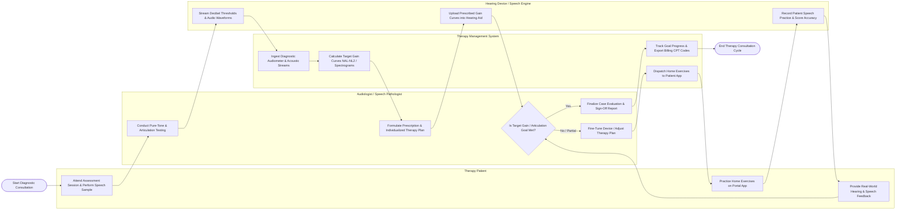

# Swimlane Diagram — Hearing & Speech Therapy Management System

## Mermaid Code

## Flow Description | Mô tả luồng

| Lane | Actor | Role in Flow |
|------|-------|-------------|
| 1 | Therapy Patient | Attends clinical assessment sessions, vocalizes speech samples, practices assigned exercises on mobile app portal, and provides feedback on real-world hearing clarity. |
| 2 | Audiologist / Speech Pathologist | Conducts pure-tone audiometry and speech articulation assessments, formulates fitting prescriptions/therapy plans, evaluates goal progress, fine-tunes settings, and signs off clinical reports. |
| 3 | Therapy Management System | Ingests audiometer and acoustic audio streams, calculates NAL-NL2/DSL v5 target gain curves, renders voice spectrograms, dispatches home exercises, and exports CPT billing codes. |
| 4 | Hearing Device / Speech Engine | Streams raw decibel thresholds and audio recordings, receives digital hearing aid programming parameters, and records/scores patient home speech practice accuracy. |
