# Action Tree — Hearing & Speech Therapy Management System

## Mermaid Code

```mermaid
graph TD
    Root["Hearing & Speech Therapy Management System"]

    Root --> M1["Audiology Evaluation & Diagnostics"]
    Root --> M2["Hearing Aid & Cochlear Implant Fitting"]
    Root --> M3["Speech-Language Pathology & Articulation"]
    Root --> M4["Voice Acoustics & Dysphagia Evaluation"]
    Root --> M5["Home Therapy & Patient Portal"]
    Root --> M6["Reporting, Billing & Compliance"]

    M1 --> A11["Generate Pure-Tone Air & Bone Audiograms"]
    M1 --> A12["Perform Tympanometry & Acoustic Reflex Tests"]
    M1 --> A13["Conduct Speech Recognition Threshold (SRT) Tests"]
    M1 --> A14["Calculate Pure Tone Average (PTA) Metrics"]

    M2 --> A21["Calculate NAL-NL2 & DSL v5 Prescription Gain"]
    M2 --> A22["Program Digital Hearing Aid Parameters"]
    M2 --> A23["Perform Real-Ear Measurement (REM) Probe Checks"]
    M2 --> A24["Configure Tinnitus Retraining Therapy Generators"]

    M3 --> A31["Perform Articulation & Phonological Error Tests"]
    M3 --> A32["Evaluate Fluency & Stuttering Severity (SSI-4)"]
    M3 --> A33["Assess Receptive & Expressive Language Delays"]
    M3 --> A34["Formulate Individualized Speech Therapy Plans"]

    M4 --> A41["Render 3D Voice Acoustic Spectrograms"]
    M4 --> A42["Extract Pitch (F0), Formants & Jitter/Shimmer"]
    M4 --> A43["Evaluate Dysphagia Oral & Pharyngeal Swallowing"]
    M4 --> A44["Track Maximum Phonation Time (MPT) Metrics"]

    M5 --> A51["Assign Interactive Home Speech Practice Drills"]
    M5 --> A52["Provide Gamified Auditory Discrimination Modules"]
    M5 --> A53["Track Patient Exercise Compliance Rates"]
    M5 --> A54["Visualize Milestone Achievement Progress"]

    M6 --> A61["Generate Formal Audiology & SLP Reports"]
    M6 --> A62["Export CPT Procedure & ICD-10 Billing Codes"]
    M6 --> A63["Export Clinical Quality Compliance Summaries"]
    M6 --> A64["Configure Diagnostic Templates & Lexicons"]
```

## Module Description | Mô tả Module

| # | Module | Description | Actions |
|---|--------|-------------|---------|
| 1 | Audiology Evaluation & Diagnostics | Manages pure-tone air/bone conduction testing, tympanometry curves, speech recognition thresholds (SRT), and pure tone average (PTA) calculations. | Generate Pure-Tone Audiograms, Perform Tympanometry Tests, Conduct SRT Tests, Calculate PTA Metrics. |
| 2 | Hearing Aid & Cochlear Implant Fitting | Calculates NAL-NL2/DSL v5 prescription gain curves, programs hearing aid memories via interface, conducts Real-Ear Measurements (REM), and sets tinnitus maskers. | Calculate Prescription Gain, Program Hearing Aid Parameters, Perform REM Probe Checks, Configure Tinnitus Maskers. |
| 3 | Speech-Language Pathology & Articulation | Evaluates articulation errors, phonology, speech fluency/stuttering (SSI-4), receptive/expressive language, and formulates therapy treatment plans. | Perform Articulation Tests, Evaluate Fluency/Stuttering, Assess Language Delays, Formulate Therapy Plans. |
| 4 | Voice Acoustics & Dysphagia Evaluation | Analyzes 3D voice acoustic spectrograms, extracts pitch/formants/jitter/shimmer, evaluates dysphagia swallowing safety, and measures max phonation time. | Render Voice Spectrograms, Extract Pitch/Formant Metrics, Evaluate Dysphagia Swallowing, Track MPT Metrics. |
| 5 | Home Therapy & Patient Portal | Assigns interactive home speech drills, gamified auditory training, tracks practice compliance %, and visualizes goal milestone achievements. | Assign Home Practice Drills, Provide Gamified Auditory Modules, Track Exercise Compliance, Visualize Milestone Progress. |
| 6 | Reporting, Billing & Compliance | Compiles audiology and SLP clinical reports, exports CPT/ICD-10 billing code payloads, generates regulatory compliance reports, and manages lexicons. | Generate Audiology & SLP Reports, Export Billing CPT Codes, Export Quality Compliance Reports, Configure Diagnostic Templates. |
