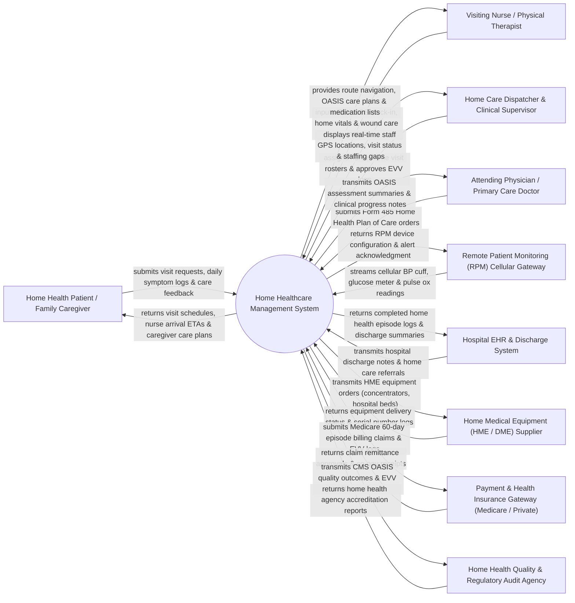

# Context Diagram — Home Healthcare Management System

## Mermaid Code

## Actor & Interaction Table | Bảng Actor & Tương tác

| # | Actor | Actor Type | Data Sent TO System | Data Received FROM System | Notes |
|---|-------|------------|---------------------|---------------------------|-------|
| 1 | Home Health Patient / Family Caregiver | Primary | Home visit requests, daily self-reported symptom logs, caregiver notes, visit feedback ratings. | Scheduled visit arrival ETAs, home care plan summaries, medication schedules, emergency contact cards. | Homebound patient receiving nursing, physical therapy, or personal care at their residence. |
| 2 | Visiting Nurse / Physical Therapist | Primary | Mobile EVV GPS clock-in/out punches, home vital signs, wound care charting, OASIS assessments, mileage logs. | Optimized visit travel routes, patient Form 485 care plans, active medication lists, safety alerts. | Field clinician traveling to patient homes to deliver clinical care, dressing changes, and therapy. |
| 3 | Home Care Dispatcher & Clinical Supervisor | Primary | Nurse visit dispatch assignments, shift roster approvals, EVV variance overrides, emergency replacements. | Real-time field staff GPS map view, visit completion dashboard, staffing gap alerts, mileage reports. | Agency coordinator managing field staff scheduling, visit verification, and clinical quality. |
| 4 | Attending Physician / Primary Care Doctor | Primary | Signed Form 485 Home Health Plan of Care orders, medication changes, lab order referrals. | OASIS assessment summaries, home nursing progress notes, urgent vital deterioration alerts. | Community physician authorizing home health medical orders and certifying homebound status. |
| 5 | Hospital EHR & Discharge System | Supporting System | Hospital discharge summaries, inpatient surgical notes, home health referral orders, Master Patient Index. | Home health episode outcome logs, readmission alerts, final home health discharge summaries. | Enterprise hospital information software transferring post-acute patients to home care agencies. |
| 6 | Remote Patient Monitoring (RPM) Cellular Gateway | Supporting System | Automated cellular telemetry data: Blood pressure, blood glucose, weight scale, pulse oximetry readings. | RPM device pairing confirmations, vital threshold parameters, alert acknowledgment tokens. | Cellular IoT gateway ingesting vital signs from medical devices installed in patient homes. |
| 7 | Home Medical Equipment (HME / DME) Supplier | Supporting System | HME delivery status confirmations, serial numbers (oxygen concentrators, wheelchairs, hospital beds), pickup logs. | Equipment prescription orders, home delivery addresses, patient equipment setup instructions. | Durable medical equipment provider supplying home care supplies and respiratory devices. |
| 8 | Payment & Health Insurance Gateway | Supporting System | Payment authorization codes, Medicare 60-day episode approvals, private insurance claim remittances. | Home health billing claims (RAP / Final claim), EVV verification proof, billable visit codes. | Payer system processing Medicare, Medicaid, and private health insurance home care claims. |
| 9 | Home Health Quality & Regulatory Audit Agency | Regulatory | OASIS data submission standards, Electronic Visit Verification (EVV) compliance rules, star rating schemas. | CMS OASIS assessment exports, EVV compliance audit logs, home health quality outcome metrics. | Government regulatory body (e.g., CMS in US, MOH in Vietnam) auditing home health agency quality. |

## System Boundary Description | Mô tả Phạm vi Hệ thống

The **Home Healthcare Management System (HHMS)** is a specialized post-acute clinical software solution designed for home health agencies, visiting nurse associations (VNA), and hospice providers. It automates home visit dispatching based on travel distance and clinician skills, enforces Electronic Visit Verification (EVV) using mobile GPS geo-fencing, manages CMS OASIS (Outcome and Assessment Information Set) evaluations and Form 485 Care Plans, ingests Cellular Remote Patient Monitoring (RPM) vitals, tracks home medical equipment (HME) deliveries, and handles Medicare 60-day episode billing.

**Inside System Scope:**
- Home visit scheduling, route optimization, and clinician skill-matching.
- Mobile Electronic Visit Verification (EVV) enforcing 21st Century Cures Act compliance (GPS, timestamp, service type, staff ID).
- In-home clinical charting (wound care photos, IV infusions, vital signs, catheter changes).
- Form 485 Home Health Plan of Care creation, physician electronic signature, and 60-day episode management.
- Integration with cellular Remote Patient Monitoring (RPM) IoT devices (BP, Glucose, Weight, SpO2).
- Ordering, delivery tracking, and retrieval of Home Medical Equipment (HME / DME).
- Staff mileage tracking, travel reimbursement calculations, and Medicare RAP/Final claim billing.

**Outside System Scope:**
- Physical driving and navigation of staff automobiles (delegated to GPS mapping apps like Google Maps).
- Physical manufacturing and maintenance of oxygen concentrators or hospital beds (handled by HME suppliers).
- Non-home inpatient hospital surgical care (handled by HIS / Hospitals).
- Commercial financial banking ledger processing (handled by general accounting software).
