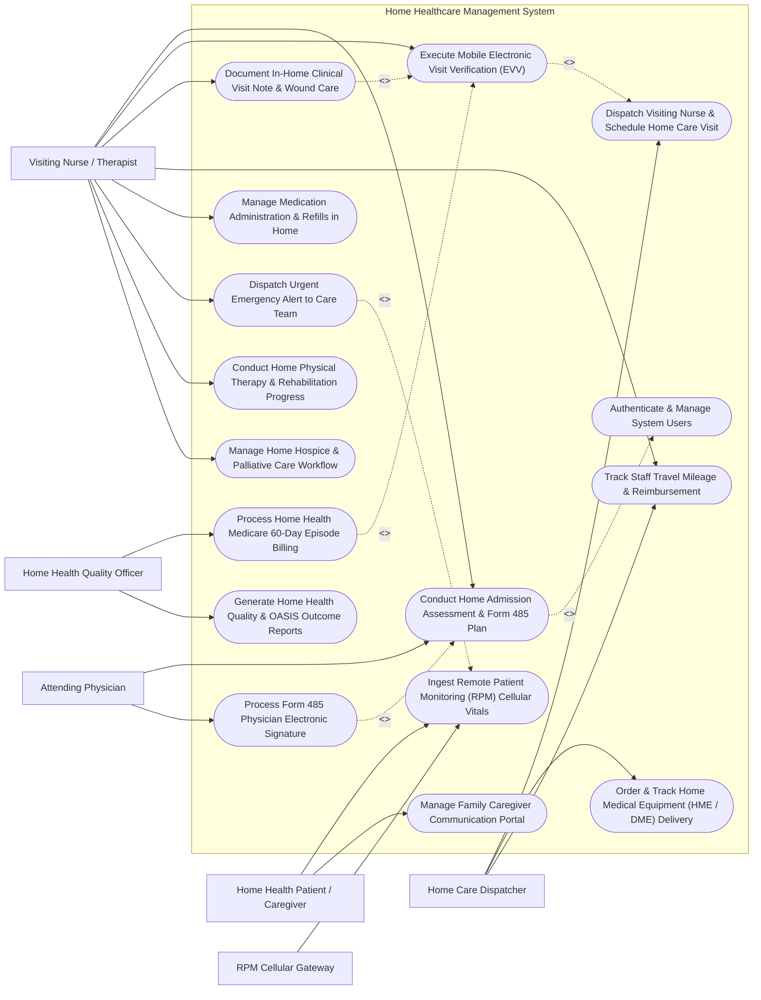

# Use Case Diagram — Home Healthcare Management System

## Mermaid Code

## Actor Table | Bảng Actor

| # | Actor | Actor Type | Role Description | Related Use Cases |
|---|-------|------------|------------------|-------------------|
| 1 | Home Health Patient / Caregiver | Primary | Homebound individual or family caregiver monitoring care plans, receiving home visits, and sending messages. | UC04, UC12 |
| 2 | Visiting Nurse / Therapist | Primary | Field clinician performing home visits, executing mobile EVV clock-in, charting wound care/vitals, and logging mileage. | UC01, UC03, UC06, UC07, UC08, UC11, UC13, UC14 |
| 3 | Home Care Dispatcher | Primary | Agency coordinator scheduling clinician visits based on location/skills, managing HME equipment orders, and monitoring EVV logs. | UC02, UC05, UC07 |
| 4 | Attending Physician | Primary | Community doctor reviewing OASIS assessments, authorizing Form 485 Home Health Plans of Care, and signing medical orders. | UC01, UC09 |
| 5 | Home Health Quality Officer | Primary | Compliance officer overseeing OASIS data submission, EVV audit compliance, Medicare 60-day billing, and agency quality metrics. | UC10, UC15 |
| 6 | RPM Cellular Gateway | Secondary / System | External IoT cellular gateway transmitting vital signs (BP, Glucose, SpO2, Weight) from home devices to the clinical system. | UC04 |

## Use Case Table | Bảng Use Case

| # | UC ID | Use Case Name | Primary Actor | Secondary Actor | Description | Priority |
|---|-------|---------------|---------------|-----------------|-------------|----------|
| 1 | UC01 | Conduct Home Admission Assessment & Form 485 Plan | Visiting Nurse | Attending Physician | Complete CMS OASIS assessment evaluating patient functional status and draft Form 485 Home Health Plan of Care. | High |
| 2 | UC02 | Dispatch Visiting Nurse & Schedule Home Care Visit | Home Care Dispatcher | Visiting Nurse | Match visiting nurses/therapists with patients based on geographic location, skills, and schedule optimized travel routes. | High |
| 3 | UC03 | Execute Mobile Electronic Visit Verification (EVV) | Visiting Nurse | Home Care Dispatcher | Perform mobile GPS geo-fenced clock-in/out at patient home to verify visit date, location, staff ID, and service type. | High |
| 4 | UC04 | Ingest Remote Patient Monitoring (RPM) Cellular Vitals | Home Health Patient / Caregiver | RPM Cellular Gateway | Receive continuous cellular vital signs telemetry (BP, Glucose, SpO2, Weight) and trigger alerts for physiological spikes. | High |
| 5 | UC05 | Order & Track Home Medical Equipment (HME / DME) Delivery | Home Care Dispatcher | None | Order oxygen concentrators, hospital beds, wheelchairs, or IV pumps from HME suppliers and track home delivery status. | High |
| 6 | UC06 | Document In-Home Clinical Visit Note & Wound Care | Visiting Nurse | None | Chart in-home vital signs, photograph/measure wound healing, record IV infusion rates, and document care intervention notes. | High |
| 7 | UC07 | Track Staff Travel Mileage & Reimbursement | Visiting Nurse | Home Care Dispatcher | Automatically calculate GPS travel distance between patient homes and generate staff mileage reimbursement logs. | Medium |
| 8 | UC08 | Manage Medication Administration & Refills in Home | Visiting Nurse | None | Verify home medication pillboxes, log administered drugs, check drug-drug interactions, and request pharmacy refills. | High |
| 9 | UC09 | Process Form 485 Physician Electronic Signature | Attending Physician | None | Transmit Form 485 Plan of Care to attending doctor for review, modification, and legally binding digital signature. | High |
| 10 | UC10 | Process Home Health Medicare 60-Day Episode Billing | Home Health Quality Officer | None | Compile EVV logs and OASIS assessments to submit Request for Anticipated Payment (RAP) and final Medicare episode claims. | High |
| 11 | UC11 | Dispatch Urgent Emergency Alert to Care Team | Visiting Nurse | None | Trigger instant high-priority emergency alerts when patient exhibits acute clinical deterioration during a home visit. | High |
| 12 | UC12 | Manage Family Caregiver Communication Portal | Home Health Patient / Caregiver | None | Provide secure messaging between family members and home care team, sharing visit arrival ETAs and progress updates. | Medium |
| 13 | UC13 | Conduct Home Physical Therapy & Rehabilitation Progress | Visiting Nurse | None | Document physical therapy range-of-motion, gait training, mobility scores, and functional goal achievements at home. | Medium |
| 14 | UC14 | Manage Home Hospice & Palliative Care Workflow | Visiting Nurse | None | Coordinate home comfort care, symptom management, pain control protocols, and bereavement support for hospice clients. | Medium |
| 15 | UC15 | Generate Home Health Quality & OASIS Outcome Reports | Home Health Quality Officer | None | Produce CMS OASIS quality outcome reports, re-hospitalization rates, EVV compliance audit logs, and clinician productivity. | Medium |
| 16 | UC16 | Authenticate & Manage System Users | All Users | None | Enforce secure mobile authentication, offline data caching, role permissions, and electronic signature audit logging. | High |

## Use Case Specification | Đặc tả Use Case

---

### UC01 — Conduct Home Admission Assessment & Form 485 Plan

| Field | Detail |
|-------|--------|
| **UC ID** | UC01 |
| **Use Case Name** | Conduct Home Admission Assessment & Form 485 Plan |
| **Actor(s)** | Primary: Visiting Nurse   Secondary: Attending Physician |
| **Description** | Conducts a comprehensive in-home clinical admission evaluation using the mandatory CMS OASIS (Outcome and Assessment Information Set) instrument, evaluating patient ADLs (Activities of Daily Living), cognitive status, living environment safety, and drafting the Form 485 Home Health Plan of Care. |
| **Precondition** | 1. The patient has an approved home health referral from hospital discharge or physician.   2. The Visiting Nurse is authenticated in HHMS with clinical assessment privileges. |
| **Main Flow** | 1. The Nurse arrives at the patient's home and opens "New Home Health Admission".   2. The System loads the standardized CMS OASIS assessment form (M-item domains: Clinical Record, Living Arrangements, Sensory Status, Integumentary/Wound Status, Respiratory, Cardiac, Elimination, Neuro/Emotional/Behavioral, ADLs/IADLs, Medications).   3. The Nurse assesses home environment safety (e.g., fall hazards, clutter, lighting, bathroom grab bars) and enters environmental safety risks.   4. The Nurse evaluates functional ADLs (Gait/Locomotion, Bathing, Dressing, Transferring, Feeding) and assigns OASIS scoring codes.   5. The Nurse assesses primary diagnoses, surgical wounds, pressure ulcers, and active medication regimens.   6. The System auto-generates a draft Form 485 (CMS Home Health Certification and Plan of Care) specifying: Primary ICD-10 diagnoses, Medical equipment requirements, Safety precautions, Functional limitations, Orders for Discipline (Skilled Nursing Q3W, Physical Therapy Q2W), and Specific measurable goals.   7. The Nurse signs the OASIS assessment and submits Form 485 to the Attending Physician for electronic signature review (UC09). |
| **Alternative Flow** | **AF1** — Recertification OASIS (60-Day Renewal): Every 60 days, the Nurse executes an OASIS Recertification assessment to evaluate patient progress and determine if home health services should be extended or discharged.   **AF2** — Transfer to Hospital Assessment: If the patient is admitted to a hospital during the home care episode, the Nurse completes an "OASIS Transfer to Inpatient Facility" assessment. |
| **Exception Flow** | **EX1** — Ineligible for Homebound Status: If the assessment reveals the patient is fully mobile and does not meet CMS "Homebound" criteria, the System displays an eligibility warning and requires manager review before proceeding.   **EX2** — Immediate Environmental Danger: If the Nurse identifies severe home safety threats (e.g., active gas leak, violence), the Nurse logs an immediate emergency exit code and alerts the agency supervisor. |
| **Postcondition** | CMS OASIS assessment is completed, Form 485 Plan of Care is drafted, homebound status is documented, and Form 485 is routed for physician signature. |
| **Business Rule** | **BR1**: Initial OASIS home admission assessment must be completed within 48 hours of referral or patient return home.   **BR2**: Form 485 Plan of Care must explicitly document that the patient is "Homebound" (requiring considerable and taxing effort to leave home). |

---

### UC02 — Dispatch Visiting Nurse & Schedule Home Care Visit

| Field | Detail |
|-------|--------|
| **UC ID** | UC02 |
| **Use Case Name** | Dispatch Visiting Nurse & Schedule Home Care Visit |
| **Actor(s)** | Primary: Home Care Dispatcher   Secondary: Visiting Nurse |
| **Description** | Matches visiting nurses, physical therapists, and home care aides with homebound patients based on geographic location, clinical skill requirements, language preferences, and availability, generating optimized daily visit itineraries and travel routes. |
| **Precondition** | 1. Active patient care plans (Form 485) with ordered visit frequencies (e.g., 3 visits/week) exist.   2. Field staff working schedules and starting home locations are registered. |
| **Main Flow** | 1. The Dispatcher opens the "Home Visit Dispatcher Board".   2. The System queries unassigned visit requirements for the target date (e.g., 45 home visits across 5 geographic zones).   3. The Dispatcher selects a geographic cluster of patients (e.g., Zone 2 - North District).   4. The System evaluates candidate clinicians using multi-criteria matching: **Skill Match** (e.g., Wound Care Certified RN vs Physical Therapist), **Location Proximity** (minimizing total drive mileage), **Language Compatibility**, and **Available Hours**.   5. The Dispatcher assigns a daily cluster of 5-6 home visits to a specific Visiting Nurse.   6. The System runs a route optimization algorithm (using TSP solver) to arrange visits in chronological order with optimized travel directions.   7. The Dispatcher publishes the daily schedule, and the System pushes the visit itinerary, patient directions, and arrival ETAs to the Nurse's mobile app.   8. The System dispatches an automated SMS/Zalo notification to each patient: "Your Visiting Nurse [Name] is scheduled to arrive tomorrow between 09:00 AM - 10:00 AM". |
| **Alternative Flow** | **AF1** — Same-Day Emergency Visit Insertion: An urgent request arrives for a post-op wound drain check. The Dispatcher identifies the nearest field nurse currently between visits and inserts the emergency stop into her active mobile itinerary.   **AF2** — Clinician Shift Sick Leave Replacement: A visiting nurse reports sick at 06:30 AM. The System highlights her 6 assigned visits and auto-reassigns them to off-duty standby staff in the same zone. |
| **Exception Flow** | **EX1** — Excessive Drive Time Warning: If a scheduled route results in > 2.5 hours of total drive time, the System flags "Excessive Travel Time" and suggests reallocating visits to a closer clinician.   **EX2** — Missing Required Specialty Skill: If no available nurse in Zone 3 possesses Wound Ostomy Certification, the System alerts the Dispatcher to authorize cross-zone travel reimbursement. |
| **Postcondition** | Optimized daily visit itineraries are generated, assigned to field staff, travel routes are mapped, and patient arrival ETA notifications are dispatched. |
| **Business Rule** | **BR1**: Visit scheduling must prioritize minimizing staff travel mileage to keep total daily drive time below 25% of total shift hours.   **BR2**: High-complexity visits (e.g., IV chemotherapy, complex wound vac) must only be assigned to clinicians holding specific certified skills. |

---

### UC03 — Execute Mobile Electronic Visit Verification (EVV) & GPS Punch

| Field | Detail |
|-------|--------|
| **UC ID** | UC03 |
| **Use Case Name** | Execute Mobile Electronic Visit Verification (EVV) & GPS Punch |
| **Actor(s)** | Primary: Visiting Nurse   Secondary: Home Care Dispatcher |
| **Description** | Performs legally mandatory Electronic Visit Verification (EVV) on a mobile device at the patient's home, capturing GPS geo-fence coordinates, exact clock-in/clock-out timestamps, staff ID, patient ID, and service type to comply with the 21st Century Cures Act. |
| **Precondition** | 1. The Visiting Nurse has an assigned home visit itinerary on the mobile app.   2. Mobile device Location Services (GPS) are enabled. |
| **Main Flow** | 1. The Nurse arrives at the patient's residence and opens the mobile HHMS app.   2. The Nurse selects the active scheduled visit and clicks "Clock-In (Start EVV Visit)".   3. The System captures the device's current GPS coordinates (Latitude, Longitude), accuracy radius, and atomic network timestamp.   4. The System compares current GPS coordinates against the patient's registered home address geo-fence (e.g., within 100-meter radius).   5. If within the geo-fence, the System displays a green "EVV Verified - Clock-In Success" banner and unlocks in-home clinical charting screens (UC06).   6. The Nurse delivers clinical care, administers medications, and charts visit notes.   7. Upon visit completion, the Nurse clicks "Clock-Out (End EVV Visit)".   8. The System captures final GPS coordinates, clock-out timestamp, and calculates total visit duration (e.g., 45 minutes).   9. The Nurse prompts the Patient or Family Caregiver to sign the digital mobile screen or enter a patient PIN code to confirm visit completion.   10. The System saves the verified EVV record, updates visit status to "Completed - EVV Compliant", and syncs the data with the billing engine (UC10). |
| **Alternative Flow** | **AF1** — Offline EVV Mode (No Cellular Signal): If the patient's home is in a rural dead zone with no cellular coverage, the mobile app captures encrypted local GPS timestamps and auto-syncs the EVV payload upon returning to cell range.   **AF2** — Community Location Visit (e.g., Senior Center): If the visit takes place outside the home (e.g., community clinic), the Nurse selects "Approved Alternate Location" and enters a location justification note. |
| **Exception Flow** | **EX1** — Geo-Fence Mismatch Warning (> 200m Away): If clock-in is attempted while the nurse is 1 mile away from the patient's home, the System blocks clock-in and logs a "Location Variance - Outside Geo-fence" exception for dispatcher review.   **EX2** — Patient Refuses Mobile Signature: If the patient refuses or is unable to sign the screen, the Nurse selects "Voice / Voice Verification" or "Patient Incapable", which triggers secondary voice verification. |
| **Postcondition** | Legally compliant EVV record (GPS, time, staff ID, patient ID, service type) is logged, visit duration is calculated, patient signature is captured, and visit is approved for billing. |
| **Business Rule** | **BR1**: 100% of home healthcare visits must record Electronic Visit Verification (EVV) data compliant with 6 mandatory fields under the 21st Century Cures Act.   **BR2**: Clock-in attempts occurring outside a 150-meter radius of the registered patient address must generate a mandatory supervisor variance alert. |

---

### UC04 — Ingest Remote Patient Monitoring (RPM) Cellular Vitals

| Field | Detail |
|-------|--------|
| **UC ID** | UC04 |
| **Use Case Name** | Ingest Remote Patient Monitoring (RPM) Cellular Vitals |
| **Actor(s)** | Primary: Home Health Patient / Caregiver   Secondary: RPM Cellular Gateway |
| **Description** | Ingests automated daily vital signs measurements (Blood Pressure, Blood Glucose, Body Weight, SpO2) transmitted via cellular IoT medical devices from patient homes, updating clinical flowsheets and triggering automated alerts for physiological breaches. |
| **Precondition** | 1. The patient is enrolled in the Remote Patient Monitoring (RPM) program.   2. Cellular IoT devices (e.g., cellular BP cuff, weight scale, glucometer) are paired to the patient profile. |
| **Main Flow** | 1. The Patient takes a daily blood pressure measurement at home using the cellular BP cuff.   2. The cellular BP cuff automatically transmits measured values (Systolic 158 mmHg, Diastolic 96 mmHg, Pulse 82 bpm) over cellular network to the RPM Gateway.   3. The RPM Gateway forwards the JSON telemetry payload to HHMS.   4. The System matches the device IMEI / SIM serial number to the patient's RPM profile and logs values in the RPM Flowsheet.   5. The System evaluates measured values against the patient's customized clinical threshold rules (e.g., Systolic BP > 140 mmHg).   6. If a threshold is breached, the System generates an amber "RPM Parameter Breach" alert on the visiting nurse's mobile app and clinical supervisor dashboard.   7. The Visiting Nurse reviews the vital trend graph, calls the patient via the app to assess symptoms, and logs an RPM Clinical Follow-Up Note. |
| **Alternative Flow** | **AF1** — Daily Weight Gain Alert (Heart Failure Monitoring): For Congestive Heart Failure (CHF) patients, the cellular weight scale logs weight daily. If weight increases by >= 3 lbs in 24 hours (indicating fluid retention), the System dispatches an urgent CHF Deterioration Alert.   **AF2** — Manual Patient Portal Entry: If the patient uses a non-cellular manual device, the Patient enters readings manually into the mobile app, flagged as "Self-Reported Manual Entry". |
| **Exception Flow** | **EX1** — Critical Hypertensive Crisis Alert (`Systolic BP >= 180 mmHg`): If recorded BP reaches hypertensive crisis levels, the System flashes an urgent red alert, sends SMS alerts to the nurse and primary care doctor, and prompts an emergency call to 911/EMS.   **EX2** — RPM Device Disconnection (No Sync for 48 Hours): If a registered device fails to transmit data for 2 consecutive days, the System generates a "Device Inactivity Warning" prompting the nurse to call and check battery/cellular status. |
| **Postcondition** | Vital signs telemetry is logged in the RPM flowsheet, trend graphs are updated, physiological threshold breaches are evaluated, and clinical alerts are dispatched if breached. |
| **Business Rule** | **BR1**: Weight increases >= 3 lbs in 24 hours or >= 5 lbs in 7 days for heart failure patients MUST trigger an automated high-priority nursing alert.   **BR2**: RPM clinical billing requires documented monthly review of at least 16 days of cellular vital sign data per patient. |

---

### UC05 — Order & Track Home Medical Equipment (HME / DME) Delivery

| Field | Detail |
|-------|--------|
| **UC ID** | UC05 |
| **Use Case Name** | Order & Track Home Medical Equipment (HME / DME) Delivery |
| **Actor(s)** | Primary: Home Care Dispatcher |
| **Description** | Handles the ordering, delivery dispatch, setup confirmation, and eventual retrieval of Durable Medical Equipment (DME / HME) such as oxygen concentrators, hospital beds, wheelchairs, IV infusion poles, and wound VAC machines needed for home care. |
| **Precondition** | 1. An active Form 485 Plan of Care or physician order specifies required medical equipment.   2. Integrated HME suppliers are configured in HHMS. |
| **Main Flow** | 1. The Dispatcher opens "HME / DME Equipment Orders" for the target patient.   2. The Dispatcher selects required equipment items from the DME catalog (e.g., 5L Oxygen Concentrator, Semi-Electric Hospital Bed, Pressure Relief Mattress).   3. The System verifies physician order justification and insurance DME coverage eligibility.   4. The Dispatcher inputs delivery instructions: Patient home address, delivery target date/time, and emergency contact details.   5. The System transmits an electronic HME Order Ticket to the selected DME Supplier.   6. The DME Supplier confirms the order, assigns a technician, and updates delivery status to "Dispatched for Delivery".   7. The DME Technician arrives at the patient home, sets up the equipment, records serial numbers (e.g., OC-SN-98124), instructs the patient/caregiver on safe operation, and captures a digital signature on the delivery manifest.   8. The System receives delivery confirmation, updates status to "Delivered & Active", and attaches equipment serial numbers to the patient's home safety profile. |
| **Alternative Flow** | **AF1** — Equipment Pickup / Return Request: Upon patient recovery or hospital discharge, the Dispatcher clicks "Request HME Pickup", and the DME Supplier schedules equipment retrieval and sanitization.   **AF2** — Emergency Oxygen Replacement: For an oxygen concentrator breakdown, the Dispatcher selects "Urgent 2-Hour Oxygen Replacement", triggering an immediate emergency courier delivery. |
| **Exception Flow** | **EX1** — HME Delivery Delay Warning: If the DME Supplier fails to deliver equipment 4 hours prior to patient hospital discharge, the System alerts the Dispatcher to contact the supplier or reassign to an alternate vendor.   **EX2** — Equipment Malfunction Alert: If the patient reports a noisy or non-functioning oxygen unit via the app, the System flags an "HME Repair Request" and notifies the supplier for same-day service. |
| **Postcondition** | HME equipment order is placed with supplier, home delivery and setup are confirmed, serial numbers are logged, and equipment is ready for home clinical use. |
| **Business Rule** | **BR1**: Oxygen concentrators and home mechanical ventilators require 24/7 emergency supplier replacement coverage guaranteed within 2 hours of malfunction report.   **BR2**: All delivered home medical equipment must be accompanied by documented patient/caregiver safety instruction verification. |
