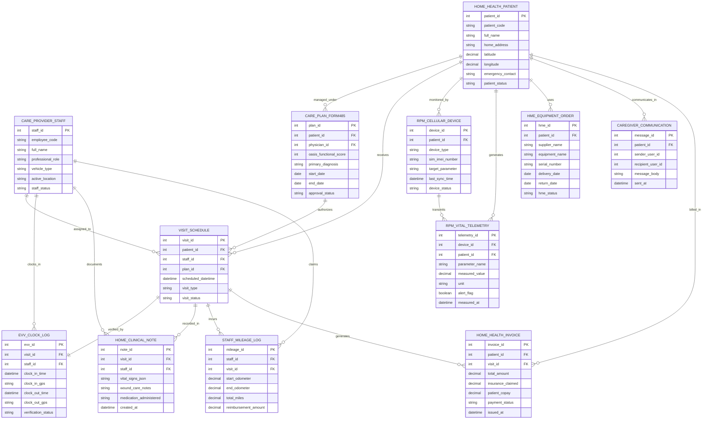

# Conceptual ERD — Home Healthcare Management System

## Mermaid Code

## Entity Description Table | Bảng mô tả Entity

| # | Entity Name | Vietnamese Name | Description | Key Attributes | Main Relationships |
|---|-------------|-----------------|-------------|----------------|-------------------|
| 1 | HOME_HEALTH_PATIENT | Bệnh nhân Chăm sóc Tại nhà | Master home health patient profile storing address, GPS coordinates (latitude/longitude), emergency contact, and status. | patient_id, patient_code, full_name, home_address, latitude, longitude, patient_status | Has many CARE_PLAN_FORM485, VISIT_SCHEDULE, RPM_CELLULAR_DEVICE, HME_EQUIPMENT_ORDER, etc. |
| 2 | CARE_PROVIDER_STAFF | Nhân viên Chăm sóc | Field clinician staff record (Visiting Nurse, Physical Therapist, Aide) storing employee code, role, vehicle type, and location. | staff_id, employee_code, full_name, professional_role, vehicle_type, active_location | Has many VISIT_SCHEDULE, EVV_CLOCK_LOG, HOME_CLINICAL_NOTE, and STAFF_MILEAGE_LOG entities. |
| 3 | CARE_PLAN_FORM485 | Kế hoạch Chăm sóc Form 485 | Form 485 Home Health Plan of Care record storing OASIS functional scores, physician orders, start/end dates, and approval status. | plan_id, patient_id, physician_id, oasis_functional_score, primary_diagnosis, approval_status | Belongs to HOME_HEALTH_PATIENT; Has many VISIT_SCHEDULE entities. |
| 4 | VISIT_SCHEDULE | Lịch Viếng thăm Tại nhà | Scheduled home care visit record tying patient, field staff, Form 485 care plan, visit date/time, and visit type (Nursing, PT, Aide). | visit_id, patient_id, staff_id, plan_id, scheduled_datetime, visit_type, visit_status | Belongs to HOME_HEALTH_PATIENT, CARE_PROVIDER_STAFF, and CARE_PLAN_FORM485; Has EVV_CLOCK_LOG, HOME_CLINICAL_NOTE, etc. |
| 5 | EVV_CLOCK_LOG | Nhật ký Xác thực EVV | Electronic Visit Verification (EVV) log recording mobile clock-in/out GPS coordinates, network timestamps, and verification status. | evv_id, visit_id, staff_id, clock_in_time, clock_in_gps, clock_out_time, clock_out_gps, verification_status | Belongs to VISIT_SCHEDULE and CARE_PROVIDER_STAFF. |
| 6 | HOME_CLINICAL_NOTE | Phiếu Chăm sóc Tại nhà | In-home clinical visit charting note storing vital signs JSON payload, wound care measurements, and medication administration notes. | note_id, visit_id, staff_id, vital_signs_json, wound_care_notes, medication_administered | Belongs to VISIT_SCHEDULE and CARE_PROVIDER_STAFF. |
| 7 | RPM_CELLULAR_DEVICE | Thiết bị Giám sát RPM | Cellular IoT medical device record (cellular BP cuff, weight scale, glucometer) holding SIM IMEI, device type, and sync status. | device_id, patient_id, device_type, sim_imei_number, target_parameter, device_status | Belongs to HOME_HEALTH_PATIENT; Has many RPM_VITAL_TELEMETRY entities. |
| 8 | RPM_VITAL_TELEMETRY | Nhật ký Sinh tồn Từ xa | Cellular vital signs telemetry record storing parameter name, measured value, units, threshold alert flags, and timestamps. | telemetry_id, device_id, patient_id, parameter_name, measured_value, unit, alert_flag, measured_at | Belongs to RPM_CELLULAR_DEVICE and HOME_HEALTH_PATIENT. |
| 9 | HME_EQUIPMENT_ORDER | Thiết bị Y tế Tại nhà (HME) | Home Medical Equipment (DME / HME) order tracking equipment name, supplier, serial number, delivery date, and return status. | hme_id, patient_id, supplier_name, equipment_name, serial_number, delivery_date, hme_status | Belongs to HOME_HEALTH_PATIENT. |
| 10 | CAREGIVER_COMMUNICATION | Trao đổi Người Chăm sóc | Secure messaging log between family caregivers, visiting nurses, and dispatchers sharing visit ETAs and care progress notes. | message_id, patient_id, sender_user_id, recipient_user_id, message_body, sent_at | Belongs to HOME_HEALTH_PATIENT. |
| 11 | STAFF_MILEAGE_LOG | Nhật ký Quãng đường Di chuyển | Travel distance log tracking odometer readings, total miles driven between home visits, and staff mileage reimbursement calculations. | mileage_id, staff_id, visit_id, start_odometer, end_odometer, total_miles, reimbursement_amount | Belongs to CARE_PROVIDER_STAFF and VISIT_SCHEDULE. |
| 12 | HOME_HEALTH_INVOICE | Hóa đơn Dịch vụ Tại nhà | Billing invoice itemizing home visit charges, Medicare 60-day episode claims (RAP / Final), insurance claims, and patient co-pays. | invoice_id, patient_id, visit_id, total_amount, insurance_claimed, patient_copay, payment_status | Belongs to HOME_HEALTH_PATIENT and VISIT_SCHEDULE. |

## Relationship Description | Mô tả Quan hệ

| # | From Entity | Cardinality | To Entity | Relationship Label | Business Explanation |
|---|-------------|-------------|-----------|-------------------|----------------------|
| 1 | HOME_HEALTH_PATIENT | one-to-many | CARE_PLAN_FORM485 | managed_under | One home health patient is managed under 60-day Form 485 care plans. |
| 2 | HOME_HEALTH_PATIENT | one-to-many | VISIT_SCHEDULE | receives | One home health patient receives multiple home care visits. |
| 3 | HOME_HEALTH_PATIENT | one-to-many | RPM_CELLULAR_DEVICE | monitored_by | One patient is monitored by cellular IoT remote patient monitoring devices. |
| 4 | HOME_HEALTH_PATIENT | one-to-many | RPM_VITAL_TELEMETRY | generates | One patient generates daily cellular vital signs telemetry readings. |
| 5 | HOME_HEALTH_PATIENT | one-to-many | HME_EQUIPMENT_ORDER | uses | One patient uses ordered home medical equipment (oxygen, hospital bed, wheelchair). |
| 6 | HOME_HEALTH_PATIENT | one-to-many | CAREGIVER_COMMUNICATION | communicates_in | One patient and family communicate in secure messaging threads with care staff. |
| 7 | HOME_HEALTH_PATIENT | one-to-many | HOME_HEALTH_INVOICE | billed_in | One patient is billed in Medicare episode or private insurance invoices. |
| 8 | CARE_PROVIDER_STAFF | one-to-many | VISIT_SCHEDULE | assigned_to | One field clinician is assigned to multiple home care visits on daily itineraries. |
| 9 | CARE_PROVIDER_STAFF | one-to-many | EVV_CLOCK_LOG | clocks_in | One field clinician clocks in/out via mobile EVV GPS punches. |
| 10 | CARE_PROVIDER_STAFF | one-to-many | HOME_CLINICAL_NOTE | documents | One field clinician documents in-home clinical visit notes and wound care. |
| 11 | CARE_PROVIDER_STAFF | one-to-many | STAFF_MILEAGE_LOG | claims | One field clinician claims travel mileage reimbursement for home visits. |
| 12 | CARE_PLAN_FORM485 | one-to-many | VISIT_SCHEDULE | authorizes | One Form 485 care plan authorizes specific visit types and frequencies. |
| 13 | VISIT_SCHEDULE | one-to-one | EVV_CLOCK_LOG | verified_by | One scheduled visit is verified by exactly one mobile EVV clock-in/out log. |
| 14 | VISIT_SCHEDULE | one-to-many | HOME_CLINICAL_NOTE | recorded_in | One completed visit is recorded in clinical visit charting notes. |
| 15 | VISIT_SCHEDULE | one-to-many | STAFF_MILEAGE_LOG | incurs | One home visit incurs staff travel mileage between locations. |
| 16 | VISIT_SCHEDULE | one-to-many | HOME_HEALTH_INVOICE | generates | One completed visit generates billable items for episode invoices. |
| 17 | RPM_CELLULAR_DEVICE | one-to-many | RPM_VITAL_TELEMETRY | transmits | One cellular IoT device transmits automated daily vital readings. |
