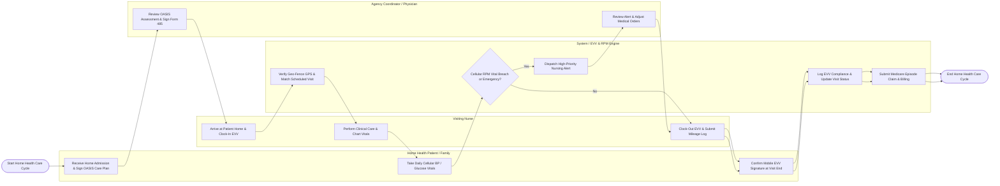

# Swimlane Diagram — Home Healthcare Management System

## Mermaid Code

## Flow Description | Mô tả luồng

| Lane | Actor / Subsystem | Role in Flow |
|------|-------------------|--------------|
| 1 | Home Health Patient / Family | Receives initial home admission, signs OASIS Form 485 care plan, takes daily cellular vital measurements, and provides mobile signature upon nurse visit completion. |
| 2 | Visiting Nurse | Arrives at patient residence, executes mobile Electronic Visit Verification (EVV) clock-in, performs clinical care/wound charting, clocks out via EVV, and logs travel mileage. |
| 3 | System / EVV & RPM Engine | Validates mobile EVV GPS geo-fence coordinates, ingests daily cellular RPM vital signs telemetry, evaluates physiological alerts, logs 21st Century Cures Act compliance, and submits Medicare episode billing claims. |
| 4 | Agency Coordinator / Physician | Reviews OASIS clinical admission assessments, applies digital signature to Form 485 Home Health Plans of Care, evaluates RPM vital breach alerts, and updates clinical orders. |
