# Action Tree — Home Healthcare Management System

## Mermaid Code

```mermaid
graph TD
    Root["Home Healthcare Management System"]

    Root --> M1["Home Admission & Form 485"]
    Root --> M2["Dispatch & Route Optimization"]
    Root --> M3["Mobile EVV & GPS Verification"]
    Root --> M4["Remote Patient Monitoring RPM"]
    Root --> M5["In-Home Clinical Charting"]
    Root --> M6["HME Equipment Logistics"]
    Root --> M7["Caregiver Portal & Messaging"]
    Root --> M8["Mileage & Medicare Billing"]

    M1 --> A11["Conduct CMS OASIS Admission Assessment"]
    M1 --> A12["Draft Form 485 Home Health Plan of Care"]
    M1 --> A13["Evaluate Home Environment Safety"]
    M1 --> A14["Obtain Physician Electronic Signature"]

    M2 --> A21["Match Staff Skills & Patient Location"]
    M2 --> A22["Optimize Daily Route & Drive Directions"]
    M2 --> A23["Dispatch Itinerary to Mobile App"]
    M2 --> A24["Notify Patient Arrival ETA SMS"]

    M3 --> A31["Capture Mobile GPS Geo-Fence Clock-In"]
    M3 --> A32["Verify Atomic Network Timestamp"]
    M3 --> A33["Capture Patient Digital Signature"]
    M3 --> A34["Audit EVV Variance Exceptions"]

    M4 --> A41["Ingest Cellular BP Glucose SpO2 Vitals"]
    M4 --> A42["Evaluate Heart Failure Weight Gain Spikes"]
    M4 --> A43["Dispatch High-Priority Nursing Alert"]
    M4 --> A44["Audit 16-Day Monthly RPM Compliance"]

    M5 --> A51["Chart In-Home Vital Signs & Vitals"]
    M5 --> A52["Photograph & Measure Wound Healing"]
    M5 --> A53["Log IV Infusion Drip Administration"]
    M5 --> A54["Document Physical Therapy Progress"]

    M6 --> A61["Order Concentrators & Hospital Beds"]
    M6 --> A62["Track DME Delivery & Serial Numbers"]
    M6 --> A63["Verify Patient Safety Instructions"]
    M6 --> A64["Schedule Equipment Retrieval Pickup"]

    M7 --> A71["Share Visit Arrival Status Updates"]
    M7 --> A72["Enable Secure Family Caregiver Chat"]
    M7 --> A73["Publish Patient Home Care Plan"]
    M7 --> A74["Collect Patient Satisfaction Rating"]

    M8 --> A81["Calculate Staff Travel Mileage Logs"]
    M8 --> A82["Submit Medicare RAP Anticipated Payment"]
    M8 --> A83["Process Final 60-Day Episode Claims"]
    M8 --> A84["Export OASIS Quality Outcome Metrics"]
```

## Module Description | Mô tả Module

| # | Module | Description | Actions |
|---|--------|-------------|---------|
| 1 | Home Admission & Form 485 | Conducts CMS OASIS admission assessments, drafts Form 485 Plans of Care, evaluates home safety, and obtains physician signatures. | Conduct CMS OASIS Admission Assessment, Draft Form 485 Home Health Plan of Care, Evaluate Home Environment Safety, Obtain Physician Electronic Signature |
| 2 | Dispatch & Route Optimization | Matches field staff skills and patient locations, optimizes daily driving itineraries, dispatches mobile schedules, and sends ETA SMS notifications. | Match Staff Skills & Patient Location, Optimize Daily Route & Drive Directions, Dispatch Itinerary to Mobile App, Notify Patient Arrival ETA SMS |
| 3 | Mobile EVV & GPS Verification | Captures 21st Century Cures Act compliant mobile EVV clock-in/out punches, verifies GPS geo-fencing, logs patient signatures, and audits exceptions. | Capture Mobile GPS Geo-Fence Clock-In, Verify Atomic Network Timestamp, Capture Patient Digital Signature, Audit EVV Variance Exceptions |
| 4 | Remote Patient Monitoring RPM | Ingests cellular IoT vitals telemetry (BP, Glucose, Weight, SpO2), detects heart failure weight spikes, dispatches alerts, and audits 16-day billing rules. | Ingest Cellular BP Glucose SpO2 Vitals, Evaluate Heart Failure Weight Gain Spikes, Dispatch High-Priority Nursing Alert, Audit 16-Day Monthly RPM Compliance |
| 5 | In-Home Clinical Charting | Records in-home vital signs, photographs/measures wound healing, documents IV infusion drips, and charts physical therapy progress. | Chart In-Home Vital Signs & Vitals, Photograph & Measure Wound Healing, Log IV Infusion Drip Administration, Document Physical Therapy Progress |
| 6 | HME Equipment Logistics | Orders oxygen concentrators and hospital beds from DME suppliers, tracks serial numbers, verifies safety instructions, and schedules pickups. | Order Concentrators & Hospital Beds, Track DME Delivery & Serial Numbers, Verify Patient Safety Instructions, Schedule Equipment Retrieval Pickup |
| 7 | Caregiver Portal & Messaging | Enables secure family caregiver communication, shares visit arrival ETAs, publishes care plans, and collects patient satisfaction ratings. | Share Visit Arrival Status Updates, Enable Secure Family Caregiver Chat, Publish Patient Home Care Plan, Collect Patient Satisfaction Rating |
| 8 | Mileage & Medicare Billing | Calculates GPS staff travel mileage reimbursement, submits Medicare RAP and final 60-day episode claims, and exports OASIS quality metrics. | Calculate Staff Travel Mileage Logs, Submit Medicare RAP Anticipated Payment, Process Final 60-Day Episode Claims, Export OASIS Quality Outcome Metrics |
