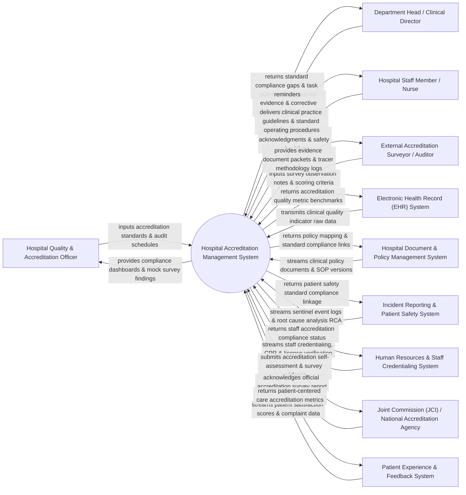

# Context Diagram — Hospital Accreditation Management System

## Mermaid Code

## Actor & Interaction Table | Bảng Actor & Tương tác

| # | Actor | Actor Type | Data Sent TO System | Data Received FROM System | Notes |
|---|-------|------------|---------------------|---------------------------|-------|
| 1 | Hospital Quality & Accreditation Officer | Primary | Joint Commission (JCI)/ISO standard frameworks, self-assessment audit schedules, mock survey scoring, accreditation timelines. | Hospital-wide compliance dashboards, standard gap analytics, mock survey findings, corrective action plan (CAP) status. | Quality director leading hospital accreditation preparation, tracer audits, and compliance monitoring. |
| 2 | Department Head / Clinical Director | Primary | Departmental evidence documents, clinical audit results, Corrective Action Plans (CAP), staff policy training completion logs. | Departmental standard compliance scores, overdue CAP task reminders, policy gap alerts. | Head of clinical or administrative department responsible for local standard compliance and evidence submission. |
| 3 | Hospital Staff Member / Nurse | Primary | Mandatory policy read-and-acknowledge sign-offs, clinical safety checklist submissions, tracer interview answers. | Standard Operating Procedures (SOPs), clinical practice guidelines, patient safety goal instructions. | Healthcare workers completing daily accredited safety practices and policy compliance tasks. |
| 4 | External Accreditation Surveyor / Auditor | Primary | On-site survey observation notes, standard compliance ratings (Met, Partially Met, Not Met), official survey findings. | Organized digital evidence binder packets, tracer methodology patient logs, policy cross-reference indexes. | Authorized auditor from Joint Commission International (JCI), ISO, or Ministry of Health conducting accreditation surveys. |
| 5 | Electronic Health Record (EHR) System | Supporting | Clinical quality indicators (e.g., medication reconciliation rate, hand-off communication logs, surgical safety checklist use). | Accreditation quality metric benchmarks, standardized clinical order set compliance feedback. | Central hospital EHR supplying empirical clinical data to prove accreditation standard compliance. |
| 6 | Hospital Document & Policy Management System | Supporting | Approved clinical policies, SOP documents, clinical practice guidelines, revision history logs. | Policy-to-standard mapping links, expired policy review warnings, standard alignment tags. | Document repository housing hospital policies and clinical practice guidelines. |
| 7 | Incident Reporting & Patient Safety System | Supporting | Patient safety event logs, near-miss incident reports, Sentinel Event disclosures, Root Cause Analysis (RCA) files. | Patient safety goal (NPSG) compliance linkage, risk mitigation action plans. | Safety software managing incident reports and RCA investigations for accreditation safety standards. |
| 8 | Human Resources & Staff Credentialing System | Supporting | Employee medical licenses, board certifications, mandatory CPR/BLS training completion dates, primary source verification logs. | Staff accreditation compliance status, expired license alerts, staff competency matrix. | HR software verifying employee qualifications, background checks, and mandatory training compliance. |
| 9 | Joint Commission (JCI) / National Accreditation Agency | Supporting / Regulatory | Official accreditation standards (JCI 7th/8th Edition), survey scoring guidelines, decision letters, certificate issuances. | Electronic self-assessment submissions, pre-survey evidence packets, Strategic Improvement Plan (SIP) updates. | International or national healthcare accreditation body issuing official hospital accreditation certifications. |
| 10 | Patient Experience & Feedback System | Supporting | Patient satisfaction survey scores, complaint resolution times, patient rights grievance logs. | Patient-centered care standard metrics, patient rights accreditation compliance reports. | Experience platform tracking patient feedback to fulfill patient rights accreditation requirements. |

## System Boundary Description | Mô tả Phạm vi Hệ thống

The **Hospital Accreditation Management System (HAMS)** is an enterprise quality and compliance software platform designed to manage healthcare accreditation frameworks (JCI, ISO 9001, ACHSI, Ministry of Health standards), facilitate digital tracer audits, organize evidence document binders, and track Corrective Action Plans (CAP).

**Inside System Scope:**
- Mapping hospital operational policies and clinical workflows to international accreditation standards (e.g., JCI International Patient Safety Goals - IPSG).
- Conducting digital mock surveys, patient tracer methodology audits, and staff competency evaluations.
- Digital evidence binder creation, version-controlled policy mapping, and primary source credentialing verification.
- Corrective Action Plan (CAP) and Strategic Improvement Plan (SIP) tracking with automated task assignment and escalation alerts.
- Aggregation of clinical quality indicators, root cause analysis (RCA) tracking, and electronic submission of pre-survey documentation to accreditation agencies.

**Outside System Scope:**
- Direct physical inspection of hospital building fire suppression or architectural wiring (handled by physical facility engineers).
- Direct primary source verification of university degrees with foreign registrars (performed by HR screening agencies).
- Direct handling of clinical patient treatment (managed by Clinical EHR and Nursing Systems).
