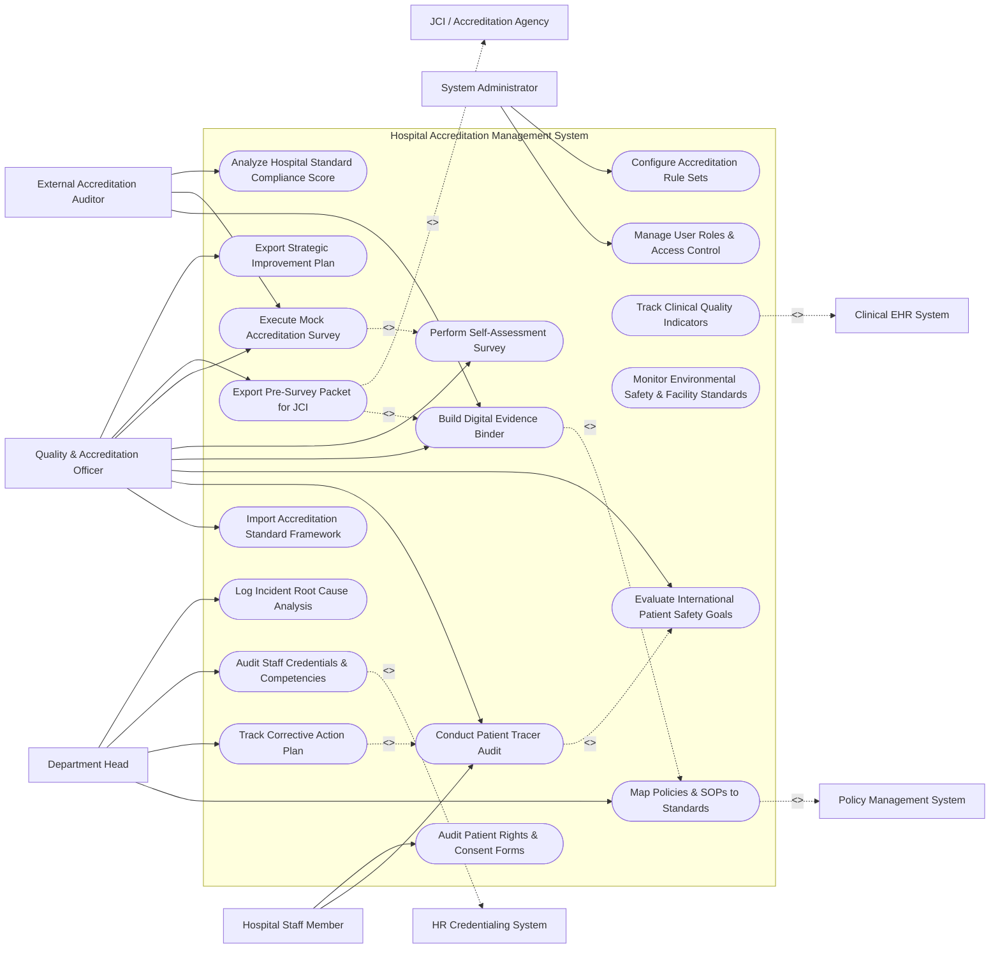

# Use Case Diagram — Hospital Accreditation Management System

## Mermaid Code

## Actor Table | Bảng Actor

| # | Actor | Actor Type | Role Description | Related Use Cases |
|---|-------|------------|------------------|-------------------|
| 1 | Quality & Accreditation Officer | Primary | Quality director managing standard frameworks, tracer audits, mock surveys, evidence binders, and JCI exports. | UC01, UC02, UC04, UC07, UC08, UC10, UC11, UC15 |
| 2 | Department Head | Primary | Clinical/administrative director mapping departmental SOPs, managing corrective action plans (CAP), and auditing staff credentials. | UC03, UC05, UC06, UC09 |
| 3 | Hospital Staff Member | Primary | Nurse, physician, or staff member participating in tracer audits and acknowledging accredited safety practices. | UC02, UC13 |
| 4 | External Accreditation Auditor | Primary | JCI, ISO, or Ministry surveyor reviewing digital evidence binders, conducting mock surveys, and analyzing compliance. | UC07, UC10, UC18 |
| 5 | System Administrator | Primary | IT administrative user managing system security roles, accreditation rule sets, and access permissions. | UC16, UC17 |
| 6 | Policy Management System | System (Secondary) | Hospital document repository supplying approved clinical policies and SOP version histories. | UC03 |
| 7 | HR Credentialing System | System (Secondary) | Human resources system providing staff medical licenses, BLS certifications, and primary source verifications. | UC06 |
| 8 | Clinical EHR System | System (Secondary) | Hospital EHR providing empirical clinical quality indicator data (e.g., hand-off logs, surgical checklists). | UC12 |
| 9 | JCI / Accreditation Agency | System (Secondary) | External accreditation body receiving pre-survey evidence packets and Strategic Improvement Plans. | UC11 |

## Use Case Table | Bảng Use Case

| # | UC ID | Use Case Name | Primary Actor | Secondary Actor | Description | Priority |
|---|-------|---------------|---------------|-----------------|-------------|----------|
| 1 | UC01 | Import Accreditation Standard Framework | Quality Officer | None | Imports structured accreditation standards (e.g., JCI Hospital Standards 8th Edition, ISO 9001:2015). | High |
| 2 | UC02 | Conduct Patient Tracer Audit | Quality Officer | Staff | Executes patient tracer methodology audits following a patient's journey across departments to verify standard compliance. | High |
| 3 | UC03 | Map Policies & SOPs to Standards | Dept Head | Policy System | Links hospital clinical policies, SOPs, and guidelines to specific accreditation standard sub-clause requirements. | High |
| 4 | UC04 | Evaluate International Patient Safety Goals | Quality Officer | None | Audits compliance with International Patient Safety Goals (IPSG 1: Patient ID, IPSG 2: Communication, IPSG 3: High-Alert Meds). | Critical |
| 5 | UC05 | Track Corrective Action Plan | Dept Head | None | Assigns, monitors, and verifies resolution of non-compliance findings via time-bound Corrective Action Plans (CAP). | High |
| 6 | UC06 | Audit Staff Credentials & Competencies | Dept Head | HR System | Verifies staff primary source license validations, CPR certifications, and annual competency assessments. | High |
| 7 | UC07 | Build Digital Evidence Binder | Quality Officer | Auditor | Compiles organized digital evidence binders containing mapped policies, audit logs, and meeting minutes for survey review. | High |
| 8 | UC08 | Perform Self-Assessment Survey | Quality Officer | None | Conducts internal self-assessment scoring (Met, Partially Met, Not Met) across all hospital accreditation chapters. | High |
| 9 | UC09 | Log Incident Root Cause Analysis | Dept Head | None | Links Sentinel Event logs, Root Cause Analysis (RCA) reports, and risk mitigation plans to patient safety standards. | High |
| 10 | UC10 | Execute Mock Accreditation Survey | Quality Officer | Auditor | Simulates an official multi-day accreditation survey with external peer reviewers to identify compliance gaps. | Critical |
| 11 | UC11 | Export Pre-Survey Packet for JCI | Quality Officer | JCI Agency | Auto-packages and transmits electronic pre-survey documentation (E-App, hospital profile, policy index) to JCI. | Critical |
| 12 | UC12 | Track Clinical Quality Indicators | Quality Officer | Clinical EHR | Monitors clinical quality indicators (hospital mortality rates, readmission rates, surgical site infection rates). | High |
| 13 | UC13 | Audit Patient Rights & Consent Forms | Staff | None | Audits informed consent form compliance, organ donation consent rules, and patient grievance resolution logs. | Medium |
| 14 | UC14 | Monitor Environmental Safety & Facility Standards | Quality Officer | None | Tracks facility safety compliance (fire drills, hazardous material storage, emergency power generator testing). | High |
| 15 | UC15 | Export Strategic Improvement Plan | Quality Officer | JCI Agency | Generates post-survey Strategic Improvement Plan (SIP) addressing surveyor findings for final certificate release. | High |
| 16 | UC16 | Manage User Roles & Access Control | Admin | None | Configures user accounts, RBAC permissions, and survey auditor read-only access accounts. | High |
| 17 | UC17 | Configure Accreditation Rule Sets | Admin | None | Configures survey scoring weights, auto-escalation reminder timelines, and chapter assignment matrices. | Medium |
| 18 | UC18 | Analyze Hospital Standard Compliance Score | Auditor | None | Generates real-time compliance heatmap charts showing percentage met by chapter, department, and IPSG goal. | Medium |

## Use Case Specification | Đặc tả Use Case

---

### UC02 — Conduct Patient Tracer Audit

| Field | Detail |
|-------|--------|
| **UC ID** | UC02 |
| **Use Case Name** | Conduct Patient Tracer Audit |
| **Actor(s)** | Primary: Quality & Accreditation Officer   Secondary: Hospital Staff Member |
| **Description** | Executes individual patient tracer methodology audits, following a selected patient's clinical care path across departments (ED -> Surgery -> ICU -> Ward -> Pharmacy) to evaluate real-time standard compliance. |
| **Precondition** | 1. Auditor has active tablet device with HAMS mobile tracer app.   2. Selected patient is currently admitted or recently discharged. |
| **Main Flow** | 1. Auditor opens "Patient Tracer Audit" module and selects a patient chart (e.g., Complex Surgical Patient with High-Alert Meds).   2. Auditor selects target accreditation tracer checklist (e.g., JCI Care of Patients - COP & Medication Management - MMU).   3. Auditor visits ED: Verifies patient 2-identifier wristband (IPSG 1), orders verification, and triage scoring.   4. Auditor visits Operating Room: Verifies Surgical Safety Checklist time-out sign-off (IPSG 4) and medication labeling.   5. Auditor visits Inpatient Ward: Interviews bedside nurse regarding high-alert electrolyte storage (IPSG 3) and verbal order read-back (IPSG 2).   6. Auditor scores each standard item on mobile tablet: `Met (2)`, `Partially Met (1)`, or `Not Met (0)`.   7. Auditor enters observation notes and attaches photo evidence.   8. System calculates total tracer score %, saves audit log, and flags non-compliant items into CAP queue (UC05). |
| **Alternative Flow** | **AF1** — System Tracer (Infection Control): Auditor executes a System Tracer focused on Hospital-Acquired Infections, tracing central-line insertion practices across 5 clinical wards. |
| **Exception Flow** | **EX1** — Immediate Life-Safety Hazard Identified: Auditor discovers unlocked narcotics cabinet or un-labeled high-alert chemo drug during tracer; System triggers "Immediate Life-Safety Hazard Alert", dispatches emergency notification to Quality Director, and halts tracer until hazard is secured. |
| **Postcondition** | Tracer audit score is recorded, standard compliance statistics are updated, and non-compliance findings are queued for corrective action. |
| **Business Rule** | **BR1**: Patient tracer methodology audits must evaluate all 6 International Patient Safety Goals (IPSG) across every audited patient journey. |

---

### UC05 — Track Corrective Action Plan (CAP)

| Field | Detail |
|-------|--------|
| **UC ID** | UC05 |
| **Use Case Name** | Track Corrective Action Plan (CAP) |
| **Actor(s)** | Primary: Department Head / Clinical Director   Secondary: Quality & Accreditation Officer |
| **Description** | Assigns, monitors, and verifies resolution of non-compliance findings identified during tracer audits or mock surveys using structured, time-bound Corrective Action Plans (CAP). |
| **Precondition** | 1. Non-compliance finding (Partially Met or Not Met) is logged from a tracer audit (UC02) or mock survey (UC10). |
| **Main Flow** | 1. System automatically generates a `CAP_TASK_ITEM` ticket for every non-compliant finding and assigns it to the responsible Department Head.   2. Department Head receives CAP task alert detailing standard clause breach (e.g., JCI MMU.3 - Unlabeled Meds in Ward Fridge).   3. Department Head investigates root cause, formulates corrective action strategy, assigns responsible owner, and sets target completion date (e.g., 14 days).   4. Assigned owner executes corrective action (e.g., purchases pre-printed drug labels, conducts nurse retraining).   5. Department Head uploads evidence of completion (retraining sign-in sheet, photos of labeled fridge) and clicks "Submit CAP for Closure".   6. Quality & Accreditation Officer reviews uploaded evidence and conducts re-audit verification.   7. Quality Officer approves closure; System updates CAP status to `CLOSED_VERIFIED` and recalculates department compliance score. |
| **Alternative Flow** | **AF1** — Extension Request: Department Head requests a 7-day completion extension due to equipment delivery delay; Quality Officer approves extension, updating CAP target date. |
| **Exception Flow** | **EX1** — Overdue CAP Escalation: CAP task reaches 100% of target deadline without resolution; System changes CAP status to `OVERDUE_ESCALATED`, highlights task in red on Quality Director dashboard, and dispatches weekly email reminder to Hospital CEO. |
| **Postcondition** | Corrective action is executed, evidence is verified, CAP ticket is closed, and standard compliance score is restored. |
| **Business Rule** | **BR1**: High-risk safety CAP tasks must be resolved and verified closed within a maximum of 30 calendar days. |

---

### UC07 — Build Digital Evidence Binder

| Field | Detail |
|-------|--------|
| **UC ID** | UC07 |
| **Use Case Name** | Build Digital Evidence Binder |
| **Actor(s)** | Primary: Quality & Accreditation Officer   Secondary: External Accreditation Auditor |
| **Description** | Compiles organized, chapter-by-chapter digital evidence binders containing mapped policies, committee meeting minutes, audit logs, and credentialing proofs for surveyor inspection. |
| **Precondition** | 1. Accreditation standard framework is loaded (UC01).   2. Policies and clinical SOPs are mapped to standard clauses (UC03). |
| **Main Flow** | 1. Quality Officer opens "Digital Evidence Binder Builder".   2. Quality Officer selects target accreditation chapter (e.g., JCI Governance, Leadership, and Direction - GLD).   3. System automatically pulls all associated evidence documents mapped to GLD standards:   &nbsp;&nbsp;&nbsp;&nbsp; a. Hospital Bylaws and Organizational Chart (GLD.1).   &nbsp;&nbsp;&nbsp;&nbsp; b. Quality Committee Monthly Meeting Minutes (GLD.4).   &nbsp;&nbsp;&nbsp;&nbsp; c. Annual Quality & Patient Safety Plan (GLD.5).   &nbsp;&nbsp;&nbsp;&nbsp; d. Departmental Key Performance Indicator (KPI) dashboards.   4. Quality Officer reviews binder layout, adds executive commentary notes, and organizes document sequence.   5. Quality Officer clicks "Compile Digital Evidence Binder".   6. System generates a secure, navigable digital PDF/HTML binder with hyperlinked table of contents and cross-references.   7. System publishes binder to External Auditor Portal, providing read-only access to surveyor team. |
| **Alternative Flow** | **AF1** — On-Site Surveyor Tablet View: External Auditor accesses digital evidence binder on tablet during survey; Auditor taps standard clause "IPSG.2", System instantly opens linked Verbal Order Read-Back Policy and 50 audited read-back log samples. |
| **Exception Flow** | **EX1** — Missing Mandatory Evidence Document: Chapter binder compilation detects an un-mapped standard clause without evidence; System displays error "Incomplete Evidence Binder: Standard GLD.7 Has No Attached Document" and blocks binder finalization until document is linked. |
| **Postcondition** | Digital evidence binder is compiled, hyperlinked, and accessible to external accreditation surveyors. |
| **Business Rule** | **BR1**: Evidence binders must be fully compiled and verified at least 60 days prior to the official accreditation survey date. |

---

### UC10 — Execute Mock Accreditation Survey

| Field | Detail |
|-------|--------|
| **UC ID** | UC10 |
| **Use Case Name** | Execute Mock Accreditation Survey |
| **Actor(s)** | Primary: Quality & Accreditation Officer   Secondary: External Accreditation Auditor |
| **Description** | Simulates a full, multi-day official accreditation survey using internal or external peer surveyors to evaluate hospital-wide readiness and generate pre-survey gap scores. |
| **Precondition** | 1. Digital evidence binders are compiled (UC07).   2. Mock survey schedule and surveyor team assignments are established. |
| **Main Flow** | 1. Quality Officer launches "Mock Accreditation Survey Event" for hospital.   2. Mock Surveyors initiate 3-day simulated survey schedule:   &nbsp;&nbsp;&nbsp;&nbsp; a. Day 1: Document & Policy Review (UC07) + Leadership Interviews.   &nbsp;&nbsp;&nbsp;&nbsp; b. Day 2: Patient Tracer Audits (UC02) across all inpatient/outpatient units.   &nbsp;&nbsp;&nbsp;&nbsp; c. Day 3: Facility Safety Walkthrough (UC14) + Staff Credentialing Checks (UC06).   3. Surveyors enter scoring ratings (`Met`, `Partially Met`, `Not Met`) and detailed surveyor commentary into mobile survey app in real time.   4. System aggregates daily scoring results and updates live Mock Survey Compliance Heatmap.   5. Upon survey conclusion, System computes overall Mock Survey Passing Probability Score (e.g., 91% Compliance - High Probability of Accreditation).   6. System automatically generates comprehensive Mock Survey Findings Report and compiles all `Not Met` items into CAP tasks (UC05). |
| **Alternative Flow** | **AF1** — Focused Unannounced Mock Survey: Quality team conducts a 1-day unannounced mini-mock survey targeting high-risk areas (Operating Room & Emergency Department) to test baseline readiness. |
| **Exception Flow** | **EX1** — Critical Life Safety Finding During Survey: Surveyor identifies blocked emergency fire exit; System flags "Immediate Life Safety Hazard", alerts Facility Director immediately, and records zero score for facility clause. |
| **Postcondition** | Mock survey compliance score is calculated, detailed findings report is generated, and corrective action plans are dispatched. |
| **Business Rule** | **BR1**: Mock survey scoring rules must mirror official Joint Commission / ISO scoring methodology exactly. |

---

### UC11 — Export Pre-Survey Packet for JCI

| Field | Detail |
|-------|--------|
| **UC ID** | UC11 |
| **Use Case Name** | Export Pre-Survey Packet for JCI |
| **Actor(s)** | Primary: Quality & Accreditation Officer   Secondary: JCI / Accreditation Agency |
| **Description** | Automatically packages required electronic pre-survey documentation (Electronic Application - E-App, hospital profile, policy index, clinical quality metrics) and transmits it to JCI. |
| **Precondition** | 1. Official accreditation survey date is confirmed with JCI or national accreditation agency.   2. Self-assessment survey (UC08) and evidence binders (UC07) are finalized. |
| **Main Flow** | 1. Quality Officer opens "Accreditation Submission Gateway" and selects target agency (e.g., Joint Commission International).   2. System fetches required pre-survey submission components:   &nbsp;&nbsp;&nbsp;&nbsp; a. Electronic Application (E-App) hospital operational profile.   &nbsp;&nbsp;&nbsp;&nbsp; b. Master Clinical Policy & SOP index.   &nbsp;&nbsp;&nbsp;&nbsp; c. Hospital bed count, department list, and staffing numbers.   &nbsp;&nbsp;&nbsp;&nbsp; d. Clinical Quality Indicator 12-month summary data (UC12).   &nbsp;&nbsp;&nbsp;&nbsp; e. Self-assessment compliance results (UC08).   3. Quality Officer reviews compiled pre-survey submission package.   4. Quality Officer applies electronic signature and clicks "Transmit Pre-Survey Packet".   5. System packages data into standardized JCI E-App XML/JSON format and transmits payload via secure HTTPS API to JCI portal.   6. JCI portal returns electronic receipt acknowledgment (`JCI_RECEPTION_SUCCESS_200`), which System logs into submission registry. |
| **Alternative Flow** | **AF1** — Post-Survey Strategic Improvement Plan (SIP) Export: Following official survey, Quality Officer uses module to upload 45-day Strategic Improvement Plan (SIP) addressing official surveyor findings for final certificate release (UC15). |
| **Exception Flow** | **EX1** — JCI Portal Transmission Failure: API endpoint is unreachable; System flags "Submission Error", saves pre-survey package as an offline encrypted ZIP archive, and provides manual download link for email backup. |
| **Postcondition** | Pre-survey documentation packet is transmitted to accreditation agency, submission receipt is logged, and hospital survey countdown is initialized. |
| **Business Rule** | **BR1**: Pre-survey documentation packets must be transmitted to JCI at least 45 days prior to the scheduled on-site survey start date. |
