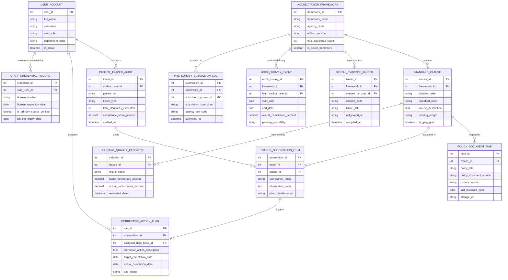

# Conceptual ERD — Hospital Accreditation Management System

## Mermaid Code

## Entity Description Table | Bảng mô tả Entity

| # | Entity Name | Vietnamese Name | Description | Key Attributes | Main Relationships |
|---|-------------|-----------------|-------------|----------------|-------------------|
| 1 | USER_ACCOUNT | Tài khoản Nguời dùng | Credentials and access roles for quality officers, department heads, staff, and external auditors. | `user_id`, `username`, `user_role`, `department_code` | Conducts `PATIENT_TRACER_AUDIT`, executes `CORRECTIVE_ACTION_PLAN`, maintains `STAFF_CREDENTIAL_RECORD`. |
| 2 | ACCREDITATION_FRAMEWORK | Khung Tiêu chuẩn Kiểm định | Master accreditation standard framework registry (JCI 8th Edition, ISO 9001, ACHSI). | `framework_id`, `framework_name`, `agency_name`, `edition_version`, `total_standards_count` | Contains `STANDARD_CLAUSE`, organized into `DIGITAL_EVIDENCE_BINDER`, exported in `PRE_SURVEY_SUBMISSION_LOG`. |
| 3 | STANDARD_CLAUSE | Điều khoản Tiêu chuẩn | Individual accreditation standard clauses, sub-requirements, scoring weights, and IPSG indicators. | `clause_id`, `framework_id`, `chapter_code`, `standard_code`, `clause_description`, `is_ipsg_goal` | Belongs to `ACCREDITATION_FRAMEWORK`, mapped to `POLICY_DOCUMENT_MAP`, evaluated in `TRACER_OBSERVATION_ITEM`. |
| 4 | POLICY_DOCUMENT_MAP | Mapped Chính sách & SOP | Mapping linkages associating hospital clinical policies, SOPs, and guidelines to specific standard clauses. | `map_id`, `clause_id`, `policy_title`, `policy_document_number`, `current_version`, `last_reviewed_date` | Mapped to `STANDARD_CLAUSE`. |
| 5 | PATIENT_TRACER_AUDIT | Kiểm toán Tracer Bệnh nhân | Patient tracer audit header records capturing patient MRN, tracer type, and overall compliance score %. | `tracer_id`, `auditor_user_id`, `patient_mrn`, `tracer_type`, `compliance_score_percent` | Conducted by `USER_ACCOUNT`, yields `TRACER_OBSERVATION_ITEM`. |
| 6 | TRACER_OBSERVATION_ITEM | Mục Quan sát Tracer | Individual standard evaluation observations scored as Met (2), Partially Met (1), or Not Met (0). | `observation_id`, `tracer_id`, `clause_id`, `compliance_rating`, `observation_notes` | Belongs to `PATIENT_TRACER_AUDIT` and `STANDARD_CLAUSE`, triggers `CORRECTIVE_ACTION_PLAN`. |
| 7 | CORRECTIVE_ACTION_PLAN | Kế hoạch Hành động Khắc phục (CAP) | Structured, time-bound corrective action task tickets tracking root cause, resolution, and closure verification. | `cap_id`, `observation_id`, `assigned_dept_head_id`, `target_completion_date`, `cap_status` | Triggers from `TRACER_OBSERVATION_ITEM`, executed by `USER_ACCOUNT`. |
| 8 | STAFF_CREDENTIAL_RECORD | Hồ sơ Năng lực Nhân viên | Primary source license verification records, medical board certifications, and BLS/CPR expiration dates. | `credential_id`, `staff_user_id`, `license_number`, `license_expiration_date`, `is_primary_source_verified` | Belongs to `USER_ACCOUNT`. |
| 9 | DIGITAL_EVIDENCE_BINDER | Hồ sơ Bằng chứng Số | Organized chapter-by-chapter digital evidence binders compiled for accreditation surveyor review. | `binder_id`, `framework_id`, `created_by_user_id`, `chapter_code`, `binder_title`, `pdf_export_uri` | Belongs to `ACCREDITATION_FRAMEWORK`. |
| 10 | MOCK_SURVEY_EVENT | Sự kiện Khảo sát Giả định | Simulated accreditation survey events capturing overall compliance scores and passing probability metrics. | `mock_survey_id`, `framework_id`, `lead_auditor_user_id`, `start_date`, `overall_compliance_percent` | Belongs to `ACCREDITATION_FRAMEWORK`. |
| 11 | CLINICAL_QUALITY_INDICATOR | Chỉ số Chất lượng Lâm sàng | Empirical clinical quality indicator benchmarks (mortality, SSI, readmission, hand-off logs) tracked for standards. | `indicator_id`, `clause_id`, `metric_name`, `target_benchmark_percent`, `actual_performance_percent` | Monitored for `STANDARD_CLAUSE`. |
| 12 | PRE_SURVEY_SUBMISSION_LOG | Nhật ký Nộp Hồ sơ Tiền Khảo sát | Submission log tracking electronic pre-survey packages transmitted to JCI or accreditation agencies. | `submission_id`, `framework_id`, `submitted_by_user_id`, `submission_control_no`, `agency_ack_code` | Belongs to `ACCREDITATION_FRAMEWORK`. |

## Relationship Description | Mô tả Quan hệ

| # | From Entity | Cardinality | To Entity | Label | Business Explanation |
|---|-------------|-------------|-----------|-------|----------------------|
| 1 | ACCREDITATION_FRAMEWORK | 1 to 1..N | STANDARD_CLAUSE | contains | An accreditation framework contains multiple standard clauses and chapters. |
| 2 | STANDARD_CLAUSE | 1 to 0..N | POLICY_DOCUMENT_MAP | mapped to | A standard clause is mapped to hospital clinical policies and SOPs. |
| 3 | STANDARD_CLAUSE | 1 to 0..N | TRACER_OBSERVATION_ITEM | evaluated in | A standard clause is evaluated across multiple tracer observation items. |
| 4 | PATIENT_TRACER_AUDIT | 1 to 1..N | TRACER_OBSERVATION_ITEM | yields | A patient tracer audit yields multiple observation evaluation items. |
| 5 | TRACER_OBSERVATION_ITEM | 1 to 0..1 | CORRECTIVE_ACTION_PLAN | triggers | A non-compliant tracer observation item triggers a Corrective Action Plan (CAP). |
| 6 | ACCREDITATION_FRAMEWORK | 1 to 0..N | DIGITAL_EVIDENCE_BINDER | organized into | An accreditation framework is organized into chapter digital evidence binders. |
| 7 | ACCREDITATION_FRAMEWORK | 1 to 0..N | MOCK_SURVEY_EVENT | evaluated during | An accreditation framework is evaluated during mock accreditation survey events. |
| 8 | STANDARD_CLAUSE | 1 to 0..N | CLINICAL_QUALITY_INDICATOR | monitored by | A standard clause is monitored by empirical clinical quality indicators. |
| 9 | ACCREDITATION_FRAMEWORK | 1 to 0..N | PRE_SURVEY_SUBMISSION_LOG | exported in | An accreditation framework is exported in pre-survey submission logs. |
| 10 | USER_ACCOUNT | 1 to 0..N | PATIENT_TRACER_AUDIT | conducts | A quality officer user account conducts patient tracer audits. |
| 11 | USER_ACCOUNT | 1 to 0..N | CORRECTIVE_ACTION_PLAN | executes | A department head user account executes corrective action plans. |
| 12 | USER_ACCOUNT | 1 to 0..1 | STAFF_CREDENTIAL_RECORD | maintains credentials for | A staff user account maintains primary source credential records. |
